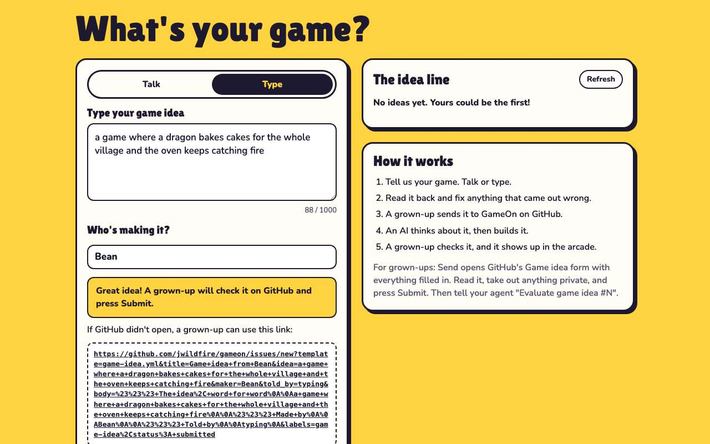
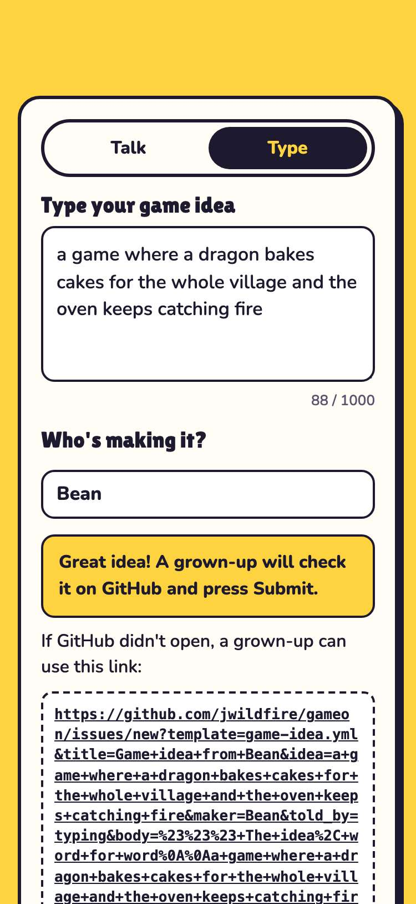

# Evidence: 100-issue-body

**PASS: 2 of 2 checks pass at desktop and phone widths.**

Generated by `npm run evidence -- 100-issue-body` from [`tests/evidence/100-issue-body.spec.mjs`](../../tests/evidence/100-issue-body.spec.mjs) against the local server (python3 -m http.server) on this branch, starting from commit a43f0d6, 2026-10-23 11:34 UTC. Rules: [docs/evidence.md](../../docs/evidence.md).

| Check | Desktop 1280 | Phone 375 |
|---|---|---|
| Send carries the body and labels as well as the form fields | pass | pass |
| a 1,000-character idea still fits in one address | pass | pass |

## 1. Send carries the body and labels as well as the form fields

- desktop: address is 460 characters; body has the idea, Made by and Told by sections
- phone: address is 460 characters; body has the idea, Made by and Told by sections

 

## 2. a 1,000-character idea still fits in one address

- desktop: 987-character idea → 2264-character address (GitHub allows about 8,000)
- phone: 987-character idea → 2264-character address (GitHub allows about 8,000)
