# Evidence: 103-fancy-food-fight

**PASS: 7 of 7 checks pass at desktop and phone widths.**

Generated by `npm run evidence -- 103-fancy-food-fight` from [`tests/evidence/103-fancy-food-fight.spec.mjs`](../../tests/evidence/103-fancy-food-fight.spec.mjs) against the local server (python3 -m http.server) on this branch, starting from commit f0a7016, 2026-10-23 12:04 UTC. Rules: [docs/evidence.md](../../docs/evidence.md).

| Check | Desktop 1280 | Phone 375 |
|---|---|---|
| the title screen opens and the game starts with nothing loaded from the internet | pass | pass |
| throwing food splats a fancy guest and scores, and a real tap throws | pass | pass |
| three hits bring the chandelier down for a huge mess | pass | pass |
| Duck makes a guest's throw miss, and without it you get splatted | pass | pass |
| each round ends with the Messiest crown, and the next round starts | pass | pass |
| saves only under gameon.fancy-food-fight. | pass | pass |
| Fancy Food Fight has a card in the arcade and plays in its frame | pass | pass |

## 1. the title screen opens and the game starts with nothing loaded from the internet

- desktop: 4 foods on the tray, Duck button, Round 1 of 3; no requests outside the site
- phone: 4 foods on the tray, Duck button, Round 1 of 3; no requests outside the site

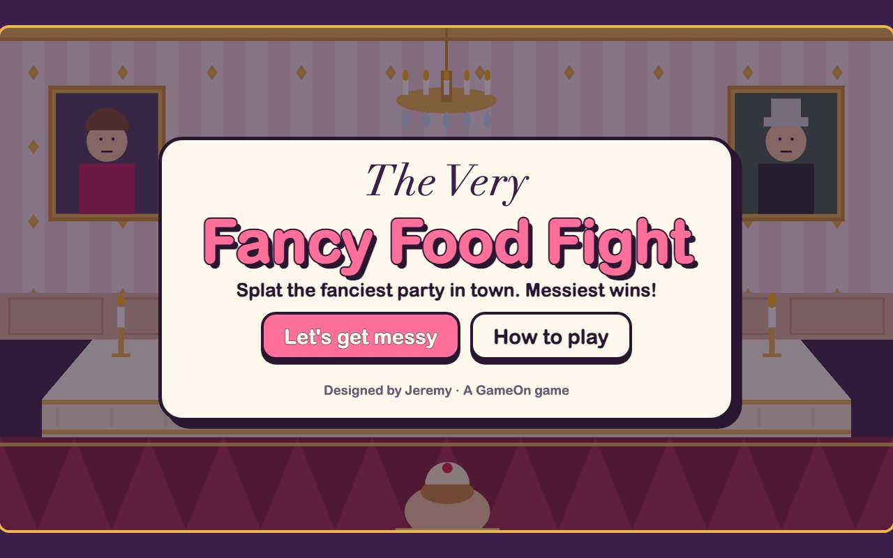 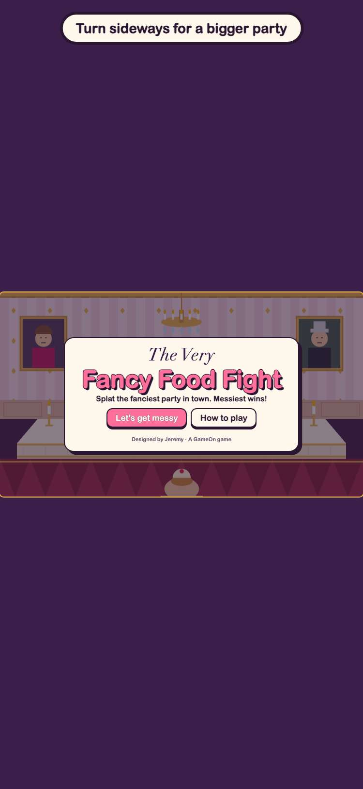

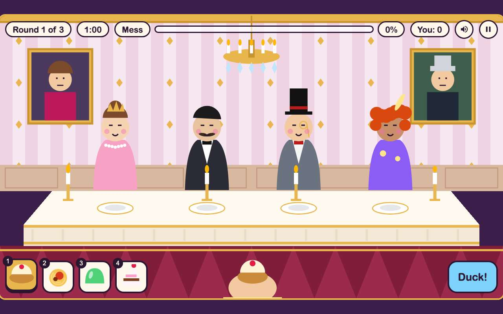 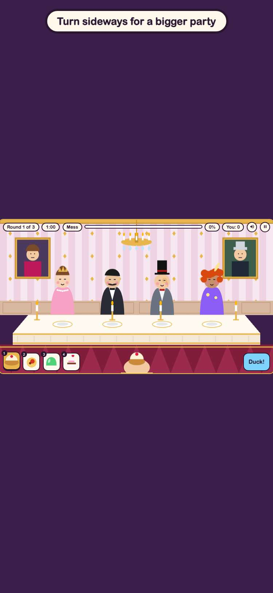

## 2. throwing food splats a fancy guest and scores, and a real tap throws

- desktop: a guest splat scored 25; a click on the wall made a new splat
- phone: a guest splat scored 25; a click on the wall made a new splat

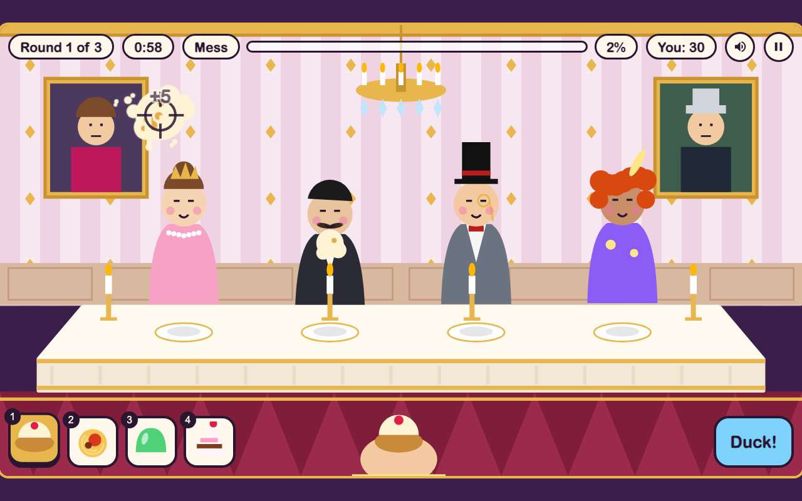 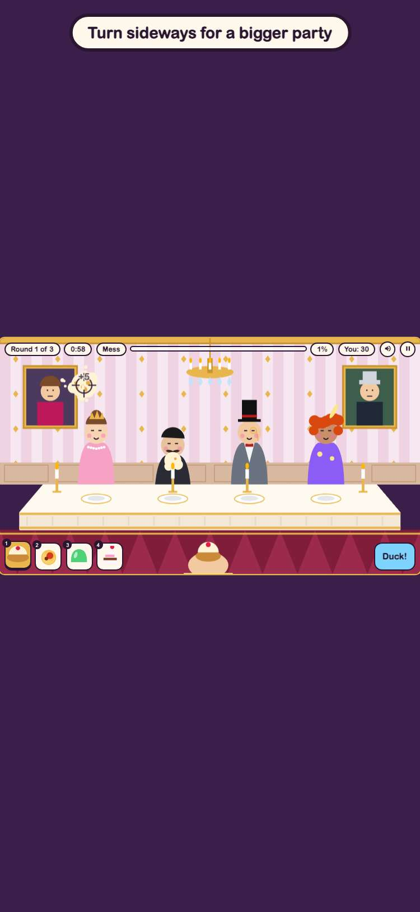

## 3. three hits bring the chandelier down for a huge mess

- desktop: Mess Meter 0% → 23%, score 220
- phone: Mess Meter 0% → 20%, score 220

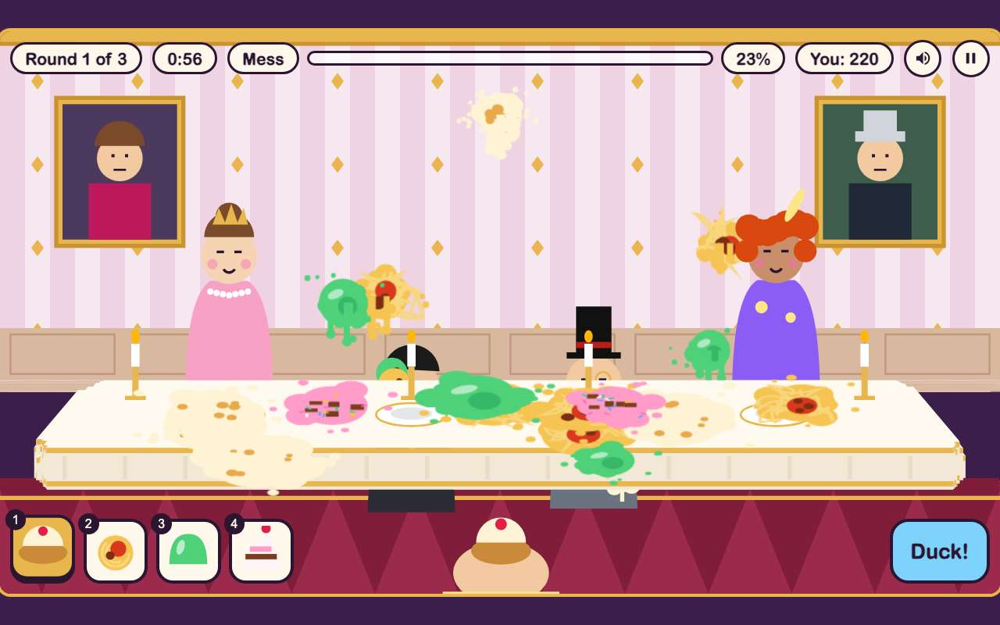 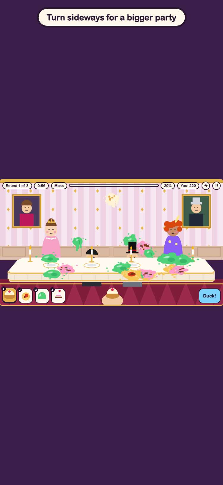

## 4. Duck makes a guest's throw miss, and without it you get splatted

- desktop: ducking: the pie flew over; not ducking: SPLAT
- phone: ducking: the pie flew over; not ducking: SPLAT

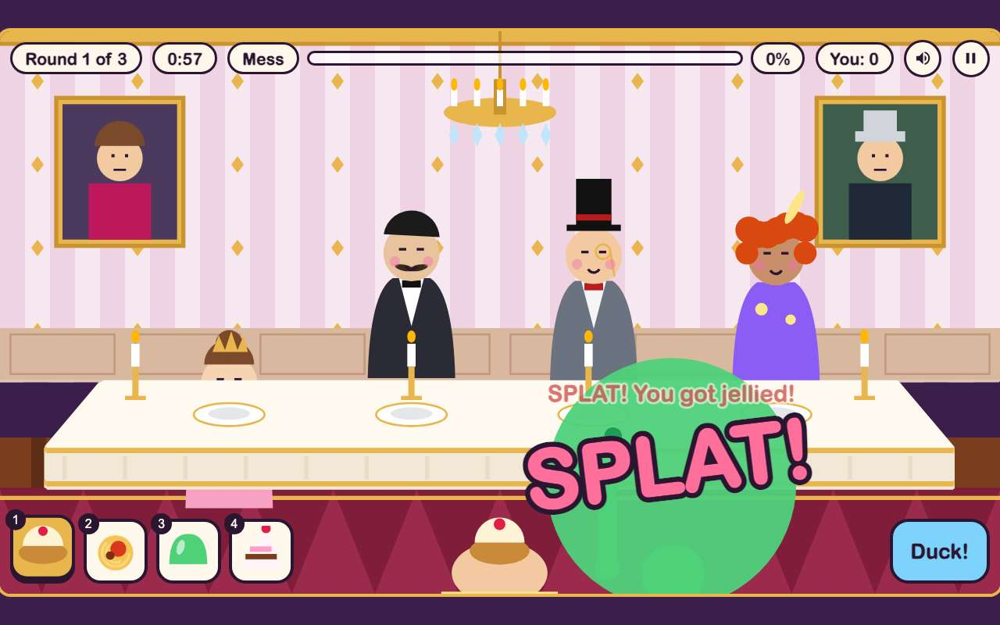 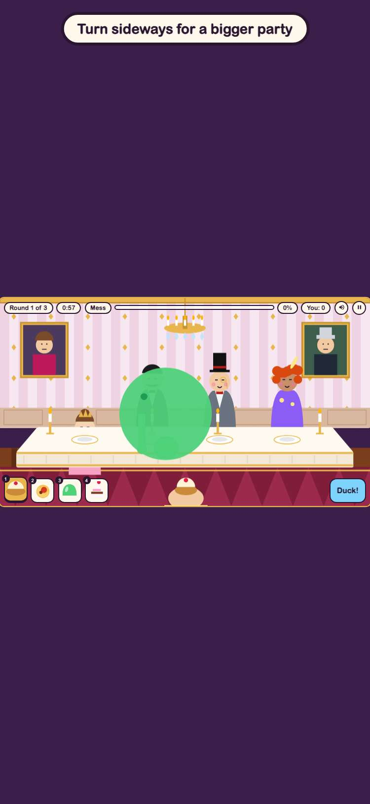

## 5. each round ends with the Messiest crown, and the next round starts

- desktop: You made the most mess. The crown is yours!
- phone: You made the most mess. The crown is yours!

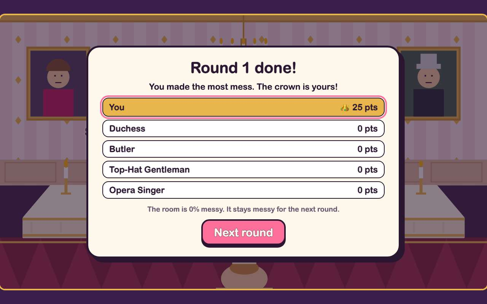 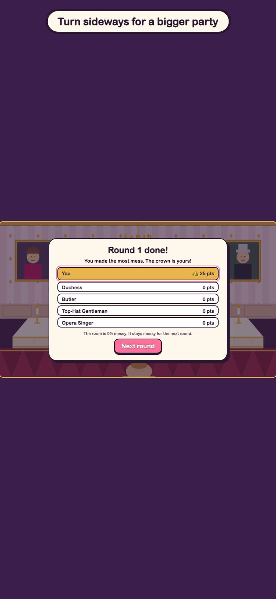

## 6. saves only under gameon.fancy-food-fight.

## 7. Fancy Food Fight has a card in the arcade and plays in its frame

- desktop: card first in the arcade; plays inside the frame; GitHub button opens its folder
- phone: card first in the arcade; plays inside the frame; GitHub button opens its folder

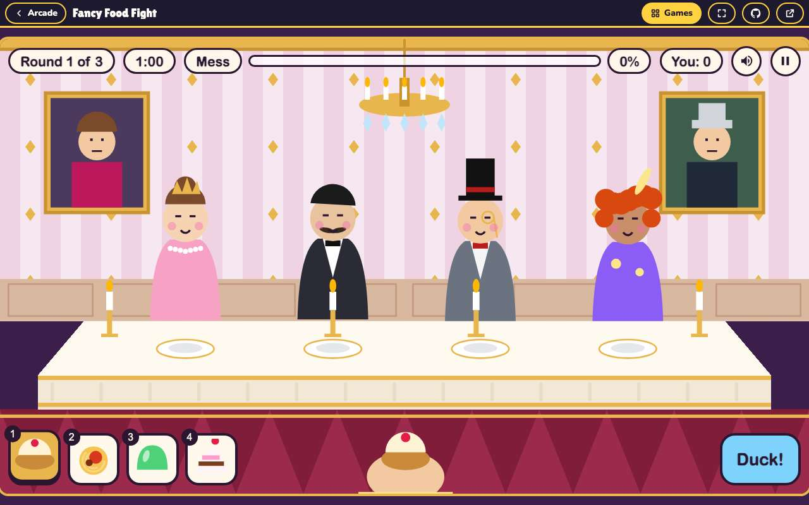 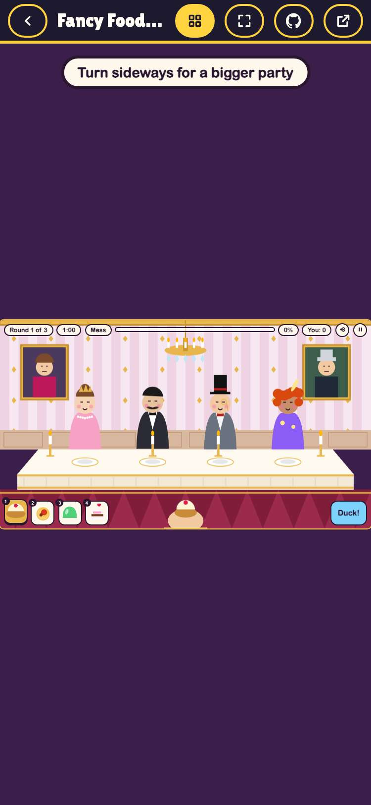
