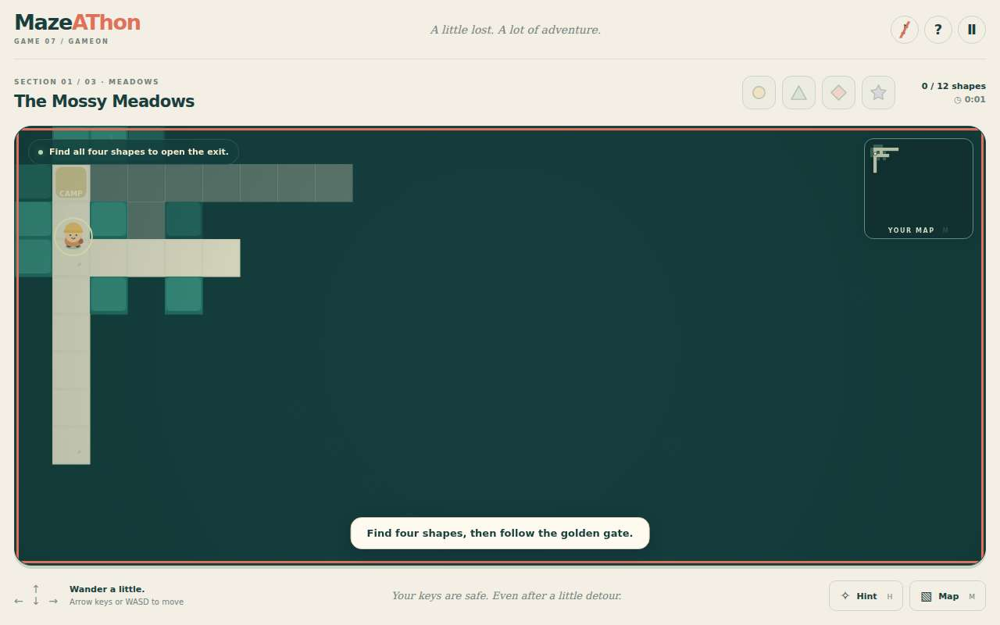
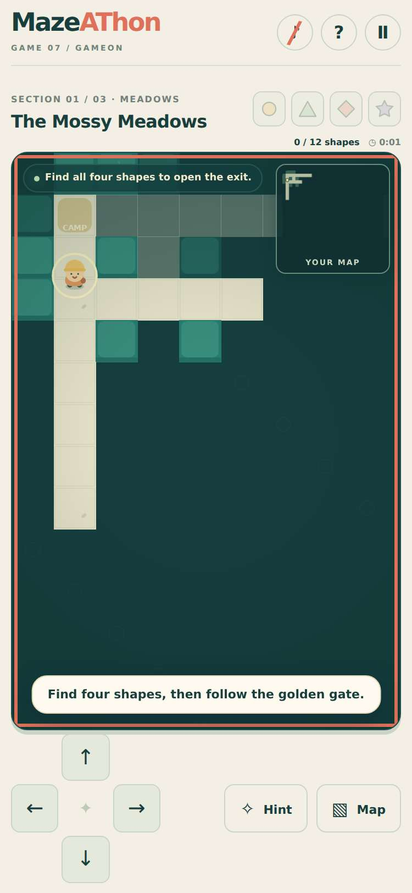
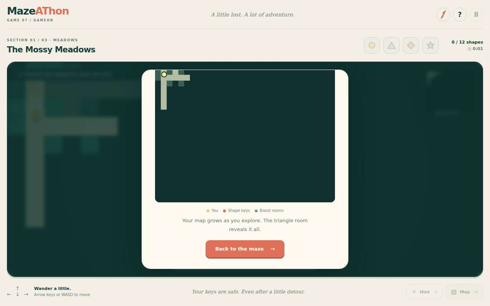
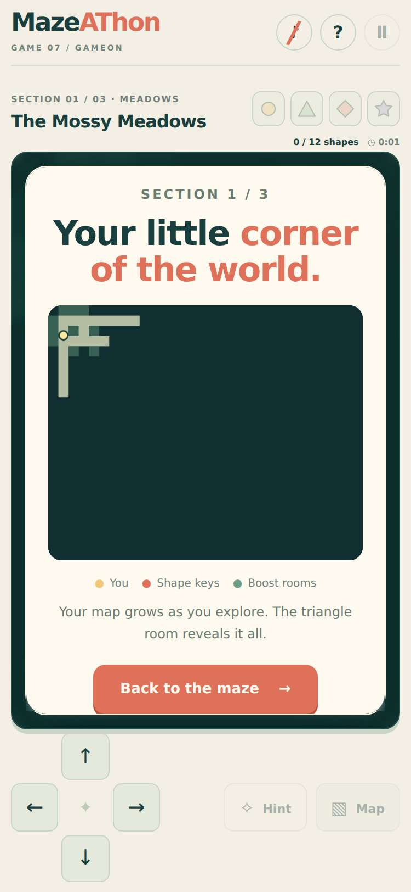
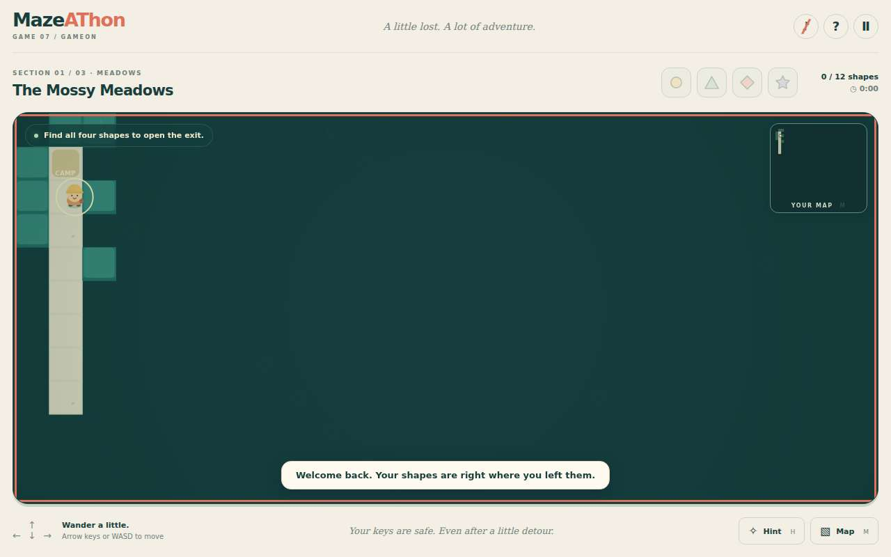
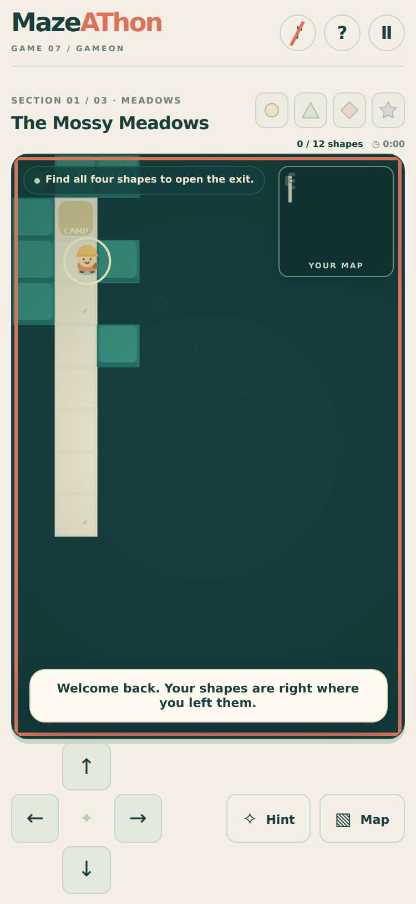
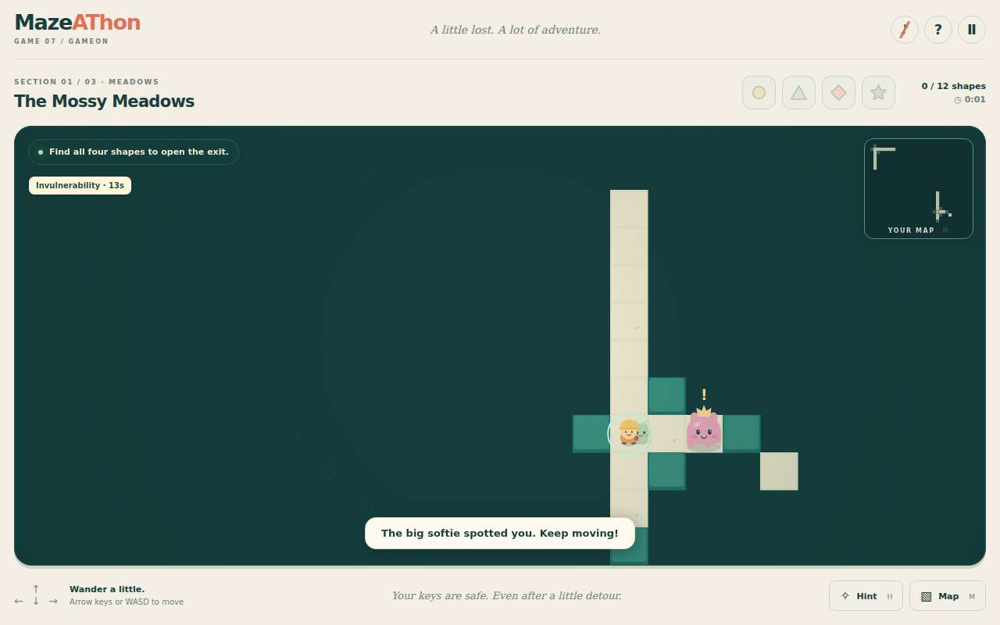
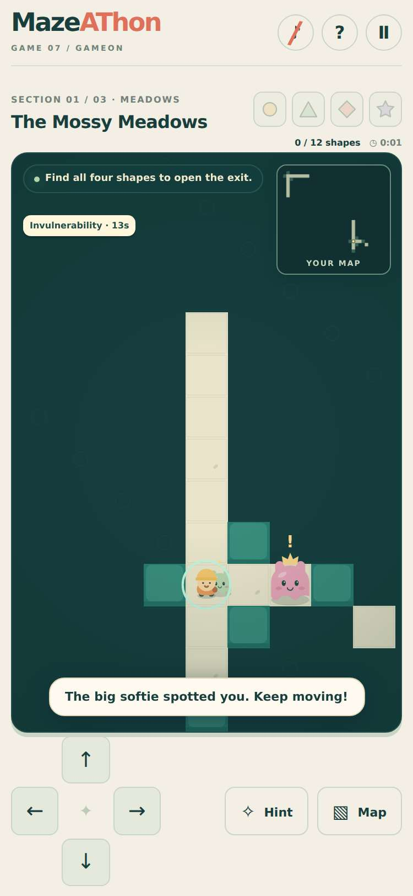
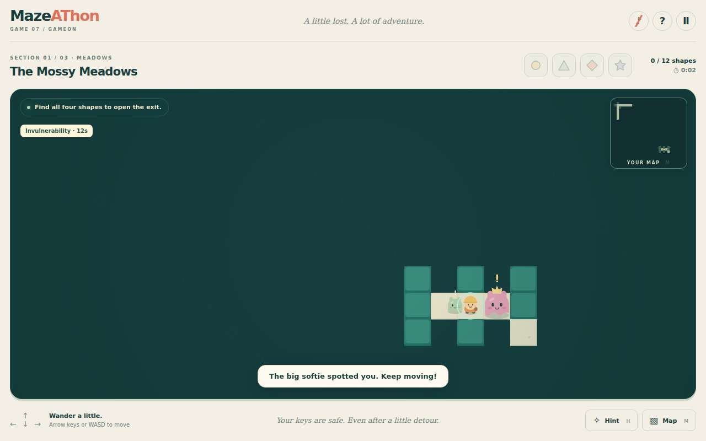
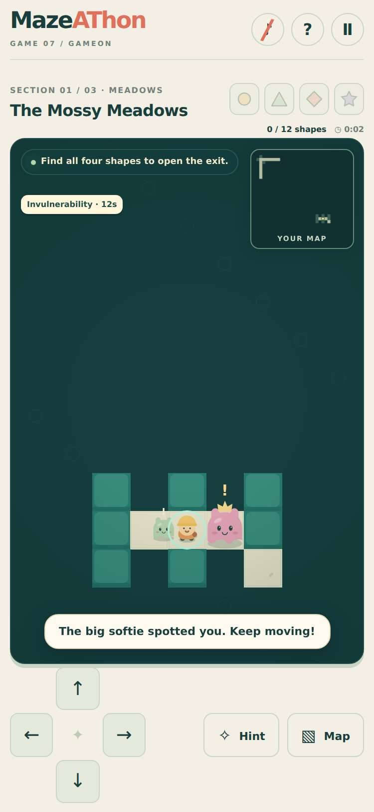

# Evidence: 107-mazeathon-playfeel

**PASS: 4 of 4 checks pass at desktop and phone widths.**

Generated by `npm run evidence -- 107-mazeathon-playfeel` from [`tests/evidence/107-mazeathon-playfeel.spec.mjs`](../../tests/evidence/107-mazeathon-playfeel.spec.mjs) against the local server (python3 -m http.server) on this branch, starting from commit 111fc7a, 2026-10-23 13:52 UTC. Rules: [docs/evidence.md](../../docs/evidence.md).

| Check | Desktop 1280 | Phone 375 |
|---|---|---|
| a new adventure has early choices that work with keyboard and phone controls | pass | pass |
| hugging a wall keeps its face visible and the floor behind it hidden, including after continuing | pass | pass |
| small monsters show a stationary warning before moving | pass | pass |
| big monsters show a stationary warning before moving | pass | pass |

## 1. a new adventure has early choices that work with keyboard and phone controls

- desktop: Seed 2026: both paths from camp are playable using arrow keys. Model regressions also check 100 seeds.
- phone: Seed 2026: both paths from camp are playable using the visible direction buttons. Model regressions also check 100 seeds.

 

 

## 2. hugging a wall keeps its face visible and the floor behind it hidden, including after continuing

- desktop: Controlled save fixture beside the opening pillar; pushing into it stops at the collision boundary. The adjacent wall is discovered and the occluded floor stays undiscovered. Continue retains the layout.
- phone: Controlled save fixture beside the opening pillar; pushing into it stops at the collision boundary. The adjacent wall is discovered and the occluded floor stays undiscovered. Continue retains the layout.

 

## 3. small monsters show a stationary warning before moving

- desktop: Controlled save near a real generated small monster, with a shield so the chase can be observed. Its ! warning lasts 0.75 seconds, with no movement. Then it chases. The unit suite separately checks unshielded corner encounters and loss of sight.
- phone: Controlled save near a real generated small monster, with a shield so the chase can be observed. Its ! warning lasts 0.75 seconds, with no movement. Then it chases. The unit suite separately checks unshielded corner encounters and loss of sight.

 

## 4. big monsters show a stationary warning before moving

- desktop: Controlled save near a real generated guardian, with a shield so the chase can be observed. Its ! warning lasts 1.2 seconds, with no movement. Then it chases. The unit suite separately checks unshielded corner encounters and loss of sight.
- phone: Controlled save near a real generated guardian, with a shield so the chase can be observed. Its ! warning lasts 1.2 seconds, with no movement. Then it chases. The unit suite separately checks unshielded corner encounters and loss of sight.

 
