# Evidence: 109-mazeathon-rooms

**PASS: 8 of 8 checks pass at desktop and phone widths.**

Generated by `npm run evidence -- 109-mazeathon-rooms` from [`tests/evidence/109-mazeathon-rooms.spec.mjs`](../../tests/evidence/109-mazeathon-rooms.spec.mjs) against the local server (python3 -m http.server) on this branch, starting from commit bba5eb6, 2026-10-23 19:33 UTC. Rules: [docs/evidence.md](../../docs/evidence.md).

| Check | Desktop 1280 | Phone 375 |
|---|---|---|
| seed 2026 spreads its rooms across the full maze | pass | pass |
| seed 909 spreads its rooms across the full maze | pass | pass |
| a scattered room stays locked when approached without its matching shape | pass | pass |
| a matching key opens the xray room from its entrance and the boost survives Continue | pass | pass |
| a matching key opens the map room from its entrance and the boost survives Continue | pass | pass |
| a matching key opens the shield room from its entrance and the boost survives Continue | pass | pass |
| a matching key opens the speed room from its entrance and the boost survives Continue | pass | pass |
| an adventure saved before scattered rooms keeps its maze and collected progress | pass | pass |

## 1. seed 2026 spreads its rooms across the full maze

- desktop: Map-reveal save fixture shows the complete new layout. Room centres: xray (26.5, 4.5); map (10.5, 4.5); shield (18.5, 14.5); speed (4.5, 18.5). Door sides and which boost occupies each location vary by seed. The model suite independently checks 900 sections.
- phone: Map-reveal save fixture shows the complete new layout. Room centres: xray (26.5, 4.5); map (10.5, 4.5); shield (18.5, 14.5); speed (4.5, 18.5). Door sides and which boost occupies each location vary by seed. The model suite independently checks 900 sections.

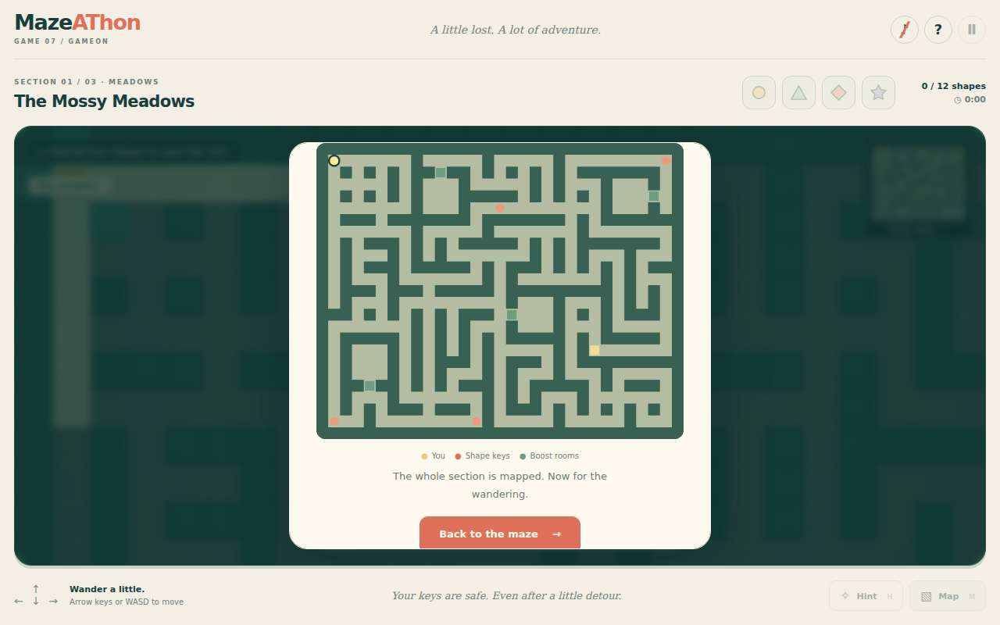 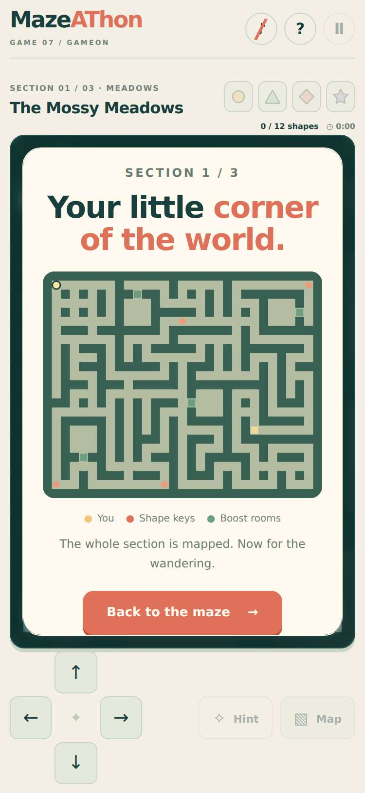

## 2. seed 909 spreads its rooms across the full maze

- desktop: Map-reveal save fixture shows the complete new layout. Room centres: xray (4.5, 10.5); map (18.5, 4.5); shield (20.5, 18.5); speed (4.5, 20.5). Door sides and which boost occupies each location vary by seed. The model suite independently checks 900 sections.
- phone: Map-reveal save fixture shows the complete new layout. Room centres: xray (4.5, 10.5); map (18.5, 4.5); shield (20.5, 18.5); speed (4.5, 20.5). Door sides and which boost occupies each location vary by seed. The model suite independently checks 900 sections.

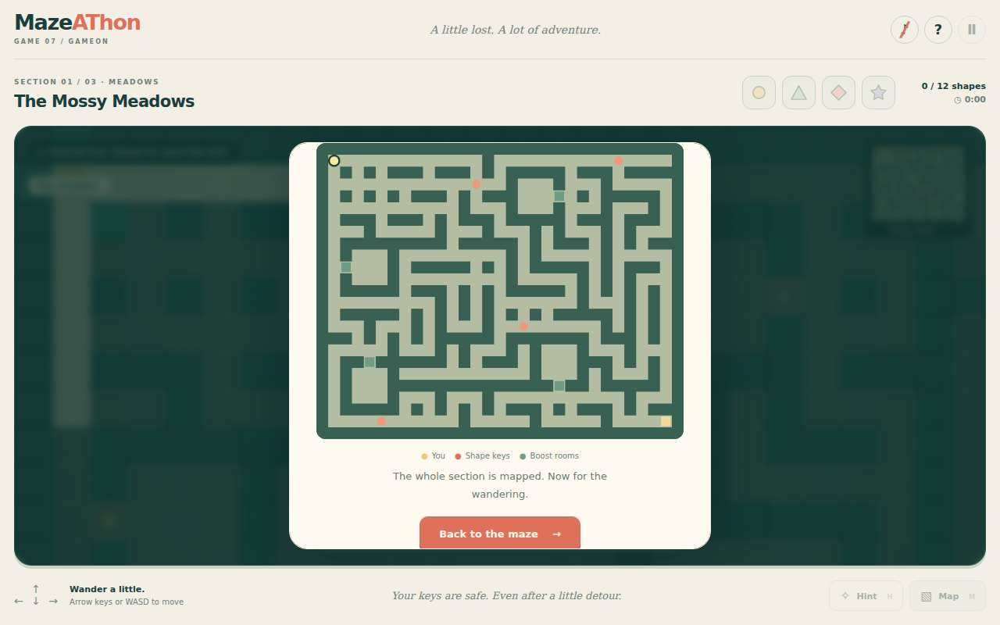 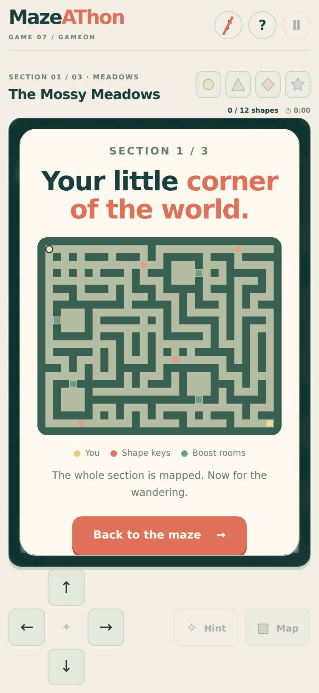

## 3. a scattered room stays locked when approached without its matching shape

- desktop: Controlled save outside the east-facing circle door, with no key: moving toward it stops outside the room.
- phone: Controlled save outside the east-facing circle door, with no key: moving toward it stops outside the room.

## 4. a matching key opens the xray room from its entrance and the boost survives Continue

- desktop: Controlled save outside the room with its matching key; arrow keys enter from the east side. The boost activates without spending the key. Continue retains the open door and boost.
- phone: Controlled save outside the room with its matching key; direction buttons enter from the east side. The boost activates without spending the key. Continue retains the open door and boost.

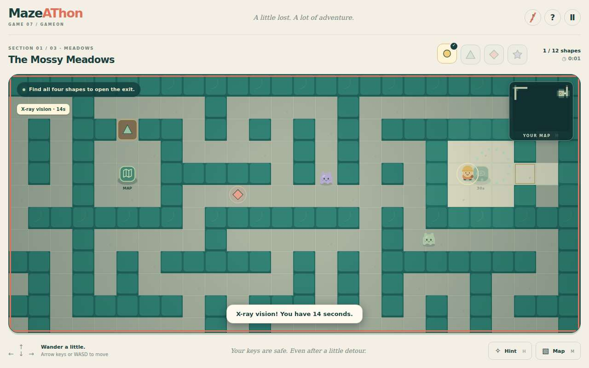 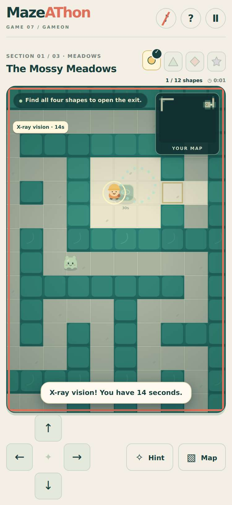

## 5. a matching key opens the map room from its entrance and the boost survives Continue

- desktop: Controlled save outside the room with its matching key; arrow keys enter from the north side. The boost activates without spending the key. Continue retains the open door and boost.
- phone: Controlled save outside the room with its matching key; direction buttons enter from the north side. The boost activates without spending the key. Continue retains the open door and boost.

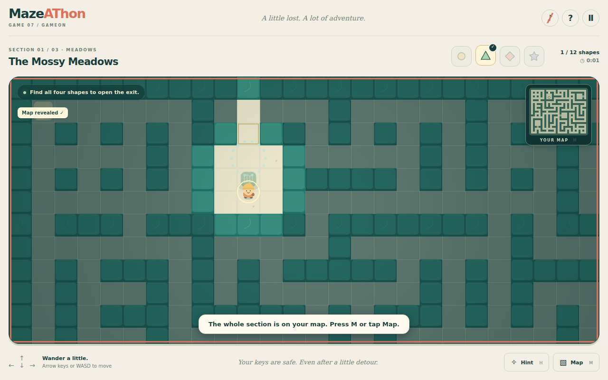 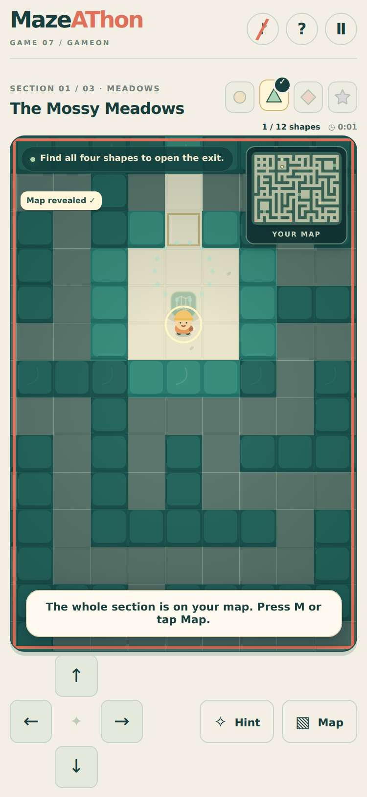

## 6. a matching key opens the shield room from its entrance and the boost survives Continue

- desktop: Controlled save outside the room with its matching key; arrow keys enter from the west side. The boost activates without spending the key. Continue retains the open door and boost.
- phone: Controlled save outside the room with its matching key; direction buttons enter from the west side. The boost activates without spending the key. Continue retains the open door and boost.

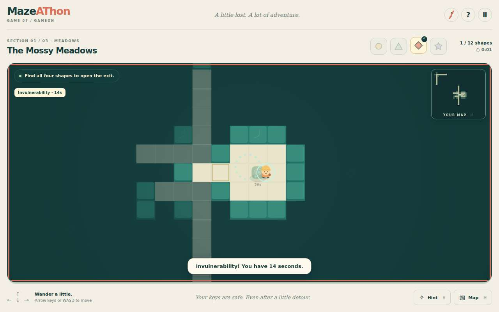 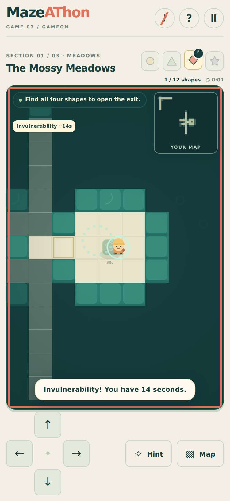

## 7. a matching key opens the speed room from its entrance and the boost survives Continue

- desktop: Controlled save outside the room with its matching key; arrow keys enter from the south side. The boost activates without spending the key. Continue retains the open door and boost.
- phone: Controlled save outside the room with its matching key; direction buttons enter from the south side. The boost activates without spending the key. Continue retains the open door and boost.

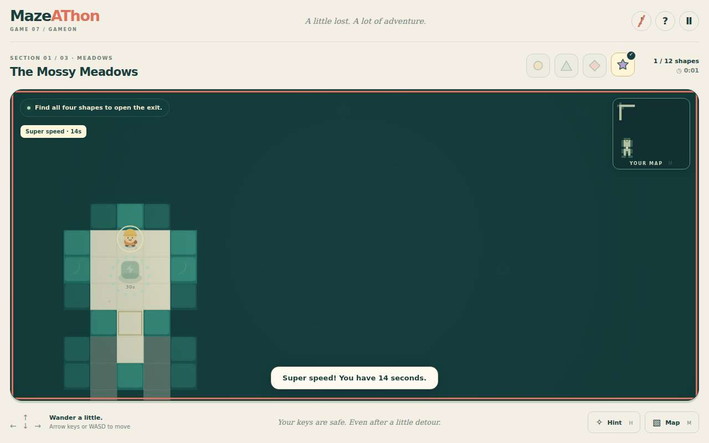 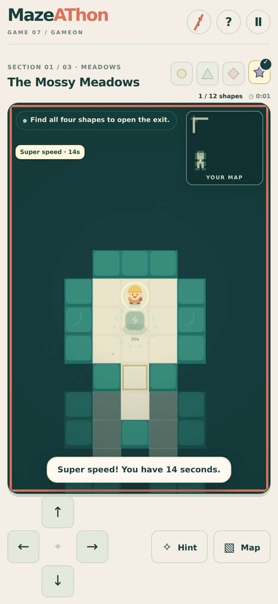

## 8. an adventure saved before scattered rooms keeps its maze and collected progress

- desktop: A pre-change save continues in exactly its old layout with its key, open room, position, and catch count. Unit fingerprints also cover the original layout version.
- phone: A pre-change save continues in exactly its old layout with its key, open room, position, and catch count. Unit fingerprints also cover the original layout version.
