# Evidence: 111-super-sauce-boy

**PASS: 8 of 8 checks pass at desktop and phone widths.**

Generated by `npm run evidence -- 111-super-sauce-boy` from [`tests/evidence/111-super-sauce-boy.spec.mjs`](../../tests/evidence/111-super-sauce-boy.spec.mjs) against the local server (python3 -m http.server) on this branch, starting from commit ff0ecc3, 2026-10-24 01:36 UTC. Rules: [docs/evidence.md](../../docs/evidence.md).

| Check | Desktop 1280 | Phone 375 |
|---|---|---|
| the title screen opens and level 1 starts, with nothing loaded from the internet | pass | pass |
| Sauce Boy runs and jumps with the real controls: the keyboard on a laptop, the touch buttons on a phone | pass | pass |
| level 1 can be beaten by holding right and pressing jump in real time | pass | pass |
| every one of the 12 levels can be beaten in the real game | pass | pass |
| running into a fork splats Sauce Boy and he pops straight back at the start | pass | pass |
| the game pauses, and Restart starts the level over | pass | pass |
| best times are saved, only under gameon.super-sauce-boy. | pass | pass |
| Super Sauce Boy has the first card in the arcade and plays in its frame | pass | pass |

## 1. the title screen opens and level 1 starts, with nothing loaded from the internet

- desktop: 12 levels, HUD shows level, timer and splats; no requests outside the site; no sideways scrolling
- phone: 12 levels, HUD shows level, timer and splats; no requests outside the site; no sideways scrolling

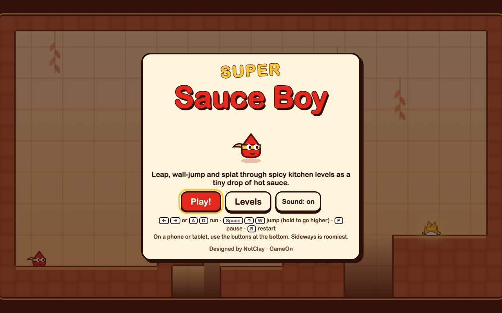 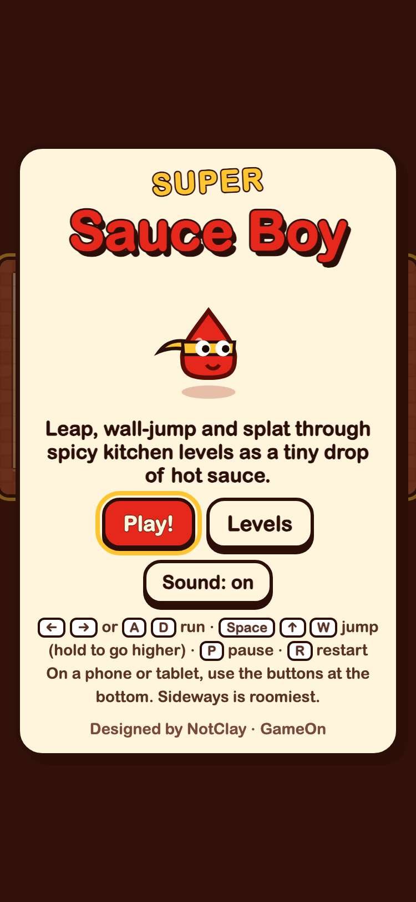

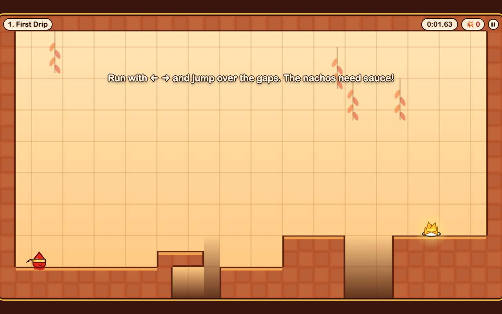 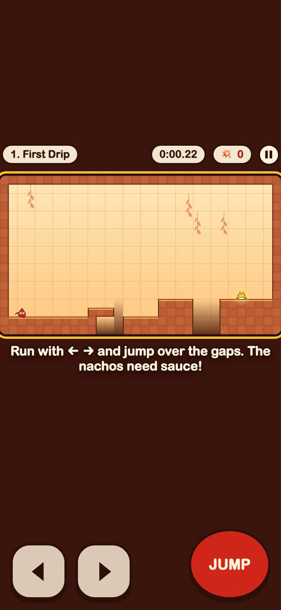

## 2. Sauce Boy runs and jumps with the real controls: the keyboard on a laptop, the touch buttons on a phone

- desktop: keyboard: ran from x 65 to 520 and jumped up to y 344; sauce trail on the floor
- phone: touch buttons: ran from x 65 to 520 and jumped up to y 338; sauce trail on the floor

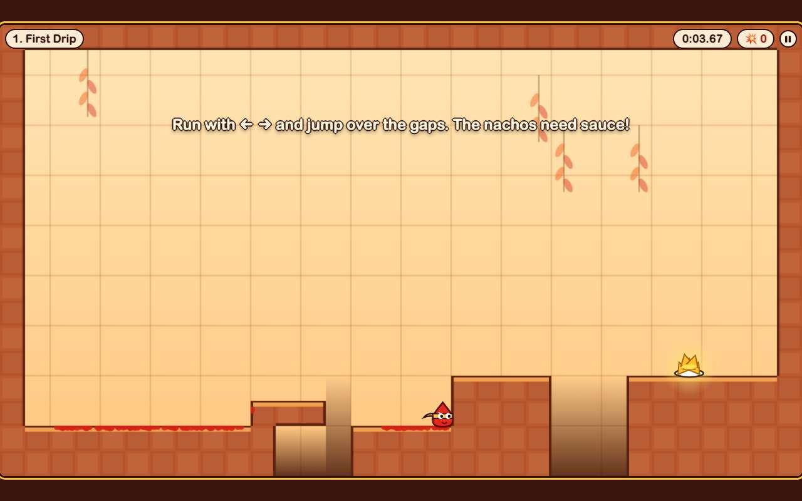 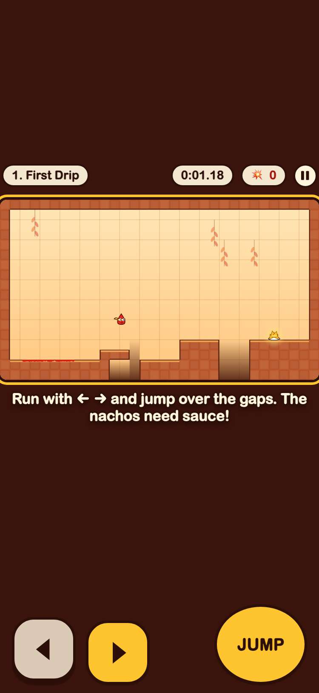

## 3. level 1 can be beaten by holding right and pressing jump in real time

- desktop: nachos sauced in 0:04.83 with 3 jumps and 0 splats
- phone: nachos sauced in 0:03.65 with 3 jumps and 0 splats

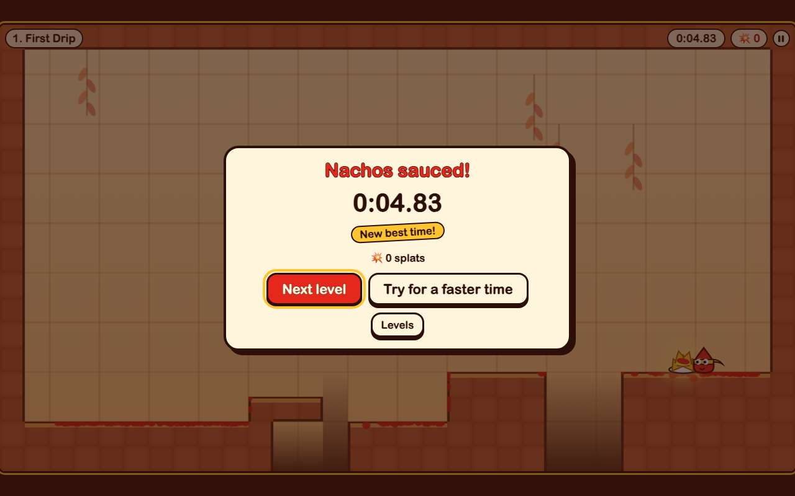 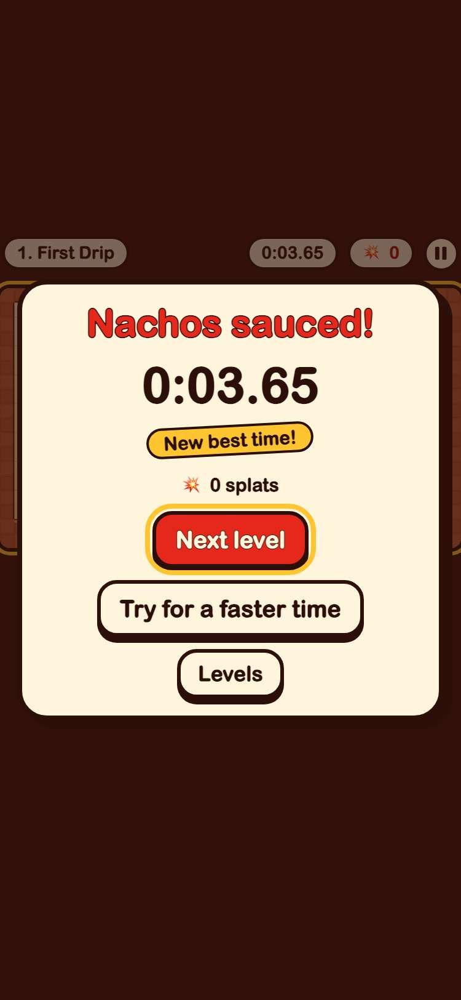

## 4. every one of the 12 levels can be beaten in the real game

- desktop: won: 1 First Drip 2.43s, 2 Tall Shelves 2.39s, 3 Fork Field 2.74s, 4 Tiny Hops 2.55s, 5 Sticky Walls 2.22s, 6 Sauce Chimney 3.22s, 7 Butter Slide 2.42s, 8 Toaster Pop 2.91s, 9 Crumbly Crackers 2.47s, 10 Hot Plates 3.36s, 11 Pizza Cutters 2.7s, 12 Nacho Grande 7.83s
- phone: won: 1 First Drip 2.43s, 2 Tall Shelves 2.39s, 3 Fork Field 2.74s, 4 Tiny Hops 2.55s, 5 Sticky Walls 2.22s, 6 Sauce Chimney 3.22s, 7 Butter Slide 2.42s, 8 Toaster Pop 2.91s, 9 Crumbly Crackers 2.47s, 10 Hot Plates 3.36s, 11 Pizza Cutters 2.7s, 12 Nacho Grande 7.83s

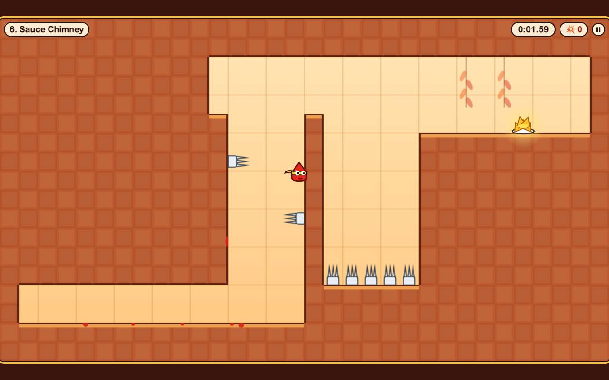 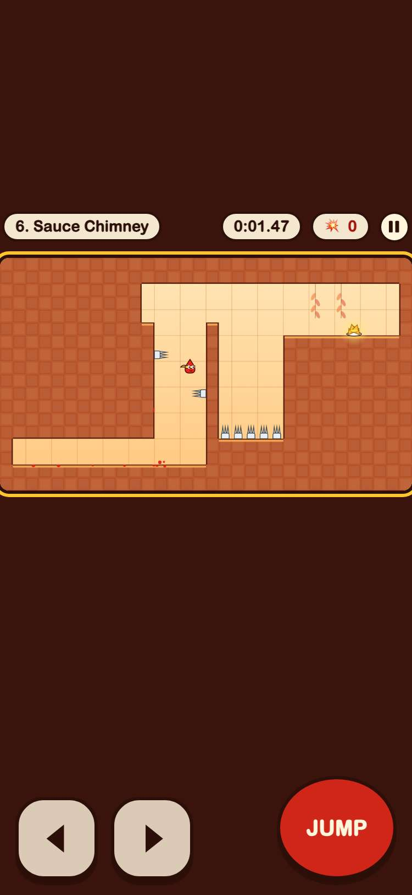

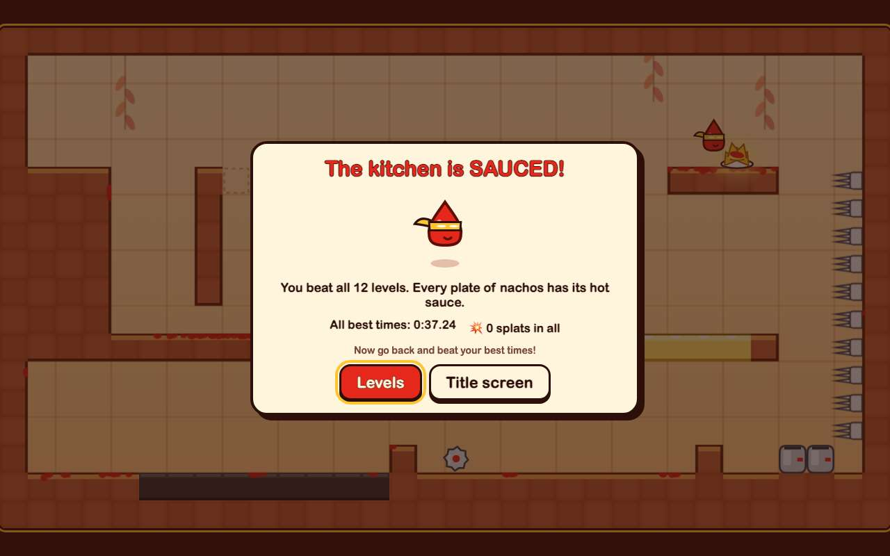 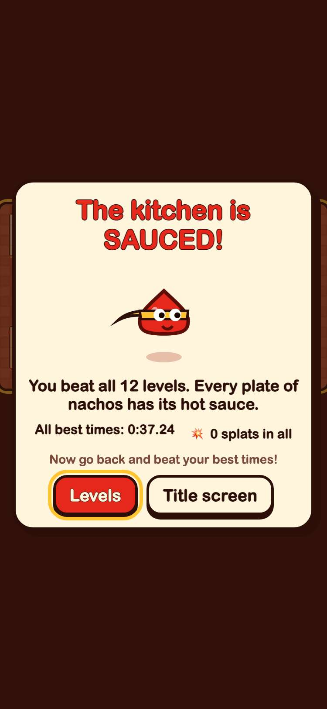

## 5. running into a fork splats Sauce Boy and he pops straight back at the start

- desktop: SPLAT! counter at 1, then back at the start (x 65) about a third of a second later
- phone: SPLAT! counter at 1, then back at the start (x 65) about a third of a second later

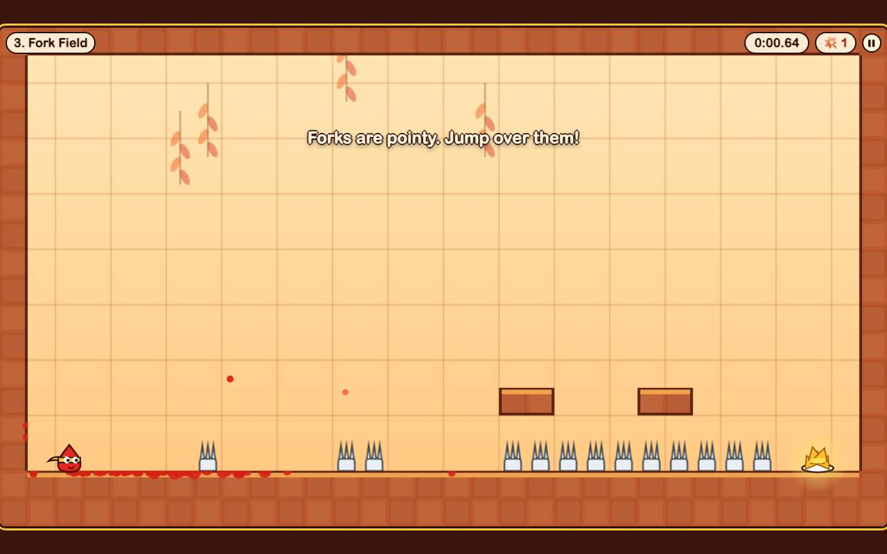 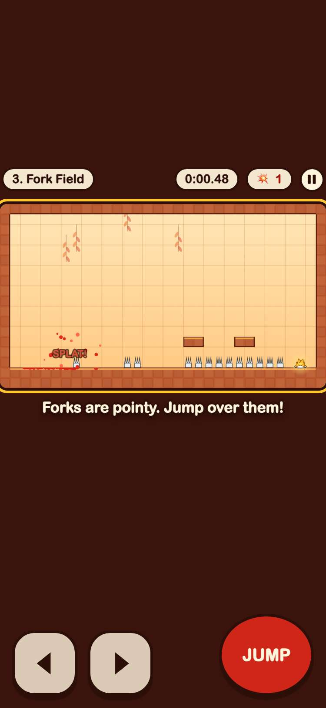

## 6. the game pauses, and Restart starts the level over

- desktop: paused at 0.84s and the clock stayed put; Restart put Sauce Boy back at the start with a fresh clock
- phone: paused at 1.57s and the clock stayed put; Restart put Sauce Boy back at the start with a fresh clock

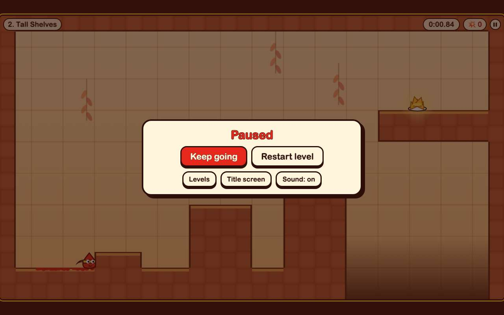 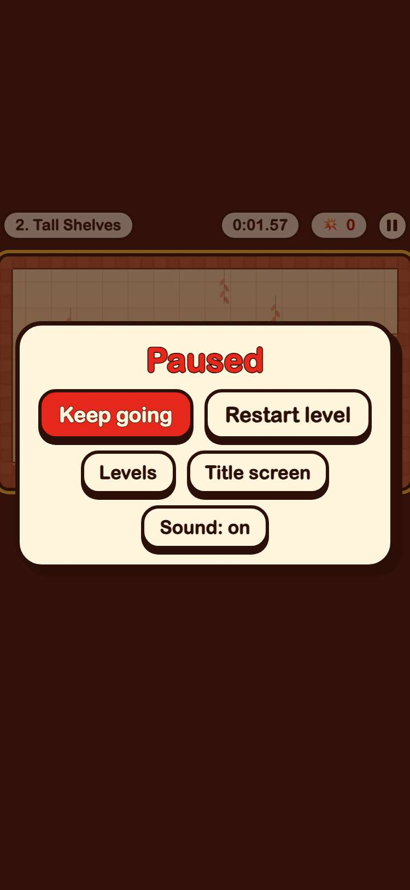

## 7. best times are saved, only under gameon.super-sauce-boy.

- desktop: keys: gameon.super-sauce-boy.best, gameon.super-sauce-boy.unlocked, gameon.super-sauce-boy.sound; level 1 best 2.43s still there after a reload
- phone: keys: gameon.super-sauce-boy.best, gameon.super-sauce-boy.unlocked, gameon.super-sauce-boy.sound; level 1 best 2.43s still there after a reload

## 8. Super Sauce Boy has the first card in the arcade and plays in its frame

- desktop: card first in the arcade with its 800x450 cover; plays inside the frame; GitHub button opens its folder
- phone: card first in the arcade with its 800x450 cover; plays inside the frame; GitHub button opens its folder

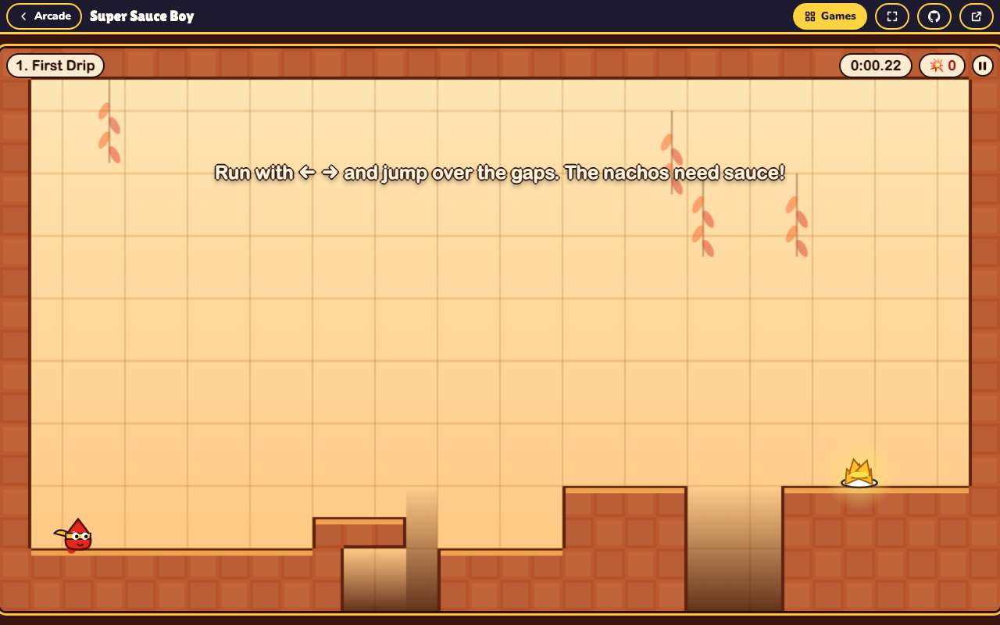 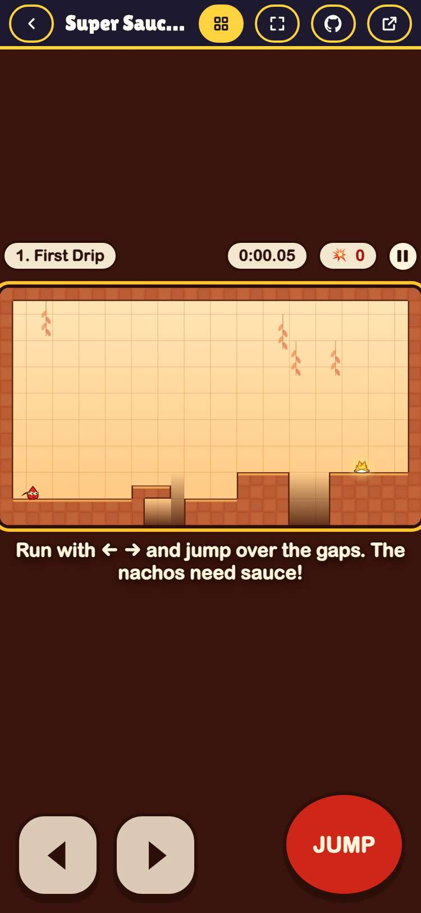
