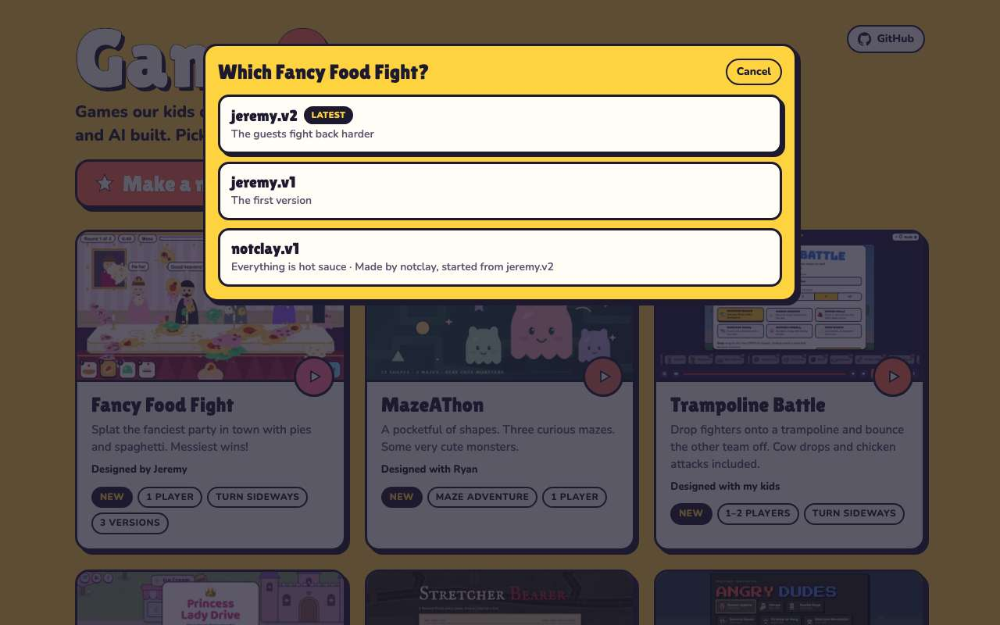
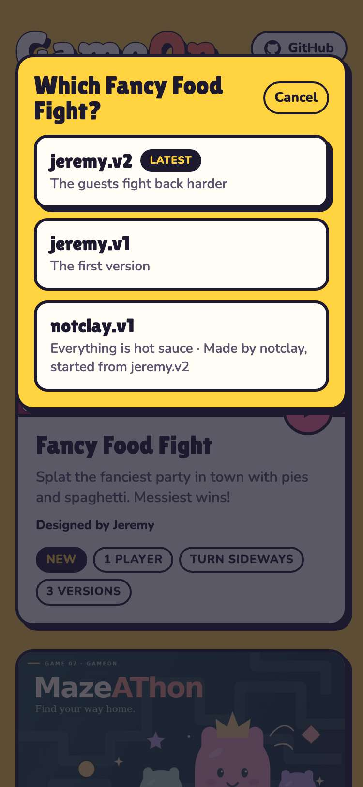
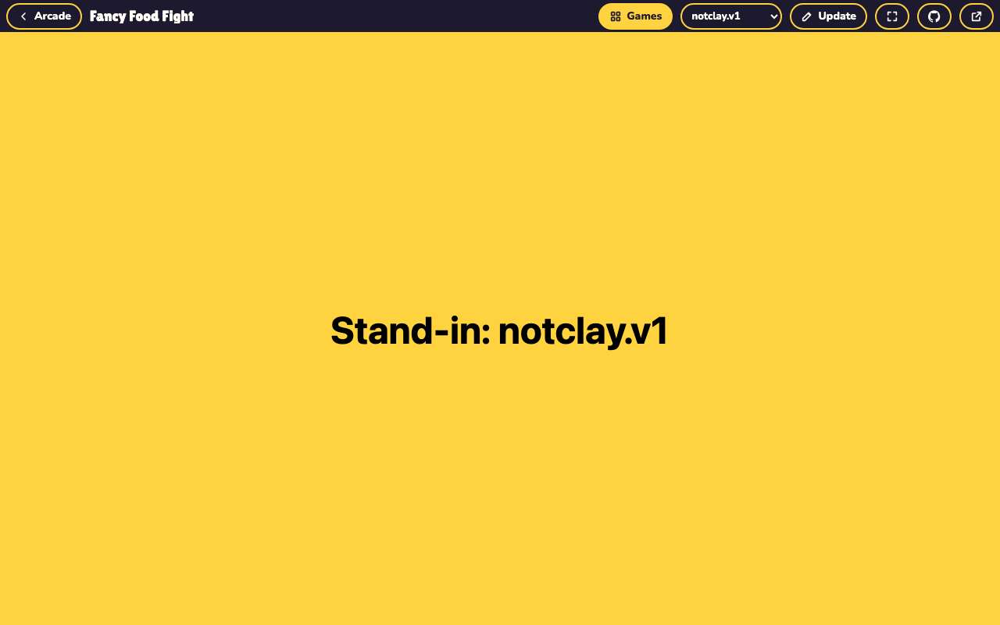
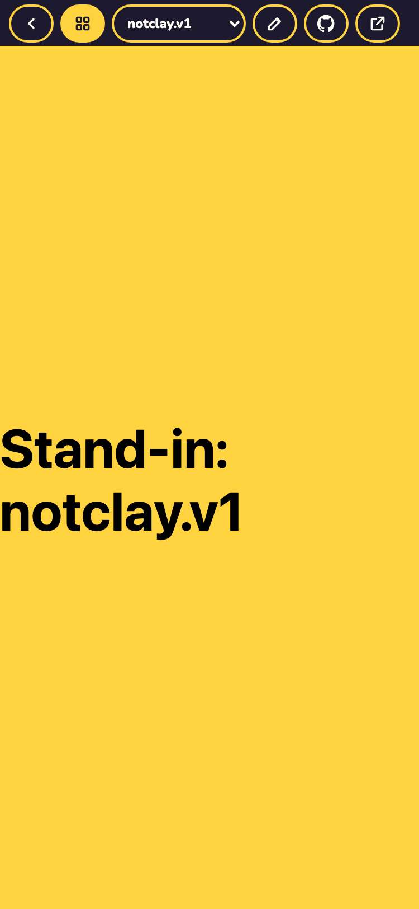
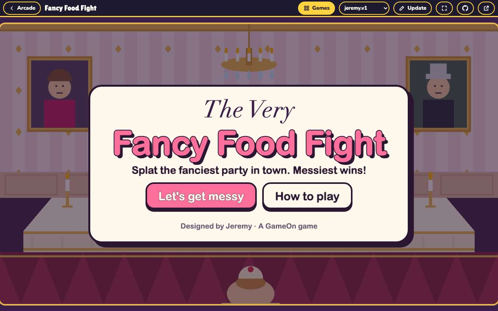
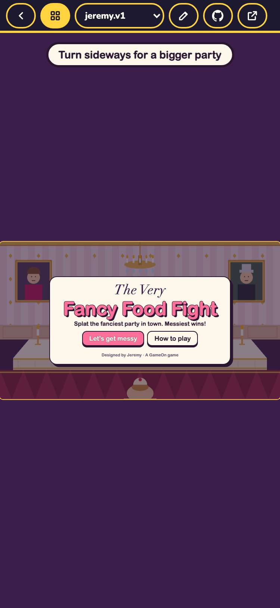
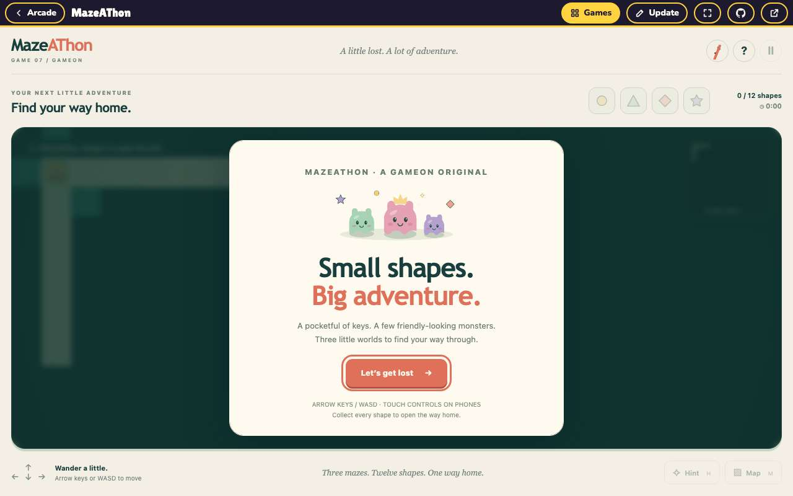
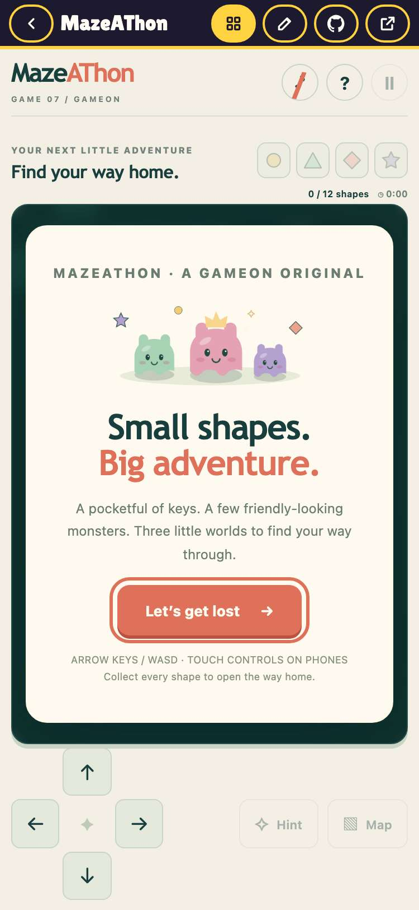

# Evidence: 115-arcade-versions

**PASS: 5 of 5 checks pass at desktop and phone widths.**

Generated by `npm run evidence -- 115-arcade-versions` from [`tests/evidence/115-arcade-versions.spec.mjs`](../../tests/evidence/115-arcade-versions.spec.mjs) against the local server (python3 -m http.server) on this branch, starting from commit 4b2e3b3, 2026-10-24 01:51 UTC. Rules: [docs/evidence.md](../../docs/evidence.md).

| Check | Desktop 1280 | Phone 375 |
|---|---|---|
| a game with versions says how many, and asks which one when it starts | pass | pass |
| picking a fork plays it, with the version, Update and GitHub links all following it | pass | pass |
| the player bar's dropdown switches versions | pass | pass |
| the arcade remembers the last pick, and Cancel goes back | pass | pass |
| a game with one version plays straight away, and Update opens the New Game page with it picked | pass | pass |

## 1. a game with versions says how many, and asks which one when it starts

- desktop: order: jeremy.v2 (Latest), jeremy.v1, then the fork notclay.v1
- phone: order: jeremy.v2 (Latest), jeremy.v1, then the fork notclay.v1

 

## 2. picking a fork plays it, with the version, Update and GitHub links all following it

- desktop: frame, version dropdown, Update and GitHub all point at notclay.v1
- phone: frame, version dropdown, Update and GitHub all point at notclay.v1

 

## 3. the player bar's dropdown switches versions

 

## 4. the arcade remembers the last pick, and Cancel goes back

- desktop: notclay.v1 marked Last played; Cancel returned to the arcade
- phone: notclay.v1 marked Last played; Cancel returned to the arcade

## 5. a game with one version plays straight away, and Update opens the New Game page with it picked

- desktop: MazeAThon (creator ryan) is ryan.v1; Update → new/?game=mazeathon&version=ryan.v1
- phone: MazeAThon (creator ryan) is ryan.v1; Update → new/?game=mazeathon&version=ryan.v1

 
