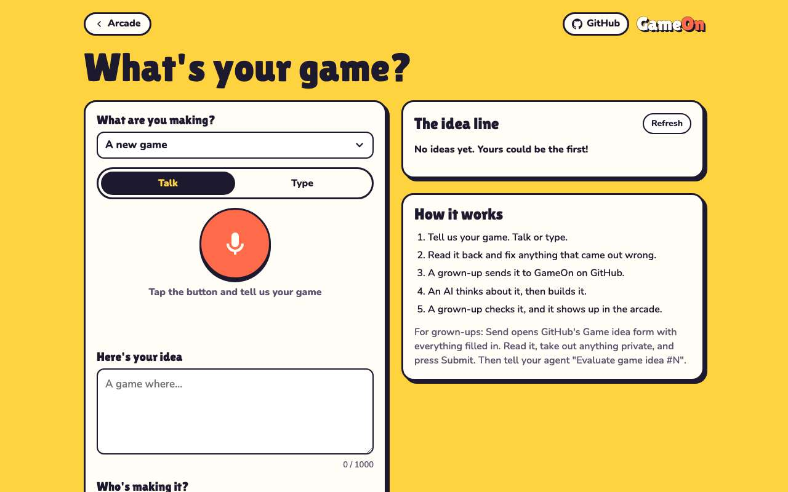
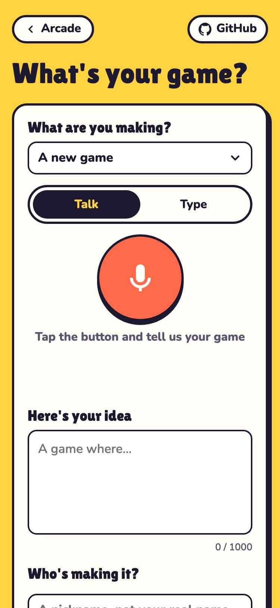
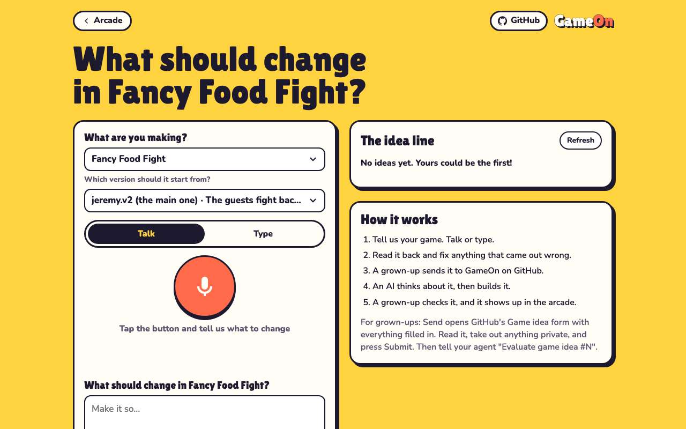
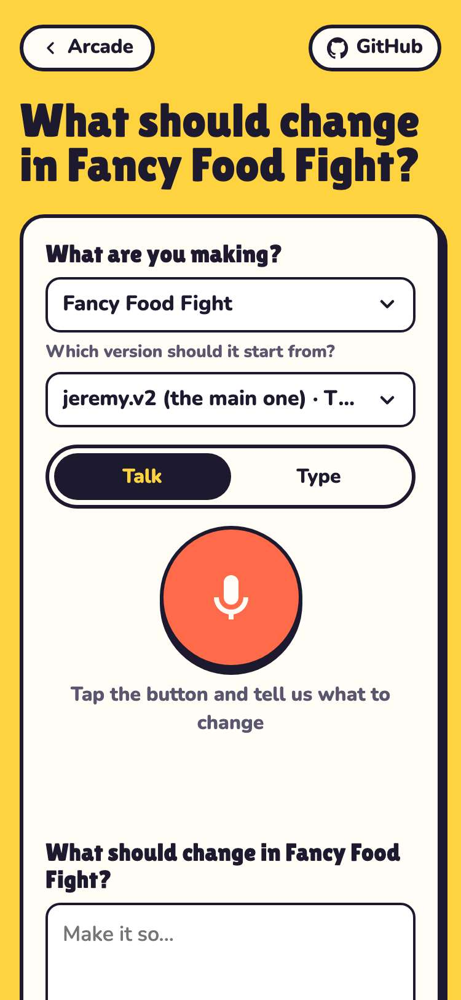
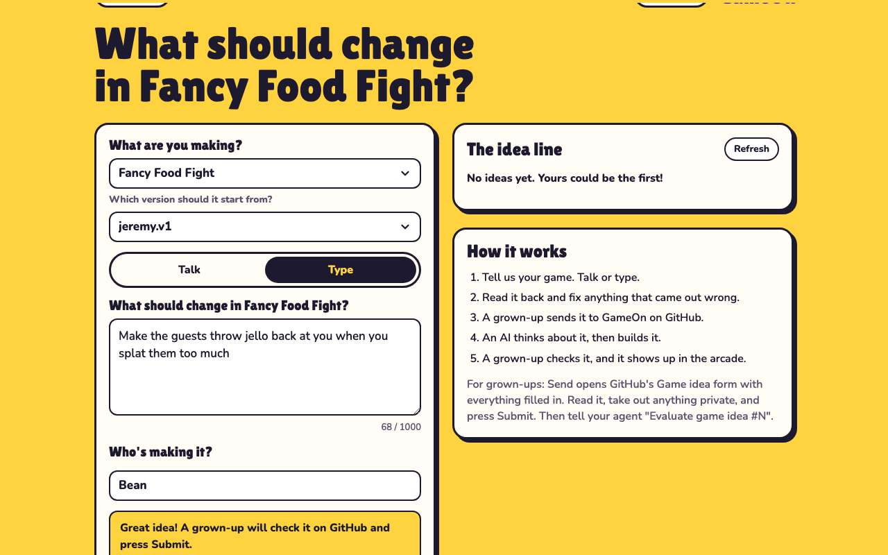
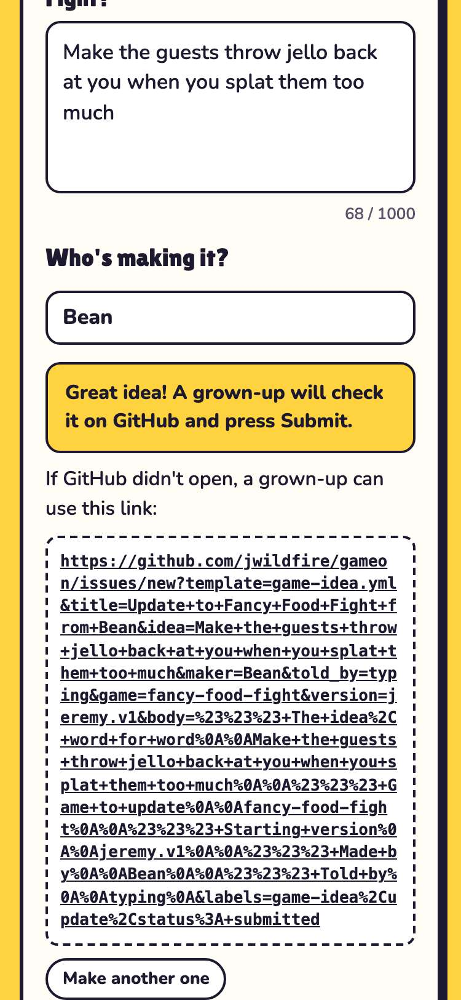
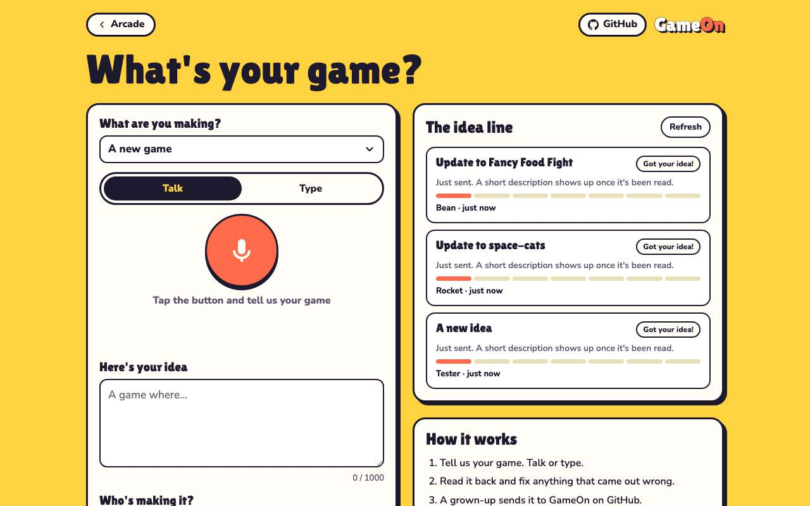
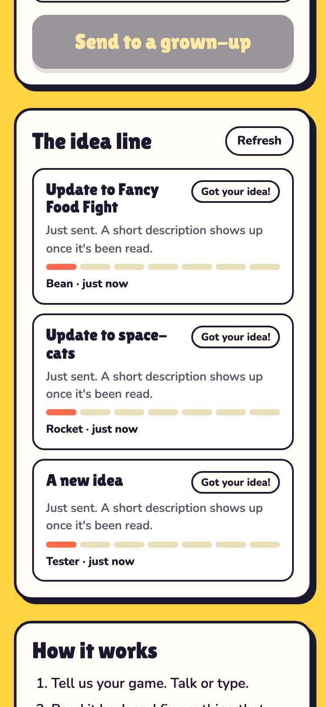

# Evidence: 116-update-a-game

**PASS: 6 of 6 checks pass at desktop and phone widths.**

Generated by `npm run evidence -- 116-update-a-game` from [`tests/evidence/116-update-a-game.spec.mjs`](../../tests/evidence/116-update-a-game.spec.mjs) against the local server (python3 -m http.server) on this branch, starting from commit 6cb2567, 2026-10-24 01:55 UTC. Rules: [docs/evidence.md](../../docs/evidence.md).

| Check | Desktop 1280 | Phone 375 |
|---|---|---|
| A new game is picked by default and Send builds the same address as before | pass | pass |
| picking a game shows its versions | pass | pass |
| new/?game=fancy-food-fight&version=jeremy.v1 pre-picks that game and version | pass | pass |
| Send for an update names the game and starting version | pass | pass |
| the idea line shows an update as Update to {Game} | pass | pass |
| nothing scrolls sideways in update mode | pass | pass |

## 1. A new game is picked by default and Send builds the same address as before

- desktop: 9 games listed after "A new game"; a new game's address has no game or version and the same title, body and labels as before
- phone: 9 games listed after "A new game"; a new game's address has no game or version and the same title, body and labels as before

 

## 2. picking a game shows its versions

- desktop: MazeAThon has one version (jeremy.v1); Fancy Food Fight with three versions starts on its default, jeremy.v2
- phone: MazeAThon has one version (jeremy.v1); Fancy Food Fight with three versions starts on its default, jeremy.v2

 

## 3. new/?game=fancy-food-fight&version=jeremy.v1 pre-picks that game and version

- desktop: version from the address wins, then the game's default; an unknown game falls back to A new game
- phone: version from the address wins, then the game's default; an unknown game falls back to A new game

 

## 4. Send for an update names the game and starting version

- desktop: title "Update to Fancy Food Fight from Bean", game=fancy-food-fight, version=jeremy.v1, labels game-idea,update,status: submitted
- phone: title "Update to Fancy Food Fight from Bean", game=fancy-food-fight, version=jeremy.v1, labels game-idea,update,status: submitted

 

## 5. the idea line shows an update as Update to {Game}

- desktop: an update to fancy-food-fight reads "Update to Fancy Food Fight"; a slug not in games.json reads as the slug; a new idea is unchanged
- phone: an update to fancy-food-fight reads "Update to Fancy Food Fight"; a slug not in games.json reads as the slug; a new idea is unchanged

 

## 6. nothing scrolls sideways in update mode

- desktop: 1280px wide; the pickers, idea box and Send fit
- phone: 375px wide; the pickers, idea box and Send fit
