# Evidence: 122-princess-lady-drive-jeremy-v2

**PASS: 11 of 11 checks pass at desktop and phone widths.**

Generated by `npm run evidence -- 122-princess-lady-drive-jeremy-v2` from [`tests/evidence/122-princess-lady-drive-jeremy-v2.spec.mjs`](../../tests/evidence/122-princess-lady-drive-jeremy-v2.spec.mjs) against the local server (python3 -m http.server) on this branch, starting from commit 555a57c, 2026-10-24 03:05 UTC. Rules: [docs/evidence.md](../../docs/evidence.md).

| Check | Desktop 1280 | Phone 375 |
|---|---|---|
| jeremy.v2 opens to its title screen and starts, with no new outside requests | pass | pass |
| the castle is now a Great Hall with doors to four new rooms | pass | pass |
| the Ballroom's floor lights up and plays, the music box stops the party, and its door goes back to the hall | pass | pass |
| the Tower's telescope looks out over the town, the flag goes up, and its stairs go back to the hall | pass | pass |
| the Kitchen's pot turns what Rosie puts in into a surprise treat, and its door goes back to the hall | pass | pass |
| the Toy Room's blocks crash and rebuild, Rosie rides the rocking horse, and its door goes back to the hall | pass | pass |
| Go out still leaves the castle from a new room | pass | pass |
| what stays still works: drive, get out, take free ice cream, go out and get back in | pass | pass |
| a jeremy.v1 save loads: Rosie keeps her balloons, pets and castle decorations | pass | pass |
| games.json makes jeremy.v2 the default and still points jeremy.v1 at its own site | pass | pass |
| the arcade plays jeremy.v2 by default, and the version picker offers jeremy.v1 | pass | pass |

## 1. jeremy.v2 opens to its title screen and starts, with no new outside requests

- desktop: outside hosts seen: fonts.googleapis.com, fonts.gstatic.com (Google Fonts, inherited from jeremy.v1)
- phone: outside hosts seen: fonts.googleapis.com, fonts.gstatic.com (Google Fonts, inherited from jeremy.v1)

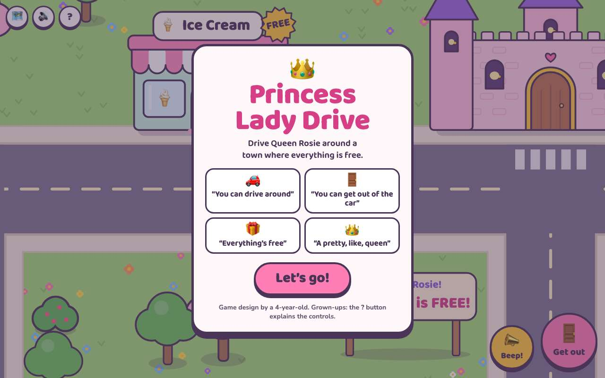 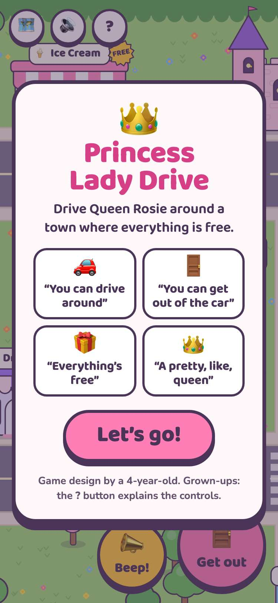

## 2. the castle is now a Great Hall with doors to four new rooms

- desktop: doors: Ballroom, Tower, Kitchen, Toy Room; throne, chest, scepter, crowns, cake, piano, bed and pool still in the hall
- phone: doors: Ballroom, Tower, Kitchen, Toy Room; throne, chest, scepter, crowns, cake, piano, bed and pool still in the hall

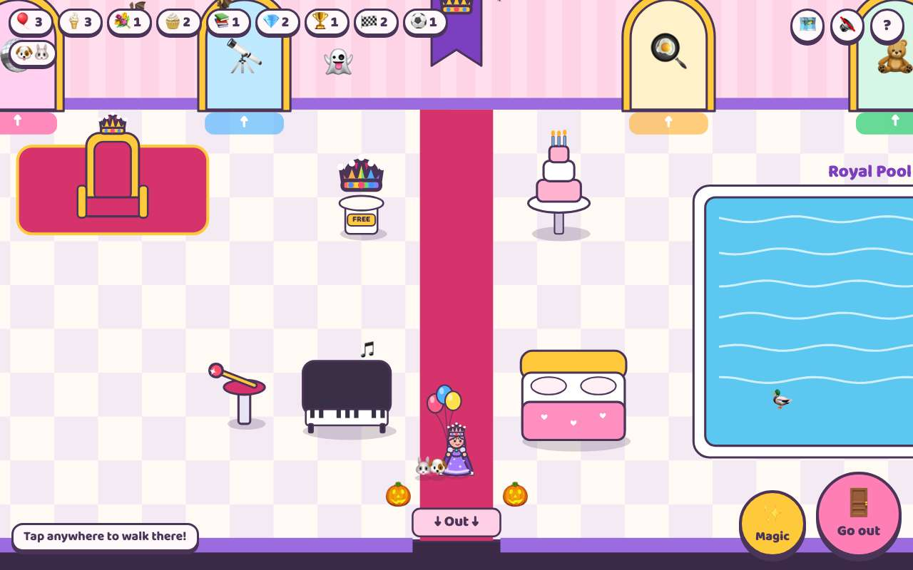 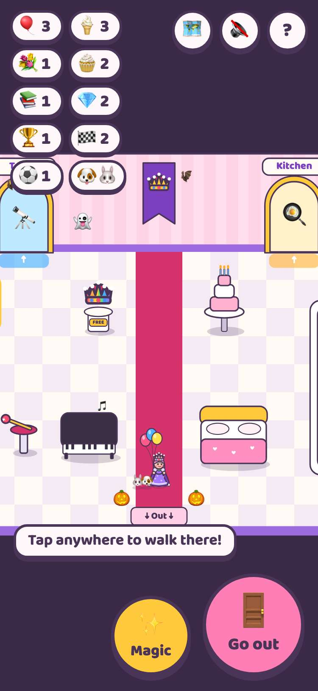

## 3. the Ballroom's floor lights up and plays, the music box stops the party, and its door goes back to the hall

- desktop: 3 dance-floor tiles lit up under Rosie; the party is on
- phone: 3 dance-floor tiles lit up under Rosie; the party is on

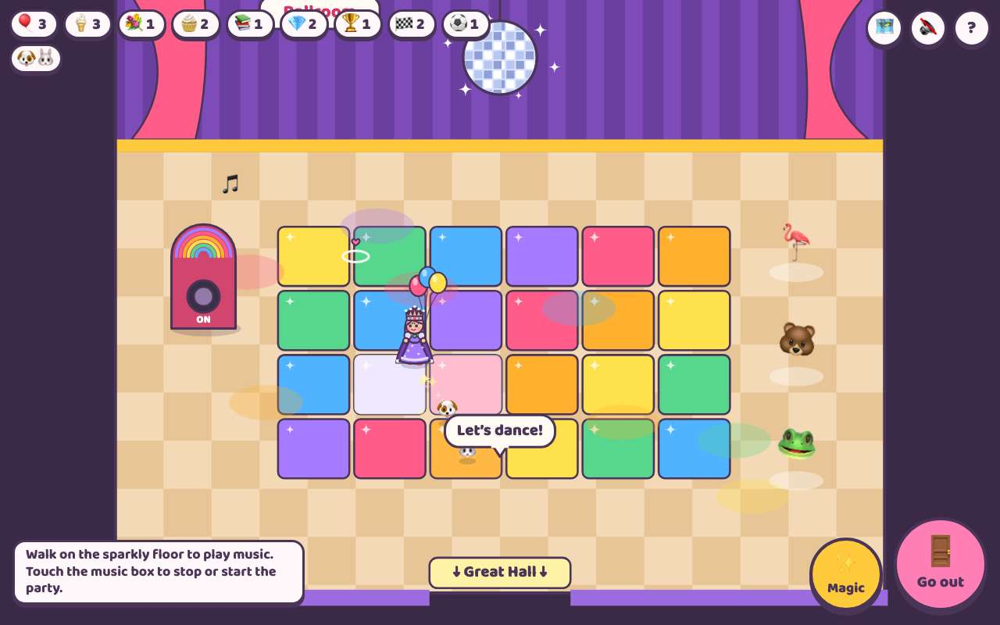 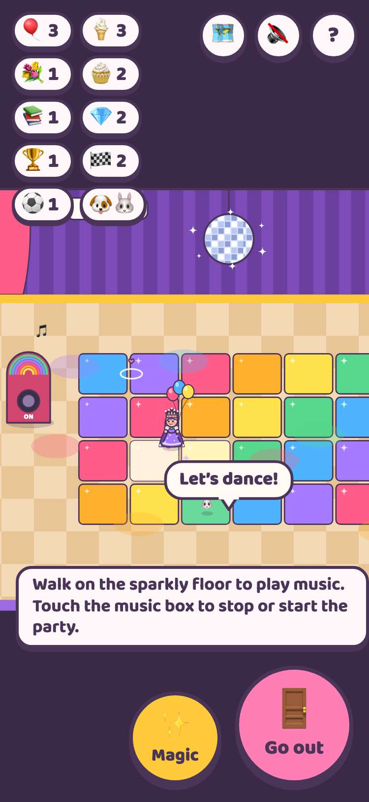

## 4. the Tower's telescope looks out over the town, the flag goes up, and its stairs go back to the hall

- desktop: the telescope shows the duck pond
- phone: the telescope shows the duck pond

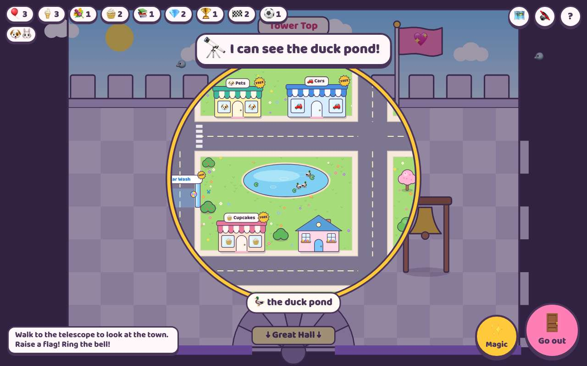 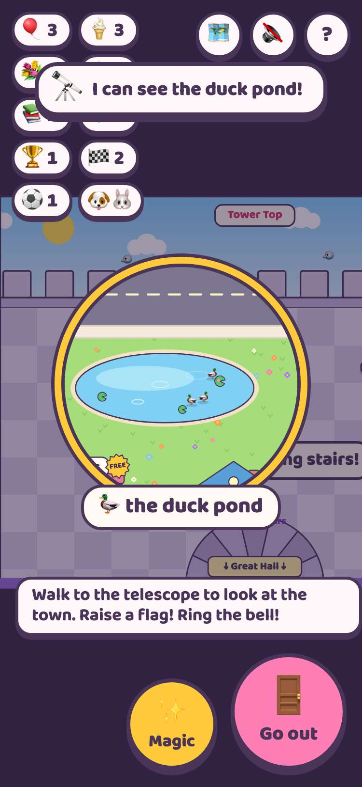

## 5. the Kitchen's pot turns what Rosie puts in into a surprise treat, and its door goes back to the hall

- desktop: the pot made a chocolate donut
- phone: the pot made a chocolate donut

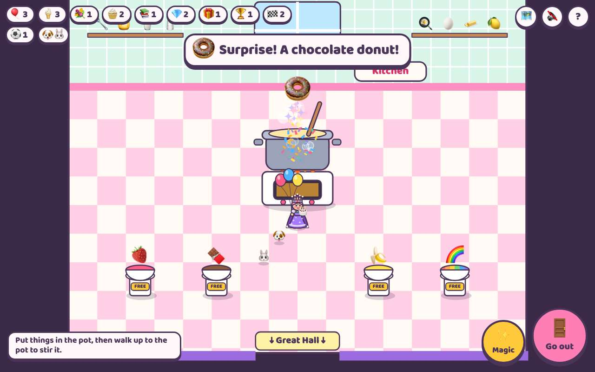 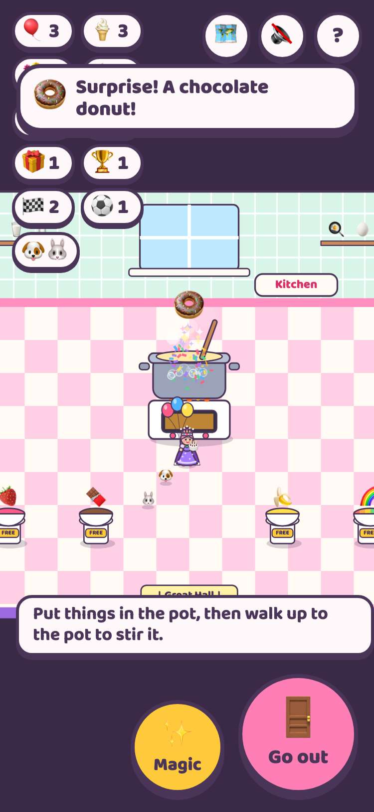

## 6. the Toy Room's blocks crash and rebuild, Rosie rides the rocking horse, and its door goes back to the hall

- desktop: blocks knocked down and rebuilt (6); Rosie is riding the rocking horse
- phone: blocks knocked down and rebuilt (6); Rosie is riding the rocking horse

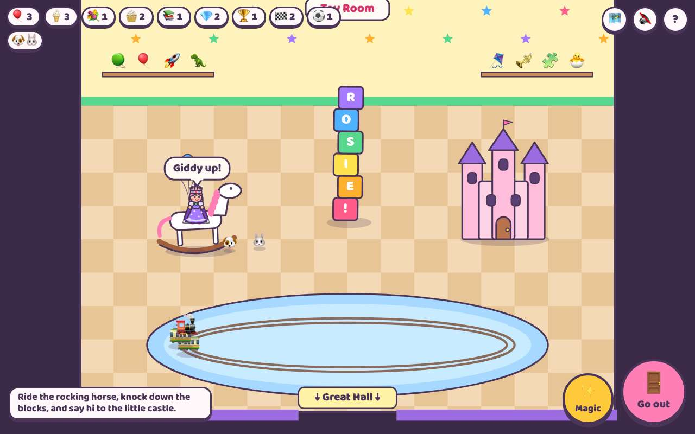 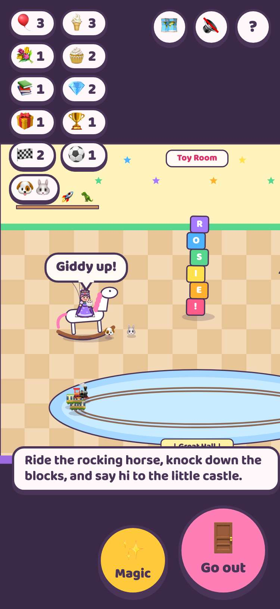

## 7. Go out still leaves the castle from a new room

- desktop: from the Kitchen, Go out puts Rosie outside the castle door
- phone: from the Kitchen, Go out puts Rosie outside the castle door

## 8. what stays still works: drive, get out, take free ice cream, go out and get back in

- desktop: Get out → Ice Cream shop → free cone → Go out → Get in
- phone: Get out → Ice Cream shop → free cone → Go out → Get in

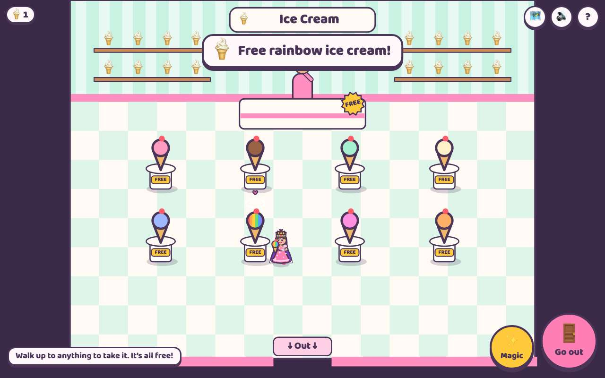 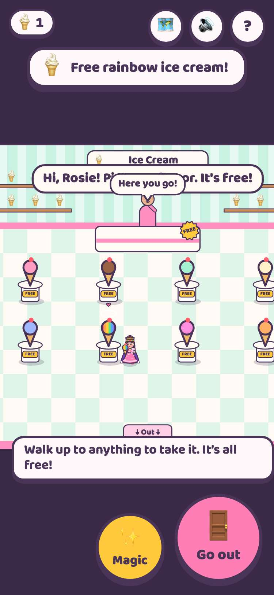

## 9. a jeremy.v1 save loads: Rosie keeps her balloons, pets and castle decorations

- desktop: keys: princess-lady-drive:v2; the save keeps exactly jeremy.v1's fields, so jeremy.v1 can still read it
- phone: keys: princess-lady-drive:v2; the save keeps exactly jeremy.v1's fields, so jeremy.v1 can still read it

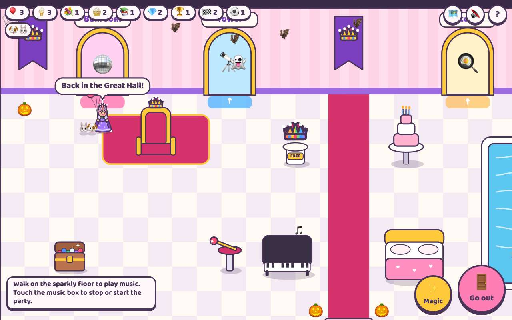 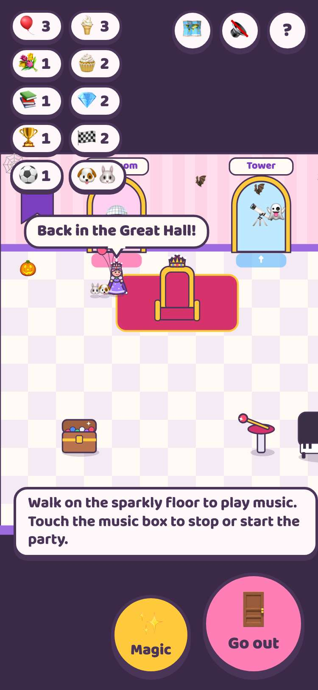

## 10. games.json makes jeremy.v2 the default and still points jeremy.v1 at its own site

- desktop: default jeremy.v2; jeremy.v1 still at https://jwildfire.github.io/princess-lady-drive/
- phone: default jeremy.v2; jeremy.v1 still at https://jwildfire.github.io/princess-lady-drive/

## 11. the arcade plays jeremy.v2 by default, and the version picker offers jeremy.v1

- desktop: card → picker (jeremy.v2 Latest, jeremy.v1) → jeremy.v2 plays in the frame
- phone: card → picker (jeremy.v2 Latest, jeremy.v1) → jeremy.v2 plays in the frame

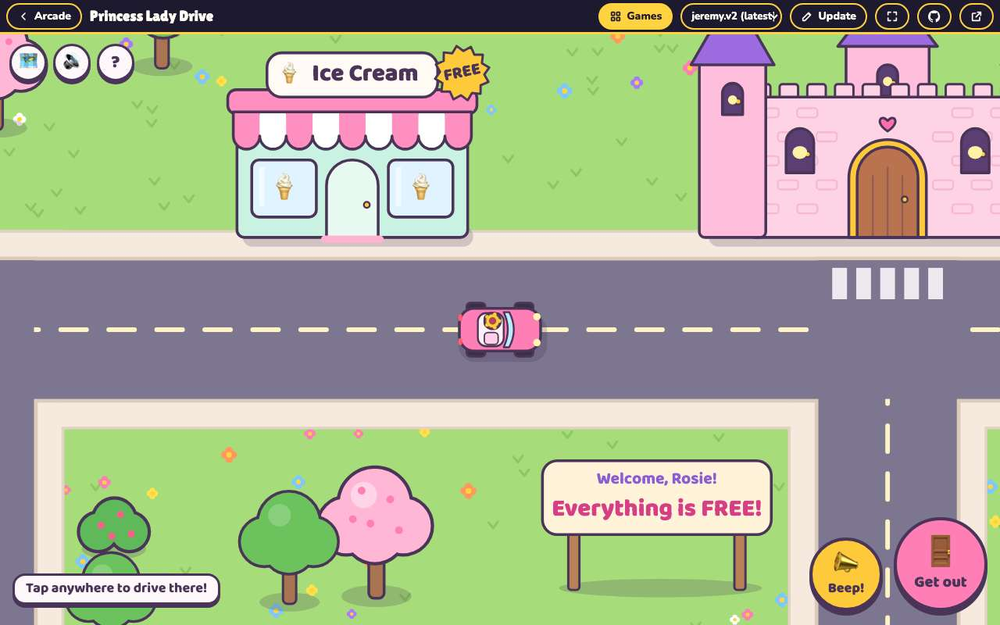 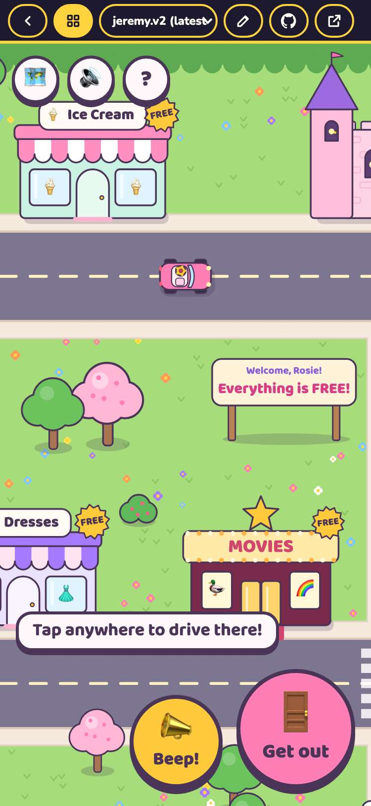
