# Evidence: 124-freeze-repo-games

**PASS: 14 of 14 checks pass at desktop and phone widths.**

Generated by `npm run evidence -- 124-freeze-repo-games` from [`tests/evidence/124-freeze-repo-games.spec.mjs`](../../tests/evidence/124-freeze-repo-games.spec.mjs) against the local server (python3 -m http.server) on this branch, starting from commit e30d105, 2026-10-24 03:56 UTC. Rules: [docs/evidence.md](../../docs/evidence.md).

| Check | Desktop 1280 | Phone 375 |
|---|---|---|
| Trampoline Battle: its card plays the frozen jeremy.v1 in the arcade, from its start screen | pass | pass |
| Princess Lady Drive: its card plays the frozen jeremy.v1 in the arcade, from its start screen | pass | pass |
| Stretcher Bearer: its card plays the frozen jeremy.v1 in the arcade, from its start screen | pass | pass |
| Angry Dudes: its card plays the frozen jeremy.v1 in the arcade, from its start screen | pass | pass |
| Magic Friends, Up We Go!: its card plays the frozen jeremy.v1 in the arcade, from its start screen | pass | pass |
| Timed Out: its card plays the frozen jeremy.v1 in the arcade, from its start screen | pass | pass |
| Trampoline Battle: saves from the original load, and it saves under the same keys | pass | pass |
| Princess Lady Drive: saves from the original load, and it saves under the same keys | pass | pass |
| Stretcher Bearer: saves from the original load, and it saves under the same keys | pass | pass |
| Angry Dudes: saves from the original load, and it saves under the same keys | pass | pass |
| Magic Friends, Up We Go!: saves from the original load, and it saves under the same keys | pass | pass |
| Timed Out: saves from the original load, and it saves under the same keys | pass | pass |
| Princess Lady Drive still offers jeremy.v2 (the default) and jeremy.v1 | pass | pass |
| every version in games.json is served from this repo, and the six record their source | pass | pass |

## 1. Trampoline Battle: its card plays the frozen jeremy.v1 in the arcade, from its start screen

- desktop: frame: games/trampoline-battle/jeremy.v1/; start screen shown, then started; outside: fonts.googleapis.com, fonts.gstatic.com; no console errors
- phone: frame: games/trampoline-battle/jeremy.v1/; start screen shown, then started; outside: fonts.googleapis.com, fonts.gstatic.com; no console errors

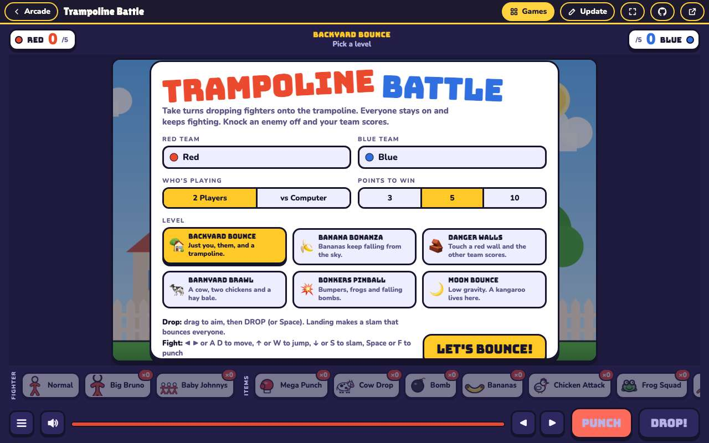 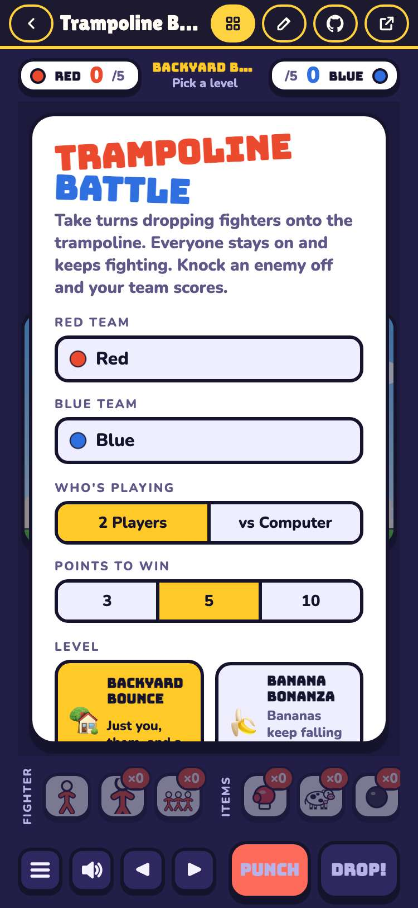

## 2. Princess Lady Drive: its card plays the frozen jeremy.v1 in the arcade, from its start screen

- desktop: frame: games/princess-lady-drive/jeremy.v1/; start screen shown, then started; outside: fonts.googleapis.com, fonts.gstatic.com; no console errors
- phone: frame: games/princess-lady-drive/jeremy.v1/; start screen shown, then started; outside: fonts.googleapis.com, fonts.gstatic.com; no console errors

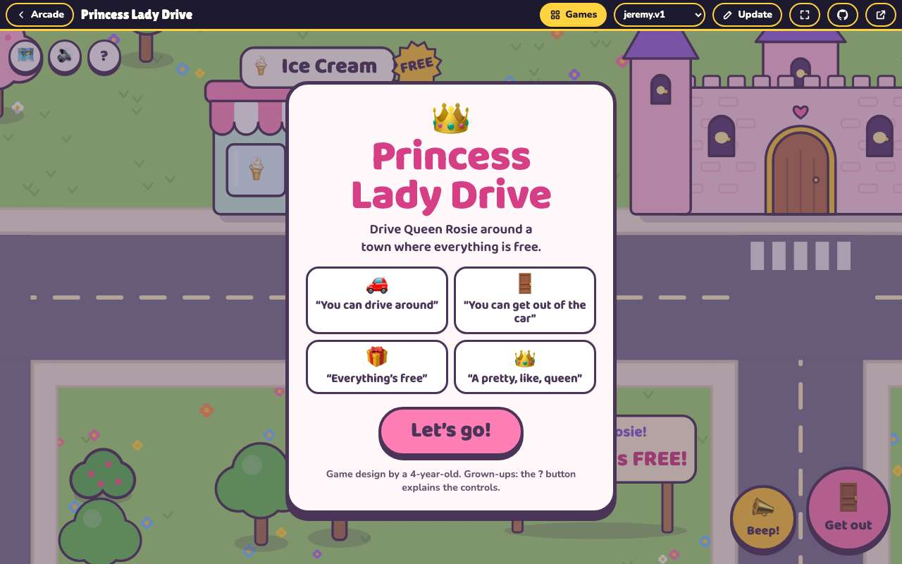 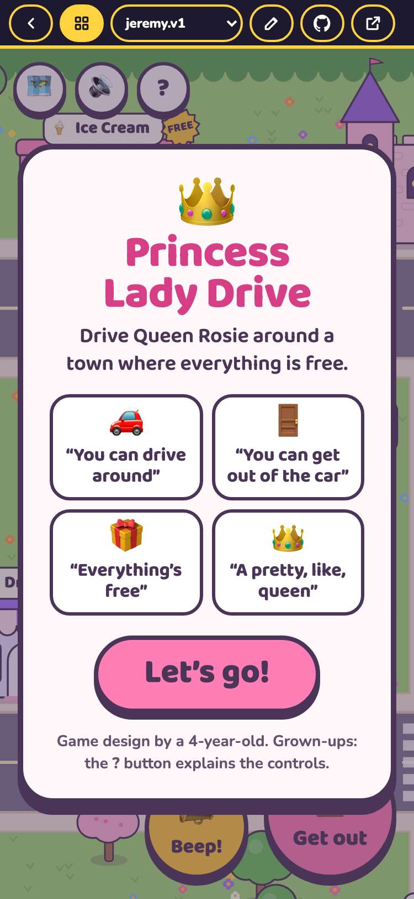

## 3. Stretcher Bearer: its card plays the frozen jeremy.v1 in the arcade, from its start screen

- desktop: frame: games/stretcher-bearer/jeremy.v1/; start screen shown, then started; outside: fonts.googleapis.com, fonts.gstatic.com; no console errors
- phone: frame: games/stretcher-bearer/jeremy.v1/; start screen shown, then started; outside: fonts.googleapis.com, fonts.gstatic.com; no console errors

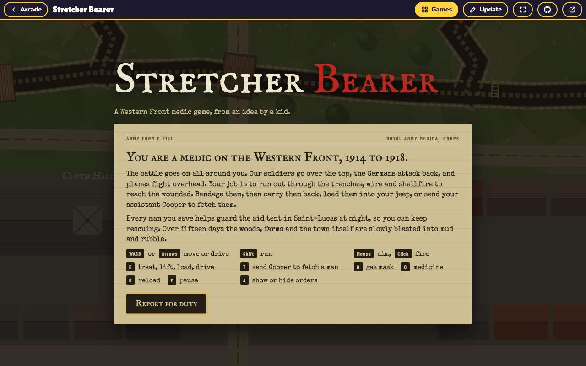 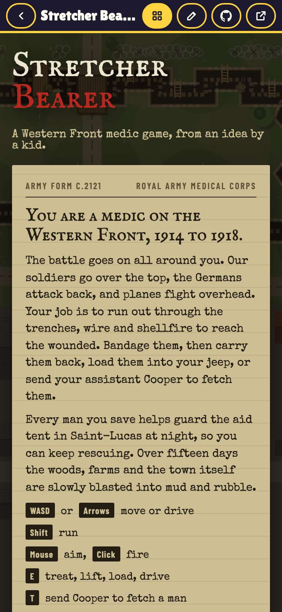

## 4. Angry Dudes: its card plays the frozen jeremy.v1 in the arcade, from its start screen

- desktop: frame: games/angry-dudes/jeremy.v1/; start screen shown, then started; outside: fonts.googleapis.com, fonts.gstatic.com, cdnjs.cloudflare.com; no console errors
- phone: frame: games/angry-dudes/jeremy.v1/; start screen shown, then started; outside: fonts.googleapis.com, fonts.gstatic.com, cdnjs.cloudflare.com; no console errors

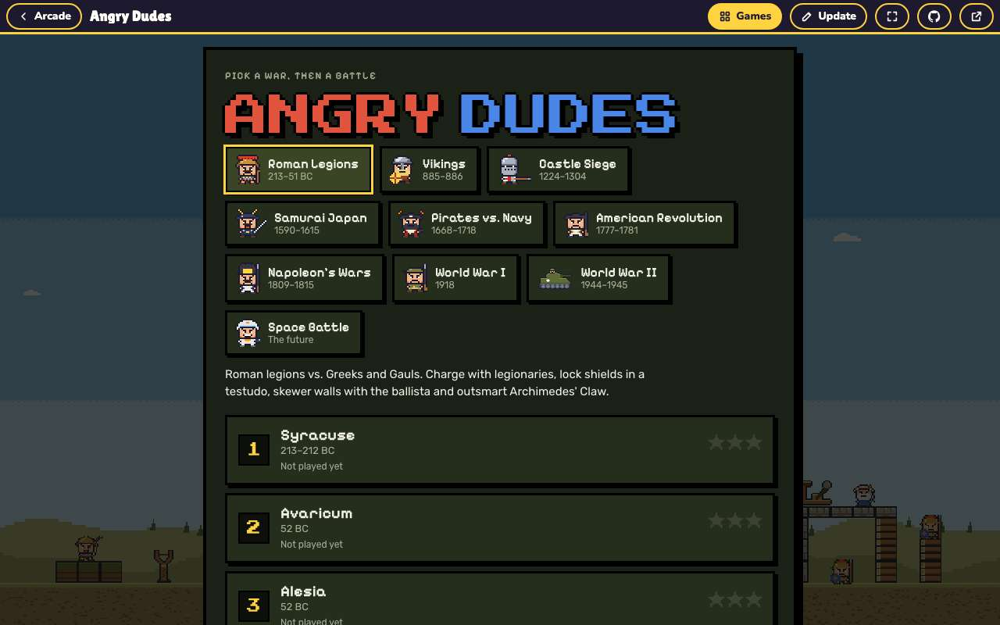 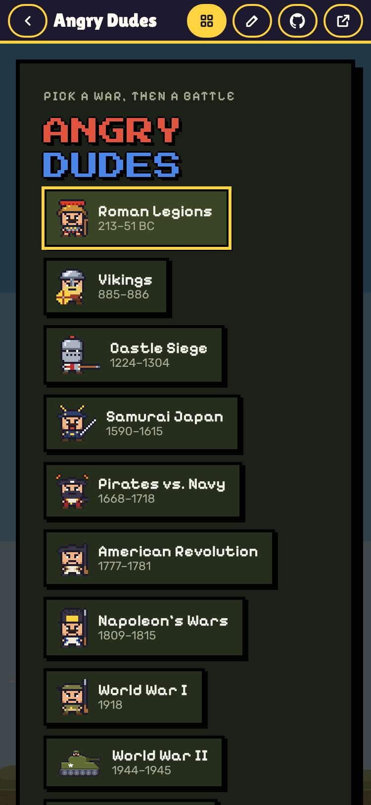

## 5. Magic Friends, Up We Go!: its card plays the frozen jeremy.v1 in the arcade, from its start screen

- desktop: frame: games/magic-friends/jeremy.v1/; start screen shown, then started; outside: fonts.googleapis.com, fonts.gstatic.com; no console errors
- phone: frame: games/magic-friends/jeremy.v1/; start screen shown, then started; outside: fonts.googleapis.com, fonts.gstatic.com; no console errors

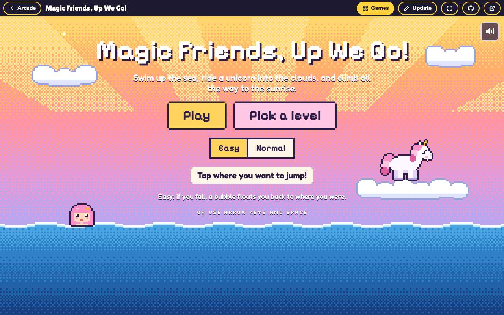 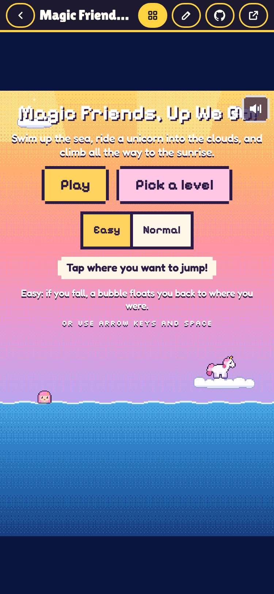

## 6. Timed Out: its card plays the frozen jeremy.v1 in the arcade, from its start screen

- desktop: frame: games/timedout/jeremy.v1/; start screen shown; outside: fonts.googleapis.com, fonts.gstatic.com; no console errors
- phone: frame: games/timedout/jeremy.v1/; start screen shown; outside: fonts.googleapis.com, fonts.gstatic.com; no console errors

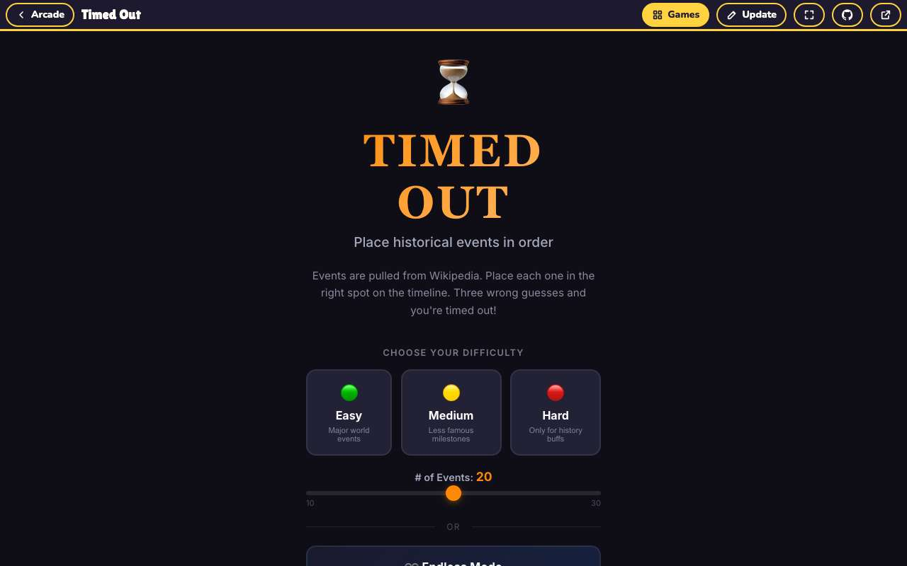 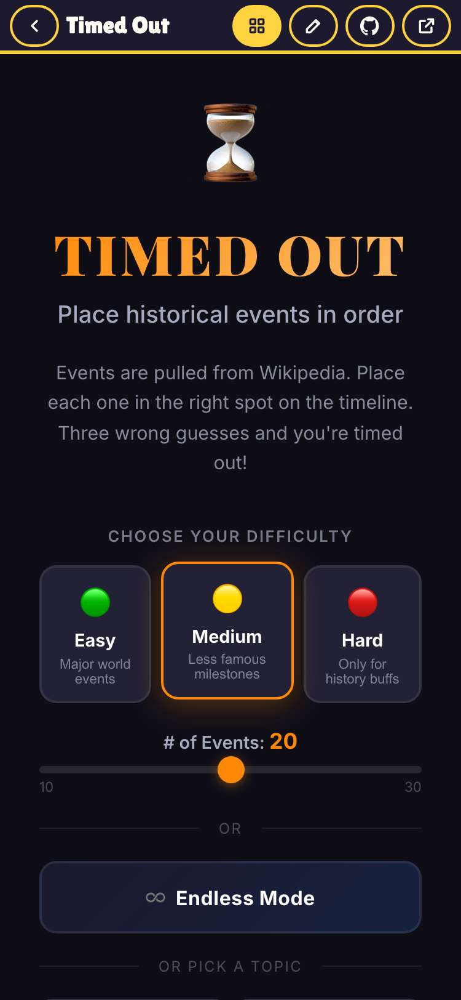

## 7. Trampoline Battle: saves from the original load, and it saves under the same keys

- desktop: seeded tb2-settings → names Rocket and Bean, vs Computer; keys after a short play: tb2-settings
- phone: seeded tb2-settings → names Rocket and Bean, vs Computer; keys after a short play: tb2-settings

## 8. Princess Lady Drive: saves from the original load, and it saves under the same keys

- desktop: seeded princess-lady-drive:v2 → sound off; keys after a short play: princess-lady-drive:v2
- phone: seeded princess-lady-drive:v2 → sound off; keys after a short play: princess-lady-drive:v2

## 9. Stretcher Bearer: saves from the original load, and it saves under the same keys

- desktop: seeded sb-best → best 4321, day 7; keys after a short play: sb-best
- phone: seeded sb-best → best 4321, day 7; keys after a short play: sb-best

## 10. Angry Dudes: saves from the original load, and it saves under the same keys

- desktop: seeded angrydudes.pack → Vikings pack picked; keys after a short play: angrydudes.pack
- phone: seeded angrydudes.pack → Vikings pack picked; keys after a short play: angrydudes.pack

## 11. Magic Friends, Up We Go!: saves from the original load, and it saves under the same keys

- desktop: seeded mfuwg-muted → sound off; keys after a short play: mfuwg-muted
- phone: seeded mfuwg-muted → sound off; keys after a short play: mfuwg-muted

## 12. Timed Out: saves from the original load, and it saves under the same keys

- desktop: seeded dadMode → Dad Mode on; keys after a short play: dadMode
- phone: seeded dadMode → Dad Mode on; keys after a short play: dadMode

## 13. Princess Lady Drive still offers jeremy.v2 (the default) and jeremy.v1

- desktop: picker: jeremy.v2 (Latest), jeremy.v1; the version dropdown switches the frame to games/princess-lady-drive/jeremy.v1/
- phone: picker: jeremy.v2 (Latest), jeremy.v1; the version dropdown switches the frame to games/princess-lady-drive/jeremy.v1/

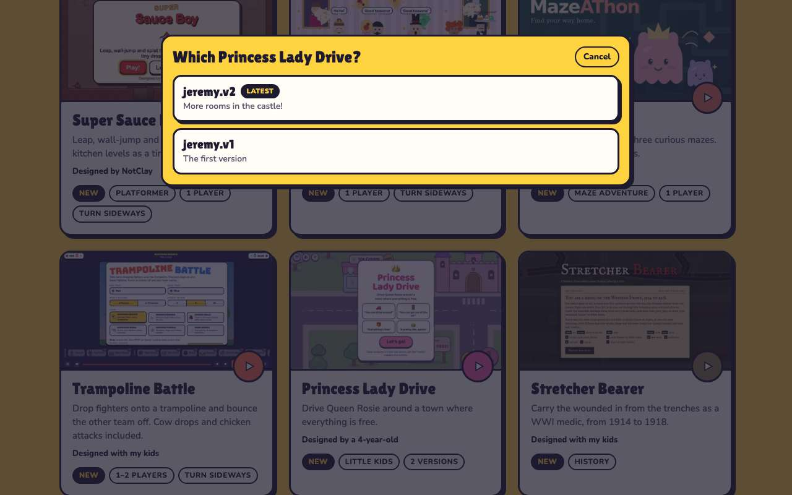 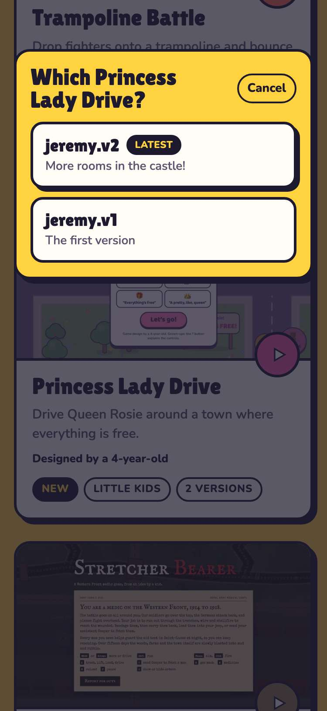

## 14. every version in games.json is served from this repo, and the six record their source

- desktop: trampoline-battle ← jwildfire/trampoline-battle@669e7fe; princess-lady-drive ← jwildfire/princess-lady-drive@43a8292; stretcher-bearer ← jwildfire/stretcher-bearer@6c2401c; angry-dudes ← jwildfire/angry-dudes@f20ad5e; magic-friends ← jwildfire/magic-friends@821dc27; timedout ← jwildfire/timedout@3326116
- phone: trampoline-battle ← jwildfire/trampoline-battle@669e7fe; princess-lady-drive ← jwildfire/princess-lady-drive@43a8292; stretcher-bearer ← jwildfire/stretcher-bearer@6c2401c; angry-dudes ← jwildfire/angry-dudes@f20ad5e; magic-friends ← jwildfire/magic-friends@821dc27; timedout ← jwildfire/timedout@3326116
