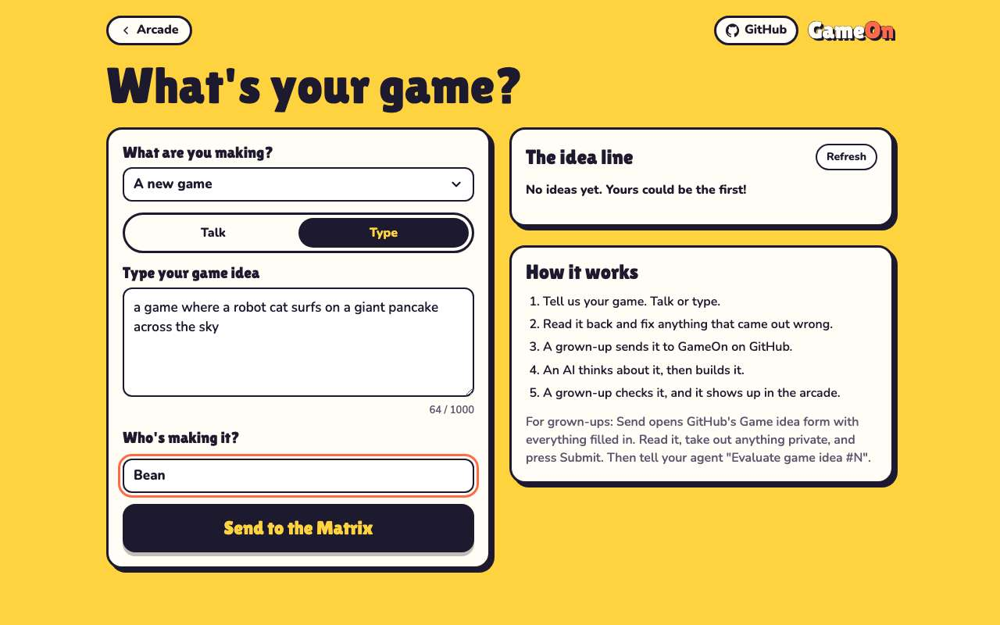
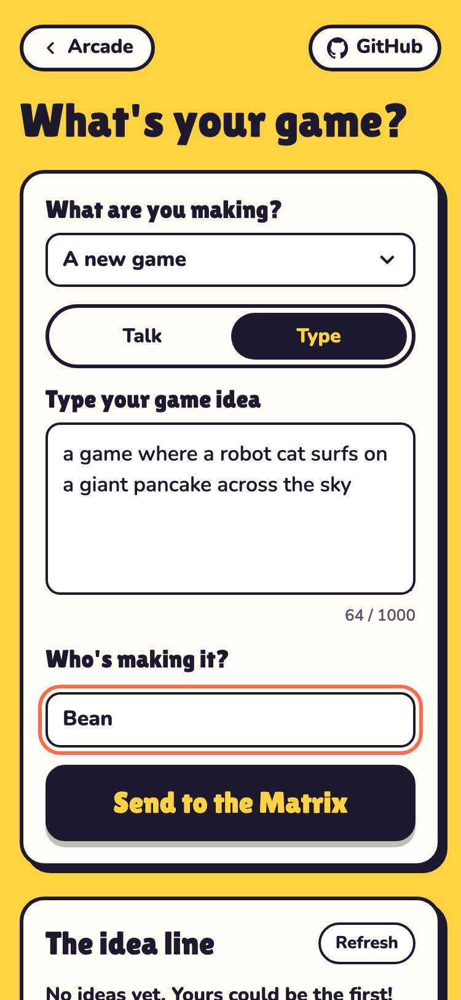
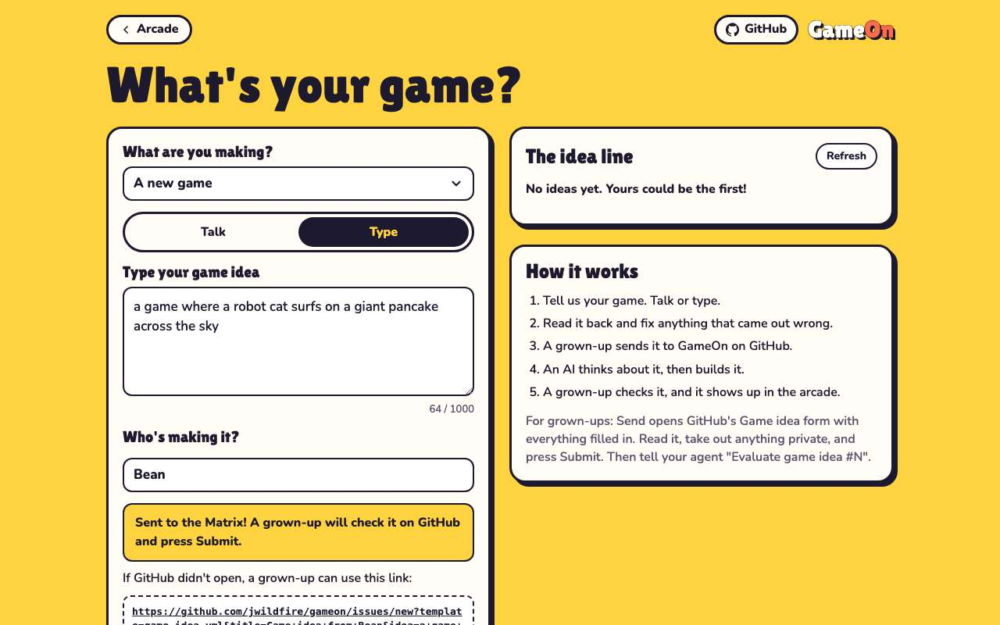
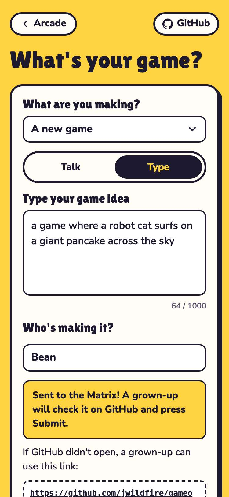

# Evidence: 125-send-to-the-matrix

**PASS: 1 of 1 checks pass at desktop and phone widths.**

Generated by `npm run evidence -- 125-send-to-the-matrix` from [`tests/evidence/125-send-to-the-matrix.spec.mjs`](../../tests/evidence/125-send-to-the-matrix.spec.mjs) against the local server (python3 -m http.server) on this branch, starting from commit e30d105, 2026-10-24 03:46 UTC. Rules: [docs/evidence.md](../../docs/evidence.md).

| Check | Desktop 1280 | Phone 375 |
|---|---|---|
| the Send button says Send to the Matrix and still sends | pass | pass |

## 1. the Send button says Send to the Matrix and still sends

- desktop: button reads Send to the Matrix; the GitHub hand-off is unchanged
- phone: button reads Send to the Matrix; the GitHub hand-off is unchanged

 

 
