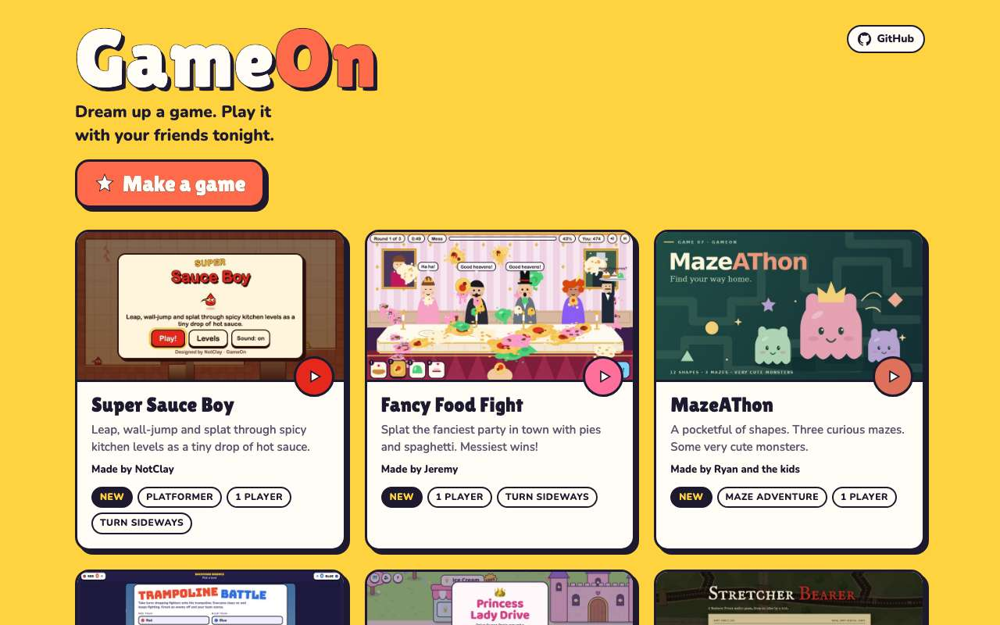
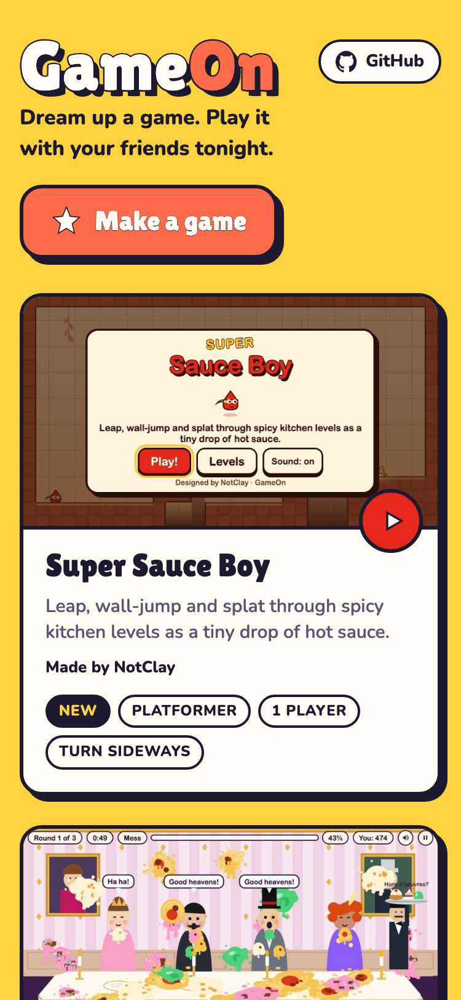
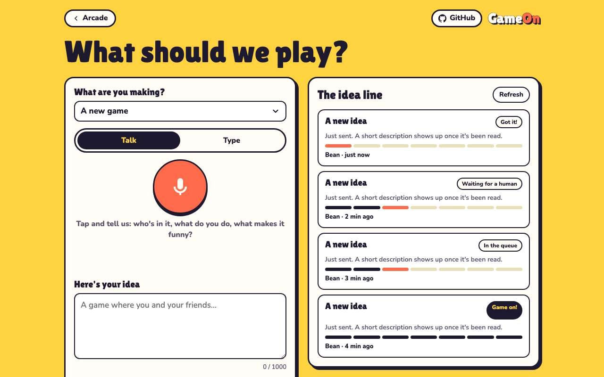
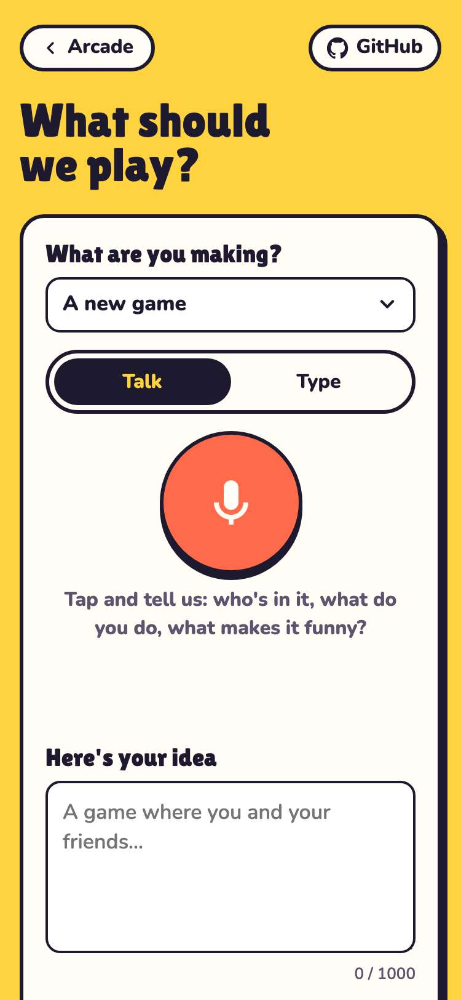

# Evidence: 129-tone

**PASS: 2 of 2 checks pass at desktop and phone widths.**

Generated by `npm run evidence -- 129-tone` from [`tests/evidence/129-tone.spec.mjs`](../../tests/evidence/129-tone.spec.mjs) against the local server (python3 -m http.server) on this branch, starting from commit 910e8af, 2026-10-24 04:30 UTC. Rules: [docs/evidence.md](../../docs/evidence.md).

| Check | Desktop 1280 | Phone 375 |
|---|---|---|
| the arcade reads as Game Night: tagline, button, credits, footer | pass | pass |
| the New Game page reads as Game Night, statuses included | pass | pass |

## 1. the arcade reads as Game Night: tagline, button, credits, footer

- desktop: 9 cards, every credit reads "Made by …"
- phone: 9 cards, every credit reads "Made by …"

 

## 2. the New Game page reads as Game Night, statuses included

- desktop: statuses: Got it!, Waiting for a human, In the queue, Game on!
- phone: statuses: Got it!, Waiting for a human, In the queue, Game on!

 
