# Evidence: 130-gamepad-arcade

**PASS: 3 of 3 checks pass at desktop and phone widths.**

Generated by `npm run evidence -- 130-gamepad-arcade` from [`tests/evidence/130-gamepad-arcade.spec.mjs`](../../tests/evidence/130-gamepad-arcade.spec.mjs) against the local server (python3 -m http.server) on this branch, starting from commit 564e50b, 2026-10-29 15:30 UTC. Rules: [docs/evidence.md](../../docs/evidence.md).

| Check | Desktop 1280 | Phone 375 |
|---|---|---|
| the hints and focus ring show only once a controller is connected | pass | pass |
| with only a controller you can pick a game, pick a version, play, switch games and come back | pass | pass |
| B backs out of each menu, and touch still works with a controller connected | pass | pass |

## 1. the hints and focus ring show only once a controller is connected

- desktop: connected: hints show "Move · A Play"; right on the D-pad moves the ring from MazeAThon to Trampoline Battle
- desktop: disconnected: hints and ring gone
- phone: connected: hints show "A Play" (phones leave out Move); down on the D-pad moves the ring from MazeAThon to Trampoline Battle
- phone: disconnected: hints and ring gone

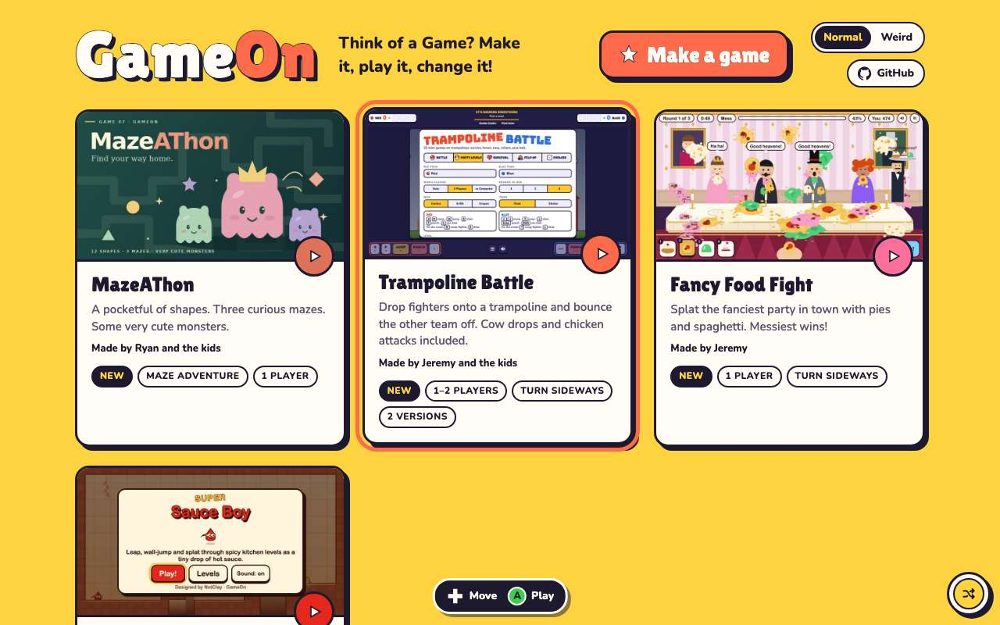 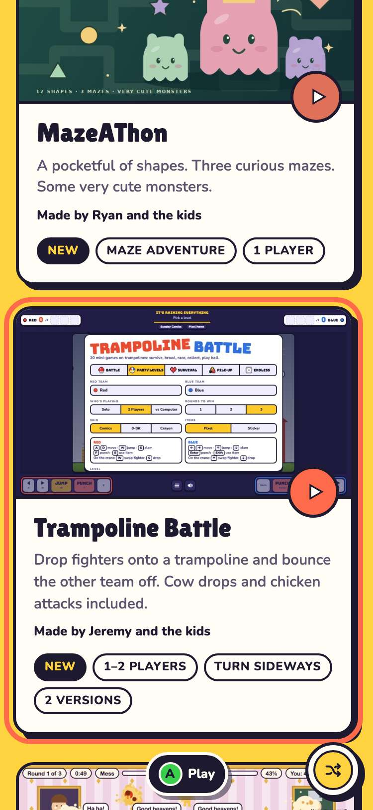

## 2. with only a controller you can pick a game, pick a version, play, switch games and come back

- desktop: A on Trampoline Battle opens Which version?; Down, A plays jeremy.v1
- desktop: in the game, A A B Y reach the game (it counts 2 A presses) and the arcade does nothing
- desktop: Start+Select, Right, Right, A on the version menu, Up, A switches to jeremy.v2
- desktop: Start+Select, Y, Left, A switches to MazeAThon
- desktop: Start+Select, A goes back to the arcade, with the ring on MazeAThon
- phone: A on Trampoline Battle opens Which version?; Down, A plays jeremy.v1
- phone: in the game, A A B Y reach the game (it counts 2 A presses) and the arcade does nothing
- phone: Start+Select, Right, Right, A on the version menu, Up, A switches to jeremy.v2
- phone: Start+Select, Y, Left, A switches to MazeAThon
- phone: Start+Select, A goes back to the arcade, with the ring on MazeAThon

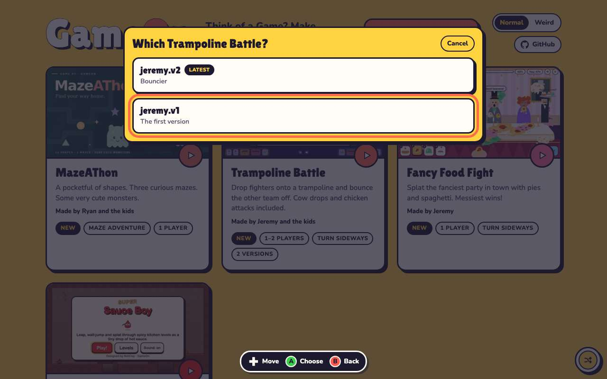 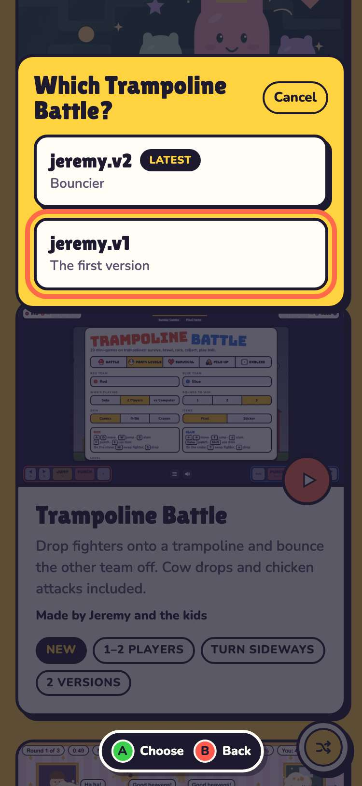

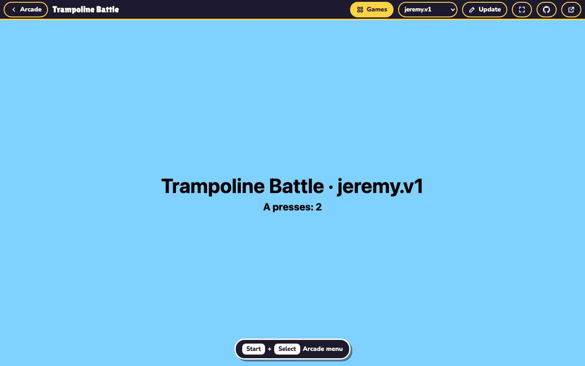 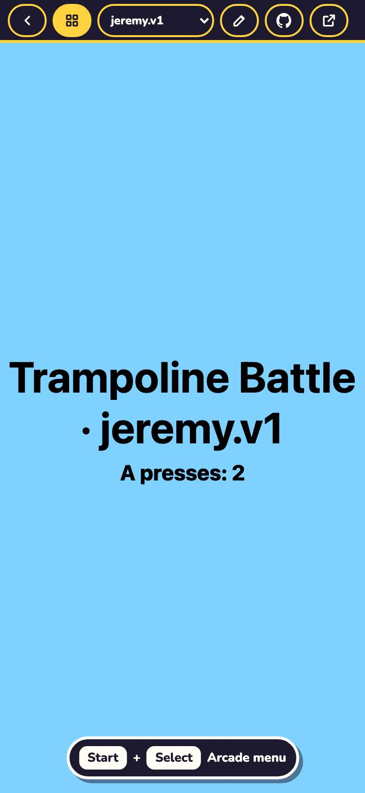

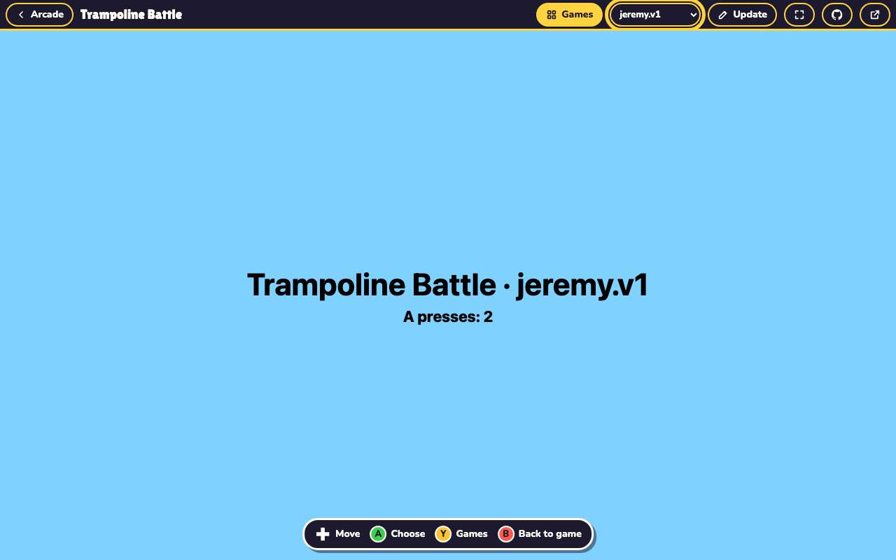 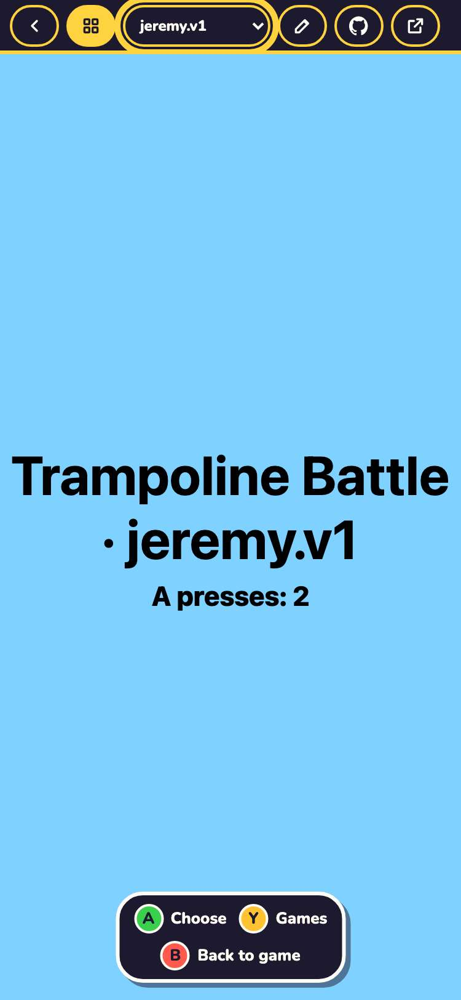

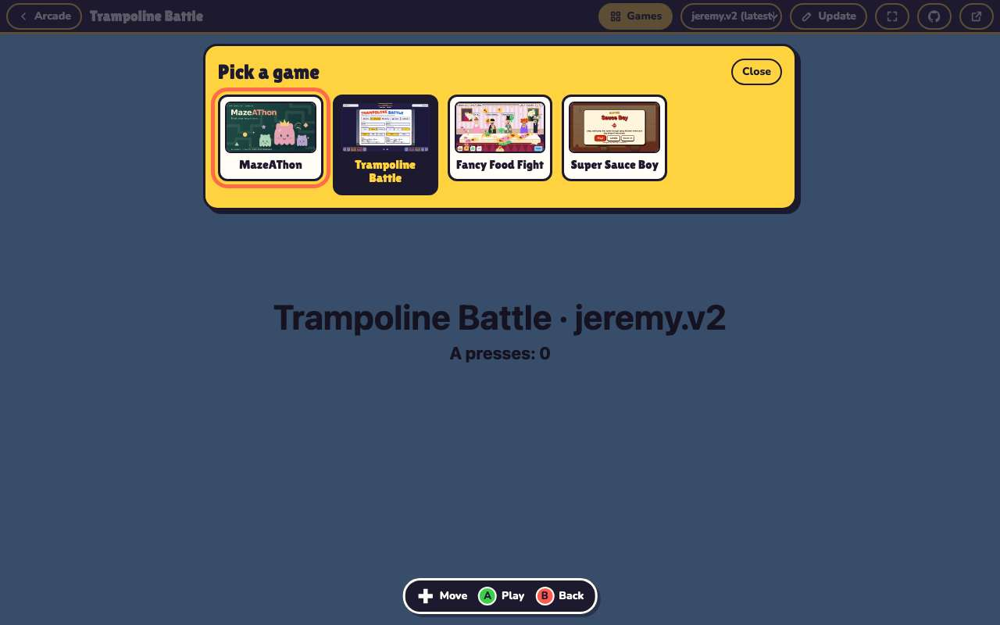 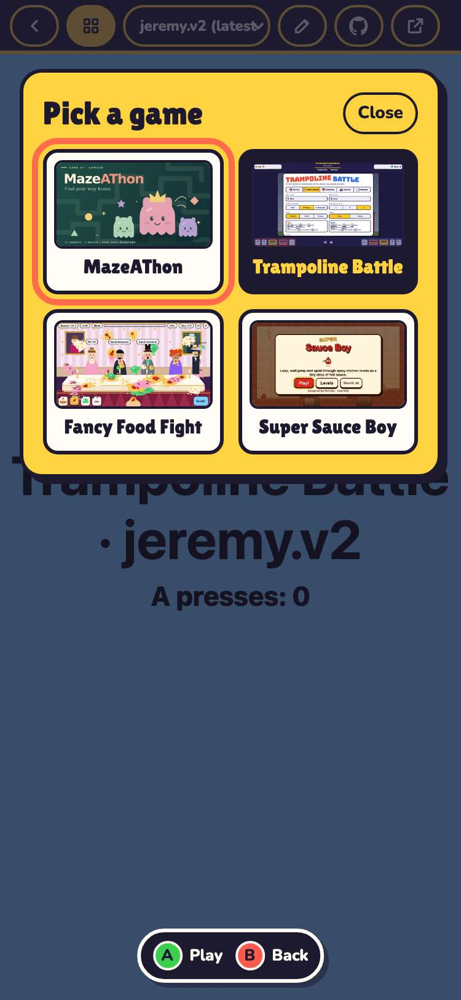

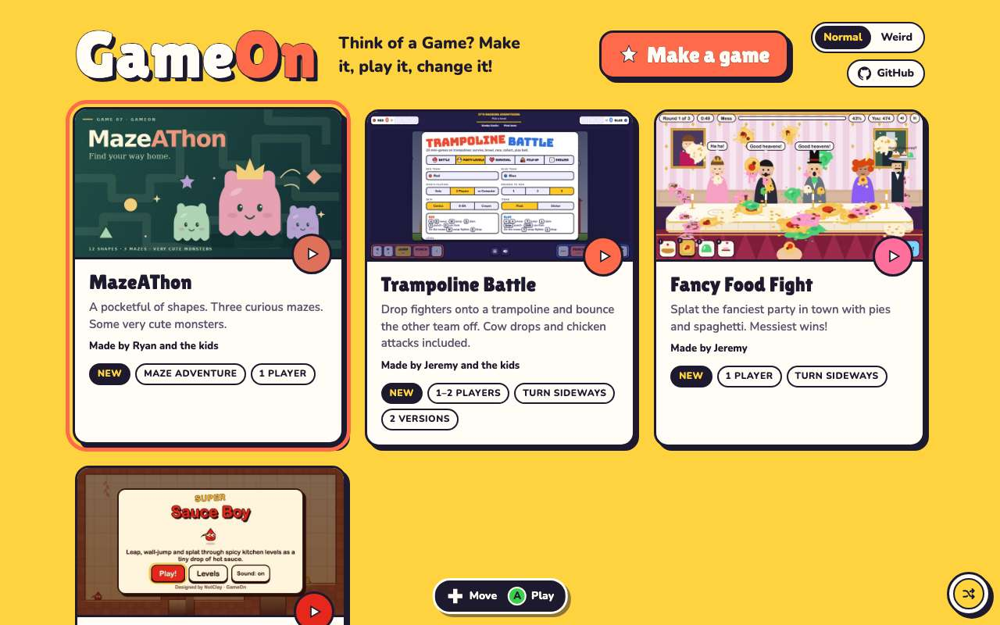 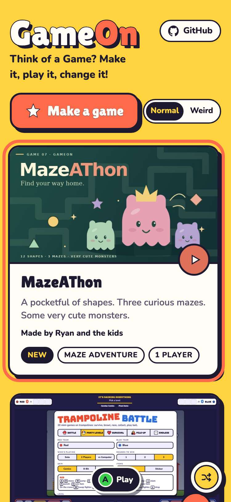

## 3. B backs out of each menu, and touch still works with a controller connected

- desktop: B in the version chooser goes back to the shelf
- desktop: B in the bar goes back to the game, which has focus again
- desktop: B in the switcher goes back to the game
- desktop: tapping Games, a game and Arcade still works with a controller connected
- phone: B in the version chooser goes back to the shelf
- phone: B in the bar goes back to the game, which has focus again
- phone: B in the switcher goes back to the game
- phone: tapping Games, a game and Arcade still works with a controller connected
