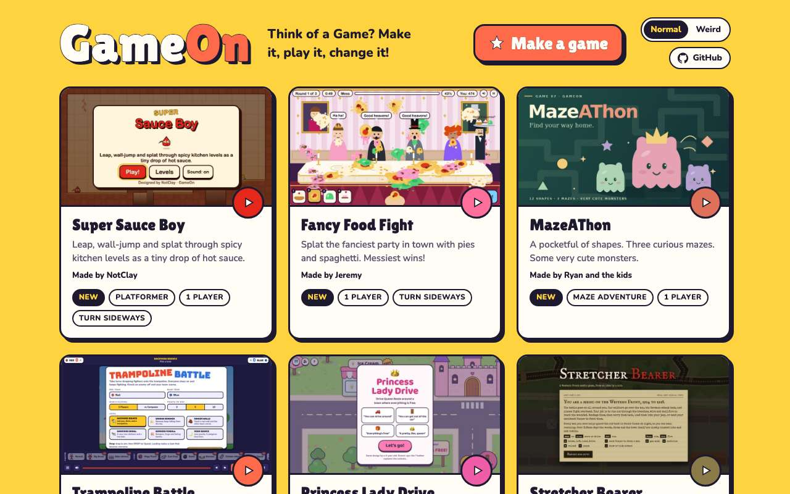
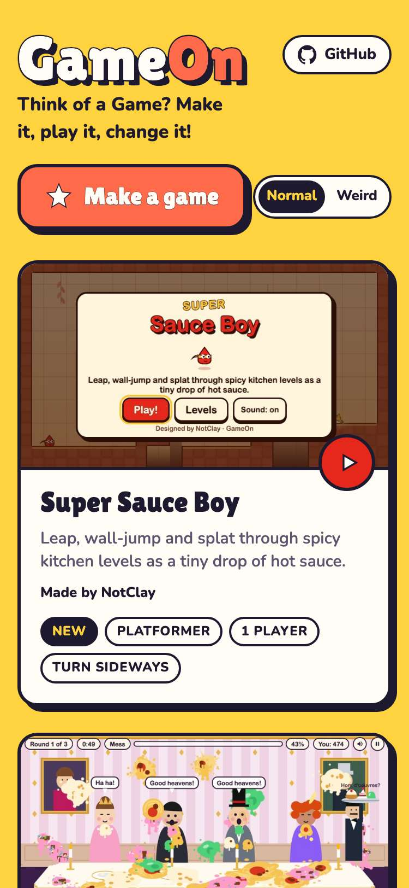
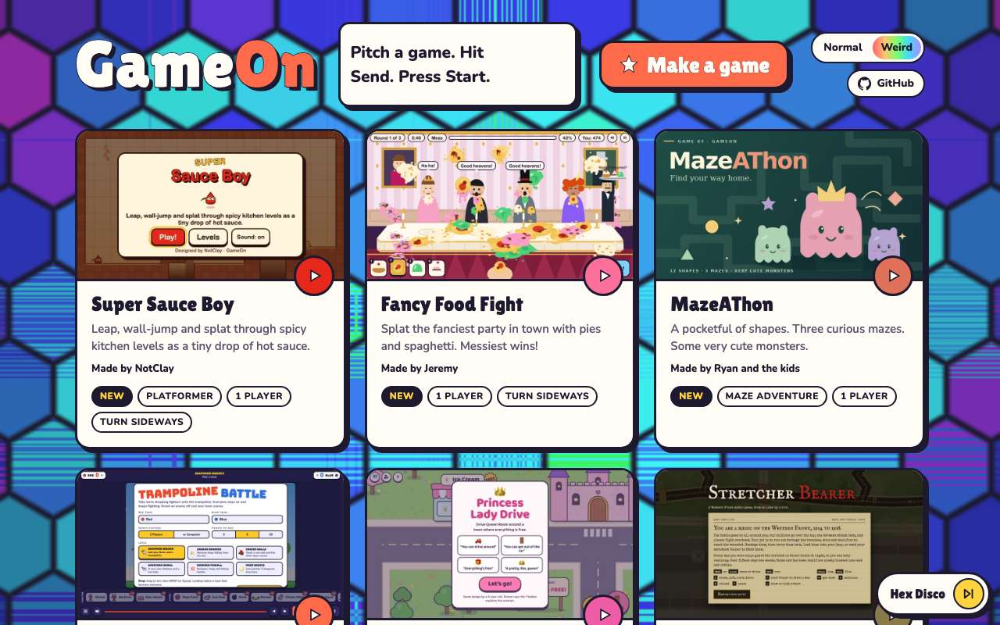
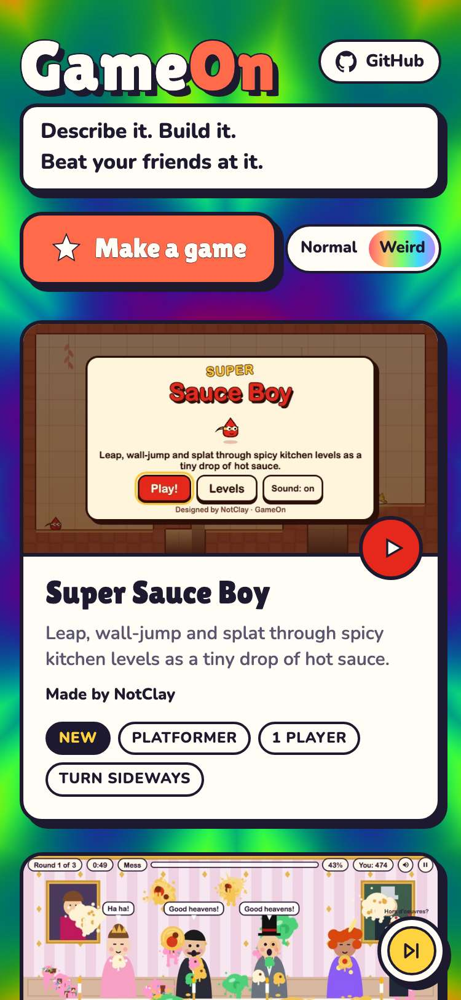
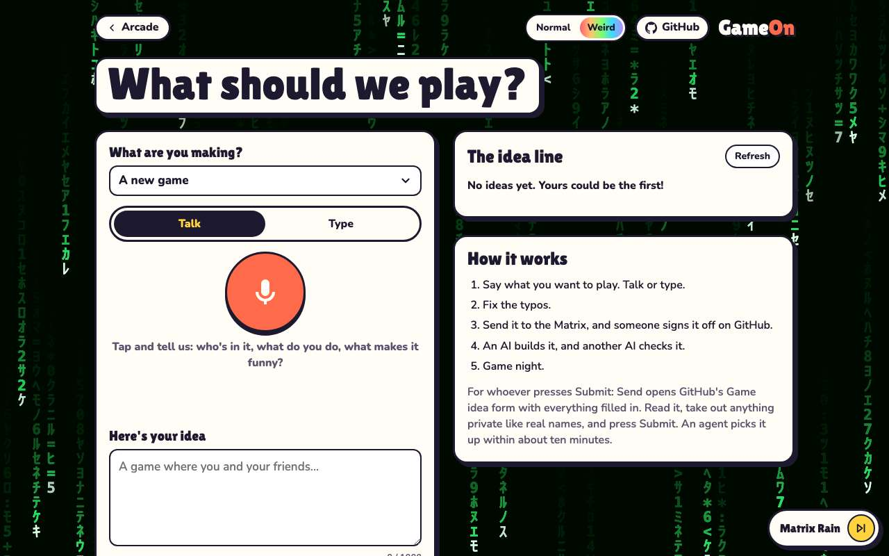
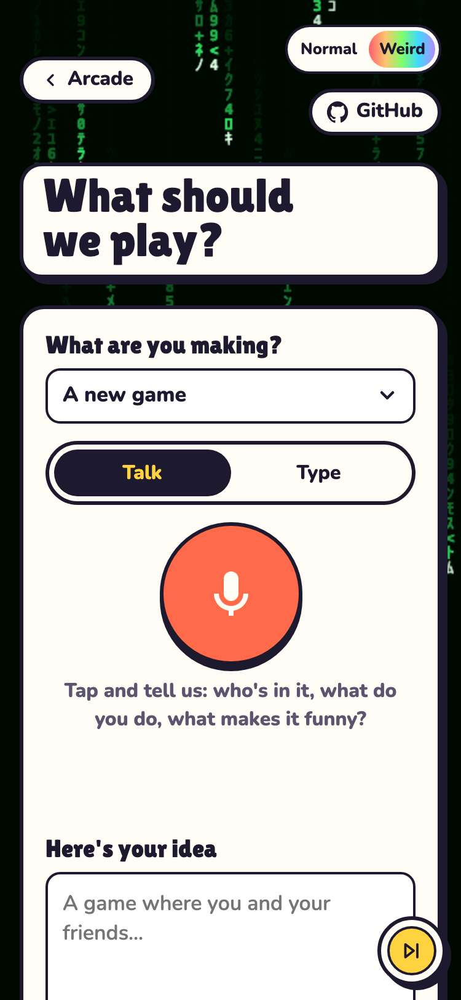
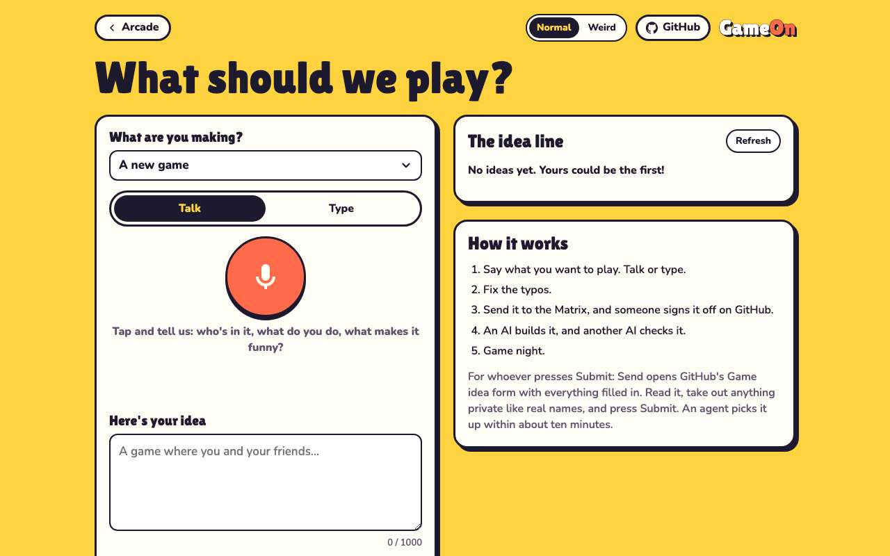
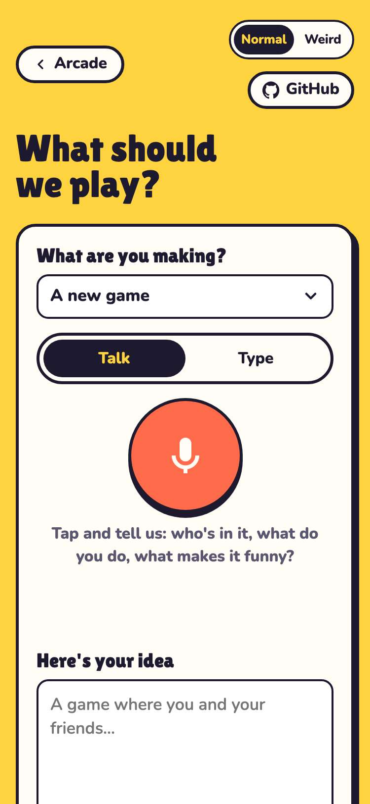

# Evidence: 134-trippy-backgrounds

**PASS: 9 of 9 checks pass at desktop and phone widths.**

Generated by `npm run evidence -- 134-trippy-backgrounds` from [`tests/evidence/134-trippy-backgrounds.spec.mjs`](../../tests/evidence/134-trippy-backgrounds.spec.mjs) against the local server (python3 -m http.server) on this branch, starting from commit 159e1bf, 2026-10-24 05:07 UTC. Rules: [docs/evidence.md](../../docs/evidence.md).

| Check | Desktop 1280 | Phone 375 |
|---|---|---|
| the default is Normal: the yellow wall, the fixed tagline, nothing drawing | pass | pass |
| switching to Weird starts the backgrounds and rotating taglines, no reload | pass | pass |
| Weird survives a reload and carries to the New Game page | pass | pass |
| switching back to Normal stops everything | pass | pass |
| in Weird mode the cycle crossfades to the next background by itself | pass | pass |
| the skip button changes the background | pass | pass |
| reduced motion in Weird mode gets a still frame and one tagline | pass | pass |
| the background pauses and the skip button hides while a game plays | pass | pass |
| each of the ten Weird picks behind the arcade | pass | pass |

## 1. the default is Normal: the yellow wall, the fixed tagline, nothing drawing

- desktop: Normal: wall #ffd23f, no frames drawn in 7 s, tagline held on "Think of a Game? Make it, play it, change it!"
- phone: Normal: wall #ffd23f, no frames drawn in 7 s, tagline held on "Think of a Game? Make it, play it, change it!"

 

## 2. switching to Weird starts the backgrounds and rotating taglines, no reload

- desktop: Weird: hex-disco on a 1280x800 canvas (548 colours), about 61 fps; tagline moved on from "Thought up by people. Built by robots. Played by everyone."
- phone: Weird: kaleidoscope on a 375x812 canvas (399 colours), about 30 fps; tagline moved on from "Your idea. Our robots. Everyone's controller."

 

## 3. Weird survives a reload and carries to the New Game page

- desktop: after a reload: Weird; New Game page: Weird, showing matrix-rain
- phone: after a reload: Weird; New Game page: Weird, showing matrix-rain

 

## 4. switching back to Normal stops everything

- desktop: Normal again: canvas hidden, no frames in 7 s, fixed tagline, and the New Game page follows
- phone: Normal again: canvas hidden, no frames in 7 s, fixed tagline, and the New Game page follows

 

## 5. in Weird mode the cycle crossfades to the next background by itself

- desktop: rainbow-tunnel moved on to retro-sun (interval shortened to 2 s with ?bgInterval=2; normally 30 to 45 s)
- phone: rainbow-plasma moved on to matrix-rain (interval shortened to 2 s with ?bgInterval=2; normally 30 to 45 s)

## 6. the skip button changes the background

- desktop: skip: liquid-marble → warp-speed
- phone: skip: retro-sun → rainbow-plasma

 

## 7. reduced motion in Weird mode gets a still frame and one tagline

- desktop: still frame of retro-sun: no frames and the same pixels and tagline ("Ideas welcome. Controllers recommended.") for 7 s
- phone: still frame of rainbow-rain: no frames and the same pixels and tagline ("Remix any game. Make it yours.") for 7 s

 

## 8. the background pauses and the skip button hides while a game plays

- desktop: playing Super Sauce Boy: paused, no frames drawn in 1.2 s, skip hidden; back home it runs again
- phone: playing Super Sauce Boy: paused, no frames drawn in 1.2 s, skip hidden; back home it runs again

## 9. each of the ten Weird picks behind the arcade

- desktop: rainbow-plasma, matrix-rain, kaleidoscope, lava-lamp, rainbow-rain, hex-disco, liquid-marble, warp-speed, rainbow-tunnel, retro-sun
- phone: rainbow-plasma, matrix-rain, kaleidoscope, lava-lamp, rainbow-rain, hex-disco, liquid-marble, warp-speed, rainbow-tunnel, retro-sun

 

 

 

 

 

 

 

 

 

 
