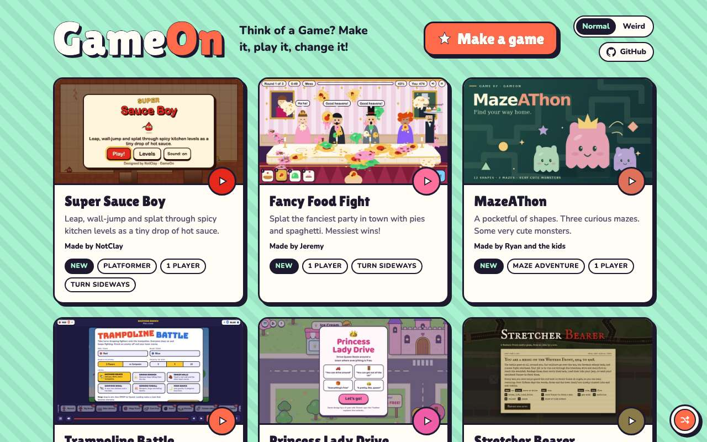
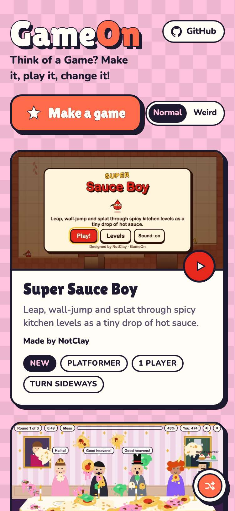
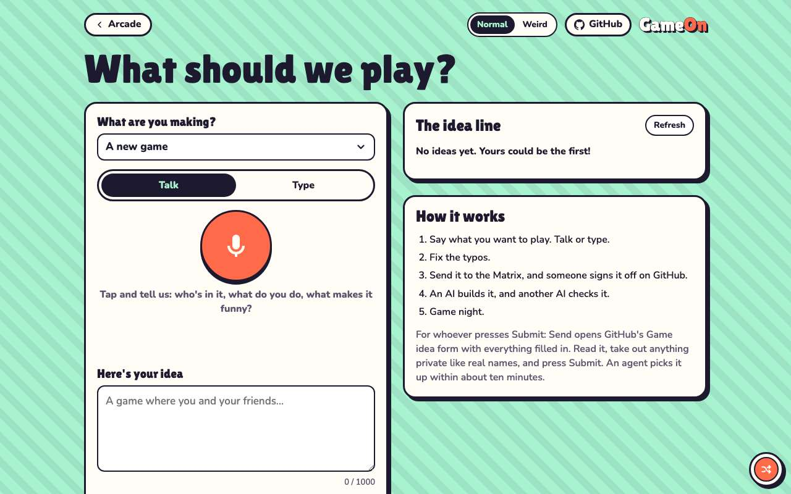
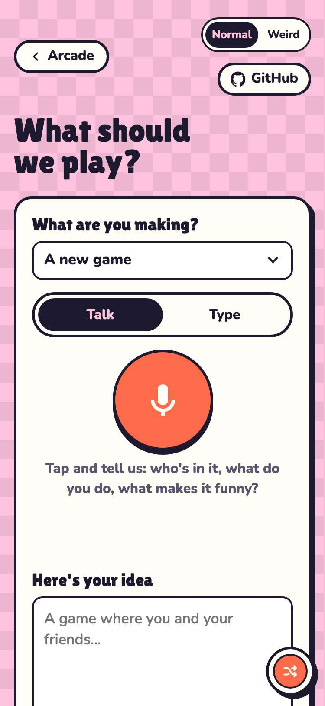
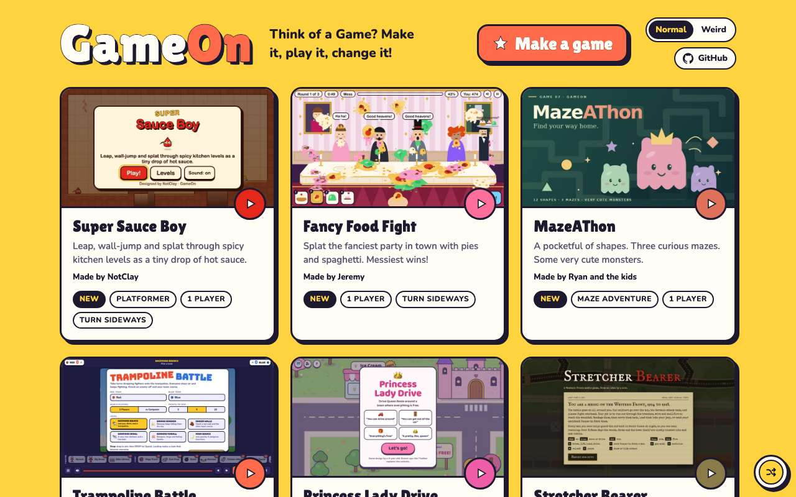
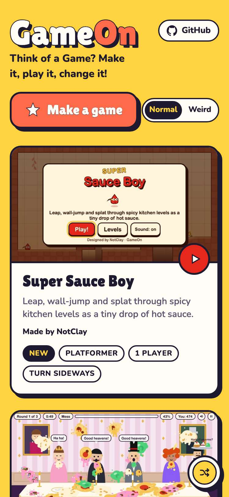

# Evidence: 138-shuffle

**PASS: 4 of 4 checks pass at desktop and phone widths.**

Generated by `npm run evidence -- 138-shuffle` from [`tests/evidence/138-shuffle.spec.mjs`](../../tests/evidence/138-shuffle.spec.mjs) against the local server (python3 -m http.server) on this branch, starting from commit 211b59e, 2026-10-24 05:33 UTC. Rules: [docs/evidence.md](../../docs/evidence.md).

| Check | Desktop 1280 | Phone 375 |
|---|---|---|
| in Normal, shuffle changes the wall, and the pick sticks and follows to the New Game page | pass | pass |
| every wall is light enough for the dark text (contrast at least 7:1) | pass | pass |
| in Weird, shuffle moves to the next background | pass | pass |
| Shuffle sits in the bottom-right corner, on screen, and hides while a game plays | pass | pass |

## 1. in Normal, shuffle changes the wall, and the pick sticks and follows to the New Game page

- desktop: sunny → mint-stripes; kept after a reload and on the New Game page
- phone: sunny → bubblegum-checks; kept after a reload and on the New Game page

 

 

## 2. every wall is light enough for the dark text (contrast at least 7:1)

- desktop: 12 walls, all at least 7:1 against the dark text
- phone: 12 walls, all at least 7:1 against the dark text

## 3. in Weird, shuffle moves to the next background

- desktop: warp-speed → matrix-rain
- phone: retro-sun → lava-lamp

## 4. Shuffle sits in the bottom-right corner, on screen, and hides while a game plays

- desktop: 1280px: Shuffle in the bottom-right corner, everything on screen, hidden in the game player
- phone: 375px: Shuffle in the bottom-right corner, everything on screen, hidden in the game player

 
