# Evidence: 139-trampoline-battle-jeremy-v2

**PASS: 8 of 8 checks pass at desktop and phone widths.**

Generated by `npm run evidence -- 139-trampoline-battle-jeremy-v2` from [`tests/evidence/139-trampoline-battle-jeremy-v2.spec.mjs`](../../tests/evidence/139-trampoline-battle-jeremy-v2.spec.mjs) against the local server (python3 -m http.server) on this branch, starting from commit bcc458c, 2026-10-24 05:39 UTC. Rules: [docs/evidence.md](../../docs/evidence.md).

| Check | Desktop 1280 | Phone 375 |
|---|---|---|
| jeremy.v2 is the repo at bdc9ea6: same files, byte for byte, except what the copy leaves out | pass | pass |
| jeremy.v2 opens to its title screen and starts, with no new outside requests | pass | pass |
| what's new works: five modes, Survival starts, the skin switches to 8-Bit Arcade, and the level ideas page opens | pass | pass |
| what stays still works: Battle drops a fighter and fights, and Esc goes back to the menu | pass | pass |
| saves: a jeremy.v1 save loads without errors and stays as it was, and the repo site's newer saves carry over | pass | pass |
| jeremy.v1 still plays from its folder | pass | pass |
| games.json makes jeremy.v2 the default, records its source, and still offers jeremy.v1 | pass | pass |
| the arcade plays jeremy.v2 by default, and the version picker offers jeremy.v1 | pass | pass |

## 1. jeremy.v2 is the repo at bdc9ea6: same files, byte for byte, except what the copy leaves out

- desktop: index.html and design/level-ideas.html match the repo's git blobs at bdc9ea6; README.md is the repo's plus the jeremy.v2 section; gameon.json added; .claude/launch.json left out; no path fixes needed
- phone: index.html and design/level-ideas.html match the repo's git blobs at bdc9ea6; README.md is the repo's plus the jeremy.v2 section; gameon.json added; .claude/launch.json left out; no path fixes needed

## 2. jeremy.v2 opens to its title screen and starts, with no new outside requests

- desktop: default game: Party Levels · round 1 · Survival (It's Raining Everything), timer at 97.1%; outside hosts: fonts.googleapis.com, fonts.gstatic.com (Google Fonts, as jeremy.v1)
- phone: default game: Party Levels · round 1 · Survival (It's Raining Everything), timer at 97.4%; outside hosts: fonts.googleapis.com, fonts.gstatic.com (Google Fonts, as jeremy.v1)

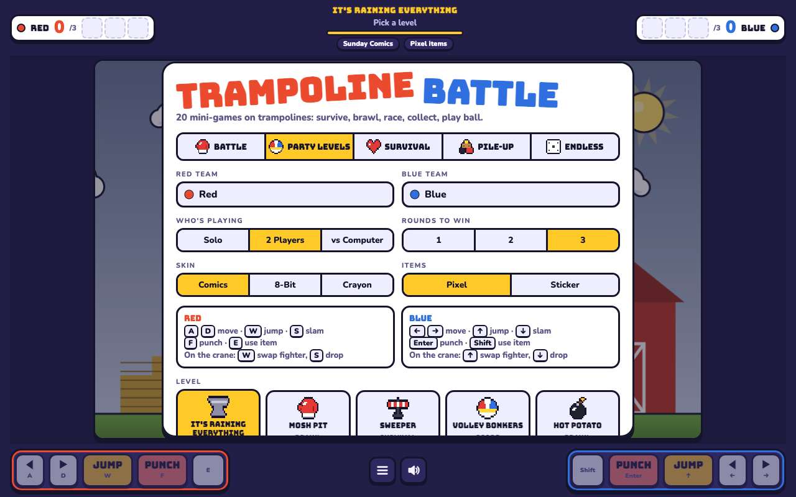 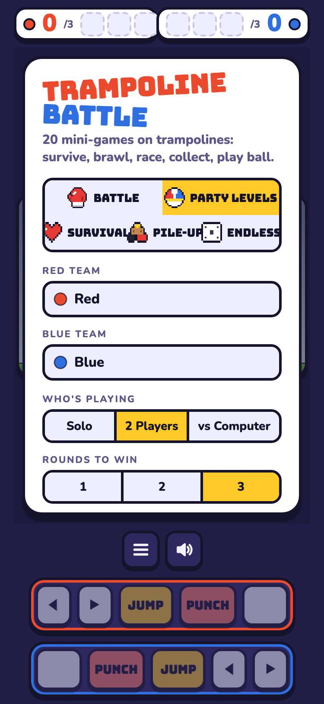

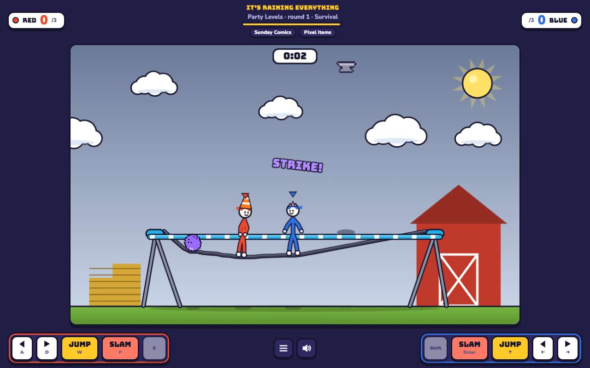 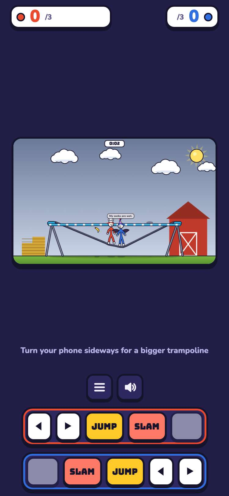

## 3. what's new works: five modes, Survival starts, the skin switches to 8-Bit Arcade, and the level ideas page opens

- desktop: modes: Battle, Party Levels, Survival, Pile-Up, Endless; Survival live in the 8-Bit Arcade skin; design/level-ideas.html loads
- phone: modes: Battle, Party Levels, Survival, Pile-Up, Endless; Survival live in the 8-Bit Arcade skin; design/level-ideas.html loads

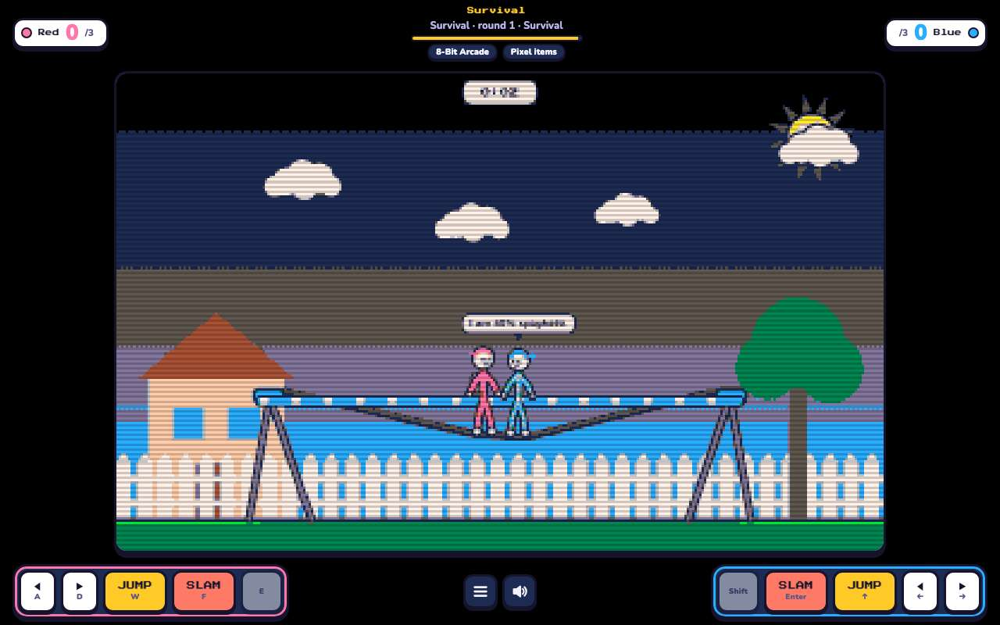 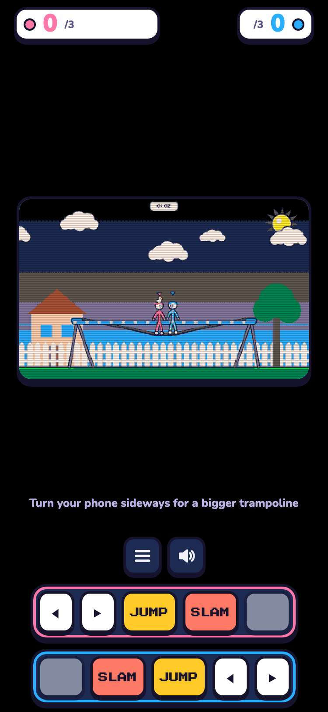

## 4. what stays still works: Battle drops a fighter and fights, and Esc goes back to the menu

- desktop: Battle: wave 1 aim → both teams drop → fight; Esc opens the menu (pause / start over)
- phone: Battle: wave 1 aim → both teams drop → fight; Esc opens the menu (pause / start over)

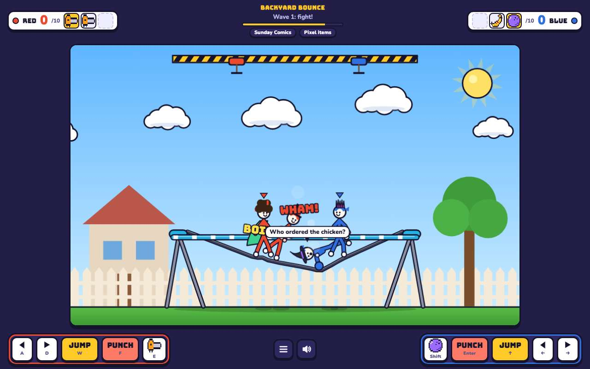 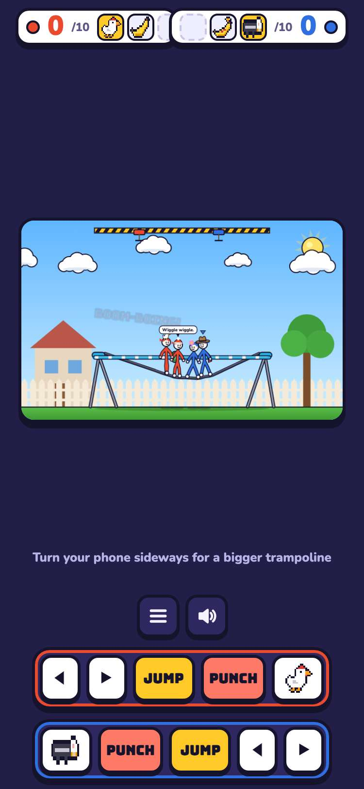

## 5. saves: a jeremy.v1 save loads without errors and stays as it was, and the repo site's newer saves carry over

- desktop: tb3-settings (Zoom, vs Computer, Battle, Crayon) loads in jeremy.v2 and saves target 5; tb2-settings untouched, and jeremy.v1 still shows Rocket, vs Computer. jeremy.v2 doesn't read tb2-settings (the repo's code), so a jeremy.v1 player starts jeremy.v2 with default settings
- phone: tb3-settings (Zoom, vs Computer, Battle, Crayon) loads in jeremy.v2 and saves target 5; tb2-settings untouched, and jeremy.v1 still shows Rocket, vs Computer. jeremy.v2 doesn't read tb2-settings (the repo's code), so a jeremy.v1 player starts jeremy.v2 with default settings

## 6. jeremy.v1 still plays from its folder

- desktop: games/trampoline-battle/jeremy.v1/ title screen, then started, no console errors
- phone: games/trampoline-battle/jeremy.v1/ title screen, then started, no console errors

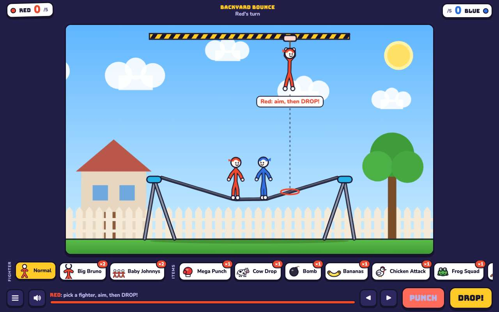 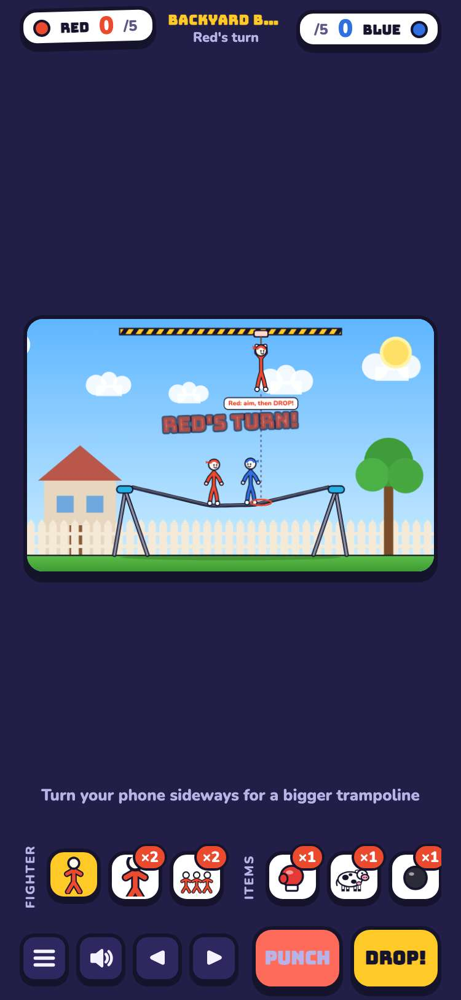

## 7. games.json makes jeremy.v2 the default, records its source, and still offers jeremy.v1

- desktop: default jeremy.v2; jeremy.v2 source jwildfire/trampoline-battle@bdc9ea6; jeremy.v1 still at games/trampoline-battle/jeremy.v1/
- phone: default jeremy.v2; jeremy.v2 source jwildfire/trampoline-battle@bdc9ea6; jeremy.v1 still at games/trampoline-battle/jeremy.v1/

## 8. the arcade plays jeremy.v2 by default, and the version picker offers jeremy.v1

- desktop: card → picker (jeremy.v2 Latest, jeremy.v1) → jeremy.v2 plays in the frame; #trampoline-battle@jeremy.v1 opens jeremy.v1
- phone: card → picker (jeremy.v2 Latest, jeremy.v1) → jeremy.v2 plays in the frame; #trampoline-battle@jeremy.v1 opens jeremy.v1

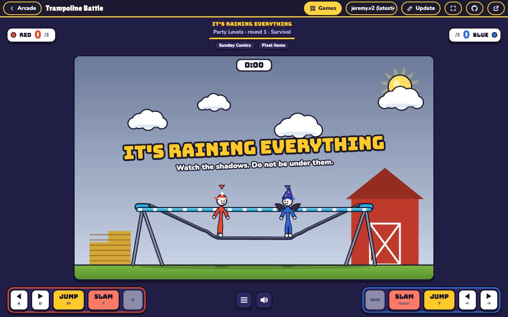 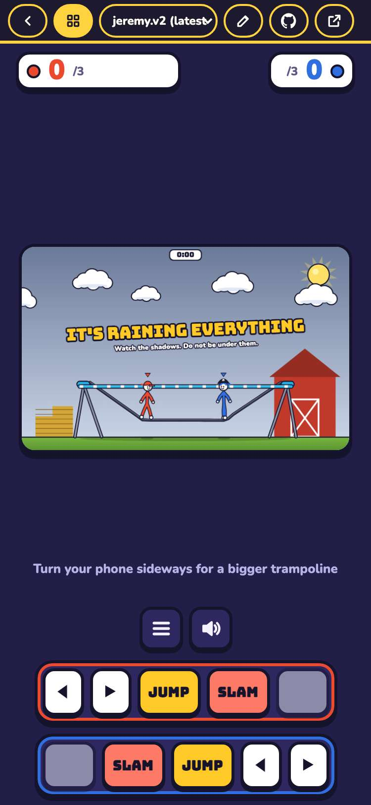
