# Evidence: 141-more-backgrounds

**PASS: 23 of 23 checks pass at desktop and phone widths.**

Generated by `npm run evidence -- 141-more-backgrounds` from [`tests/evidence/141-more-backgrounds.spec.mjs`](../../tests/evidence/141-more-backgrounds.spec.mjs) against the local server (python3 -m http.server) on this branch, starting from commit 152f953, 2026-10-24 06:11 UTC. Rules: [docs/evidence.md](../../docs/evidence.md).

| Check | Desktop 1280 | Phone 375 |
|---|---|---|
| Stained Glass renders behind the arcade without flashing | pass | pass |
| Turing Spots renders behind the arcade without flashing | pass | pass |
| Mandelbrot Dive renders behind the arcade without flashing | pass | pass |
| Neon Ridges renders behind the arcade without flashing | pass | pass |
| Op-Art Warp renders behind the arcade without flashing | pass | pass |
| Cube Field renders behind the arcade without flashing | pass | pass |
| Liquid Chrome renders behind the arcade without flashing | pass | pass |
| Firefly Fog renders behind the arcade without flashing | pass | pass |
| Truchet Tiles renders behind the arcade without flashing | pass | pass |
| Pixel Sort renders behind the arcade without flashing | pass | pass |
| Halftone Wave renders behind the arcade without flashing | pass | pass |
| ASCII Wave renders behind the arcade without flashing | pass | pass |
| Nested Squares renders behind the arcade without flashing | pass | pass |
| Bounce House renders behind the arcade without flashing | pass | pass |
| VHS Dream renders behind the arcade without flashing | pass | pass |
| Sprinkle Snow renders behind the arcade without flashing | pass | pass |
| Two-Tone Goo renders behind the arcade without flashing | pass | pass |
| Flow Field renders behind the arcade without flashing | pass | pass |
| String Art renders behind the arcade without flashing | pass | pass |
| Gyro Rings renders behind the arcade without flashing | pass | pass |
| the cycle runs through the original ten plus the new picks | pass | pass |
| Next moves from the last original pick on to a new one | pass | pass |
| Shuffle lands on new backgrounds | pass | pass |

## 1. Stained Glass renders behind the arcade without flashing

- desktop: 634 colours on 1280x800, 11 fps live here; flash check over 3 animated seconds at 20 samples a second: flashing 0.0%, biggest 50 ms jump 0.0% of the screen, mean step 0.000
- phone: 607 colours on 375x812, 30 fps live here; flash check over 3 animated seconds at 20 samples a second: flashing 0.0%, biggest 50 ms jump 0.0% of the screen, mean step 0.000

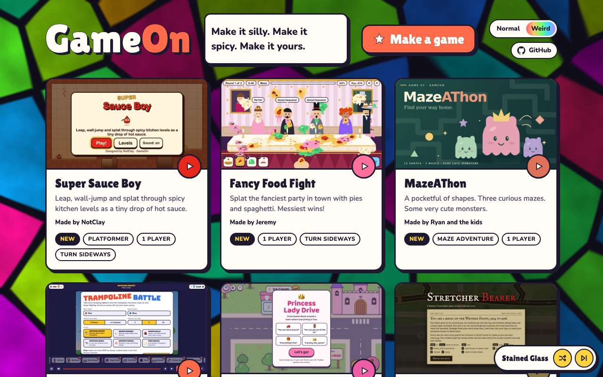 

## 2. Turing Spots renders behind the arcade without flashing

- desktop: 368 colours on 1280x800, 60 fps live here; flash check over 3 animated seconds at 20 samples a second: flashing 0.0%, biggest 50 ms jump 0.3% of the screen, mean step 0.002
- phone: 302 colours on 375x812, 30 fps live here; flash check over 3 animated seconds at 20 samples a second: flashing 0.0%, biggest 50 ms jump 0.5% of the screen, mean step 0.003

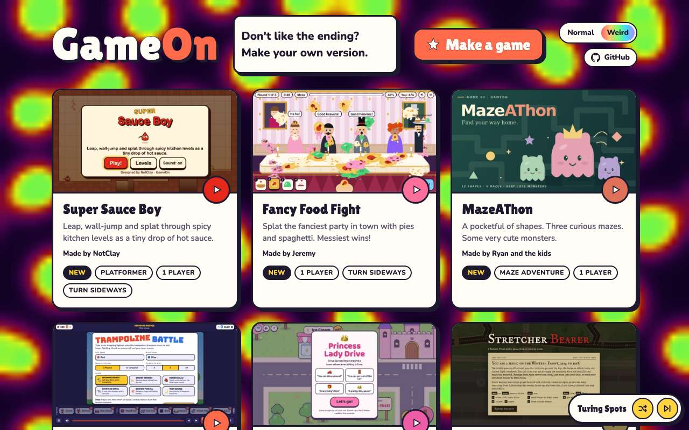 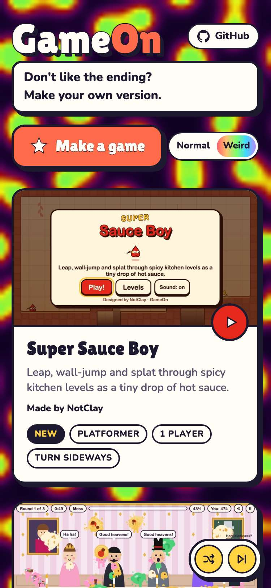

## 3. Mandelbrot Dive renders behind the arcade without flashing

- desktop: 864 colours on 1280x800, 5 fps live here; flash check over 3 animated seconds at 20 samples a second: flashing 0.0%, biggest 50 ms jump 0.0% of the screen, mean step 0.002
- phone: 585 colours on 375x812, 21 fps live here; flash check over 3 animated seconds at 20 samples a second: flashing 0.0%, biggest 50 ms jump 0.0% of the screen, mean step 0.002

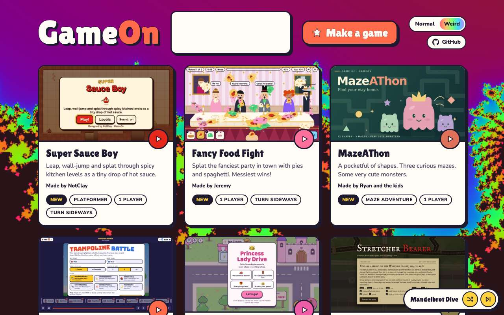 

## 4. Neon Ridges renders behind the arcade without flashing

- desktop: 436 colours on 1280x800, 56 fps live here; flash check over 3 animated seconds at 20 samples a second: flashing 0.0%, biggest 50 ms jump 0.0% of the screen, mean step 0.001
- phone: 277 colours on 375x812, 30 fps live here; flash check over 3 animated seconds at 20 samples a second: flashing 0.0%, biggest 50 ms jump 0.0% of the screen, mean step 0.001

 

## 5. Op-Art Warp renders behind the arcade without flashing

- desktop: 204 colours on 1280x800, 43 fps live here; flash check over 3 animated seconds at 20 samples a second: flashing 0.0%, biggest 50 ms jump 0.5% of the screen, mean step 0.005
- phone: 207 colours on 375x812, 30 fps live here; flash check over 3 animated seconds at 20 samples a second: flashing 0.0%, biggest 50 ms jump 0.0% of the screen, mean step 0.001

 

## 6. Cube Field renders behind the arcade without flashing

- desktop: 361 colours on 1280x800, 60 fps live here; flash check over 3 animated seconds at 20 samples a second: flashing 0.0%, biggest 50 ms jump 0.0% of the screen, mean step 0.002
- phone: 271 colours on 375x812, 30 fps live here; flash check over 3 animated seconds at 20 samples a second: flashing 0.0%, biggest 50 ms jump 0.3% of the screen, mean step 0.005

 

## 7. Liquid Chrome renders behind the arcade without flashing

- desktop: 1855 colours on 1280x800, 26 fps live here; flash check over 3 animated seconds at 20 samples a second: flashing 0.0%, biggest 50 ms jump 0.0% of the screen, mean step 0.000
- phone: 1338 colours on 375x812, 30 fps live here; flash check over 3 animated seconds at 20 samples a second: flashing 0.0%, biggest 50 ms jump 0.0% of the screen, mean step 0.000

 

## 8. Firefly Fog renders behind the arcade without flashing

- desktop: 2462 colours on 1280x800, 59 fps live here; flash check over 3 animated seconds at 20 samples a second: flashing 0.0%, biggest 50 ms jump 0.0% of the screen, mean step 0.001
- phone: 840 colours on 375x812, 29 fps live here; flash check over 3 animated seconds at 20 samples a second: flashing 0.0%, biggest 50 ms jump 0.0% of the screen, mean step 0.001

 

## 9. Truchet Tiles renders behind the arcade without flashing

- desktop: 1223 colours on 1280x800, 55 fps live here; flash check over 3 animated seconds at 20 samples a second: flashing 0.0%, biggest 50 ms jump 0.0% of the screen, mean step 0.001
- phone: 813 colours on 375x812, 30 fps live here; flash check over 3 animated seconds at 20 samples a second: flashing 0.0%, biggest 50 ms jump 0.0% of the screen, mean step 0.001

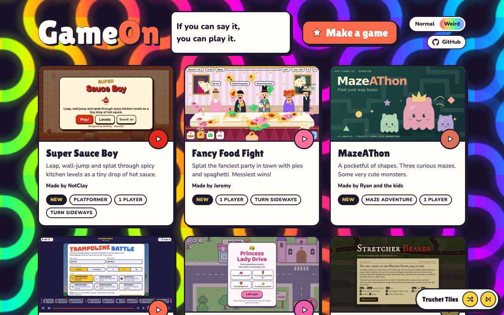 

## 10. Pixel Sort renders behind the arcade without flashing

- desktop: 1427 colours on 1280x800, 60 fps live here; flash check over 3 animated seconds at 20 samples a second: flashing 0.0%, biggest 50 ms jump 0.0% of the screen, mean step 0.000
- phone: 926 colours on 375x812, 30 fps live here; flash check over 3 animated seconds at 20 samples a second: flashing 0.0%, biggest 50 ms jump 0.0% of the screen, mean step 0.001

 

## 11. Halftone Wave renders behind the arcade without flashing

- desktop: 964 colours on 1280x800, 53 fps live here; flash check over 3 animated seconds at 20 samples a second: flashing 0.0%, biggest 50 ms jump 0.0% of the screen, mean step 0.001
- phone: 636 colours on 375x812, 30 fps live here; flash check over 3 animated seconds at 20 samples a second: flashing 0.0%, biggest 50 ms jump 0.0% of the screen, mean step 0.000

 

## 12. ASCII Wave renders behind the arcade without flashing

- desktop: 1892 colours on 1280x800, 60 fps live here; flash check over 3 animated seconds at 20 samples a second: flashing 0.0%, biggest 50 ms jump 0.0% of the screen, mean step 0.001
- phone: 940 colours on 375x812, 29 fps live here; flash check over 3 animated seconds at 20 samples a second: flashing 0.0%, biggest 50 ms jump 0.0% of the screen, mean step 0.001

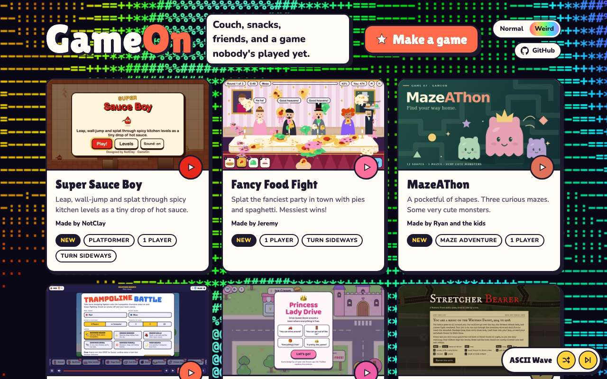 

## 13. Nested Squares renders behind the arcade without flashing

- desktop: 424 colours on 1280x800, 57 fps live here; flash check over 3 animated seconds at 20 samples a second: flashing 0.0%, biggest 50 ms jump 0.0% of the screen, mean step 0.001
- phone: 398 colours on 375x812, 30 fps live here; flash check over 3 animated seconds at 20 samples a second: flashing 0.0%, biggest 50 ms jump 0.0% of the screen, mean step 0.001

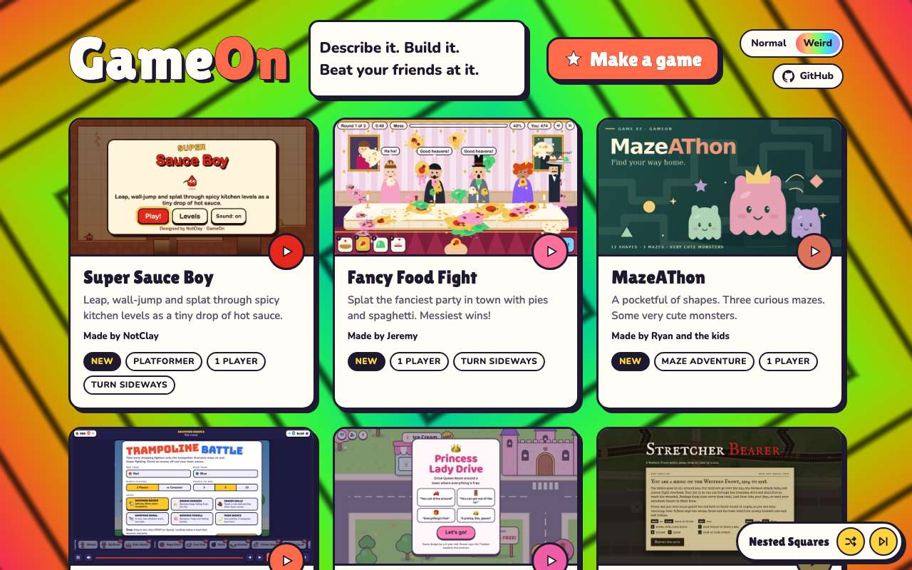 

## 14. Bounce House renders behind the arcade without flashing

- desktop: 371 colours on 1280x800, 60 fps live here; flash check over 3 animated seconds at 20 samples a second: flashing 0.0%, biggest 50 ms jump 0.5% of the screen, mean step 0.010
- phone: 234 colours on 375x812, 30 fps live here; flash check over 3 animated seconds at 20 samples a second: flashing 0.0%, biggest 50 ms jump 0.5% of the screen, mean step 0.011

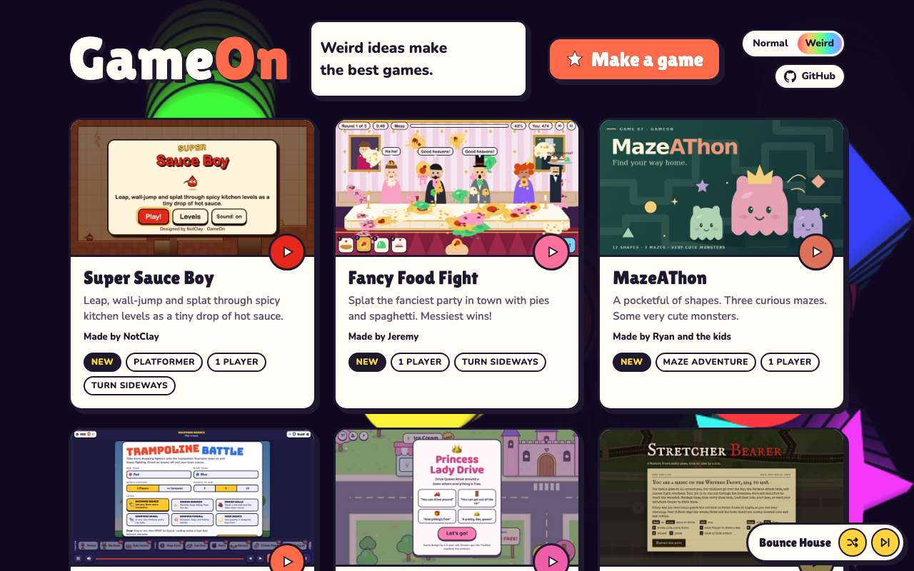 

## 15. VHS Dream renders behind the arcade without flashing

- desktop: 698 colours on 1280x800, 48 fps live here; flash check over 3 animated seconds at 20 samples a second: flashing 0.0%, biggest 50 ms jump 0.0% of the screen, mean step 0.000
- phone: 528 colours on 375x812, 29 fps live here; flash check over 3 animated seconds at 20 samples a second: flashing 0.0%, biggest 50 ms jump 0.0% of the screen, mean step 0.000

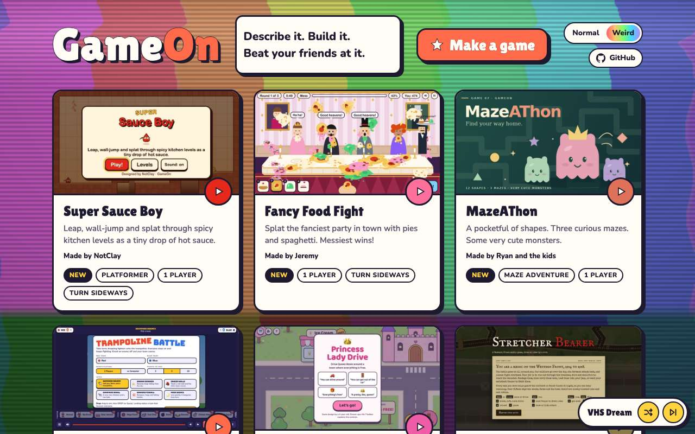 

## 16. Sprinkle Snow renders behind the arcade without flashing

- desktop: 393 colours on 1280x800, 59 fps live here; flash check over 3 animated seconds at 20 samples a second: flashing 0.0%, biggest 50 ms jump 0.0% of the screen, mean step 0.000
- phone: 142 colours on 375x812, 30 fps live here; flash check over 3 animated seconds at 20 samples a second: flashing 0.0%, biggest 50 ms jump 0.0% of the screen, mean step 0.000

 

## 17. Two-Tone Goo renders behind the arcade without flashing

- desktop: 115 colours on 1280x800, 47 fps live here; flash check over 3 animated seconds at 20 samples a second: flashing 0.0%, biggest 50 ms jump 1.8% of the screen, mean step 0.010
- phone: 87 colours on 375x812, 30 fps live here; flash check over 3 animated seconds at 20 samples a second: flashing 0.0%, biggest 50 ms jump 0.0% of the screen, mean step 0.002

 

## 18. Flow Field renders behind the arcade without flashing

- desktop: 924 colours on 1280x800, 59 fps live here; flash check over 3 animated seconds at 20 samples a second: flashing 0.0%, biggest 50 ms jump 0.0% of the screen, mean step 0.000
- phone: 380 colours on 375x812, 30 fps live here; flash check over 3 animated seconds at 20 samples a second: flashing 0.0%, biggest 50 ms jump 0.0% of the screen, mean step 0.000

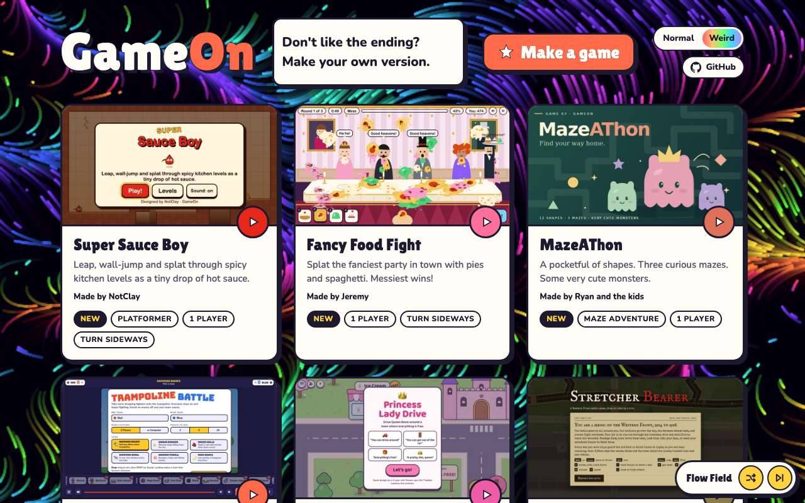 

## 19. String Art renders behind the arcade without flashing

- desktop: 798 colours on 1280x800, 59 fps live here; flash check over 3 animated seconds at 20 samples a second: flashing 0.0%, biggest 50 ms jump 0.0% of the screen, mean step 0.000
- phone: 409 colours on 375x812, 30 fps live here; flash check over 3 animated seconds at 20 samples a second: flashing 0.0%, biggest 50 ms jump 0.0% of the screen, mean step 0.000

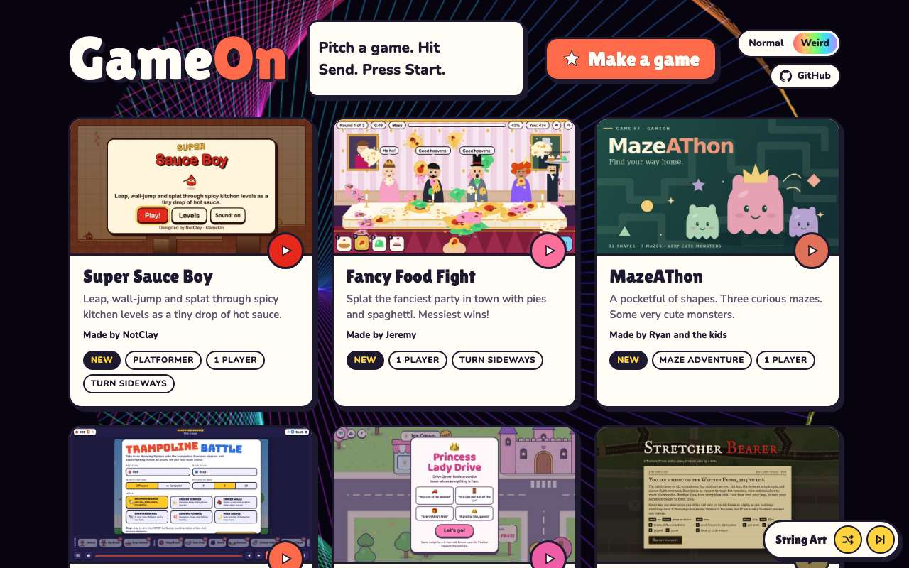 

## 20. Gyro Rings renders behind the arcade without flashing

- desktop: 420 colours on 1280x800, 60 fps live here; flash check over 3 animated seconds at 20 samples a second: flashing 0.0%, biggest 50 ms jump 0.0% of the screen, mean step 0.000
- phone: 252 colours on 375x812, 29 fps live here; flash check over 3 animated seconds at 20 samples a second: flashing 0.0%, biggest 50 ms jump 0.0% of the screen, mean step 0.001

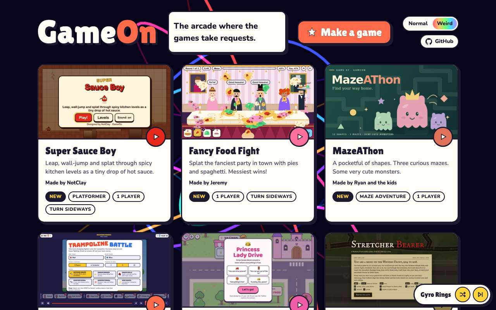 

## 21. the cycle runs through the original ten plus the new picks

- desktop: 30 in the cycle (20 new) out of 40: stained-glass, neon-ridges, mandelbrot-dive, cube-field, op-art, flow-field, liquid-chrome, firefly-fog, truchet-tiles, pixel-sort, halftone-wave, string-art, nested-squares, bounce-shapes, vhs-dream, sprinkles, two-tone-goo, reaction-diffusion, gyro-rings, ascii-wave
- phone: 30 in the cycle (20 new) out of 40: stained-glass, neon-ridges, mandelbrot-dive, cube-field, op-art, flow-field, liquid-chrome, firefly-fog, truchet-tiles, pixel-sort, halftone-wave, string-art, nested-squares, bounce-shapes, vhs-dream, sprinkles, two-tone-goo, reaction-diffusion, gyro-rings, ascii-wave

## 22. Next moves from the last original pick on to a new one

- desktop: retro-sun → stained-glass
- phone: retro-sun → stained-glass

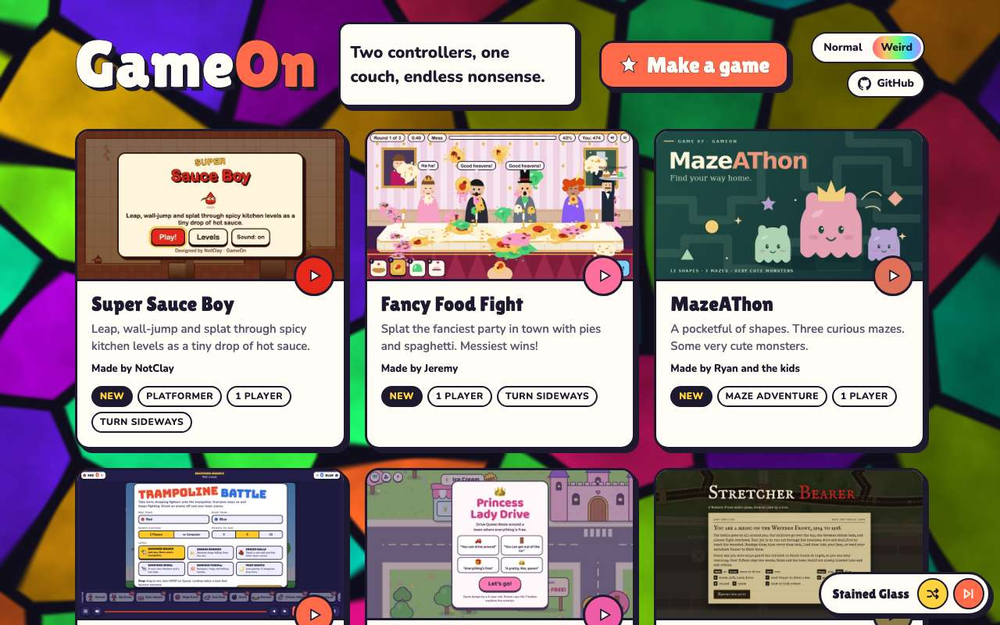 

## 23. Shuffle lands on new backgrounds

- desktop: shuffle visited cube-field → string-art → vhs-dream; new ones: cube-field, string-art, vhs-dream
- phone: shuffle visited op-art → sprinkles → hex-disco → sprinkles; new ones: op-art, sprinkles, sprinkles

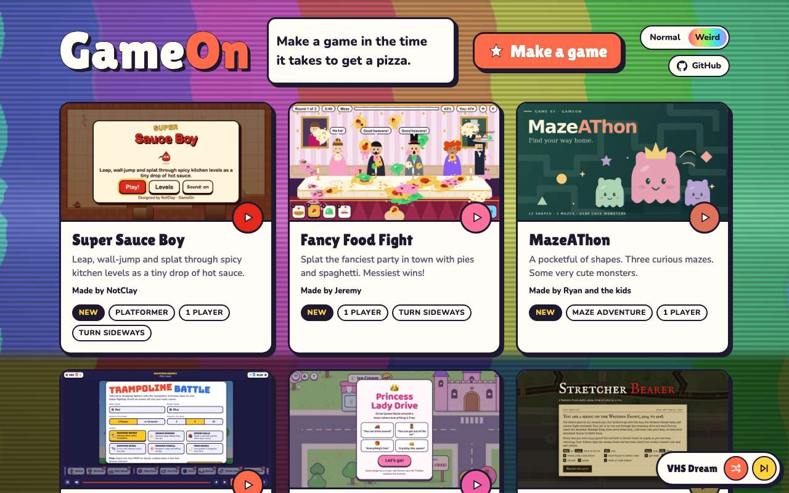 
