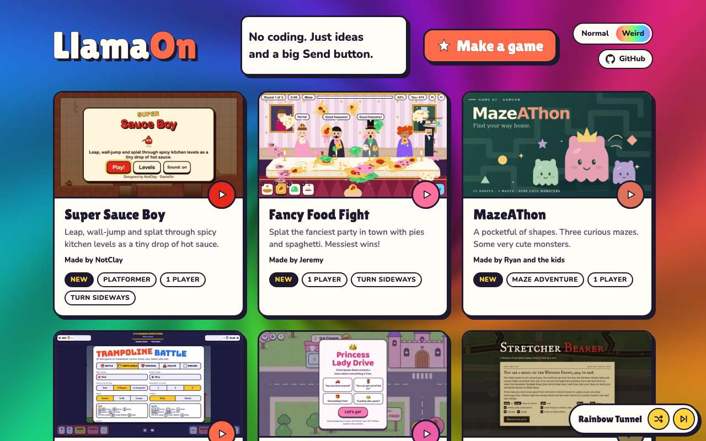
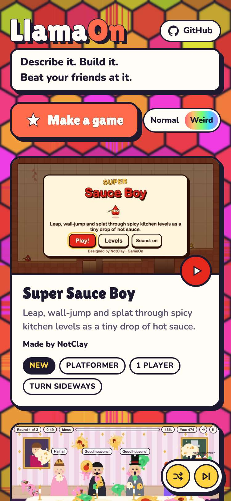
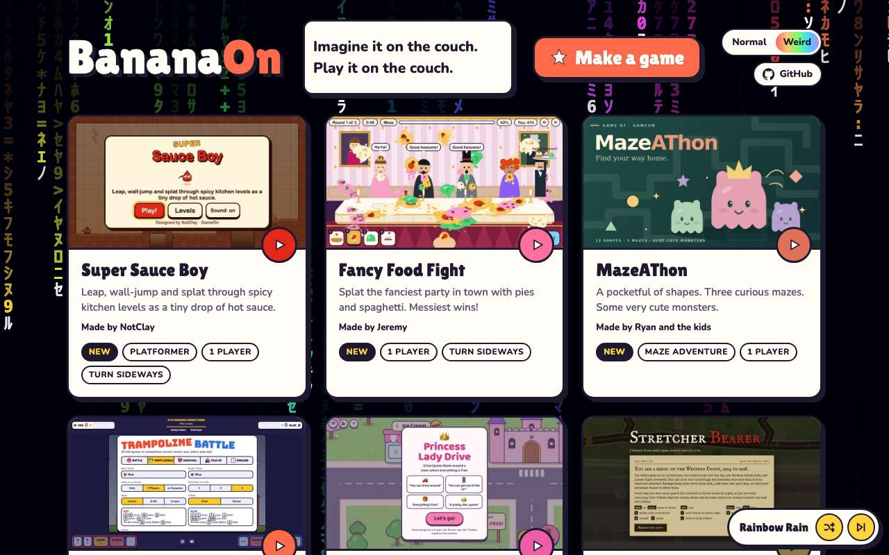

# Evidence: 145-weird-titles

**PASS: 5 of 5 checks pass at desktop and phone widths.**

Generated by `npm run evidence -- 145-weird-titles` from [`tests/evidence/145-weird-titles.spec.mjs`](../../tests/evidence/145-weird-titles.spec.mjs) against the local server (python3 -m http.server) on this branch, starting from commit a878f7e, 2026-10-24 06:16 UTC. Rules: [docs/evidence.md](../../docs/evidence.md).

| Check | Desktop 1280 | Phone 375 |
|---|---|---|
| Normal mode shows GameOn and it never changes | pass | pass |
| Weird mode starts on GameOn, then swaps in a new ___On title half a beat after the tagline | pass | pass |
| switching modes starts and stops the rotation without a reload, and Normal restores GameOn | pass | pass |
| every title fits: no sideways scroll, no wrapping, and the header doesn't move | pass | pass |
| with reduced motion the title still changes in Weird mode, with no wobble | pass | pass |

## 1. Normal mode shows GameOn and it never changes

- desktop: GameOn for 3 s with the interval shortened to 0.5 s (?titleInterval=0.5): no change
- phone: GameOn for 3 s with the interval shortened to 0.5 s (?titleInterval=0.5): no change

 

## 2. Weird mode starts on GameOn, then swaps in a new ___On title half a beat after the tagline

- desktop: 32 titles; GameOn held past 3 s, became FlameOn by 4 s, held, then LlamaOn by 10.5 s (6.5 s later); heading still named GameOn
- phone: 32 titles; GameOn held past 3 s, became FlameOn by 4 s, held, then LlamaOn by 10.5 s (6.5 s later); heading still named GameOn

 

## 3. switching modes starts and stops the rotation without a reload, and Normal restores GameOn

- desktop: Weird showed FlameOn, LlamaOn, DreamOn, GlitchOn; back in Normal it read GameOn at once and held for 2.4 s
- phone: Weird showed FlameOn, LlamaOn, DreamOn, GlitchOn; back in Normal it read GameOn at once and held for 2.4 s

## 4. every title fits: no sideways scroll, no wrapping, and the header doesn't move

- desktop: 1600px: all 32 titles fit on one line in the one-row header; widest is BananaOn at 311px; header 109px tall throughout
- desktop: 1280px: all 32 titles fit on one line in the one-row header; widest is BananaOn at 310px; header 109px tall throughout
- phone: 375px: all 32 titles fit on one line, clear of GitHub; widest is BananaOn at 223px; header 197px tall throughout

 

## 5. with reduced motion the title still changes in Weird mode, with no wobble

- desktop: reduced motion: the title changed (to FlameOn) and kept changing, with no animation running; Normal restored GameOn
- phone: reduced motion: the title changed (to FlameOn) and kept changing, with no animation running; Normal restored GameOn
