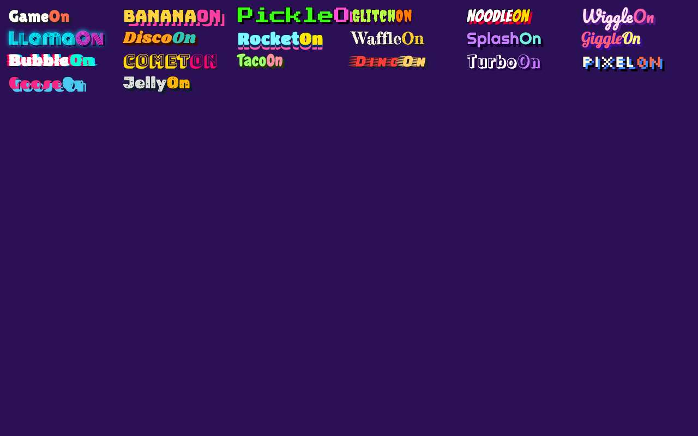
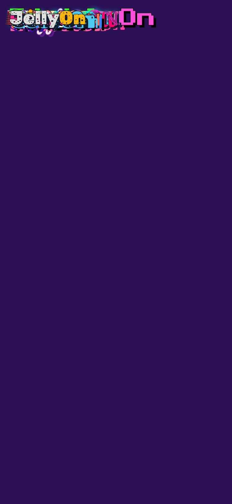

# Evidence: 149-title-styles

**PASS: 3 of 3 checks pass at desktop and phone widths.**

Generated by `npm run evidence -- 149-title-styles` from [`tests/evidence/149-title-styles.spec.mjs`](../../tests/evidence/149-title-styles.spec.mjs) against the local server (python3 -m http.server) on this branch, starting from commit 3b3cc3e, 2026-10-24 11:04 UTC. Rules: [docs/evidence.md](../../docs/evidence.md).

| Check | Desktop 1280 | Phone 375 |
|---|---|---|
| Normal keeps the classic logo and loads none of the title fonts | pass | pass |
| each new title in Weird mode has a different font and colors, through all 20 looks | pass | pass |
| every look fits with the widest titles: one line, no sideways scroll, the header holds still | pass | pass |

## 1. Normal keeps the classic logo and loads none of the title fonts

- desktop: Normal: GameOn in "Lilita One", no data-style, and no request for the 19 title fonts
- phone: Normal: GameOn in "Lilita One", no data-style, and no request for the 19 title fonts

## 2. each new title in Weird mode has a different font and colors, through all 20 looks

- desktop: 20 looks in order, each with a new font and two-tone colors: Classic, Bungee, Press Start 2P, Creepster, Bangers, Pacifico, Monoton, Shrikhand, Titan One, Fredericka the Great, Righteous, Lobster, Rubik Glitch, Bungee Shade, Chewy, Faster One, Rampart One, Silkscreen, Fascinate, Rubik Moonrocks; all 19 fonts loaded
- phone: 20 looks in order, each with a new font and two-tone colors: Classic, Bungee, Press Start 2P, Creepster, Bangers, Pacifico, Monoton, Shrikhand, Titan One, Fredericka the Great, Righteous, Lobster, Rubik Glitch, Bungee Shade, Chewy, Faster One, Rampart One, Silkscreen, Fascinate, Rubik Moonrocks; all 19 fonts loaded

## 3. every look fits with the widest titles: one line, no sideways scroll, the header holds still

- desktop: 1600px: 200 title-and-look pairs (20 looks × the 10 widest titles) fit on one line with the header unmoved; widest is SplashOn in Bungee Shade at 311px
- desktop: 1280px: 200 title-and-look pairs (20 looks × the 10 widest titles) fit on one line with the header unmoved; widest is SplashOn in Bungee Shade at 311px
- phone: 375px: 200 title-and-look pairs (20 looks × the 10 widest titles) fit on one line with the header unmoved; widest is BananaOn in Bungee Shade at 224px

 
