# Evidence: 151-trampoline-battle-jeremy-v3

**PASS: 10 of 10 checks pass at desktop and phone widths.**

Generated by `npm run evidence -- 151-trampoline-battle-jeremy-v3` from [`tests/evidence/151-trampoline-battle-jeremy-v3.spec.mjs`](../../tests/evidence/151-trampoline-battle-jeremy-v3.spec.mjs) against the local server (python3 -m http.server) on this branch, starting from commit a339042, 2026-10-24 12:02 UTC. Rules: [docs/evidence.md](../../docs/evidence.md).

| Check | Desktop 1280 | Phone 375 |
|---|---|---|
| jeremy.v3 is the repo at f0316e5: same files, byte for byte, except what the copy leaves out | pass | pass |
| jeremy.v3 opens to its title screen and starts, with no new outside requests | pass | pass |
| what's new: the engine picker, Pure Chaos, 100 trampoline levels on three shelves, and 20 racing and 20 climbing levels | pass | pass |
| what's new plays: a race, Pure Chaos on the climbing tower, and the level buttons pause and play | pass | pass |
| what stays still works: Battle drops a fighter and fights, and Esc goes back to the menu | pass | pass |
| saves: what jeremy.v2 saved loads in jeremy.v3, with its settings and best times | pass | pass |
| known save problem, inherited from the repo: once jeremy.v3 saves a Shuffle setting, jeremy.v2 can't start; jeremy.v1 is unaffected | pass | pass |
| jeremy.v1 and jeremy.v2 still play from their folders | pass | pass |
| games.json makes jeremy.v3 the default, records its source, and still offers jeremy.v1 and jeremy.v2 | pass | pass |
| the arcade plays jeremy.v3 by default, and the version picker offers jeremy.v2 and jeremy.v1 | pass | pass |

## 1. jeremy.v3 is the repo at f0316e5: same files, byte for byte, except what the copy leaves out

- desktop: 6 files match the repo's git blobs at f0316e5; README.md is the repo's plus the jeremy.v3 section; gameon.json added; .github/, .gitignore and .claude/launch.json left out; no path fixes needed
- phone: 6 files match the repo's git blobs at f0316e5; README.md is the repo's plus the jeremy.v3 section; gameon.json added; .github/, .gitignore and .claude/launch.json left out; no path fixes needed

## 2. jeremy.v3 opens to its title screen and starts, with no new outside requests

- desktop: Just Bounce: Party Levels · round 1 · Score (Hoop Dreams), timer at 96.9%; outside hosts: fonts.googleapis.com, fonts.gstatic.com (Google Fonts, as jeremy.v2)
- phone: Just Bounce: Party Levels · round 1 · Survival (Lava Rising), timer at 97.1%; outside hosts: fonts.googleapis.com, fonts.gstatic.com (Google Fonts, as jeremy.v2)

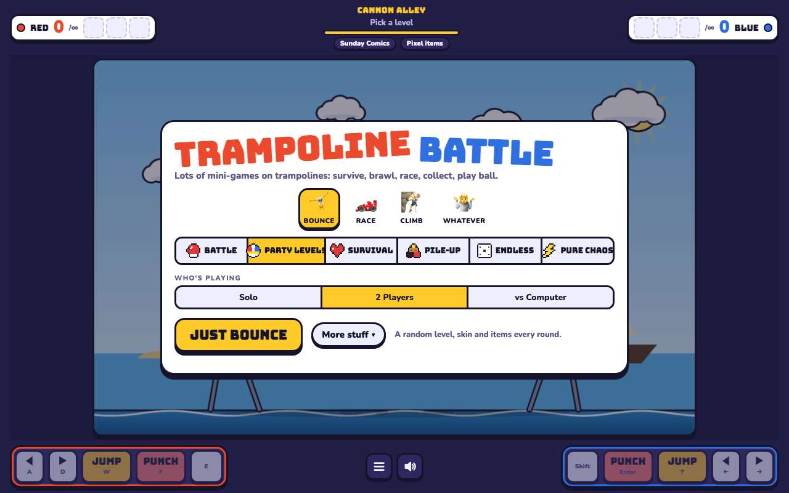 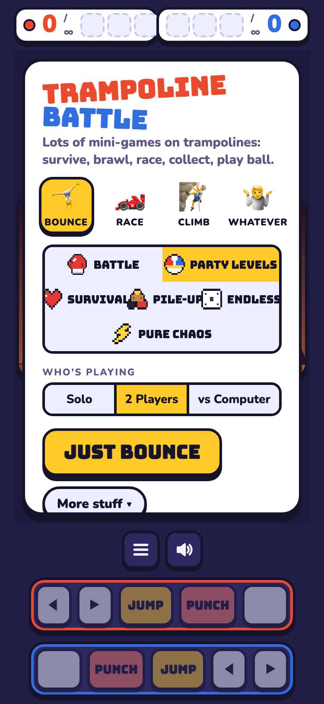

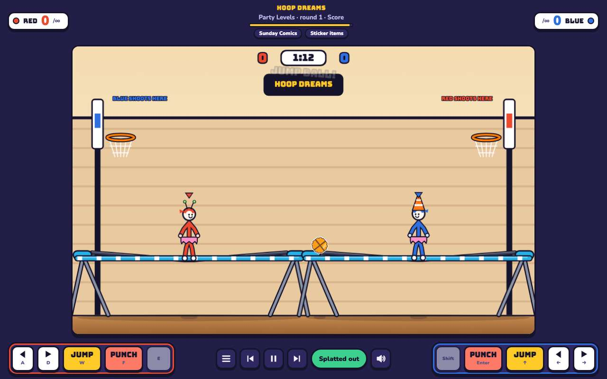 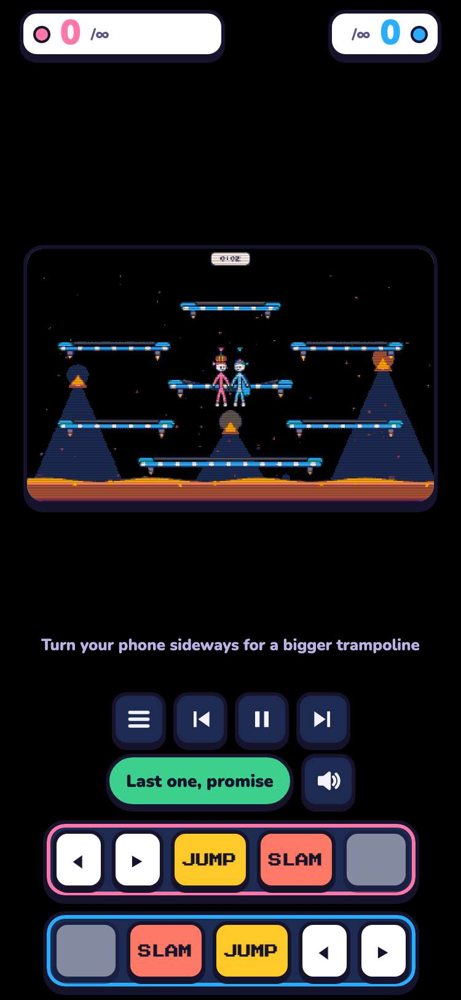

## 3. what's new: the engine picker, Pure Chaos, 100 trampoline levels on three shelves, and 20 racing and 20 climbing levels

- desktop: engines: Bounce, Race, Climb, Whatever; modes add Pure Chaos; trampoline shelves 20 + 30 + 50 = 100; racing 20, climbing 20
- phone: engines: Bounce, Race, Climb, Whatever; modes add Pure Chaos; trampoline shelves 20 + 30 + 50 = 100; racing 20, climbing 20

## 4. what's new plays: a race, Pure Chaos on the climbing tower, and the level buttons pause and play

- desktop: race: Avalanche! (Party Levels · round 1 · Survival), paused with the play/pause button and played again; climb + Pure Chaos: Slippy Sloppy Tower (Pure Chaos · round 1 · Brawl)
- phone: race: Avalanche! (Party Levels · round 1 · Survival), paused with the play/pause button and played again; climb + Pure Chaos: Wrong-Way Escalators (Pure Chaos · round 1 · Race)

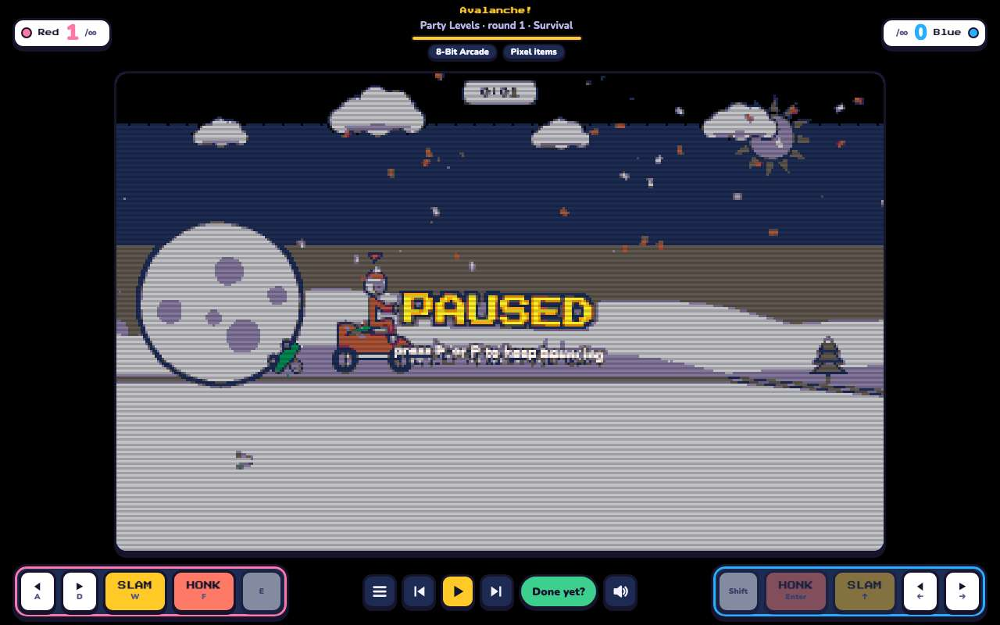 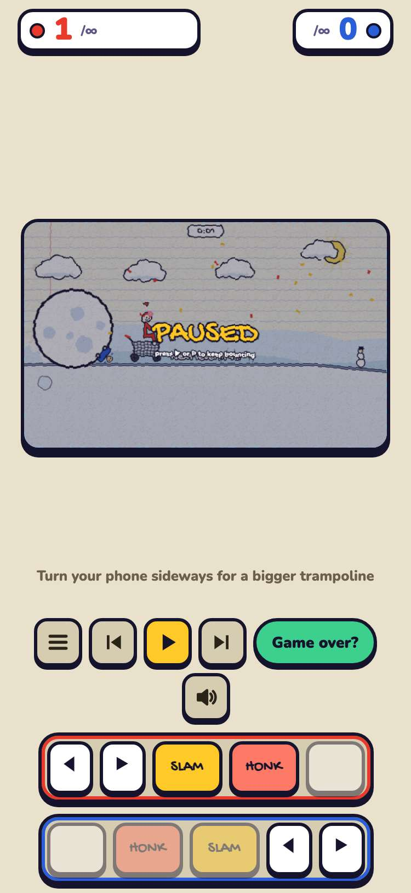

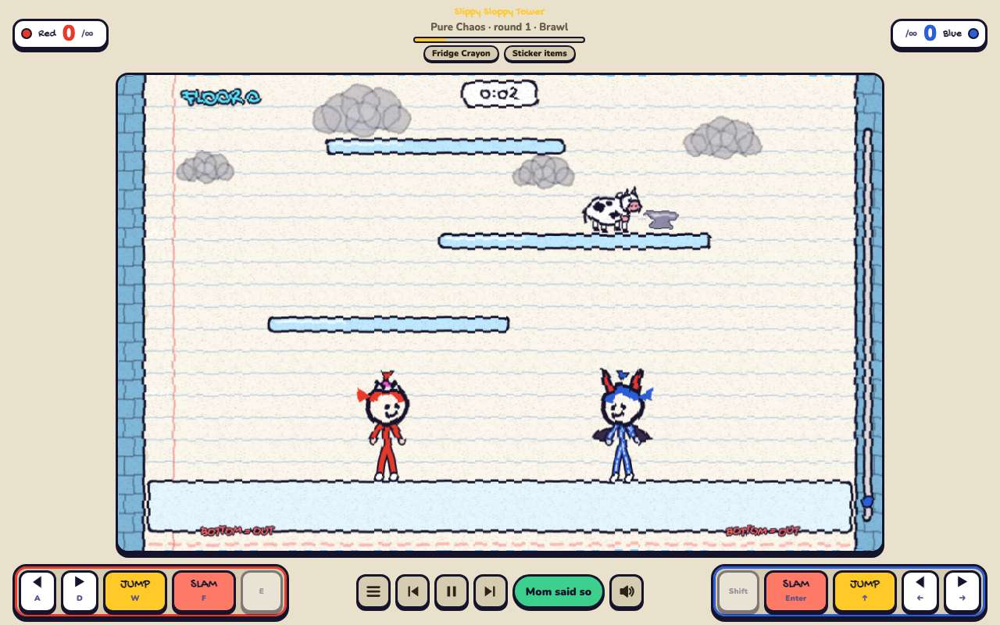 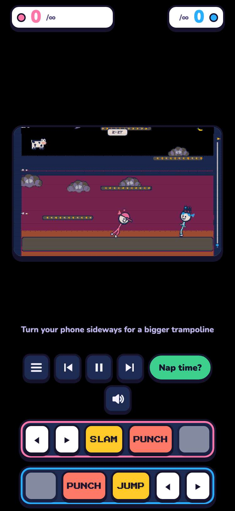

## 5. what stays still works: Battle drops a fighter and fights, and Esc goes back to the menu

- desktop: Battle: wave 1 aim → both teams drop → fight; Esc opens the menu (pause / start over)
- phone: Battle: wave 1 aim → both teams drop → fight; Esc opens the menu (pause / start over)

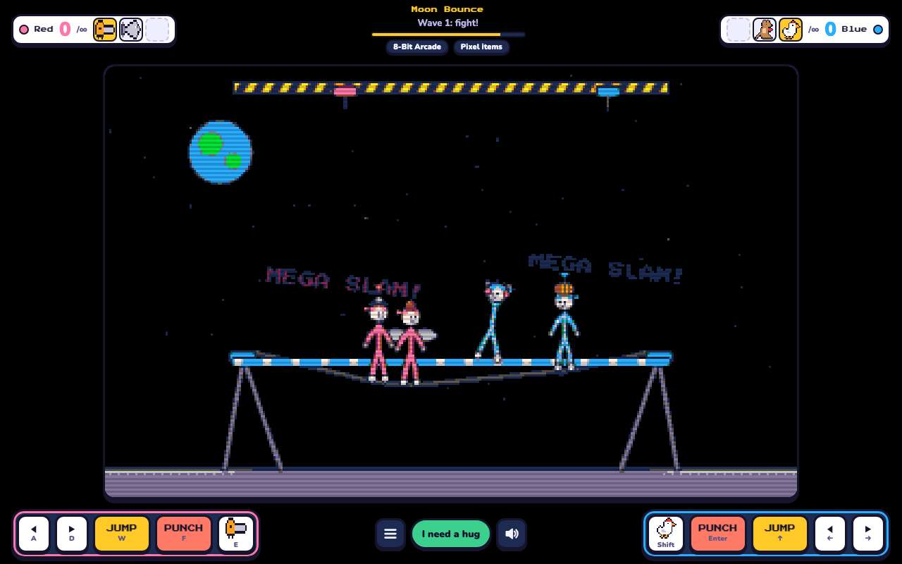 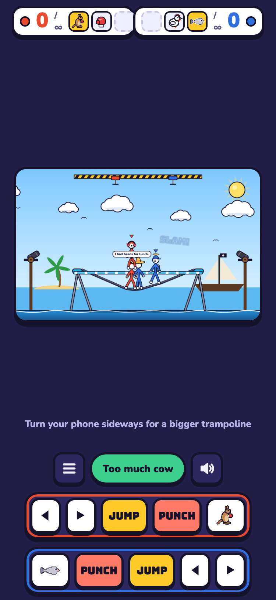

## 6. saves: what jeremy.v2 saved loads in jeremy.v3, with its settings and best times

- desktop: jeremy.v2's tb3-settings (Zoom, vs Computer, Survival, Crayon, 2 rounds) and tb4-best (survival 42.5 s) show in jeremy.v3; saving keeps every jeremy.v2 value and adds more and engine; tb2-settings untouched; no new keys
- phone: jeremy.v2's tb3-settings (Zoom, vs Computer, Survival, Crayon, 2 rounds) and tb4-best (survival 42.5 s) show in jeremy.v3; saving keeps every jeremy.v2 value and adds more and engine; tb2-settings untouched; no new keys

## 7. known save problem, inherited from the repo: once jeremy.v3 saves a Shuffle setting, jeremy.v2 can't start; jeremy.v1 is unaffected

- desktop: jeremy.v3 saved {"names":["Red","Blue"],"mode":"2p","game":"party","mini":"random","level":"random","rounds":0,"pileRounds":0,"target":0,"skin":"random","items":"random","more":true,"engine":"bounce","v4":true}; jeremy.v2 then logs ["Cannot read properties of undefined (reading 'label')"] and won't start (its code has no "random" skin, level or Pure Chaos); jeremy.v1 starts. Left as copied: see the PR's Notes
- phone: jeremy.v3 saved {"names":["Red","Blue"],"mode":"2p","game":"party","mini":"random","level":"random","rounds":0,"pileRounds":0,"target":0,"skin":"random","items":"random","more":true,"engine":"bounce","v4":true}; jeremy.v2 then logs ["Cannot read properties of undefined (reading 'label')"] and won't start (its code has no "random" skin, level or Pure Chaos); jeremy.v1 starts. Left as copied: see the PR's Notes

## 8. jeremy.v1 and jeremy.v2 still play from their folders

- desktop: games/trampoline-battle/jeremy.v2/ and games/trampoline-battle/jeremy.v1/: title screen, then started, no console errors
- phone: games/trampoline-battle/jeremy.v2/ and games/trampoline-battle/jeremy.v1/: title screen, then started, no console errors

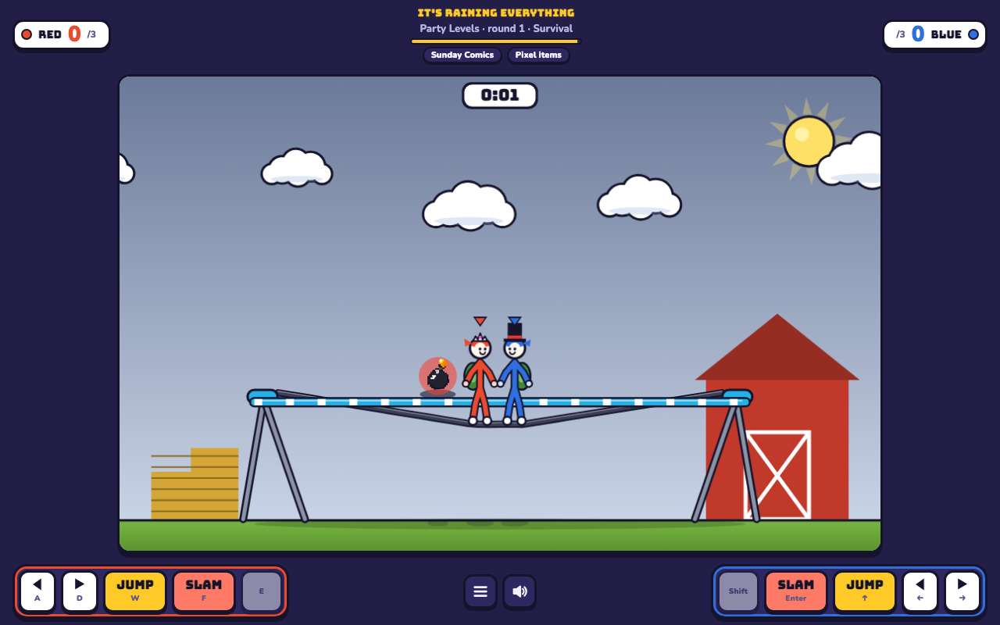 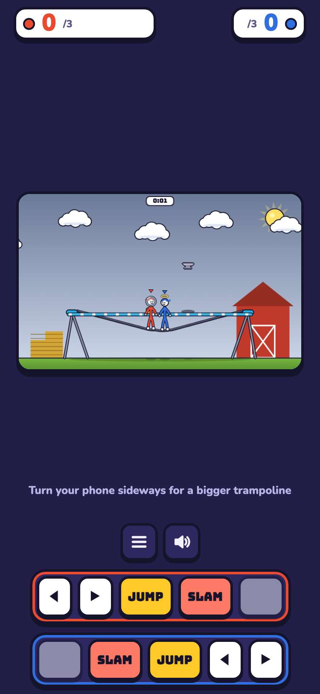

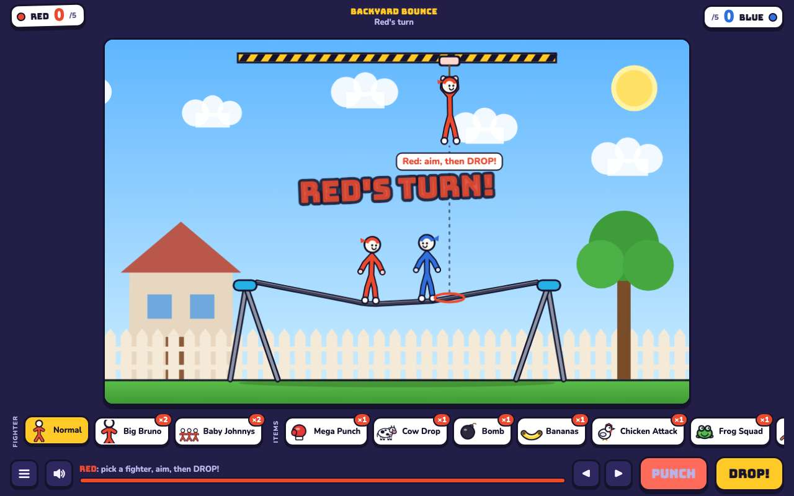 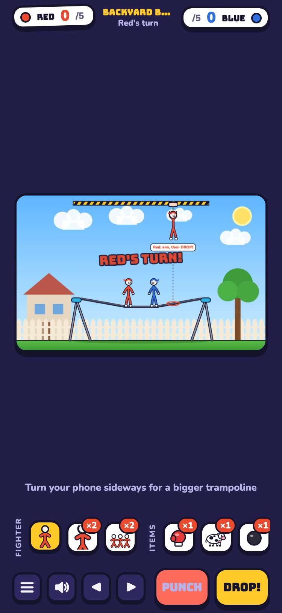

## 9. games.json makes jeremy.v3 the default, records its source, and still offers jeremy.v1 and jeremy.v2

- desktop: default jeremy.v3; jeremy.v3 source jwildfire/trampoline-battle@f0316e5; jeremy.v1 and jeremy.v2 still at their urls
- phone: default jeremy.v3; jeremy.v3 source jwildfire/trampoline-battle@f0316e5; jeremy.v1 and jeremy.v2 still at their urls

## 10. the arcade plays jeremy.v3 by default, and the version picker offers jeremy.v2 and jeremy.v1

- desktop: card → picker (jeremy.v3 Latest, jeremy.v2, jeremy.v1) → jeremy.v3 plays in the frame; #trampoline-battle@jeremy.v2 and @jeremy.v1 open those versions
- phone: card → picker (jeremy.v3 Latest, jeremy.v2, jeremy.v1) → jeremy.v3 plays in the frame; #trampoline-battle@jeremy.v2 and @jeremy.v1 open those versions

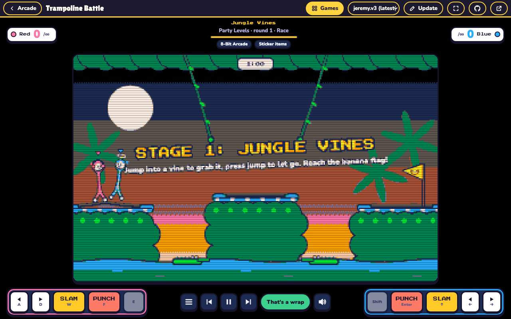 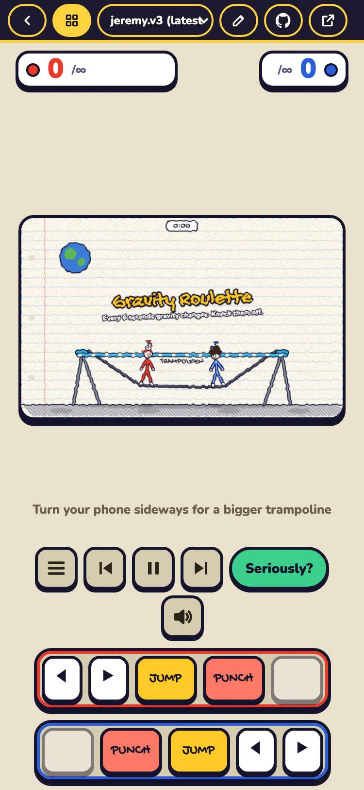
