# Evidence: 155-big-weird-dig

**PASS: 9 of 9 checks pass at desktop and phone widths.**

Generated by `npm run evidence -- 155-big-weird-dig` from [`tests/evidence/155-big-weird-dig.spec.mjs`](../../tests/evidence/155-big-weird-dig.spec.mjs) against the local server (python3 -m http.server) on this branch, starting from commit ca87f57, 2026-10-24 13:05 UTC. Rules: [docs/evidence.md](../../docs/evidence.md).

| Check | Desktop 1280 | Phone 375 |
|---|---|---|
| the title screen opens and level 1 starts, with nothing loaded from the internet | pass | pass |
| the bulldozer digs a real tunnel with the real controls: the keyboard on a laptop, the arrow pad on a phone | pass | pass |
| a weird find pops out with a TA-DA and a joke, and goes into the Weird Museum | pass | pass |
| a boulder wobbles and falls when you dig out the dirt under it, and the blade shoves a mole back | pass | pass |
| every one of the 8 levels can be beaten in the real game | pass | pass |
| the game pauses, Restart starts the level over, and running out of fuel offers a retry | pass | pass |
| finds and progress are saved only under gameon.big-weird-dig., and the museum shows them after a reload | pass | pass |
| the game still plays when the browser blocks saving | pass | pass |
| Big Weird Dig has the first card in the arcade and plays in its frame | pass | pass |

## 1. the title screen opens and level 1 starts, with nothing loaded from the internet

- desktop: 8 levels and 30 weird things; HUD shows the level, fuel and the 3 things to find; no requests outside the site; no sideways scrolling
- phone: 8 levels and 30 weird things; HUD shows the level, fuel and the 3 things to find; no requests outside the site; no sideways scrolling

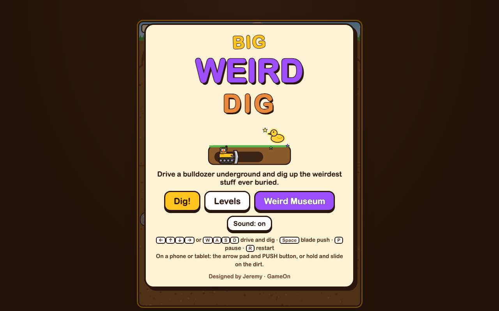 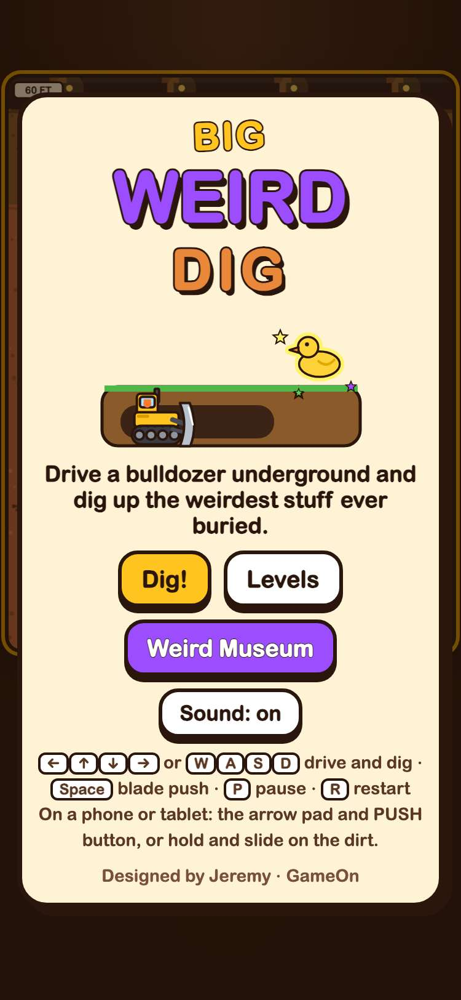

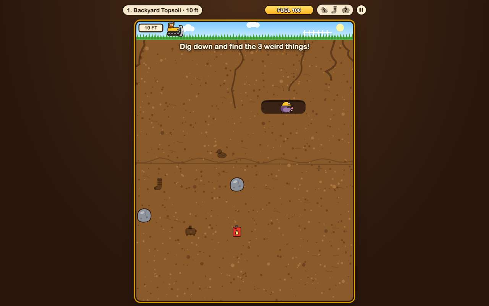 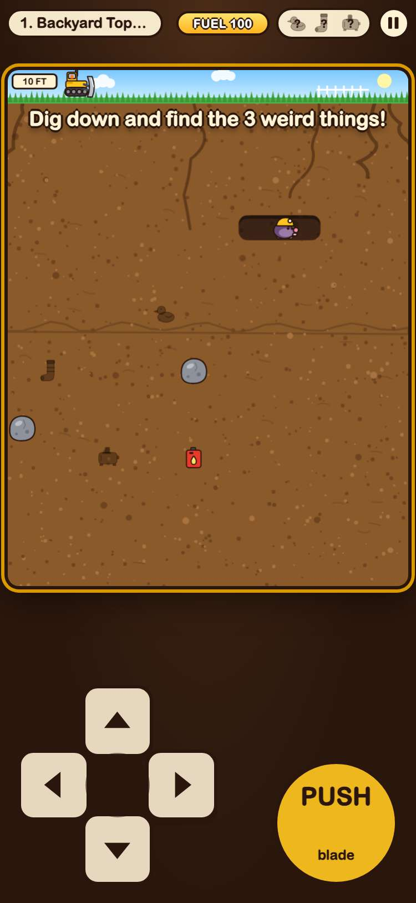

## 2. the bulldozer digs a real tunnel with the real controls: the keyboard on a laptop, the arrow pad on a phone

- desktop: arrow keys: dug 6 cells, down to row 4 and across to column 4; fuel 100 → 96
- phone: arrow pad (one thumb, slid from down to right): dug 6 cells, down to row 4 and across to column 4; fuel 100 → 96

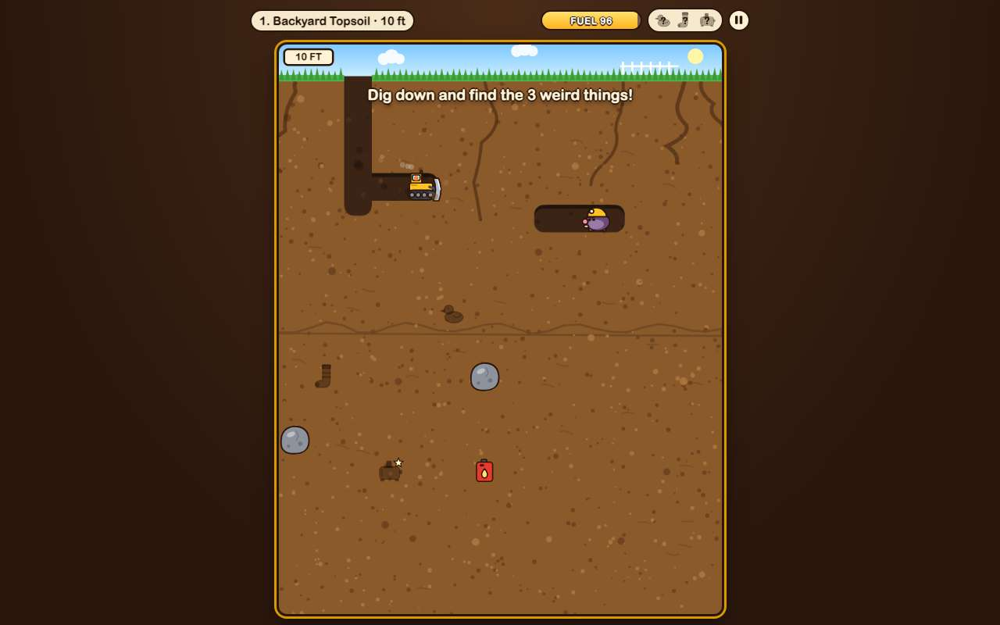 

## 3. a weird find pops out with a TA-DA and a joke, and goes into the Weird Museum

- desktop: found the Rubber Duck (“It still squeaks. Nobody knows how it got down here.”); museum now holds duck
- phone: found the Rubber Duck (“It still squeaks. Nobody knows how it got down here.”); museum now holds duck

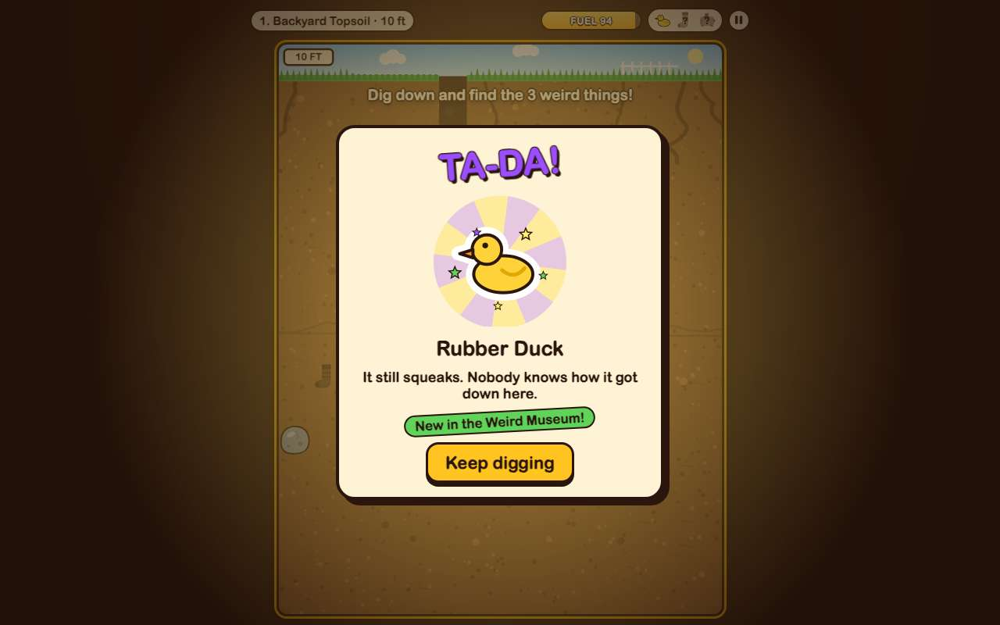 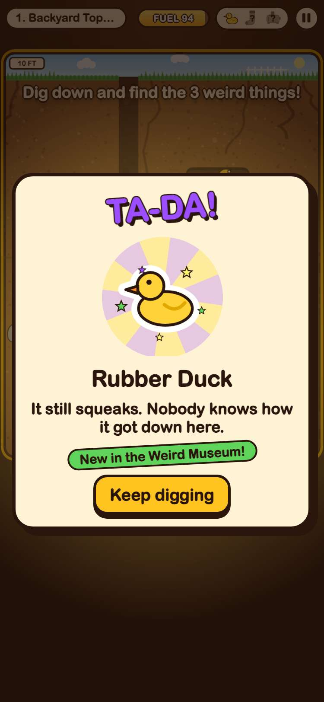

## 4. a boulder wobbles and falls when you dig out the dirt under it, and the blade shoves a mole back

- desktop: boulder at column 6, row 10 stayed put while the bulldozer held it up, wobbled when it drove off, then fell and went KRUNCH; the blade shoved the mole from column 9 to 10.0 and left it dizzy
- phone: boulder at column 6, row 10 stayed put while the bulldozer held it up, wobbled when it drove off, then fell and went KRUNCH; the blade shoved the mole from column 9 to 10.0 and left it dizzy

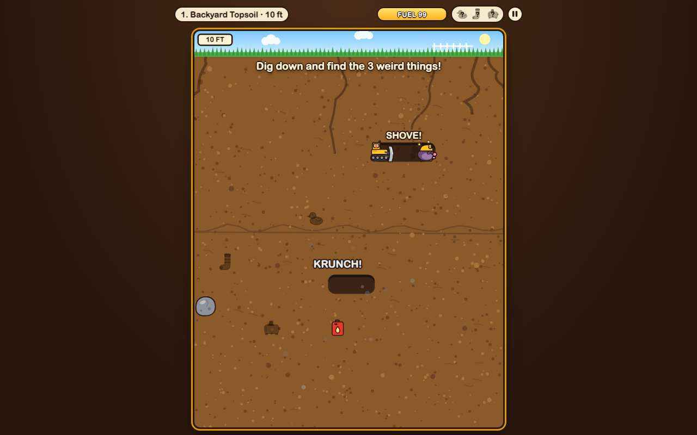 

## 5. every one of the 8 levels can be beaten in the real game

- desktop: won every level (game seconds, starting fuel → fuel left): 1: 6s, fuel 100 → 87; 2: 12s, fuel 85 → 85; 3: 14s, fuel 75 → 69; 4: 14s, fuel 70 → 57; 5: 17s, fuel 65 → 49; 6: 21s, fuel 60 → 63; 7: 29s, fuel 60 → 57; 8: 30s, fuel 60 → 47
- phone: won every level (game seconds, starting fuel → fuel left): 1: 6s, fuel 100 → 87; 2: 12s, fuel 85 → 85; 3: 14s, fuel 75 → 69; 4: 14s, fuel 70 → 57; 5: 17s, fuel 65 → 49; 6: 20s, fuel 60 → 65; 7: 30s, fuel 60 → 53; 8: 31s, fuel 60 → 47

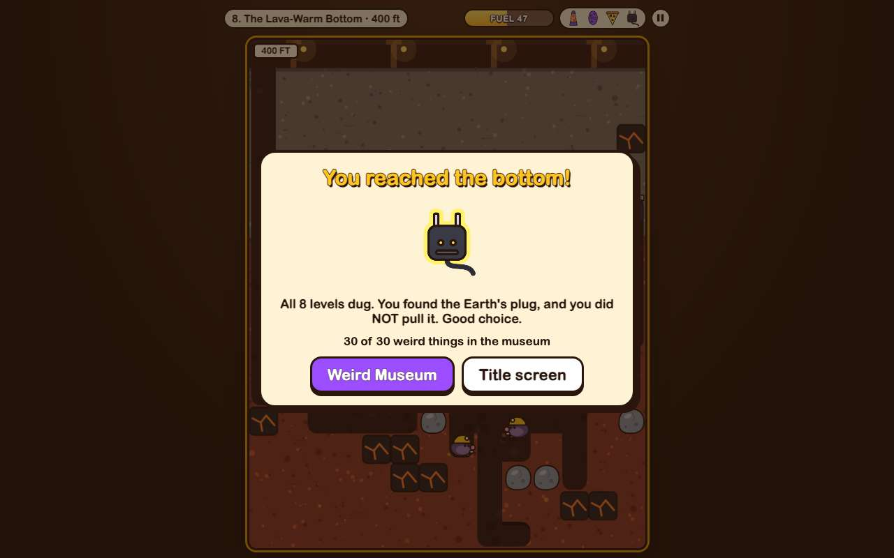 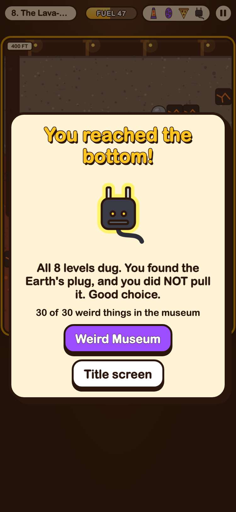

## 6. the game pauses, Restart starts the level over, and running out of fuel offers a retry

- desktop: paused at 0.73s and the clock stayed put; Restart put the bulldozer back on top with a fresh clock; an empty tank showed “Out of fuel!” and Try again refilled it
- phone: paused at 0.82s and the clock stayed put; Restart put the bulldozer back on top with a fresh clock; an empty tank showed “Out of fuel!” and Try again refilled it

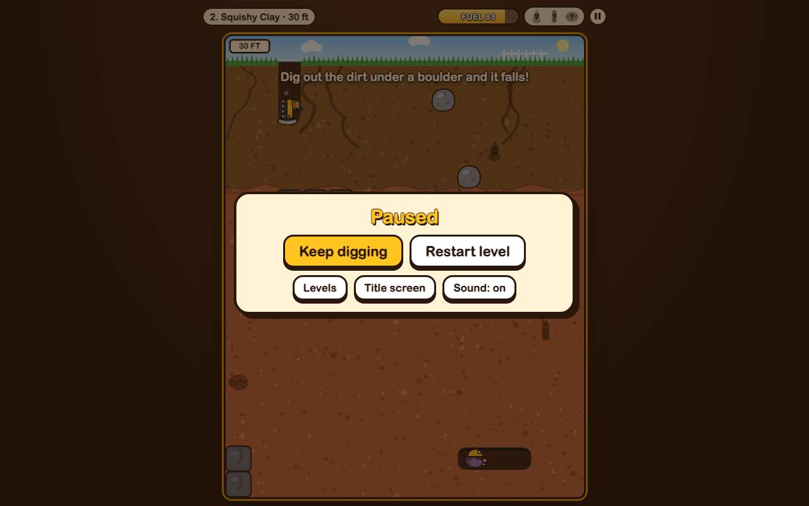 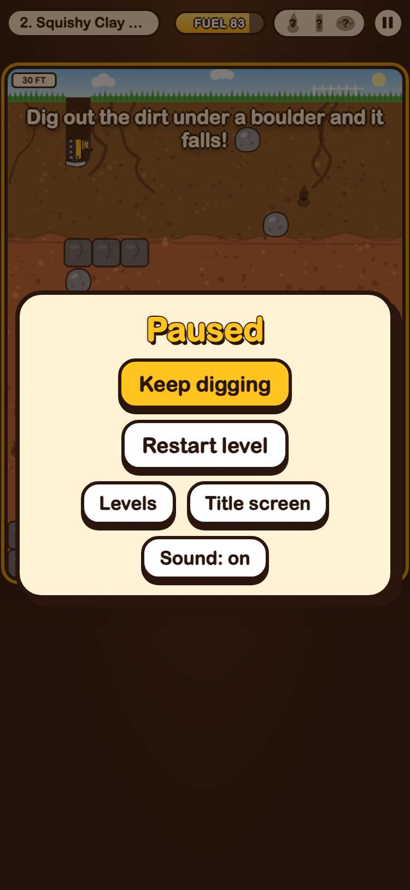

## 7. finds and progress are saved only under gameon.big-weird-dig., and the museum shows them after a reload

- desktop: keys: gameon.big-weird-dig.museum, gameon.big-weird-dig.progress, gameon.big-weird-dig.sound; after a reload the museum shelf has the duck, sock and toaster, and level 2 is unlocked
- phone: keys: gameon.big-weird-dig.museum, gameon.big-weird-dig.progress, gameon.big-weird-dig.sound; after a reload the museum shelf has the duck, sock and toaster, and level 2 is unlocked

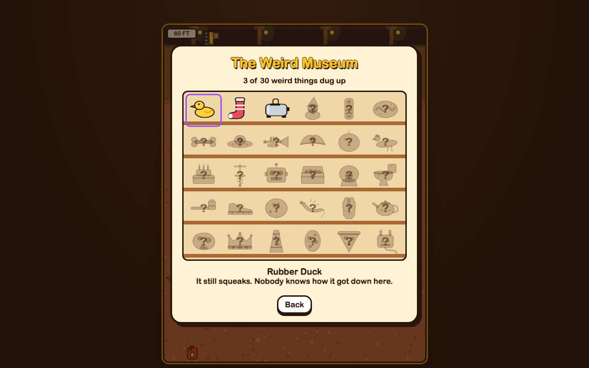 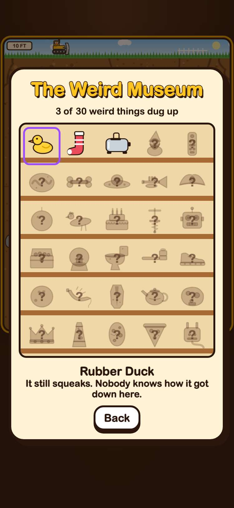

## 8. the game still plays when the browser blocks saving

- desktop: with localStorage throwing, the title screen opened and level 1 played
- phone: with localStorage throwing, the title screen opened and level 1 played

## 9. Big Weird Dig has the first card in the arcade and plays in its frame

- desktop: card first in the arcade with its 800x450 cover; plays inside the frame; GitHub button opens its folder
- phone: card first in the arcade with its 800x450 cover; plays inside the frame; GitHub button opens its folder

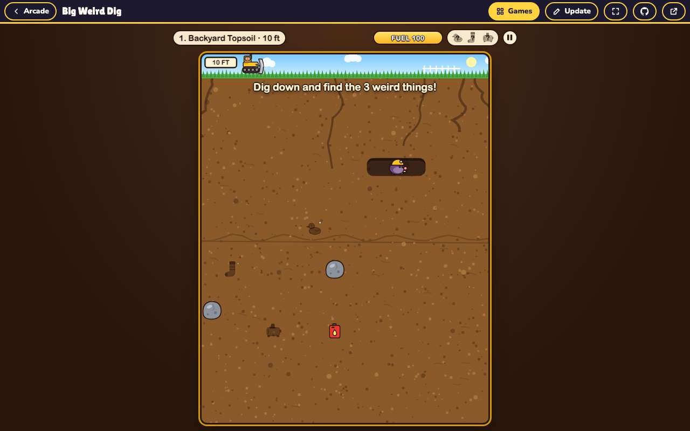 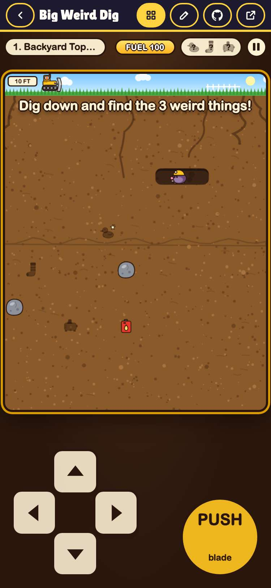
