# Evidence: 157-pet-wash-payback

**PASS: 9 of 9 checks pass at desktop and phone widths.**

Generated by `npm run evidence -- 157-pet-wash-payback` from [`tests/evidence/157-pet-wash-payback.spec.mjs`](../../tests/evidence/157-pet-wash-payback.spec.mjs) against the local server (python3 -m http.server) on this branch, starting from commit ed8c245, 2026-10-24 13:42 UTC. Rules: [docs/evidence.md](../../docs/evidence.md).

| Check | Desktop 1280 | Phone 375 |
|---|---|---|
| the title screen opens and Play leads to Biscuit's wash, with nothing loaded from the internet | pass | pass |
| dragging over a mud spot scrubs it to bubbles, rinses it and towels it dry, with a real mouse or finger | pass | pass |
| the hose round runs with the real controls: arrow keys on a laptop, a drag joystick on a phone | pass | pass |
| each pet sprays its own way: the cat ambushes from a bush, the bunny sprinkles, the pig leaves mud, the surprise duck throws balloons | pass | pass |
| a whole game through the real buttons: all 5 pets washed in time and escaped, with a final score | pass | pass |
| later pets are harder: a player who stands still gets wetter, and the wash clock gets tighter | pass | pass |
| the game pauses, and Restart starts the round over | pass | pass |
| best stars are saved only under gameon.pet-wash-payback., and Pick a pet shows them | pass | pass |
| Pet Wash Payback has a card near the front of the arcade and plays in its frame | pass | pass |

## 1. the title screen opens and Play leads to Biscuit's wash, with nothing loaded from the internet

- desktop: Biscuit in the tub with 7 mud spots and 35 seconds on the clock; soap, rinse and towel buttons; no requests outside the site; no sideways scrolling
- phone: Biscuit in the tub with 7 mud spots and 35 seconds on the clock; soap, rinse and towel buttons; no requests outside the site; no sideways scrolling

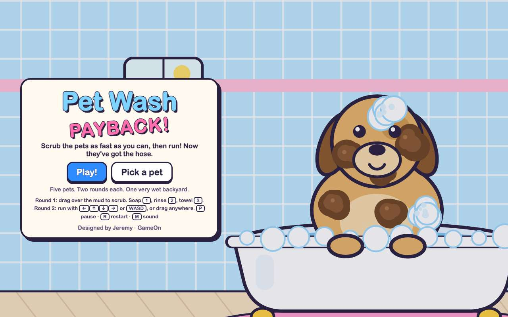 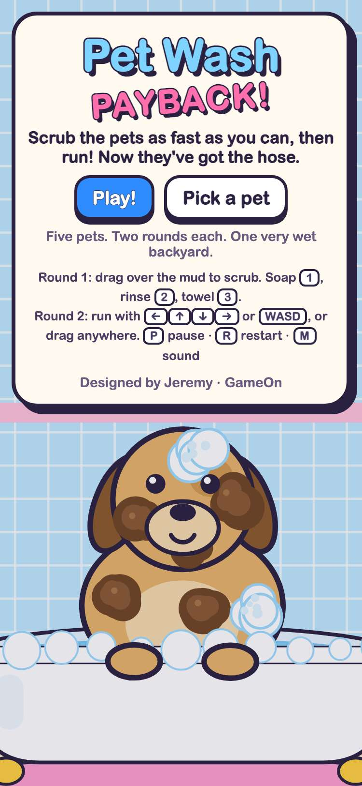

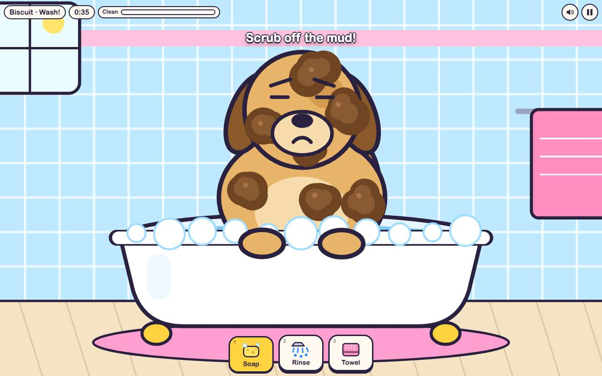 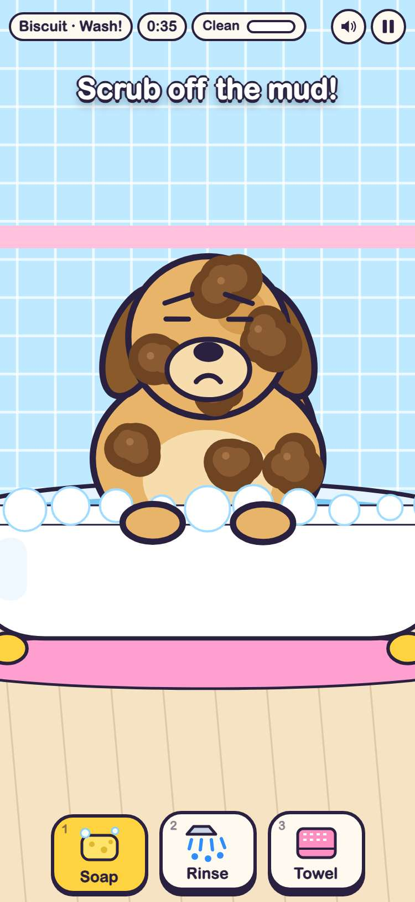

## 2. dragging over a mud spot scrubs it to bubbles, rinses it and towels it dry, with a real mouse or finger

- desktop: mouse drag: spot 1 went mud → bubbles → wet → clean; the Clean meter is at 14%
- phone: touch drag: spot 1 went mud → bubbles → wet → clean; the Clean meter is at 14%

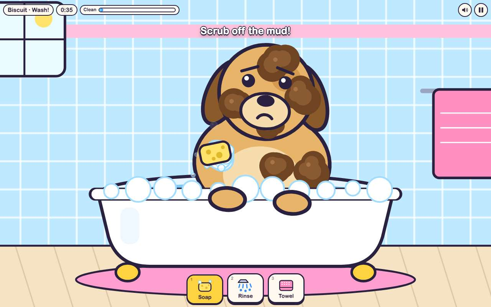 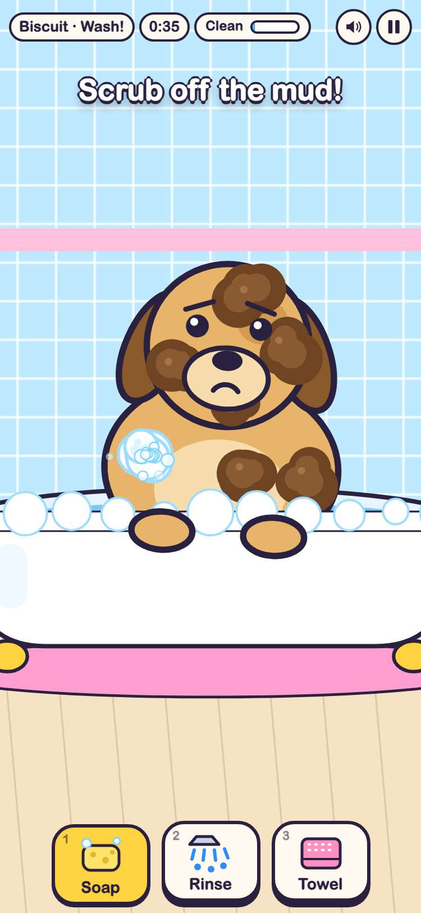

## 3. the hose round runs with the real controls: arrow keys on a laptop, a drag joystick on a phone

- desktop: held → and ↑: the kid ran from (236, 423) to (328, 333)
- phone: dragged the joystick up and right: the kid ran from (150, 931) to (276, 855)

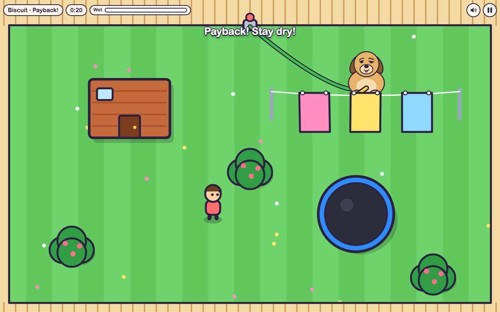 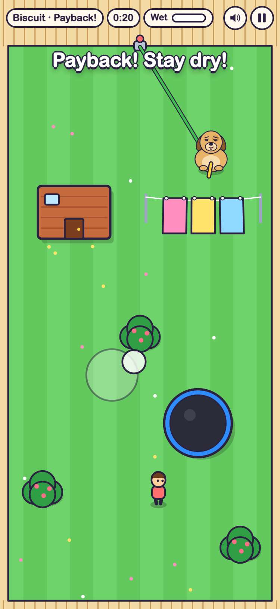

## 4. each pet sprays its own way: the cat ambushes from a bush, the bunny sprinkles, the pig leaves mud, the surprise duck throws balloons

- desktop: Mittens waited in a bush, then sprayed from it; Clover hopped and swished her sprinkler 1.18 radians; Truffle left 1 mud puddles that cut your speed to 103 (from 205), with a cone 0.42 radians wide; Sir Quackers threw a balloon with its shadow at 236,423
- phone: Mittens waited in a bush, then sprayed from it; Clover hopped and swished her sprinkler 0.92 radians; Truffle left 2 mud puddles that cut your speed to 103 (from 205), with a cone 0.42 radians wide; Sir Quackers threw a balloon with its shadow at 150,931

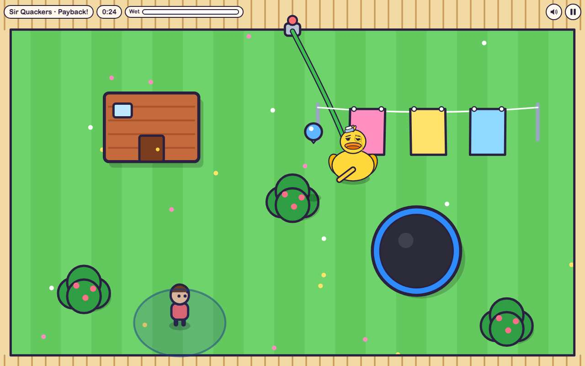 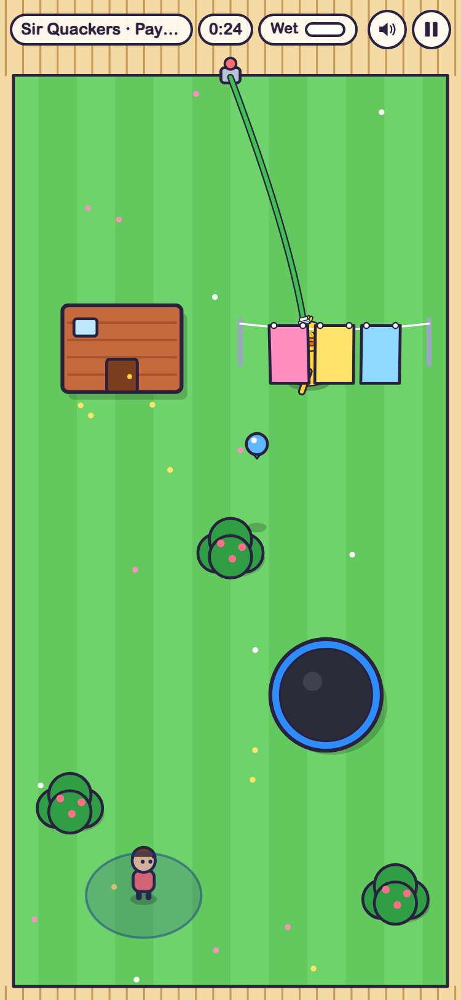

## 5. a whole game through the real buttons: all 5 pets washed in time and escaped, with a final score

- desktop: Biscuit: washed with 20.3s left (3★), 13% wet (3★); Mittens: washed with 20.8s left (3★), 0% wet (3★); Clover: washed with 21s left (3★), 0% wet (3★); Truffle: washed with 15.5s left (2★), 0% wet (3★); Sir Quackers: washed with 19.8s left (3★), 0% wet (3★); final 6586 points
- phone: Biscuit: washed with 18.1s left (3★), 0% wet (3★); Mittens: washed with 18.9s left (3★), 0% wet (3★); Clover: washed with 19.8s left (3★), 6% wet (3★); Truffle: washed with 9.1s left (2★), 6% wet (3★); Sir Quackers: washed with 16.8s left (3★), 0% wet (3★); final 6465 points

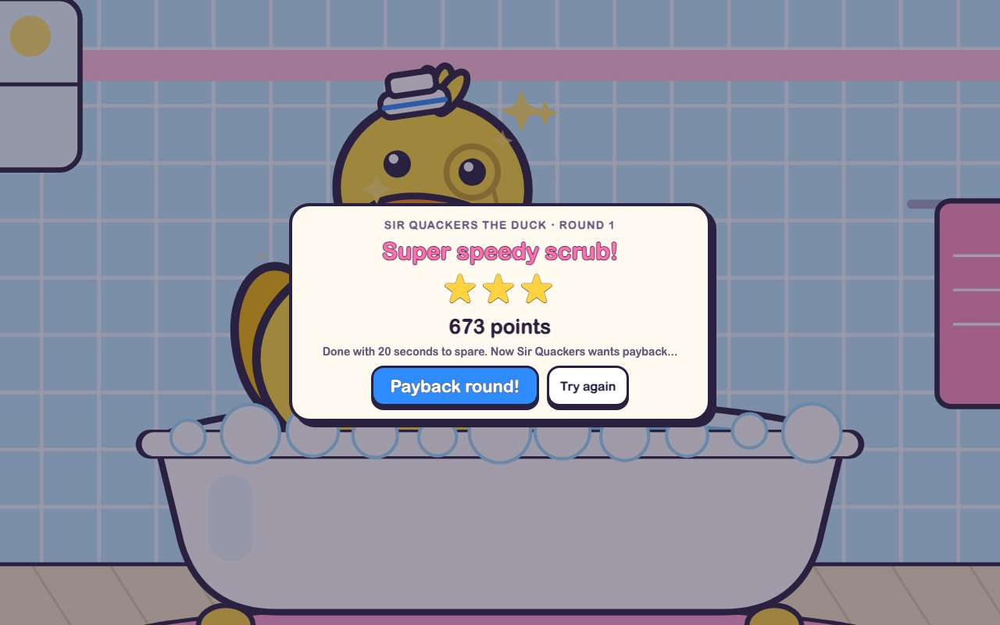 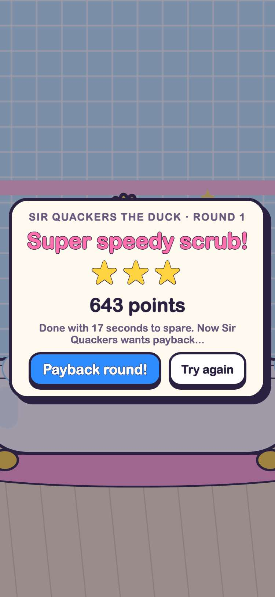

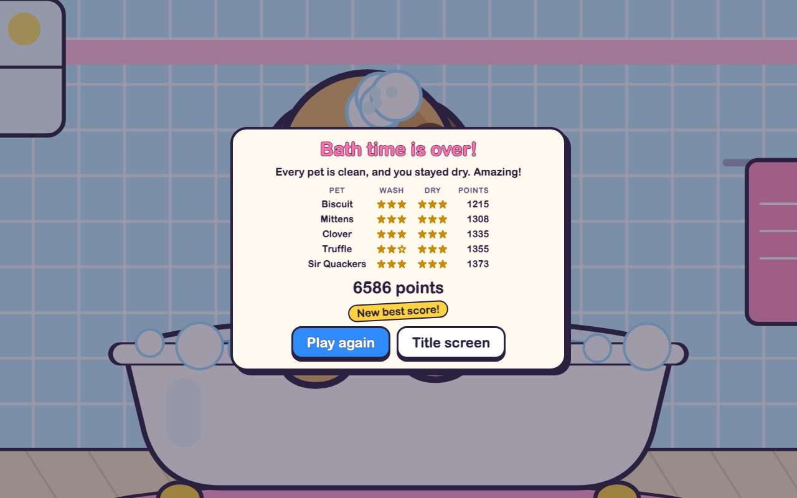 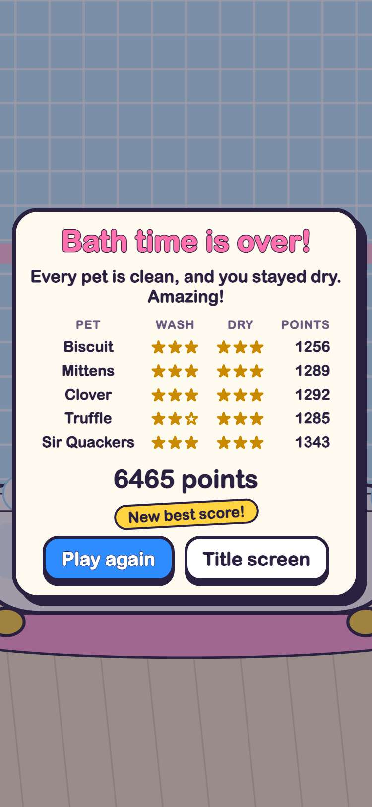

## 6. later pets are harder: a player who stands still gets wetter, and the wash clock gets tighter

- desktop: standing still: Biscuit SOAKED, Mittens SOAKED, Clover 68% wet, Truffle SOAKED, Sir Quackers SOAKED; wash: Biscuit 7 spots in 35s, Mittens 8 spots in 36s, Clover 9 spots in 37s, Truffle 10 spots in 42s, Sir Quackers 11 spots in 38s
- phone: standing still: Biscuit SOAKED, Mittens SOAKED, Clover 66% wet, Truffle 85% wet, Sir Quackers SOAKED; wash: Biscuit 7 spots in 35s, Mittens 8 spots in 36s, Clover 9 spots in 37s, Truffle 10 spots in 42s, Sir Quackers 11 spots in 38s

## 7. the game pauses, and Restart starts the round over

- desktop: paused at 34.8s left and the clock stayed put; Restart put Mittens back in the tub with a fresh clock; P pauses and unpauses
- phone: paused at 34.8s left and the clock stayed put; Restart put Mittens back in the tub with a fresh clock; P pauses and unpauses

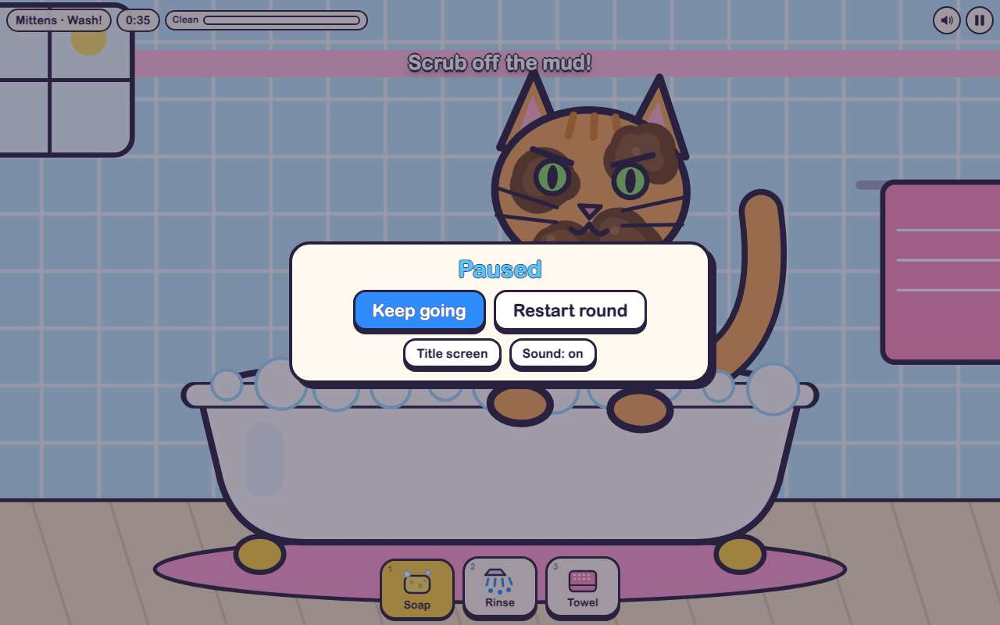 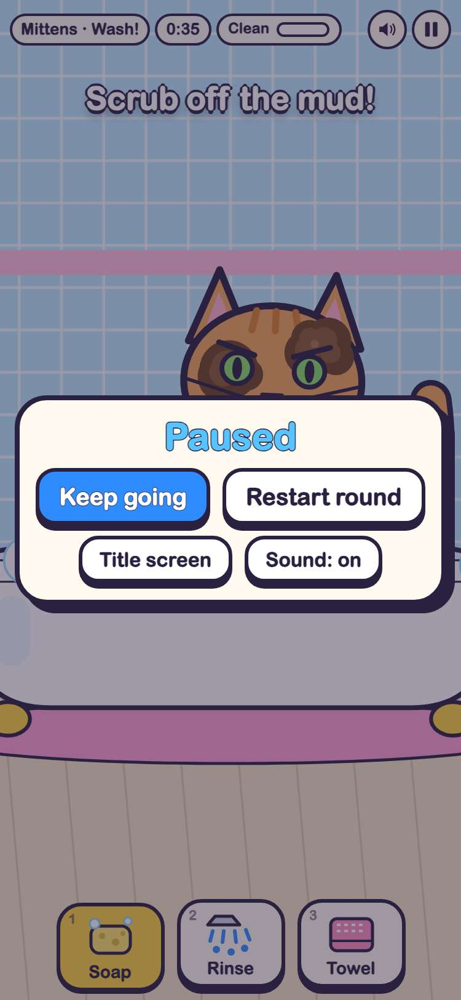

## 8. best stars are saved only under gameon.pet-wash-payback., and Pick a pet shows them

- desktop: keys: gameon.pet-wash-payback.best, gameon.pet-wash-payback.reached; Biscuit's best 3★ wash and 3☂ dry still there after a reload; Mittens unlocked, the surprise pet still a secret
- phone: keys: gameon.pet-wash-payback.best, gameon.pet-wash-payback.reached; Biscuit's best 3★ wash and 3☂ dry still there after a reload; Mittens unlocked, the surprise pet still a secret

## 9. Pet Wash Payback has a card near the front of the arcade and plays in its frame

- desktop: card at position 2 on the shelf with its 800x450 cover; plays inside the frame; GitHub button opens its folder
- phone: card at position 2 on the shelf with its 800x450 cover; plays inside the frame; GitHub button opens its folder

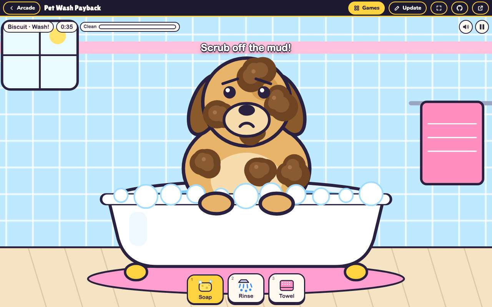 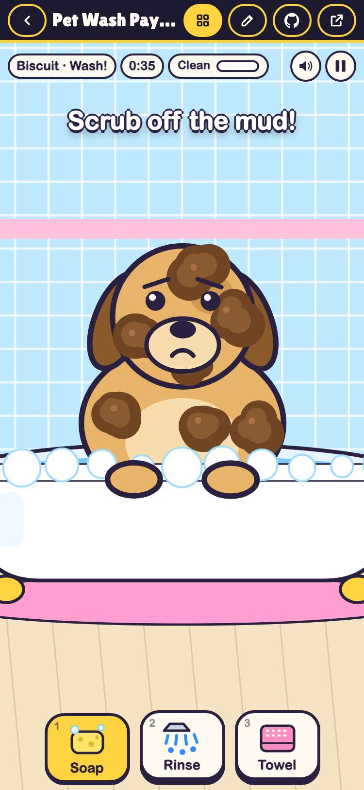
