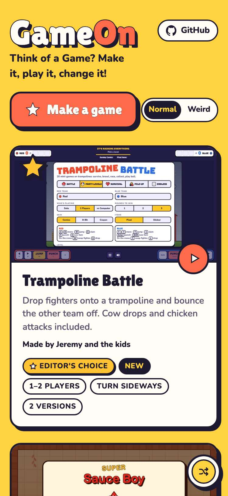
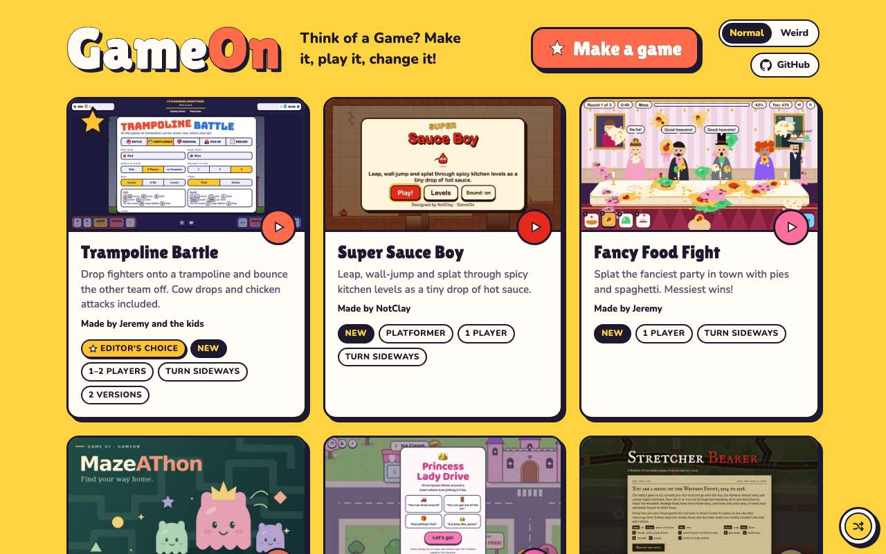
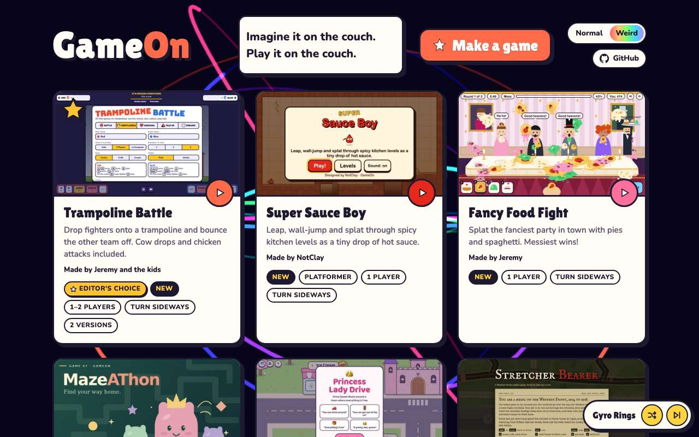
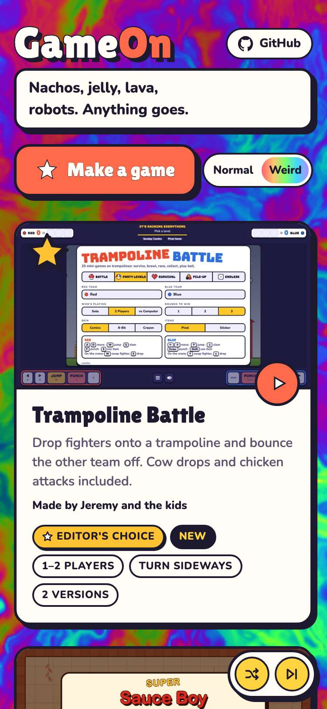

# Evidence: 158-editors-choice

**PASS: 4 of 4 checks pass at desktop and phone widths.**

Generated by `npm run evidence -- 158-editors-choice` from [`tests/evidence/158-editors-choice.spec.mjs`](../../tests/evidence/158-editors-choice.spec.mjs) against the local server (python3 -m http.server) on this branch, starting from commit 81908a5, 2026-10-24 13:07 UTC. Rules: [docs/evidence.md](../../docs/evidence.md).

| Check | Desktop 1280 | Phone 375 |
|---|---|---|
| Trampoline Battle is the only Editor's Choice, first on the shelf, and the rest keep their order | pass | pass |
| in Normal mode the starred card fits with no sideways scroll | pass | pass |
| in Weird mode the starred card fits with no sideways scroll | pass | pass |
| the starred card, deep links and the version picker still work | pass | pass |

## 1. Trampoline Battle is the only Editor's Choice, first on the shelf, and the rest keep their order

- desktop: shelf: trampoline-battle, super-sauce-boy, fancy-food-fight, mazeathon, princess-lady-drive, stretcher-bearer, angry-dudes, magic-friends, timedout
- phone: shelf: trampoline-battle, super-sauce-boy, fancy-food-fight, mazeathon, princess-lady-drive, stretcher-bearer, angry-dudes, magic-friends, timedout

 

## 2. in Normal mode the starred card fits with no sideways scroll

- desktop: 1280px normal: star inside the cover, 5 tags inside the card, page 1280px wide
- phone: 375px normal: star inside the cover, 5 tags inside the card, page 375px wide

 

## 3. in Weird mode the starred card fits with no sideways scroll

- desktop: 1280px weird: star inside the cover, 5 tags inside the card, page 1280px wide
- phone: 375px weird: star inside the cover, 5 tags inside the card, page 375px wide

 

## 4. the starred card, deep links and the version picker still work

- desktop: card opens the version picker (jeremy.v2 first); #trampoline-battle@jeremy.v1 plays; #super-sauce-boy plays
- phone: card opens the version picker (jeremy.v2 first); #trampoline-battle@jeremy.v1 plays; #super-sauce-boy plays
