# Evidence: 163-pet-wash-payback-jeremy-v2

**PASS: 11 of 11 checks pass at desktop and phone widths.**

Generated by `npm run evidence -- 163-pet-wash-payback-jeremy-v2` from [`tests/evidence/163-pet-wash-payback-jeremy-v2.spec.mjs`](../../tests/evidence/163-pet-wash-payback-jeremy-v2.spec.mjs) against the local server (python3 -m http.server) on this branch, starting from commit a19d43f, 2026-10-25 02:25 UTC. Rules: [docs/evidence.md](../../docs/evidence.md).

| Check | Desktop 1280 | Phone 375 |
|---|---|---|
| jeremy.v2 opens to its title screen and Play starts Biscuit's wash, with nothing loaded from outside the site | pass | pass |
| new in the tub: 10 squirrels that scurry and hop out when clean, and a parrot you tap to catch | pass | pass |
| new in the tub: the hippo sinks out of reach, and the octopus grabs the tool you're holding | pass | pass |
| payback: all nine pets come after you, each with its own way to get you wet, and only Biscuit has the hose | pass | pass |
| payback builds up round by round: more pets, a longer round, and a dodging player can still escape | pass | pass |
| what stays: dragging over a spot soaps, rinses and towels it, with a real mouse or finger | pass | pass |
| what stays: the run controls (arrow keys or a drag joystick), the wet meter, pause and restart | pass | pass |
| a whole game through the real buttons: nine pets washed, nine payback rounds, a final score | pass | pass |
| saves: jeremy.v1's best score, stars, unlocked pets and sound setting load, and jeremy.v1's keys stay as they were | pass | pass |
| jeremy.v1 still plays at games/pet-wash-payback/ | pass | pass |
| in the arcade, Pet Wash Payback plays jeremy.v2 by default and the picker still offers jeremy.v1 | pass | pass |

## 1. jeremy.v2 opens to its title screen and Play starts Biscuit's wash, with nothing loaded from outside the site

- desktop: title → "Pet 1 of 9" → Biscuit in the tub with 7 mud spots and 35 s; no requests outside the site (jeremy.v1 made none either); no sideways scrolling
- phone: title → "Pet 1 of 9" → Biscuit in the tub with 7 mud spots and 35 s; no requests outside the site (jeremy.v1 made none either); no sideways scrolling

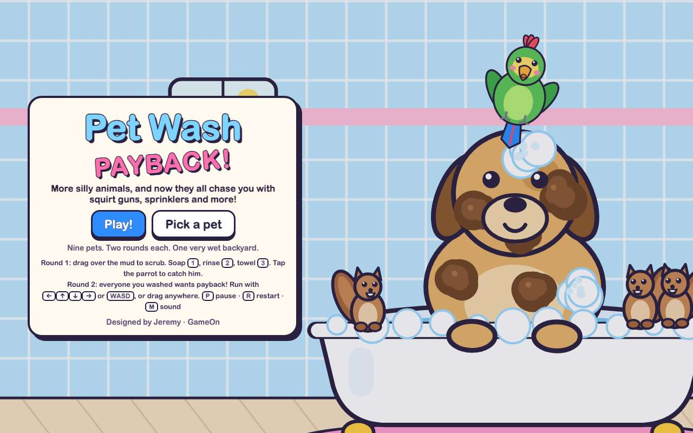 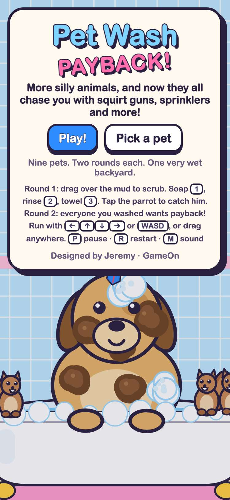

## 2. new in the tub: 10 squirrels that scurry and hop out when clean, and a parrot you tap to catch

- desktop: the Nutty Gang: 10 squirrels, 8 moved within 2 s; washed with 28 s left and all 10 hopped up on the tub. Pickles: a mouse click on him while flying caught him (fly → return → sit); he flew off again after 5.9 s; washed in 4 catches
- phone: the Nutty Gang: 10 squirrels, 9 moved within 2 s; washed with 28 s left and all 10 hopped up on the tub. Pickles: a finger tap on him while flying caught him (fly → return → sit); he flew off again after 5.9 s; washed in 4 catches

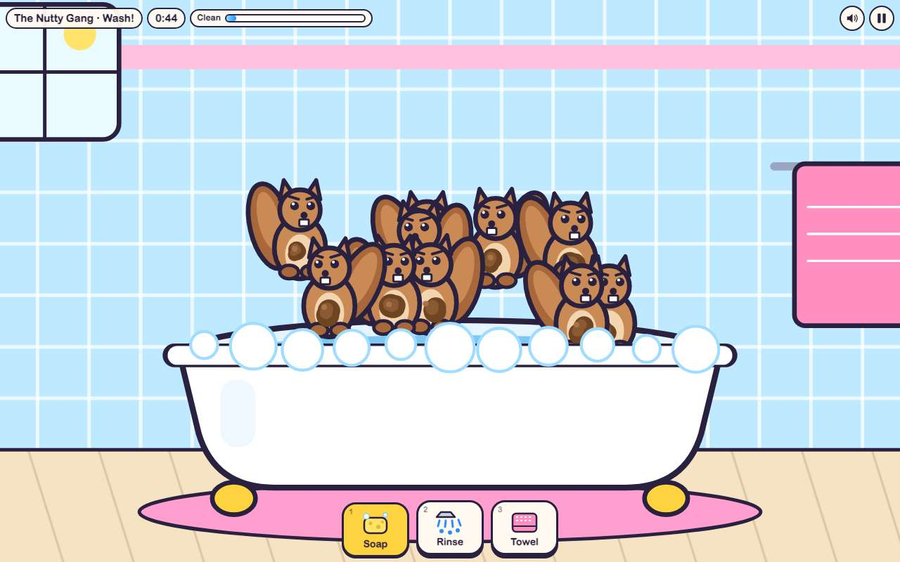 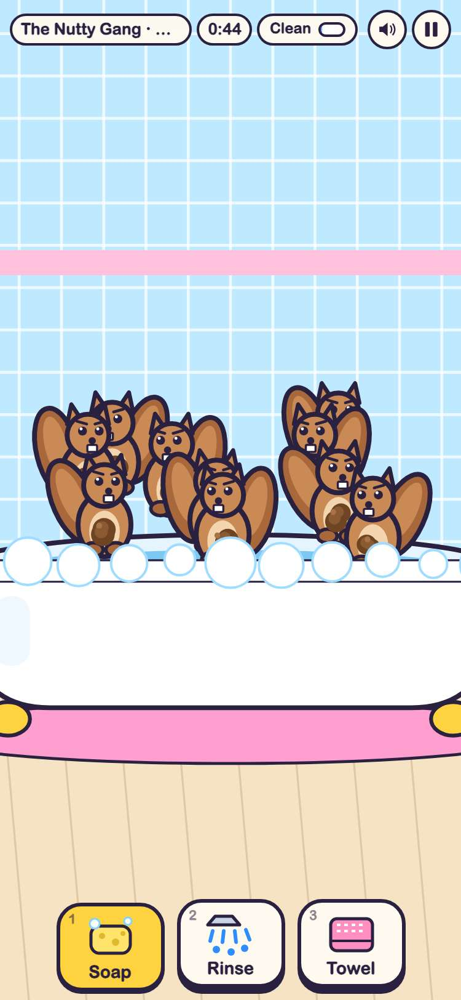

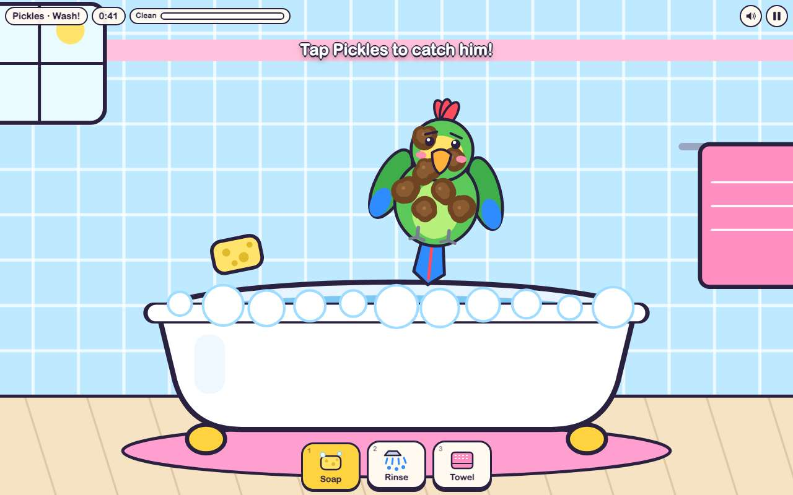 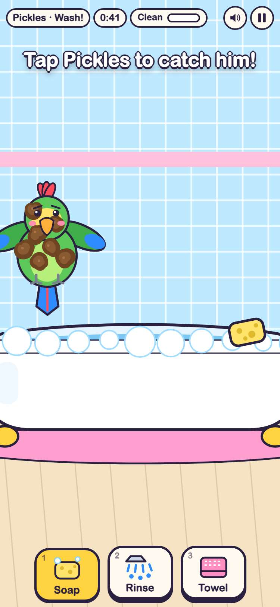

## 3. new in the tub: the hippo sinks out of reach, and the octopus grabs the tool you're holding

- desktop: Bubbles sank after 4.3 s and scrubbing a spot below the water did nothing; she came back up 1.8 s later; washed with time to spare (21.8 s). Inky grabbed the RINSE after 3.5 s: its button greys out and pressing 2 keeps the soap; he gave it back 2.4 s later; washed in 14.1 s
- phone: Bubbles sank after 4.3 s and scrubbing a spot below the water did nothing; she came back up 1.8 s later; washed with time to spare (28.4 s). Inky grabbed the RINSE after 3.5 s: its button greys out and pressing 2 keeps the soap; he gave it back 2.4 s later; washed in 17.2 s

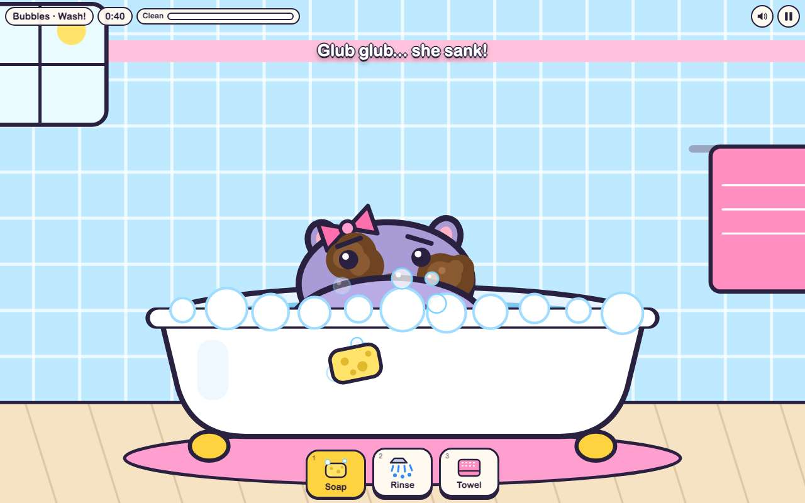 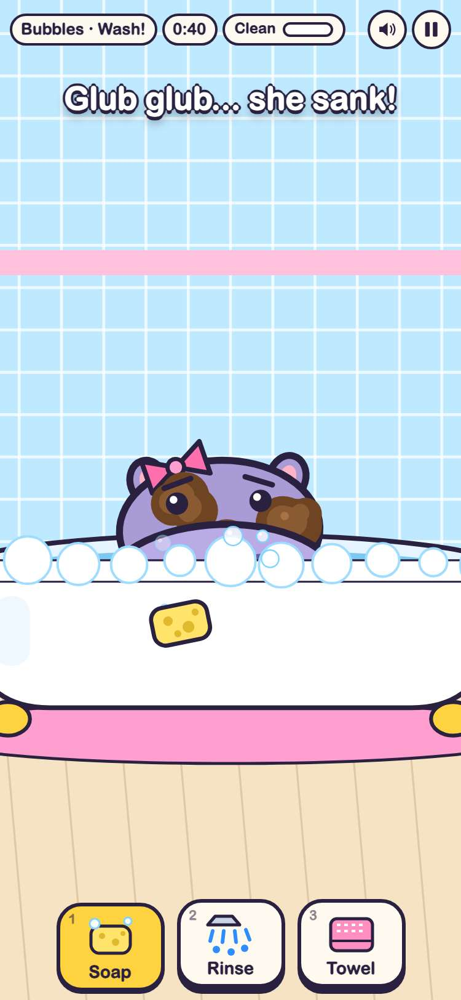

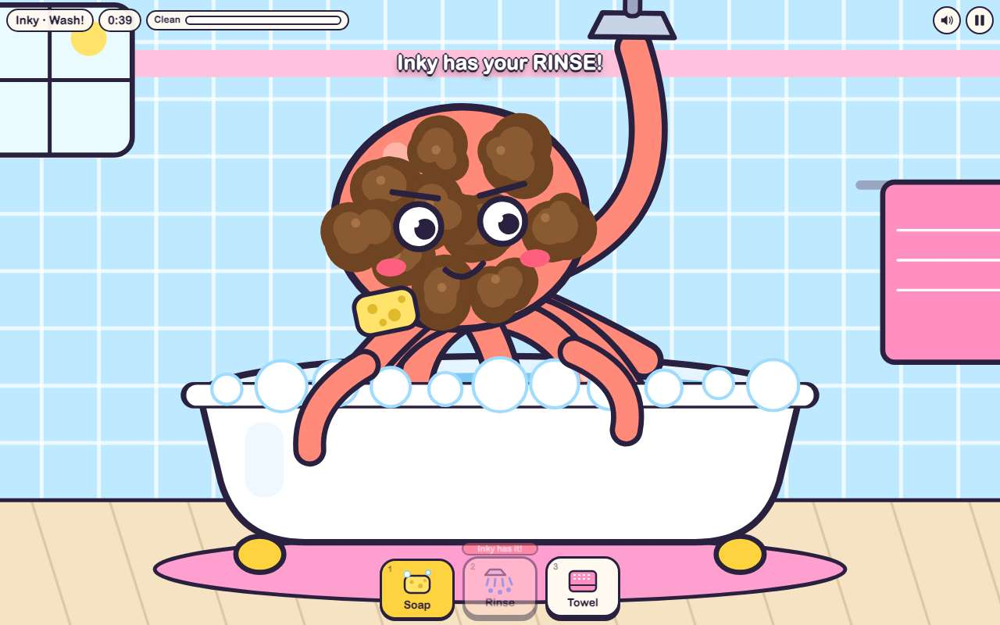 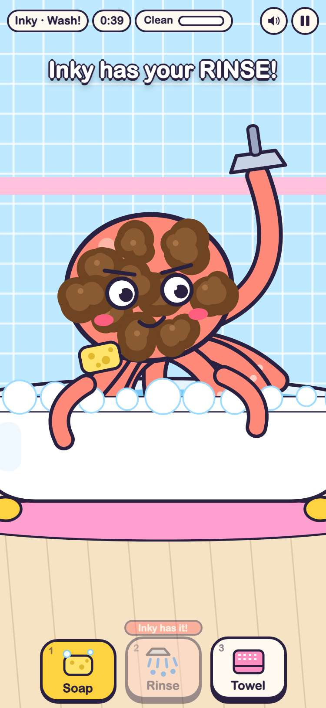

## 4. payback: all nine pets come after you, each with its own way to get you wet, and only Biscuit has the hose

- desktop: 5 chase at once on this screen (duck, dog, octopus, hippo, pig), the rest wait on the fence (parrot, bunny, squirrel, cat) and tag in; every pet joined within the 30 s round; nine different kinds of water seen (balloon, bucket, hose, mud, octo, rain, sprinkle, squirt, wave); standing still with all nine, hit by 9 of them (dog 191, octopus 11, hippo 2, pig 1, duck 15, parrot 13, bunny 36, squirrel 4, cat 32); exactly one hose. Alone, each one got a still player wet: dog (hose) after 2.0 s, cat (squirt gun) after 2.6 s, squirrel (bucket) after 2.7 s, bunny (sprinkler) after 1.8 s, parrot (rain cloud) after 3.1 s, pig (mud splash) after 2.6 s, hippo (belly flop) after 3.2 s, octopus (8 squirt guns) after 2.8 s, duck (water balloons) after 2.8 s
- phone: 4 chase at once on this screen (duck, dog, octopus, hippo), the rest wait on the fence (pig, parrot, bunny, squirrel, cat) and tag in; every pet joined within the 30 s round; nine different kinds of water seen (balloon, bucket, hose, mud, octo, rain, sprinkle, squirt, wave); standing still with all nine, hit by 8 of them (octopus 2, hippo 2, duck 15, dog 178, parrot 7, bunny 19, squirrel 2, cat 16); exactly one hose. Alone, each one got a still player wet: dog (hose) after 2.2 s, cat (squirt gun) after 3.2 s, squirrel (bucket) after 2.9 s, bunny (sprinkler) after 4.2 s, parrot (rain cloud) after 3.6 s, pig (mud splash) after 4.2 s, hippo (belly flop) after 6.1 s, octopus (8 squirt guns) after 3.0 s, duck (water balloons) after 2.8 s

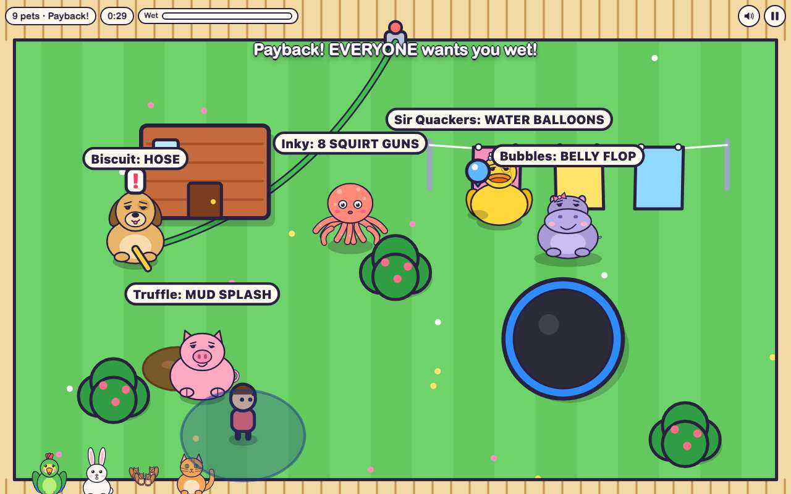 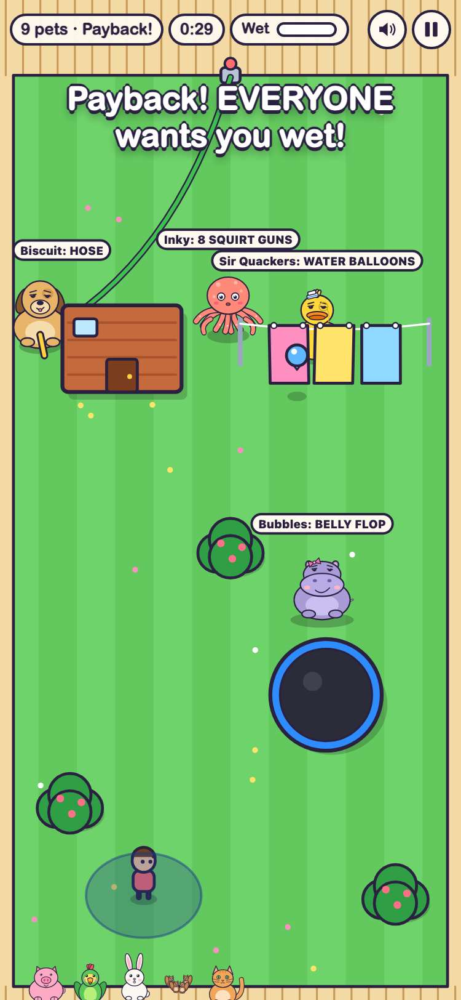

## 5. payback builds up round by round: more pets, a longer round, and a dodging player can still escape

- desktop: round after Biscuit: 1 pet (1 at once), 20 s; dodging 0% wet, standing still SOAKED; round after Mittens: 2 pets (2 at once), 23 s; dodging 7% wet, standing still SOAKED; round after The Nutty Gang: 3 pets (3 at once), 26 s; dodging 26% wet, standing still SOAKED; round after Clover: 4 pets (4 at once), 28 s; dodging 21% wet, standing still SOAKED; round after Pickles: 5 pets (5 at once), 30 s; dodging 19% wet, standing still SOAKED; round after Truffle: 6 pets (5 at once), 30 s; dodging 66% wet, standing still SOAKED; round after Bubbles: 7 pets (5 at once), 30 s; dodging 51% wet, standing still SOAKED; round after Inky: 8 pets (5 at once), 30 s; dodging 28% wet, standing still SOAKED; round after Sir Quackers: 9 pets (5 at once), 30 s; dodging 65% wet, standing still SOAKED
- phone: round after Biscuit: 1 pet (1 at once), 20 s; dodging 5% wet, standing still SOAKED; round after Mittens: 2 pets (2 at once), 23 s; dodging 3% wet, standing still SOAKED; round after The Nutty Gang: 3 pets (3 at once), 26 s; dodging 15% wet, standing still SOAKED; round after Clover: 4 pets (4 at once), 28 s; dodging 9% wet, standing still SOAKED; round after Pickles: 5 pets (4 at once), 30 s; dodging 16% wet, standing still SOAKED; round after Truffle: 6 pets (4 at once), 30 s; dodging 15% wet, standing still SOAKED; round after Bubbles: 7 pets (4 at once), 30 s; dodging 35% wet, standing still SOAKED; round after Inky: 8 pets (4 at once), 30 s; dodging 38% wet, standing still SOAKED; round after Sir Quackers: 9 pets (4 at once), 30 s; dodging SOAKED, standing still SOAKED

## 6. what stays: dragging over a spot soaps, rinses and towels it, with a real mouse or finger

- desktop: mouse drag: Biscuit's spot 1 went mud → bubbles → wet → clean; the Clean meter is at 14%
- phone: touch drag: Biscuit's spot 1 went mud → bubbles → wet → clean; the Clean meter is at 14%

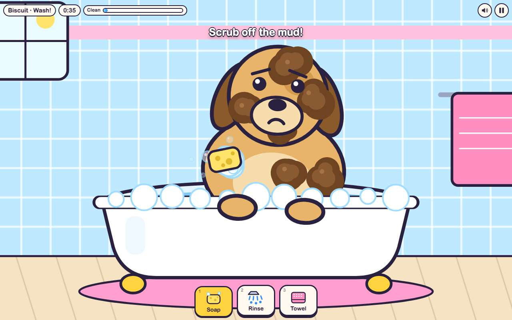 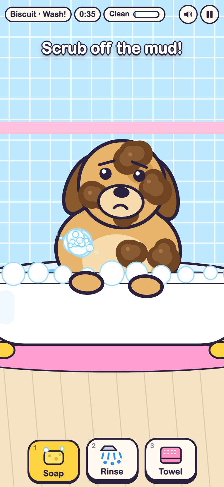

## 7. what stays: the run controls (arrow keys or a drag joystick), the wet meter, pause and restart

- desktop: held → and ↑: the kid ran from (236, 423) to (325, 336); paused at 19.4 s and the clock stayed put; Restart started the round over; P pauses and unpauses
- phone: dragged the joystick up and right: the kid ran from (150, 931) to (270, 858); paused at 19.2 s and the clock stayed put; Restart started the round over; P pauses and unpauses

## 8. a whole game through the real buttons: nine pets washed, nine payback rounds, a final score

- desktop: Biscuit: washed with 21.6 s left, then 1 pet → 2% wet; Mittens: washed with 22 s left, then 2 pets → 1% wet; The Nutty Gang: washed with 31.4 s left, then 3 pets → 28% wet; Clover: washed with 21.6 s left, then 4 pets → 89% wet; Pickles: washed with 27.3 s left, then 5 pets → 48% wet; Truffle: washed with 17.7 s left, then 6 pets → 63% wet; Bubbles: washed with 18.6 s left, then 7 pets → 18% wet; Inky: washed with 25.9 s left, then 8 pets → 48% wet; Sir Quackers: washed with 22.5 s left, then 9 pets → 70% wet; final 10477 points
- phone: Biscuit: washed with 20.1 s left, then 1 pet → 4% wet; Mittens: washed with 20.4 s left, then 2 pets → 2% wet; The Nutty Gang: washed with 29.4 s left, then 3 pets → 15% wet; Clover: washed with 21.9 s left, then 4 pets → 27% wet; Pickles: washed with 25.9 s left, then 5 pets → 10% wet; Truffle: washed with 14.8 s left, then 6 pets → 32% wet; Bubbles: washed with 22.4 s left, then 7 pets → 19% wet; Inky: washed with 26.3 s left, then 8 pets → 26% wet; Sir Quackers: washed with 18.8 s left, then 9 pets → SOAKED; final 11084 points

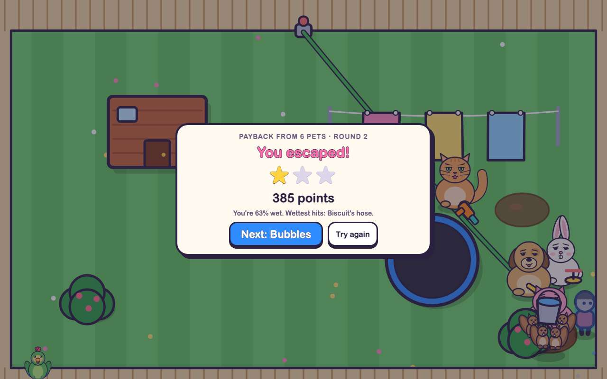 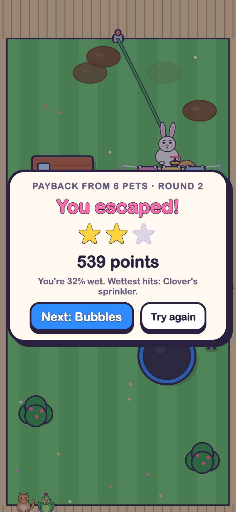

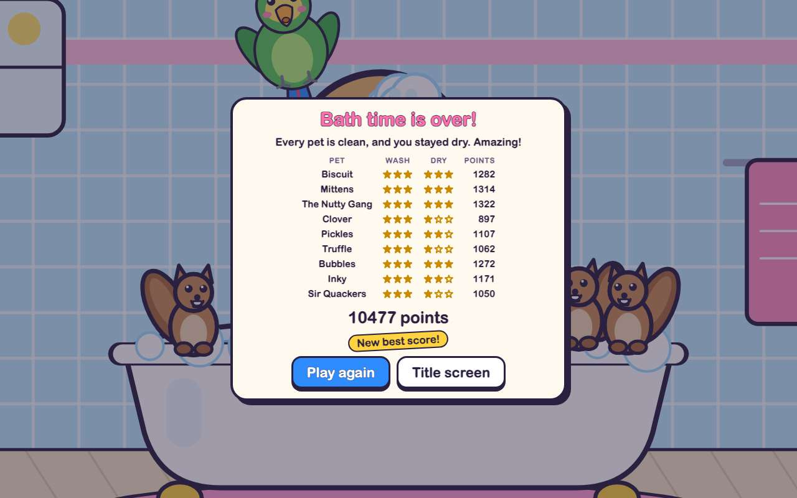 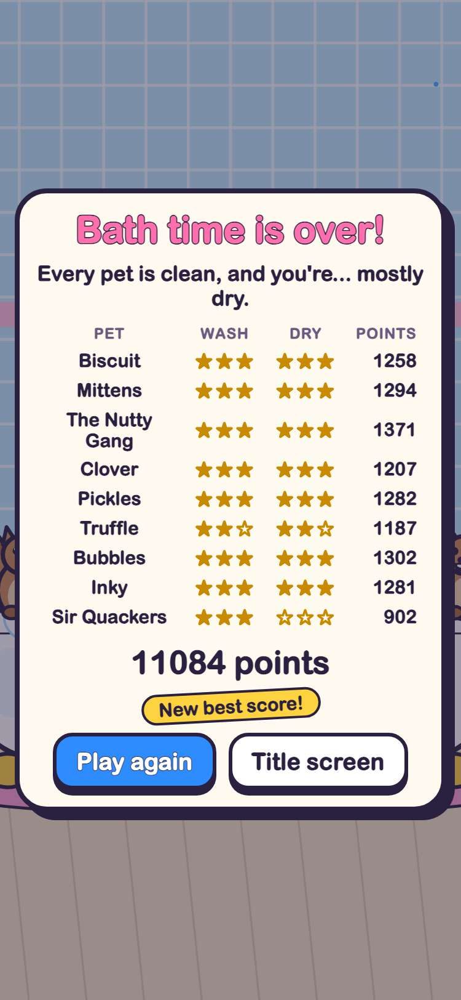

## 9. saves: jeremy.v1's best score, stars, unlocked pets and sound setting load, and jeremy.v1's keys stay as they were

- desktop: seeded jeremy.v1's best (4321, Biscuit ★3 ☂2), reached 3 and muted: jeremy.v2 shows the 4321 on its title, those stars in Pick a pet, the first 4 pets open (up to Clover) and the sound off. After a round: jeremy.v1's three keys are byte for byte the same; new keys: gameon.pet-wash-payback.jeremy.v2.best, gameon.pet-wash-payback.jeremy.v2.reached; jeremy.v1 still shows its best and stars
- phone: seeded jeremy.v1's best (4321, Biscuit ★3 ☂2), reached 3 and muted: jeremy.v2 shows the 4321 on its title, those stars in Pick a pet, the first 4 pets open (up to Clover) and the sound off. After a round: jeremy.v1's three keys are byte for byte the same; new keys: gameon.pet-wash-payback.jeremy.v2.best, gameon.pet-wash-payback.jeremy.v2.reached; jeremy.v1 still shows its best and stars

## 10. jeremy.v1 still plays at games/pet-wash-payback/

- desktop: jeremy.v1 at games/pet-wash-payback/: its own title, "Pet 1 of 5", Biscuit's wash running
- phone: jeremy.v1 at games/pet-wash-payback/: its own title, "Pet 1 of 5", Biscuit's wash running

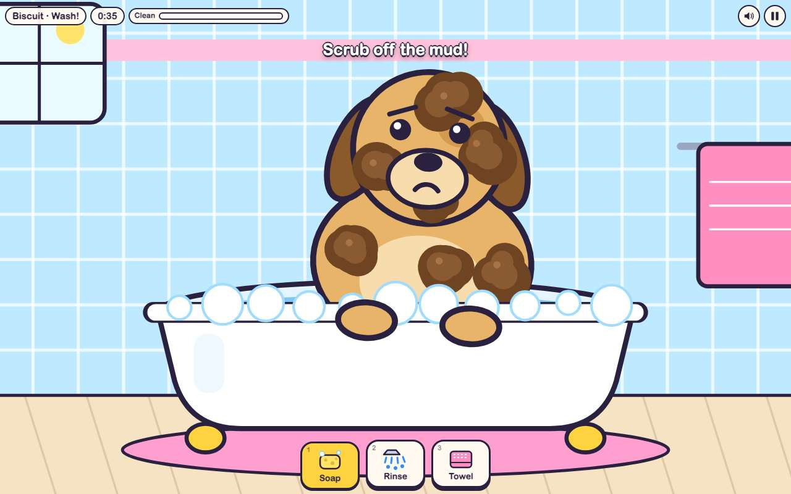 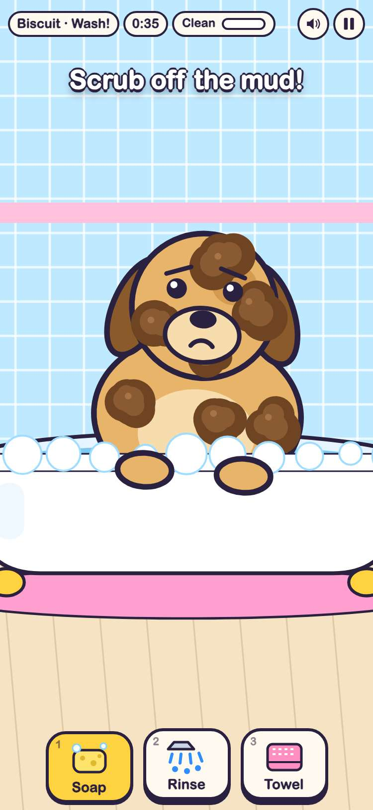

## 11. in the arcade, Pet Wash Payback plays jeremy.v2 by default and the picker still offers jeremy.v1

- desktop: card (2 versions) → picker: jeremy.v2 Latest first, then jeremy.v1 → jeremy.v2 plays in the frame (Pet 1 of 9); #pet-wash-payback@jeremy.v1 opens jeremy.v1 (Pet 1 of 5)
- phone: card (2 versions) → picker: jeremy.v2 Latest first, then jeremy.v1 → jeremy.v2 plays in the frame (Pet 1 of 9); #pet-wash-payback@jeremy.v1 opens jeremy.v1 (Pet 1 of 5)

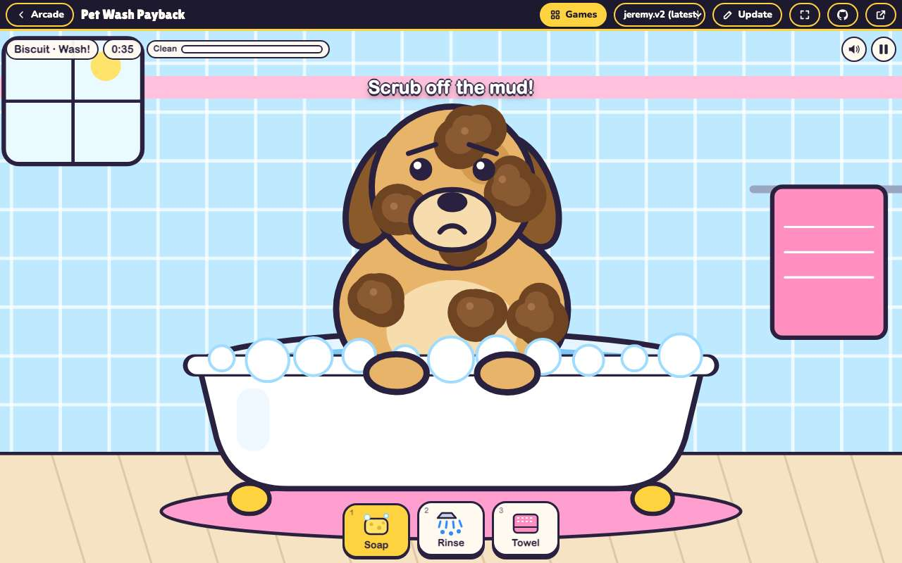 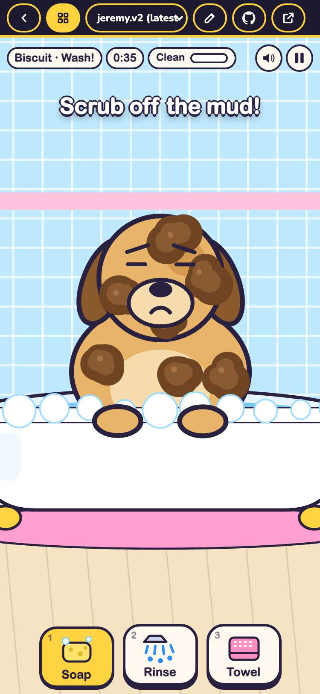
