# Evidence: 168-devils-burger-station

**PASS: 10 of 10 checks pass at desktop and phone widths.**

Generated by `npm run evidence -- 168-devils-burger-station` from [`tests/evidence/168-devils-burger-station.spec.mjs`](../../tests/evidence/168-devils-burger-station.spec.mjs) against the local server (python3 -m http.server) on this branch, starting from commit 786a78b, 2026-10-25 04:43 UTC. Rules: [docs/evidence.md](../../docs/evidence.md).

| Check | Desktop 1280 | Phone 375 |
|---|---|---|
| the title screen opens and shift 1 starts, with nothing loaded from the internet | pass | pass |
| a burger stacked like its ticket, with the right hot sauce, makes the devil happy and pays a tip | pass | pass |
| no hot sauce or the wrong one makes a devil steaming mad, and three of them end the shift | pass | pass |
| the game's words are goofy: devils get steaming mad, and there's no swearing anywhere | pass | pass |
| every one of the 5 shifts can be beaten in the real game, and each is busier than the last | pass | pass |
| later shifts bring fussy devils, double orders, and Big Boss Blaze at the end | pass | pass |
| the game pauses, and Restart starts the shift over | pass | pass |
| the best score and unlocked shifts are saved only under gameon.devils-burger-station. | pass | pass |
| the game still plays when the browser blocks saving | pass | pass |
| Devil's Burger Station has a card at the front of the arcade and plays in its frame | pass | pass |

## 1. the title screen opens and shift 1 starts, with nothing loaded from the internet

- desktop: 5 shifts, 8 ingredient buttons and 3 hot sauces (Mild, Fiery, LAVA); a devil walks up with a ticket; no requests outside the site; no sideways scrolling
- phone: 5 shifts, 8 ingredient buttons and 3 hot sauces (Mild, Fiery, LAVA); a devil walks up with a ticket; no requests outside the site; no sideways scrolling

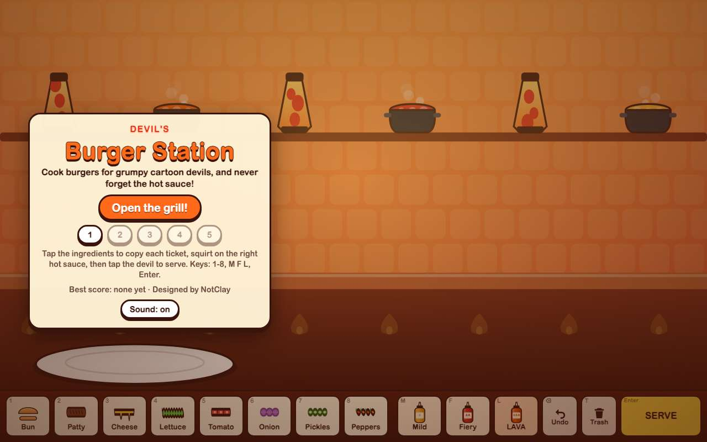 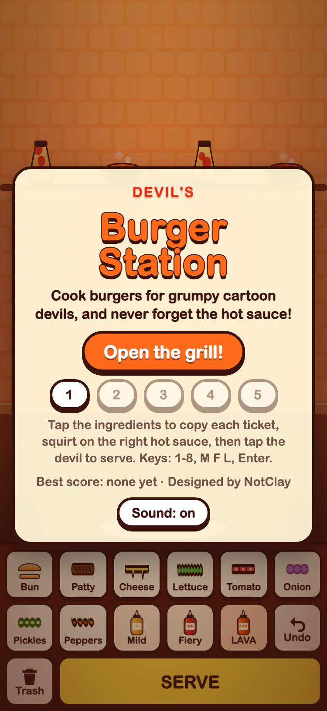

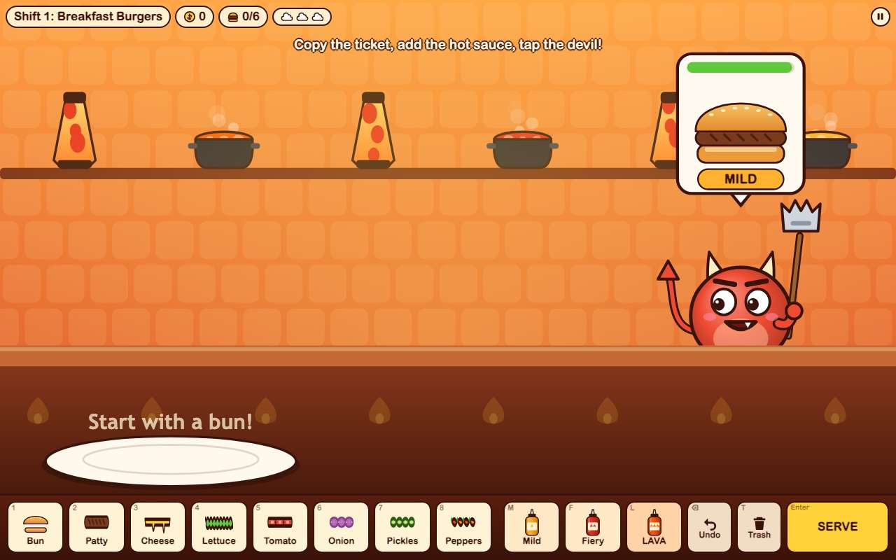 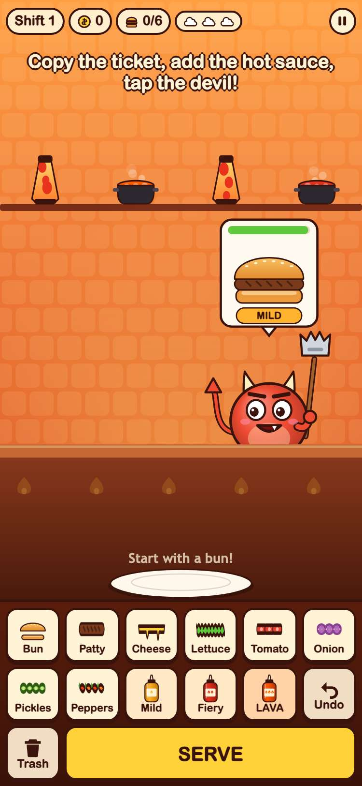

## 2. a burger stacked like its ticket, with the right hot sauce, makes the devil happy and pays a tip

- desktop: pressed the number keys and a sauce letter, then clicked the devil: bun + patty + bun with MILD sauce for Blip; paid 9 coins including a 4 coin tip
- phone: tapped the tray buttons, then tapped the devil: bun + patty + bun with MILD sauce for Blip; paid 9 coins including a 4 coin tip

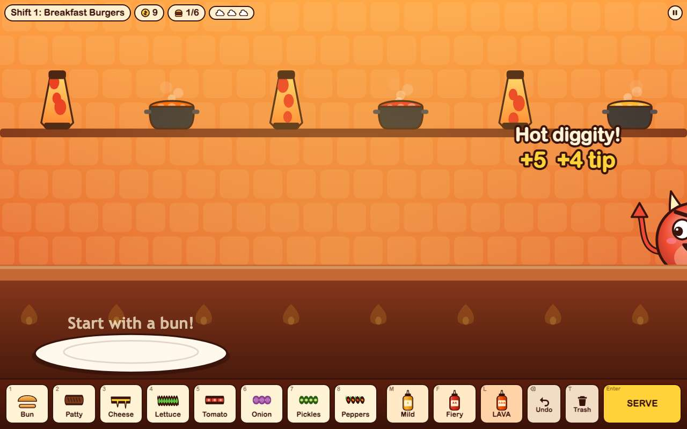 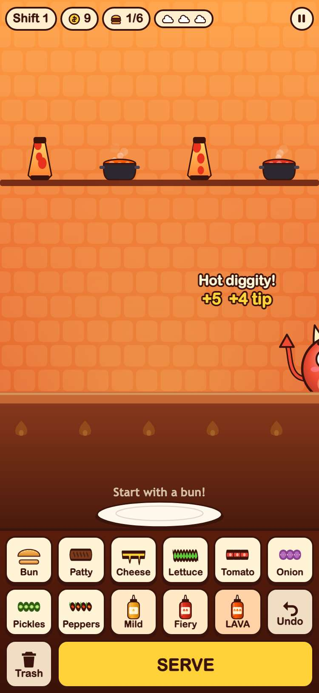

## 3. no hot sauce or the wrong one makes a devil steaming mad, and three of them end the shift

- desktop: no sauce on bun+patty+bun: steaming mad; LAVA instead of MILD: steaming mad; a third ran out of patience and the shift ended with "Too steamy in here!"; Try again started shift 1 fresh
- phone: no sauce on bun+patty+bun: steaming mad; LAVA instead of MILD: steaming mad; a third ran out of patience and the shift ended with "Too steamy in here!"; Try again started shift 1 fresh

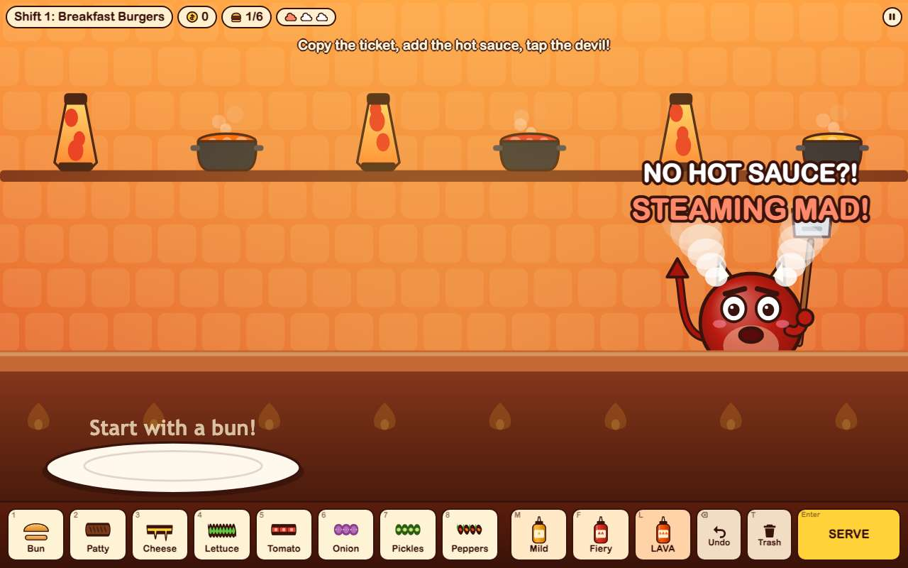 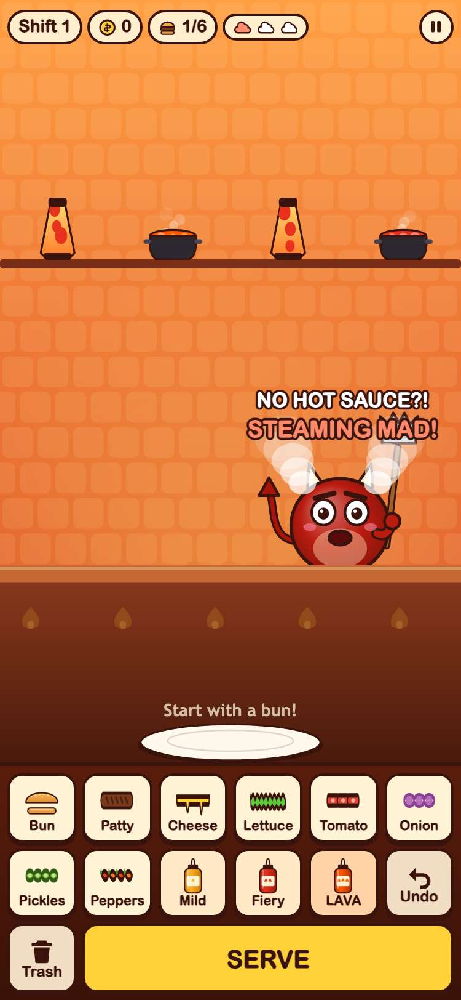

## 4. the game's words are goofy: devils get steaming mad, and there's no swearing anywhere

- desktop: index.html, game.js, engine.js, art.js, bot.js: "steaming mad" is there; none of hell, pissed, damn, crap or heck
- phone: index.html, game.js, engine.js, art.js, bot.js: "steaming mad" is there; none of hell, pissed, damn, crap or heck

## 5. every one of the 5 shifts can be beaten in the real game, and each is busier than the last

- desktop: shift: devils, at the counter at once, patience, coins, steaming mad, game seconds: 1: 6 devils, 2 at once, 46s, 75 coins, 0 steamed, 37s; 2: 8 devils, 2 at once, 42s, 119 coins, 0 steamed, 44s; 3: 10 devils, 3 at once, 40s, 176 coins, 0 steamed, 49s; 4: 11 devils, 3 at once, 38s, 292 coins, 0 steamed, 77s; 5: 13 devils, 3 at once, 36s, 329 coins, 0 steamed, 85s
- phone: shift: devils, at the counter at once, patience, coins, steaming mad, game seconds: 1: 6 devils, 2 at once, 46s, 75 coins, 0 steamed, 37s; 2: 8 devils, 2 at once, 42s, 119 coins, 0 steamed, 44s; 3: 10 devils, 3 at once, 40s, 176 coins, 0 steamed, 48s; 4: 11 devils, 3 at once, 38s, 292 coins, 0 steamed, 77s; 5: 13 devils, 3 at once, 36s, 329 coins, 0 steamed, 85s

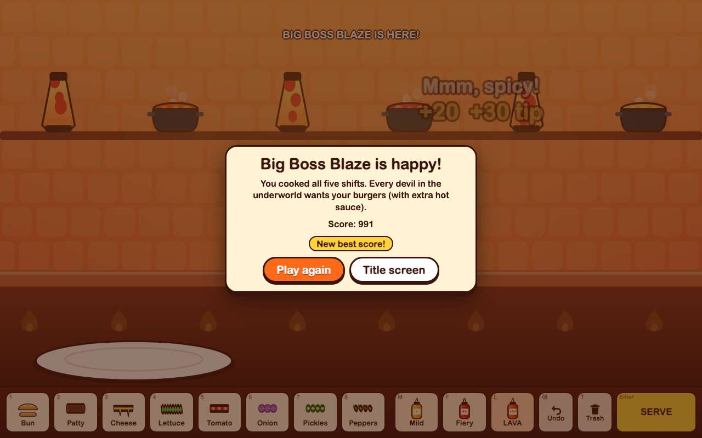 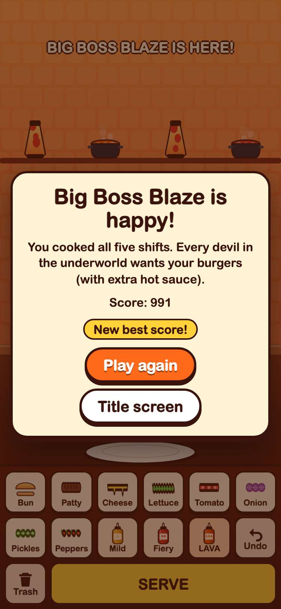

## 6. later shifts bring fussy devils, double orders, and Big Boss Blaze at the end

- desktop: shift 4: 5 double orders and 4 fussy devils; shift 5: 12 devils, then Big Boss Blaze with 2 burgers on one ticket (the first one ticked off here)
- phone: shift 4: 5 double orders and 4 fussy devils; shift 5: 12 devils, then Big Boss Blaze with 2 burgers on one ticket (the first one ticked off here)

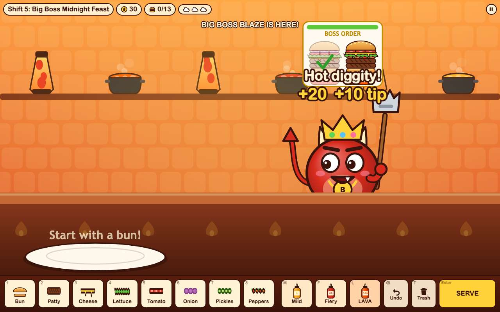 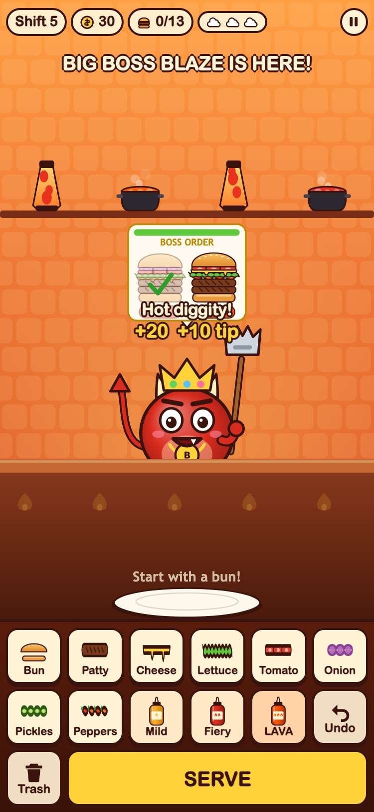

## 7. the game pauses, and Restart starts the shift over

- desktop: paused at 2.92s and the clock stayed put; Keep cooking ran it again; P paused, and Restart shift brought back the shift intro with a fresh clock and an empty plate
- phone: paused at 2.93s and the clock stayed put; Keep cooking ran it again; P paused, and Restart shift brought back the shift intro with a fresh clock and an empty plate

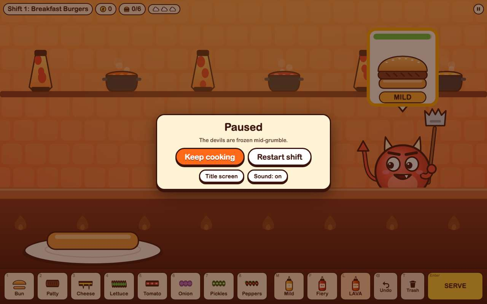 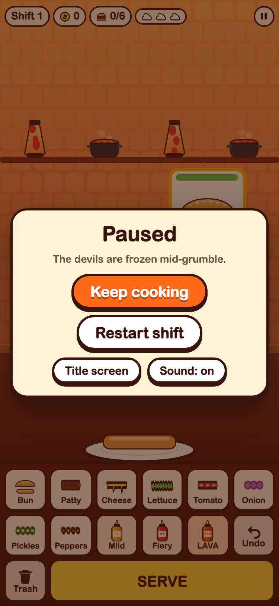

## 8. the best score and unlocked shifts are saved only under gameon.devils-burger-station.

- desktop: keys: gameon.devils-burger-station.sound, gameon.devils-burger-station.progress, gameon.devils-burger-station.best; after a reload the title shows best score 75, 3 stars on shift 1 and shift 2 unlocked
- phone: keys: gameon.devils-burger-station.sound, gameon.devils-burger-station.progress, gameon.devils-burger-station.best; after a reload the title shows best score 75, 3 stars on shift 1 and shift 2 unlocked

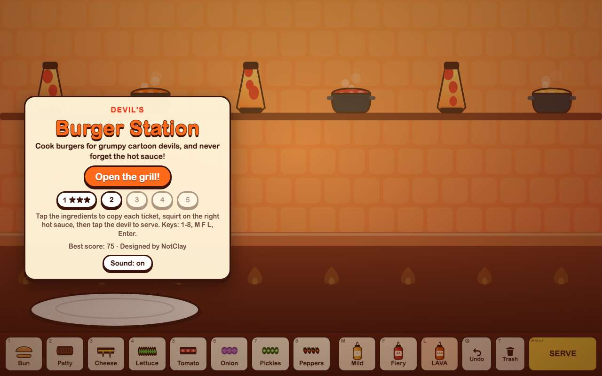 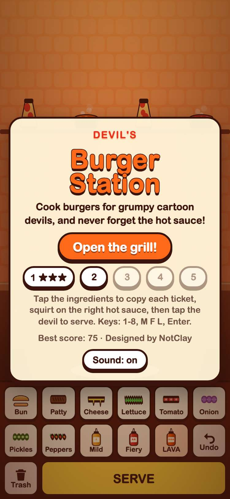

## 9. the game still plays when the browser blocks saving

- desktop: with localStorage throwing, the title screen opened and shift 1 played through to Shift clear
- phone: with localStorage throwing, the title screen opened and shift 1 played through to Shift clear

## 10. Devil's Burger Station has a card at the front of the arcade and plays in its frame

- desktop: card at position 2, after the 1 Editor's Choice card(s) and ahead of Oops! We're Late!, with its 800x450 cover; plays inside the frame; GitHub button opens its folder
- phone: card at position 2, after the 1 Editor's Choice card(s) and ahead of Oops! We're Late!, with its 800x450 cover; plays inside the frame; GitHub button opens its folder

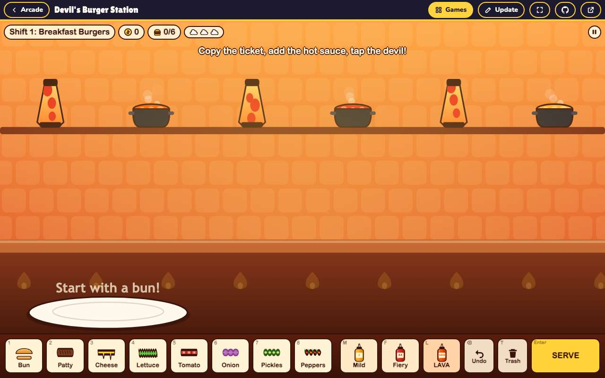 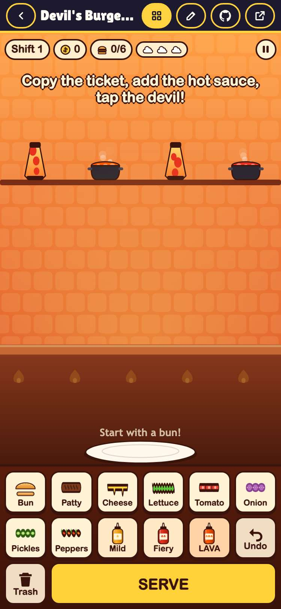
