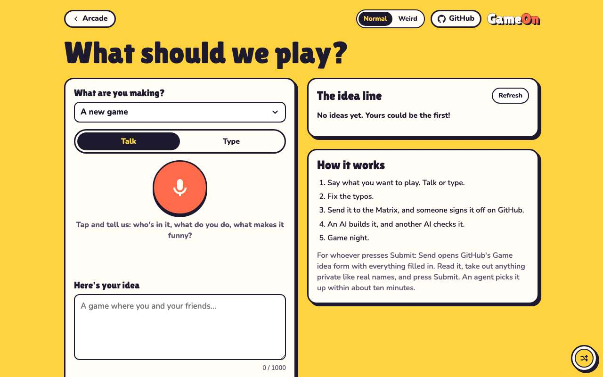
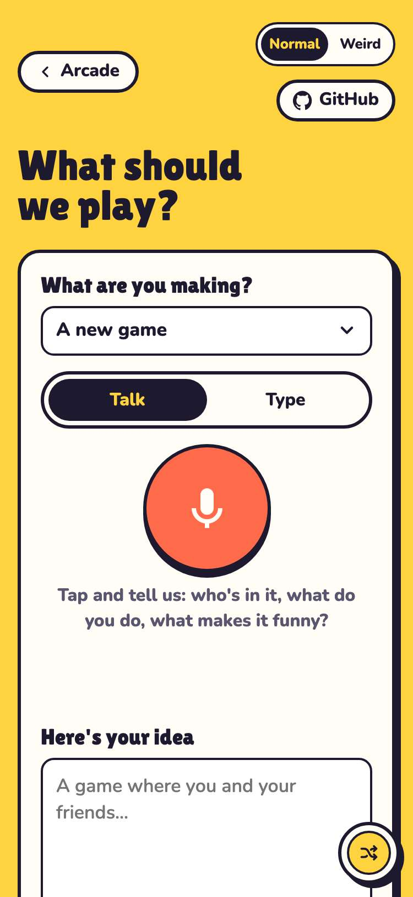
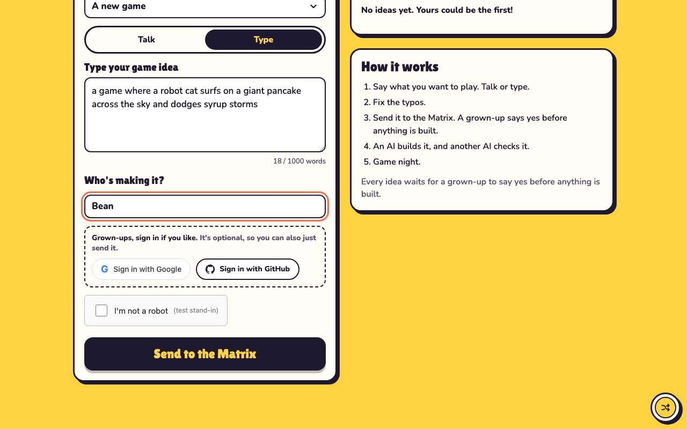
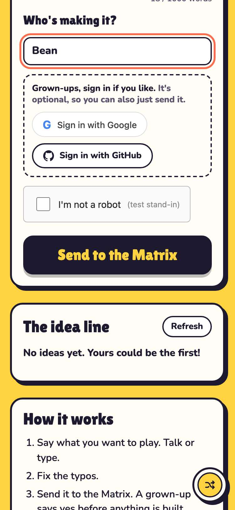
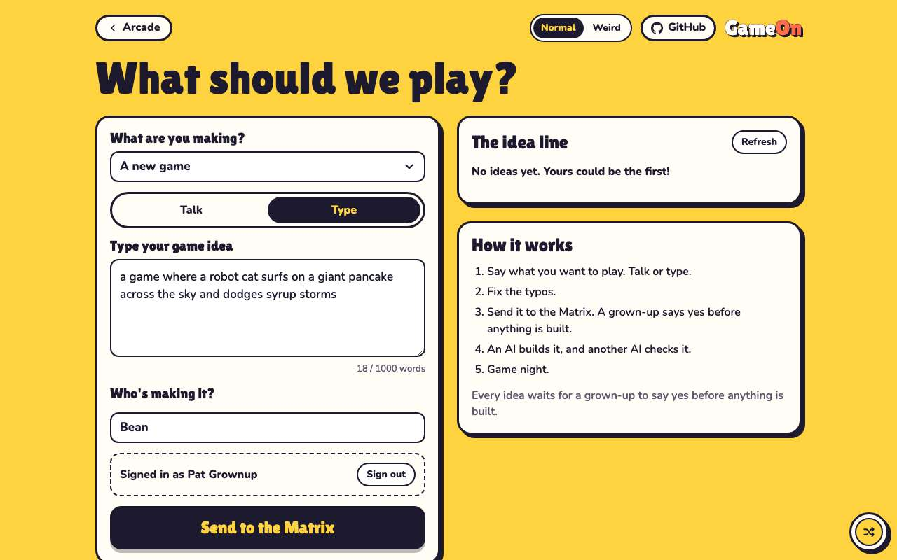
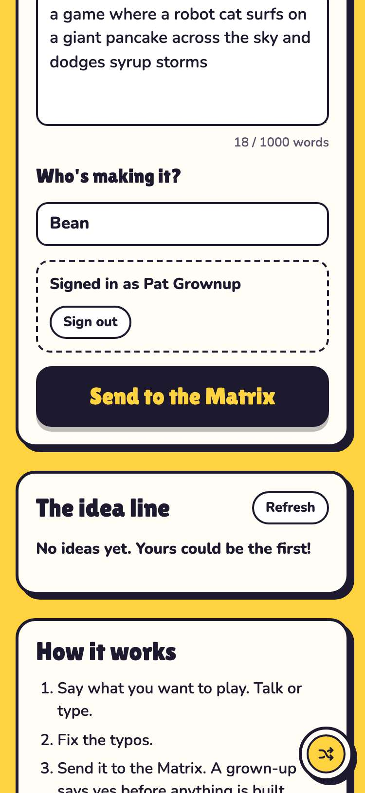
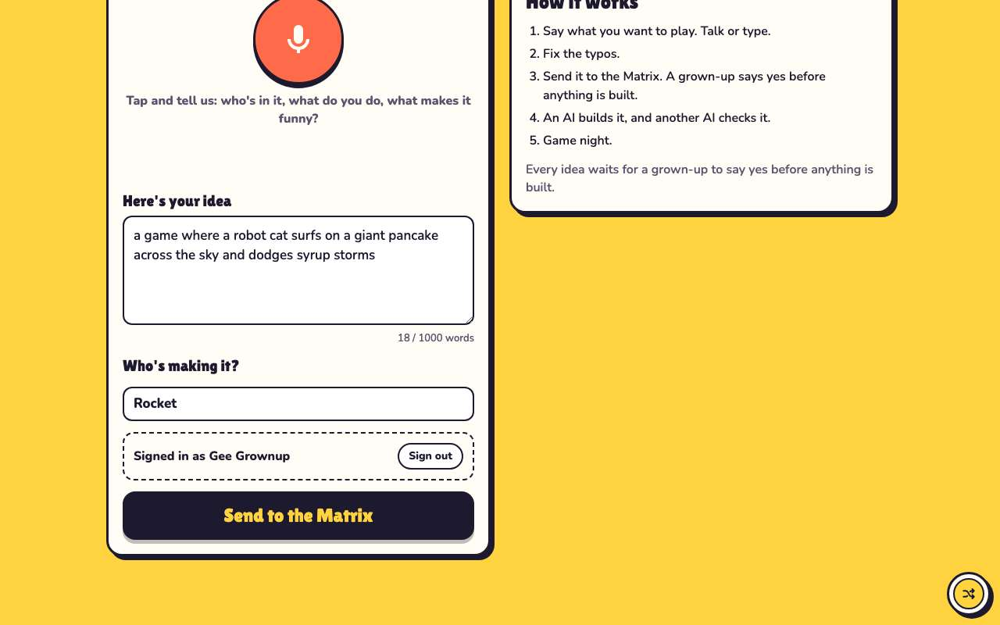
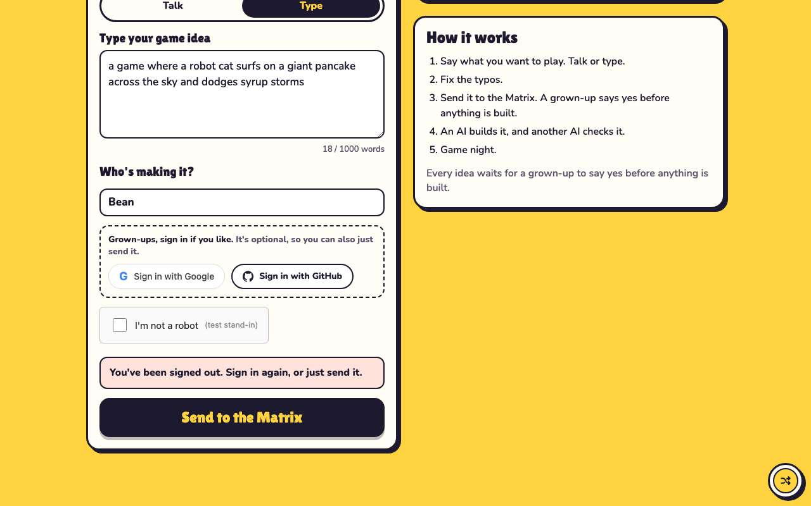
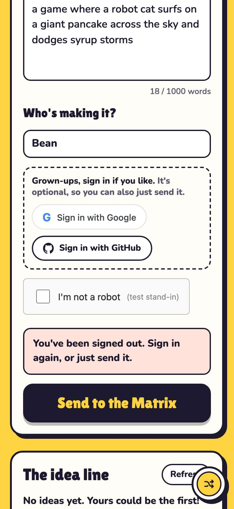

# Evidence: 173-page-sign-in

**PASS: 6 of 6 checks pass at desktop and phone widths.**

Generated by `npm run evidence -- 173-page-sign-in` from [`tests/evidence/173-page-sign-in.spec.mjs`](../../tests/evidence/173-page-sign-in.spec.mjs) against the local server (python3 -m http.server) on this branch, starting from commit b1969f9, 2026-10-25 03:05 UTC. Rules: [docs/evidence.md](../../docs/evidence.md).

| Check | Desktop 1280 | Phone 375 |
|---|---|---|
| with no sign-in configured, the page shows no sign-in and loads nothing from Google | pass | pass |
| with sign-in on, sending without signing in is unchanged: robot check, Turnstile token | pass | pass |
| Google sign-in shows Signed in as, skips the robot check and sends the session token | pass | pass |
| GitHub sign-in comes back with the token in the fragment, which leaves the address at once | pass | pass |
| Sign out forgets the session and brings back the robot check | pass | pass |
| the committed config leaves sign-in off until the Worker is set up | pass | pass |

## 1. with no sign-in configured, the page shows no sign-in and loads nothing from Google

- desktop: intake on with no providers, and intake off with providers named: no sign-in box, no Google script
- phone: intake on with no providers, and intake off with providers named: no sign-in box, no Google script

 

## 2. with sign-in on, sending without signing in is unchanged: robot check, Turnstile token

- desktop: body sent: {"idea":"<idea>","maker":"Bean","told_by":"typing","turnstile":"fake-turnstile-token"}
- phone: body sent: {"idea":"<idea>","maker":"Bean","told_by":"typing","turnstile":"fake-turnstile-token"}

 

## 3. Google sign-in shows Signed in as, skips the robot check and sends the session token

- desktop: POST /auth/google gets {credential}; POST /ideas gets {idea, maker, told_by, session} and no turnstile
- desktop: after a reload: still signed in (gameon.arcade.signin), still no robot check
- phone: POST /auth/google gets {credential}; POST /ideas gets {idea, maker, told_by, session} and no turnstile
- phone: after a reload: still signed in (gameon.arcade.signin), still no robot check

 

## 4. GitHub sign-in comes back with the token in the fragment, which leaves the address at once

- desktop: address after the return: /new/?from=evidence (no fragment); the idea and nickname were kept
- phone: address after the return: /new/?from=evidence (no fragment); the idea and nickname were kept

 

## 5. Sign out forgets the session and brings back the robot check

- desktop: Sign out clears gameon.arcade.signin; after a reload the robot check is back
- desktop: a signed_out refusal from the Worker signs out, keeps the idea, and shows the robot check
- phone: Sign out clears gameon.arcade.signin; after a reload the robot check is back
- phone: a signed_out refusal from the Worker signs out, keeps the idea, and shows the robot check

 

## 6. the committed config leaves sign-in off until the Worker is set up

- desktop: new/intake-config.js: url and familyCodes false unchanged; googleClientId "" and githubSignIn false
- phone: new/intake-config.js: url and familyCodes false unchanged; googleClientId "" and githubSignIn false
