# Evidence: 187-phone-friendly-games

**PASS: 18 of 18 checks pass at desktop and phone widths.**

Generated by `npm run evidence -- 187-phone-friendly-games` from [`tests/evidence/187-phone-friendly-games.spec.mjs`](../../tests/evidence/187-phone-friendly-games.spec.mjs) against the local server (python3 -m http.server) on this branch, starting from commit 443c499, 2026-10-29 16:58 UTC. Rules: [docs/evidence.md](../../docs/evidence.md).

| Check | Desktop 1280 | Phone 375 |
|---|---|---|
| Claw of Cool (games/claw-of-cool/jeremy.v2/) measured against the phone bar | pass | pass |
| Fidget Factory (games/fidget-factory/) measured against the phone bar | pass | pass |
| Ant Farm Wars (games/ant-farm-wars/) measured against the phone bar | pass | pass |
| Devil's Burger Station (games/devils-burger-station/) measured against the phone bar | pass | pass |
| Oops! We're Late! (games/oops-were-late/) measured against the phone bar | pass | pass |
| Pet Wash Payback (games/pet-wash-payback/jeremy.v3/) measured against the phone bar | pass | pass |
| Big Weird Dig (games/big-weird-dig/) measured against the phone bar | pass | pass |
| Super Sauce Boy (games/super-sauce-boy/) measured against the phone bar | pass | pass |
| Fancy Food Fight (games/fancy-food-fight/) measured against the phone bar | pass | pass |
| MazeAThon (games/mazeathon/) measured against the phone bar | pass | pass |
| Delve Squad (games/delve-squad/) measured against the phone bar | pass | pass |
| Trampoline Battle (games/trampoline-battle/jeremy.v2/) measured against the phone bar | pass | pass |
| Princess Lady Drive (games/princess-lady-drive/jeremy.v2/) measured against the phone bar | pass | pass |
| Stretcher Bearer (games/stretcher-bearer/jeremy.v1/) measured against the phone bar | pass | pass |
| Angry Dudes (games/angry-dudes/jeremy.v1/) measured against the phone bar | pass | pass |
| Magic Friends, Up We Go! (games/magic-friends/jeremy.v1/) measured against the phone bar | pass | pass |
| Timed Out (games/timedout/jeremy.v1/) measured against the phone bar | pass | pass |
| the audit covers every game's default version on dev today | pass | pass |

## 1. Claw of Cool (games/claw-of-cool/jeremy.v2/) measured against the phone bar

- desktop: a works, d works, ArrowLeft works, ArrowRight works, s works, w works, ArrowDown works, ArrowUp works
- phone: 375x812: tapped the Left pad key: 13 -> 19.000000000000004
- phone: 6 targets on the title screen, 13 in play; 22 short of the bar: title: "1 Classic Unlocked" and "2 Aquarium LOCKED" are 3 px apart (need 8); title: "2 Aquarium LOCKED" and "3 Dino Dig LOCKED" are 3 px apart (need 8); title: "3 Dino Dig LOCKED" and "4 Space Station LOCKED" are 2 px apart (need 8); title: "4 Space Station LOCKED" and "5 Snack Attack LOCKED" are 3 px apart (need 8); play: "Insert coin" is 103x27 (needs 48x48)

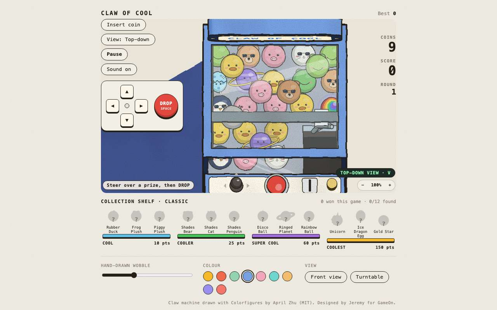 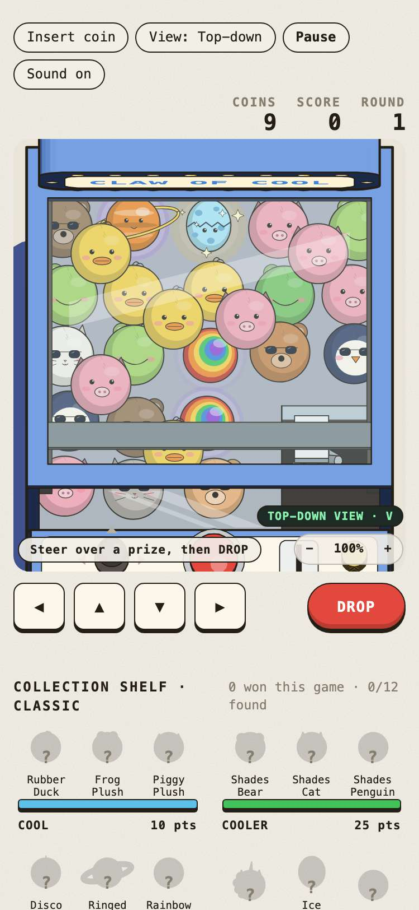

## 2. Fidget Factory (games/fidget-factory/) measured against the phone bar

- desktop: d does nothing, ArrowRight works, a does nothing, ArrowLeft works
- phone: 375x812: tapped Turn right: 0 -> 1
- phone: 4 targets on the title screen, 5 in play; 8 short of the bar: title: "My shelf (0)" is 295x47 (needs 48x48); title: "Sound effects" is 44x44 (needs 48x48); title: "Music" is 44x44 (needs 48x48); play: "Pause" is 44x44 (needs 48x48); play: "Shelf" is 67x41 (needs 48x48)

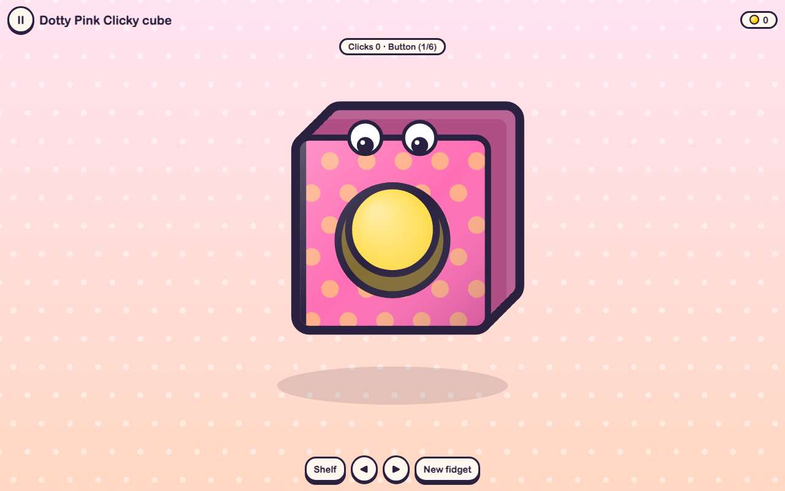 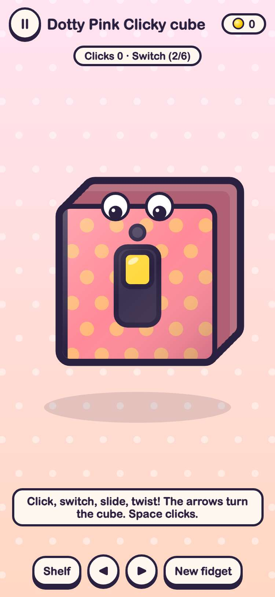

## 3. Ant Farm Wars (games/ant-farm-wars/) measured against the phone bar

- desktop: a does nothing, ArrowLeft does nothing, d does nothing, ArrowRight does nothing, w does nothing, ArrowUp does nothing
- phone: 375x812: tapped the farm (rally point): "null" -> "[11,13]"
- phone: 1 targets on the title screen, 3 in play; 7 short of the bar: title: "Play" is 99x47 (needs 48x48); play: "Speed (Space)" is 30x30 (needs 48x48); play: "Sound on or off" is 30x30 (needs 48x48); play: "Pause (P)" is 30x30 (needs 48x48); play: "Pause (P)" is 6 px from the edge (needs 8)

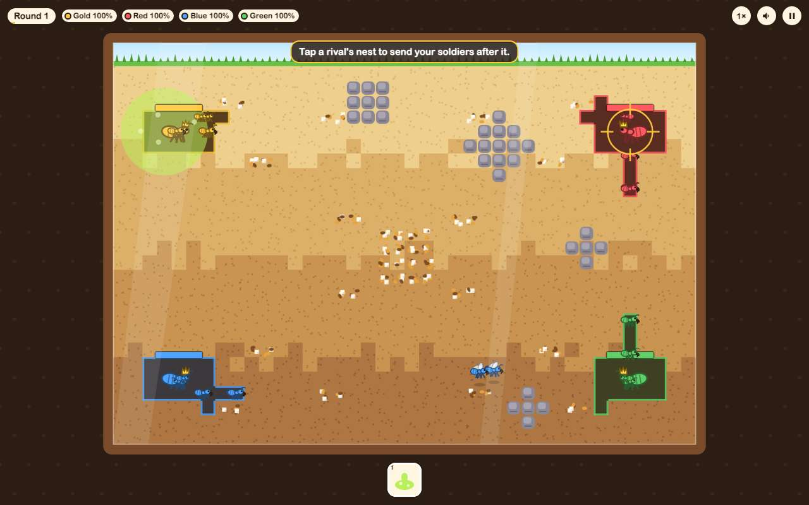 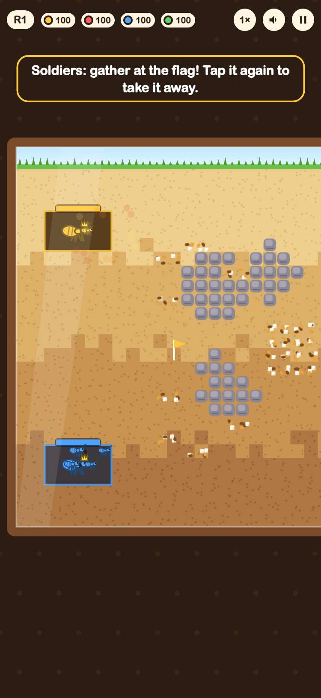

## 4. Devil's Burger Station (games/devils-burger-station/) measured against the phone bar

- desktop: a does nothing, ArrowLeft works, d does nothing, ArrowRight works
- phone: 375x812: tapped Bun: "[]" -> "[\"bun\"]"
- phone: 7 targets on the title screen, 15 in play; 50 short of the bar: title: "Open the grill!" is 187x47 (needs 48x48); title: "Shift 1: Breakfast Burge" is 46x35 (needs 48x48); title: "Shift 2: Lunch Rush" is 46x35 (needs 48x48); title: "Shift 3: Fussy Afternoon" is 46x35 (needs 48x48); title: "Shift 4: Double Trouble " is 46x35 (needs 48x48)

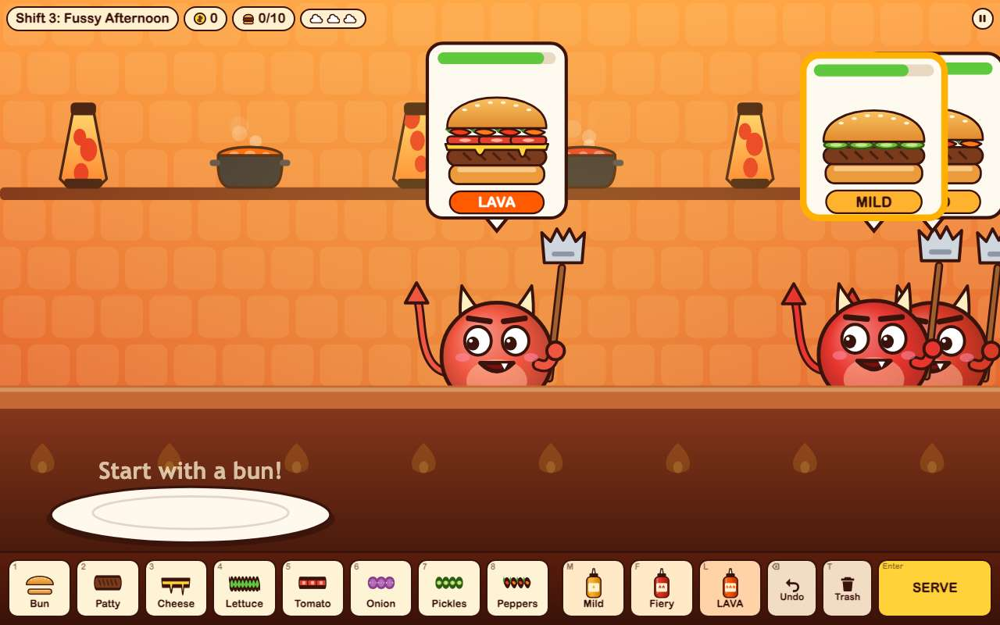 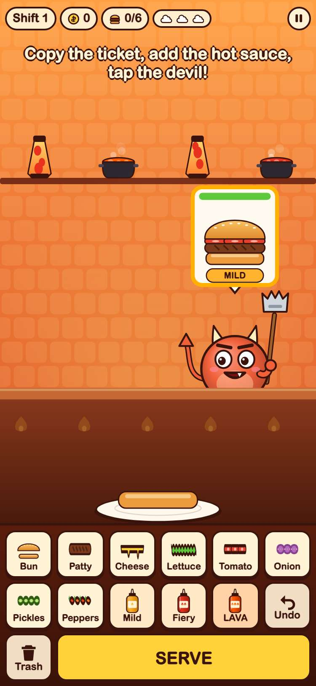

## 5. Oops! We're Late! (games/oops-were-late/) measured against the phone bar

- desktop: w works, ArrowUp works, a works, ArrowLeft works, s works, ArrowDown works, d works, ArrowRight works
- phone: 375x812: tapped a finger held on the floor: "440,676" -> "421,628"
- phone: 3 targets on the title screen, 1 in play; 4 short of the bar: title: "Sneak in!" is 132x47 (needs 48x48); title: "Rooms" is 109x47 (needs 48x48); title: "Sound: on" is 112x38 (needs 48x48); play: "Pause" is 28x28 (needs 48x48)

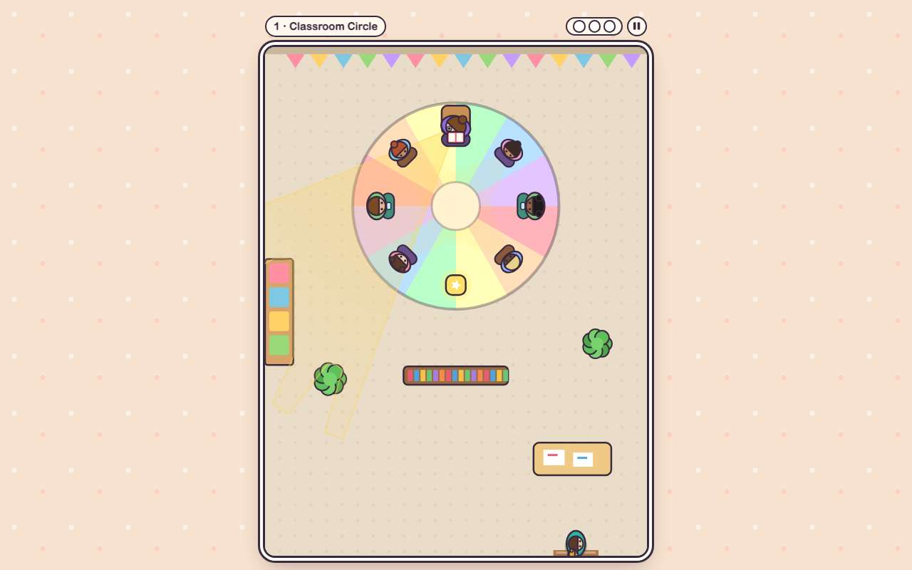 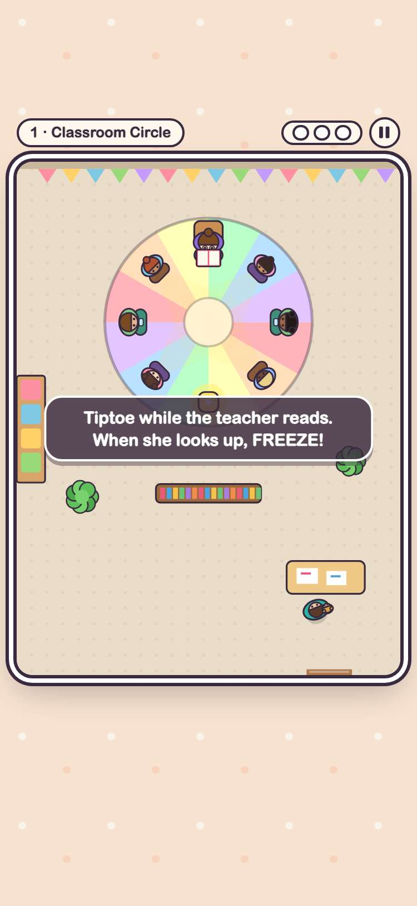

## 6. Pet Wash Payback (games/pet-wash-payback/jeremy.v3/) measured against the phone bar

- desktop: w does nothing, ArrowUp does nothing, a does nothing, ArrowLeft does nothing, s does nothing, ArrowDown does nothing, d does nothing, ArrowRight does nothing, Space does nothing, Enter does nothing
- phone: 375x812: tapped tool 2: 0 -> 2
- phone: 3 targets on the title screen, 5 in play; 7 short of the bar: title: "Play!" is 84x46 (needs 48x48); title: "Survival!" is 118x46 (needs 48x48); title: "Pick a pet" is 128x46 (needs 48x48); play: "Sound on or off" is 32x32 (needs 48x48); play: "Pause" is 32x32 (needs 48x48)

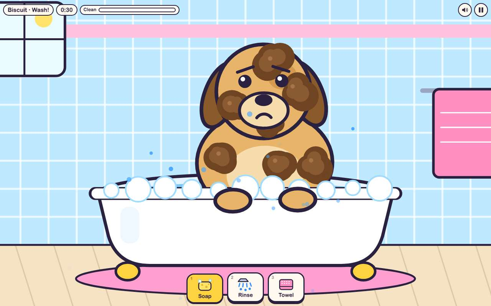 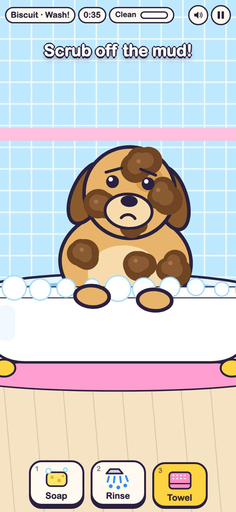

## 7. Big Weird Dig (games/big-weird-dig/) measured against the phone bar

- desktop: s works, w works, ArrowDown works, ArrowUp works, a works, d works, ArrowLeft works, ArrowRight works
- phone: 375x812: tapped the d-pad (down): "2.00,0.00" -> "2.00,1.81"
- phone: 4 targets on the title screen, 2 in play; 6 short of the bar: title: "Dig!" is 75x46 (needs 48x48); title: "Levels" is 97x46 (needs 48x48); title: "Weird Museum" is 173x46 (needs 48x48); title: "Sound: on" is 117x40 (needs 48x48); play: "Pause" is 28x28 (needs 48x48)

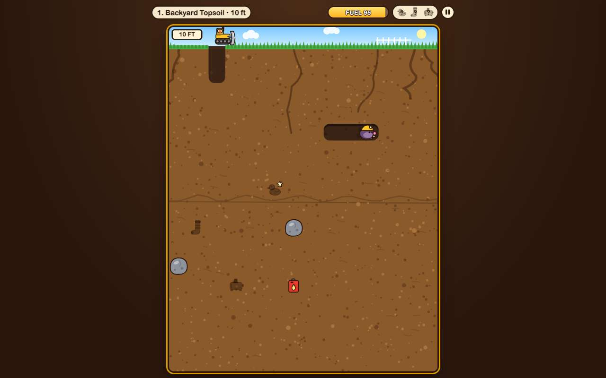 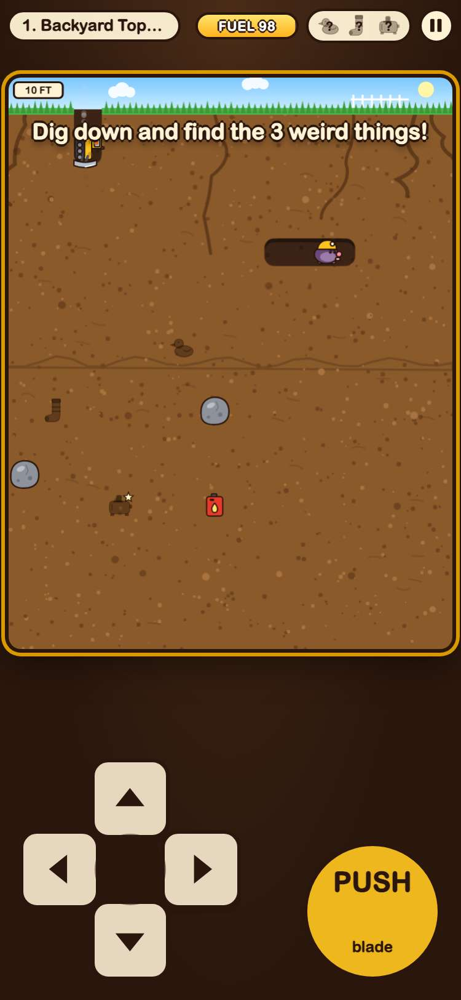

## 8. Super Sauce Boy (games/super-sauce-boy/) measured against the phone bar

- desktop: d works, ArrowRight works, a works, ArrowLeft works
- desktop: w works, ArrowUp works
- phone: 812x375: tapped the run-right button (held): "65.0" -> "237.6"
- phone: 3 targets on the title screen, 4 in play; 2 short of the bar: play: "Pause" is 28x28 (needs 48x48); play: "Pause" is 6 px from the edge (needs 8)

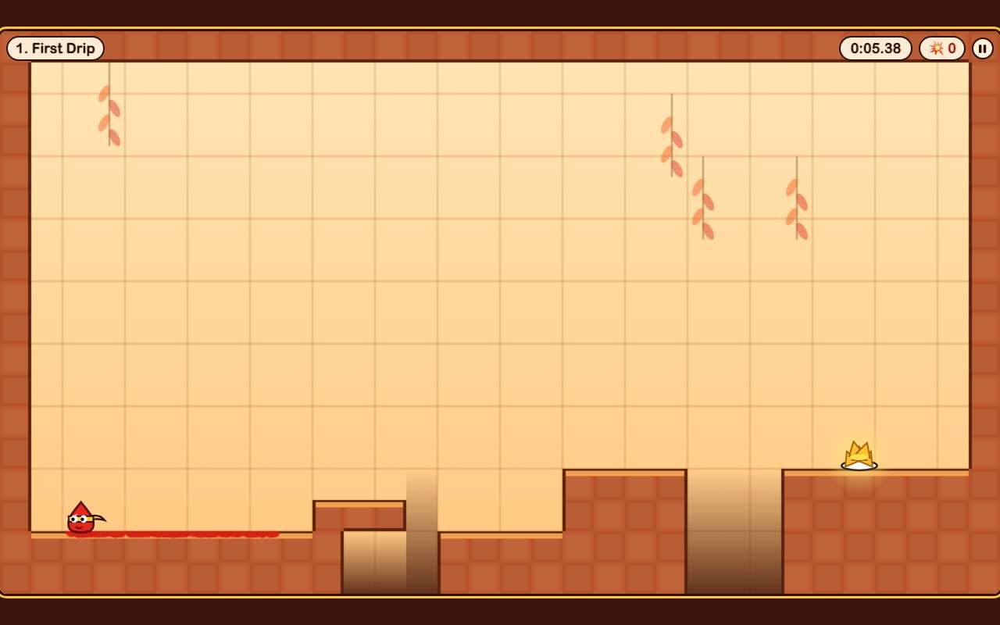 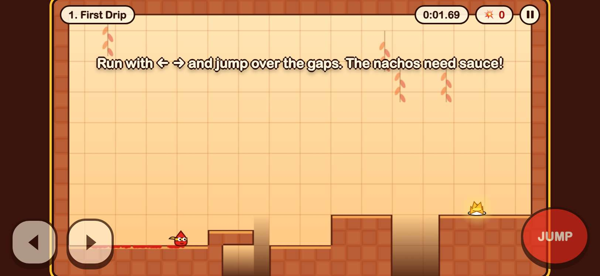

## 9. Fancy Food Fight (games/fancy-food-fight/) measured against the phone bar

- desktop: d works, ArrowRight works, a works, ArrowLeft works, w works, ArrowUp works, s works, ArrowDown works
- phone: 812x375: tapped the food court (throw): 0 -> 1
- phone: 2 targets on the title screen, 7 in play; 20 short of the bar: title: "Let's get messy" is 149x35 (needs 48x48); title: "How to play" is 121x35 (needs 48x48); title: "Let's get messy" and "How to play" are 6 px apart (need 8); play: "Sound on" is 25x25 (needs 48x48); play: "Sound on" is 6 px from the edge (needs 8)

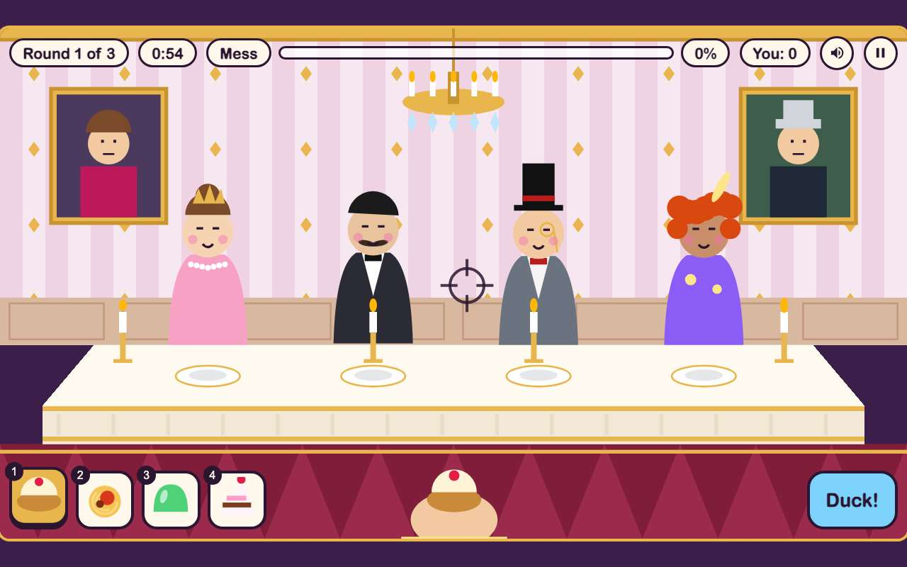 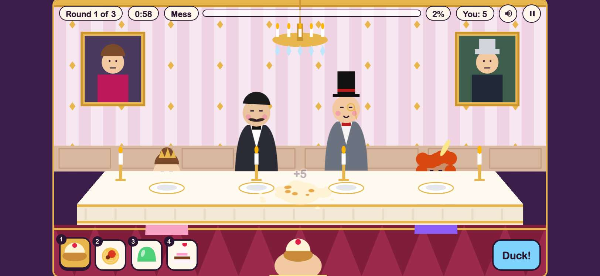

## 10. MazeAThon (games/mazeathon/) measured against the phone bar

- desktop: d works, a works, ArrowRight works, ArrowLeft works, s works, w works, ArrowDown works, ArrowUp works
- phone: 375x812: tapped the d-pad Right (held): "{\"x\":1.5,\"y\":1.5}" -> "{\"x\":3.3540000000000014,\"y\":1.5}"
- phone: 11 targets on the title screen, 11 in play; 33 short of the bar: title: "Back to GameOn" is 110x37 (needs 48x48); title: "Turn sound on" is 33x33 (needs 48x48); title: "How to play" is 33x33 (needs 48x48); title: "Pause game" is 33x33 (needs 48x48); title: "Let’s get lost →" is 165x45 (needs 48x48)

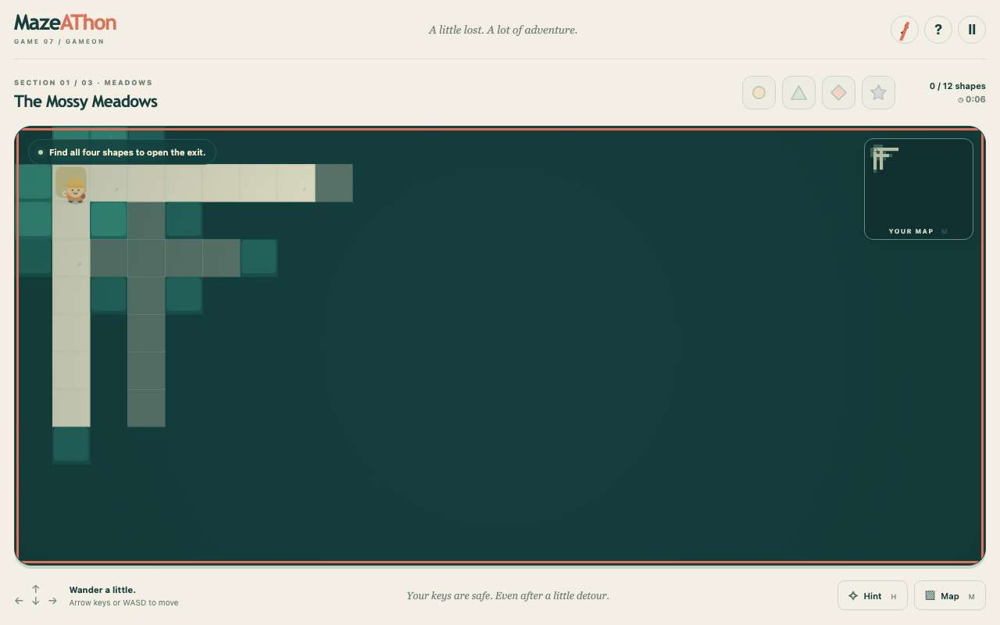 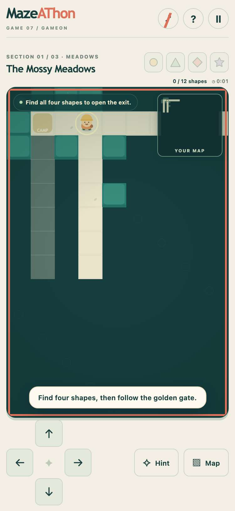

## 11. Delve Squad (games/delve-squad/) measured against the phone bar

- desktop: d does nothing, ArrowRight works, a does nothing, ArrowLeft works
- phone: 375x812: tapped the second hero: 0 -> 1
- phone: 2 targets on the title screen, 10 in play; 14 short of the bar: title: "Sound on or off" is 42x42 (needs 48x48); play: "Pause menu" is 42x42 (needs 48x48); play: "Wren Lv 1 Fighter HP 130" and "Tilda Lv 1 Wizard HP 70/" are 7 px apart (need 8); play: "Bright Spiky Ring RARE C" and "Sharp Spear RARE WEAPON " are 7 px apart (need 8); play: "Bright Spiky Ring RARE C" and "Dusty Axe COMMON WEAPON " are 7 px apart (need 8)

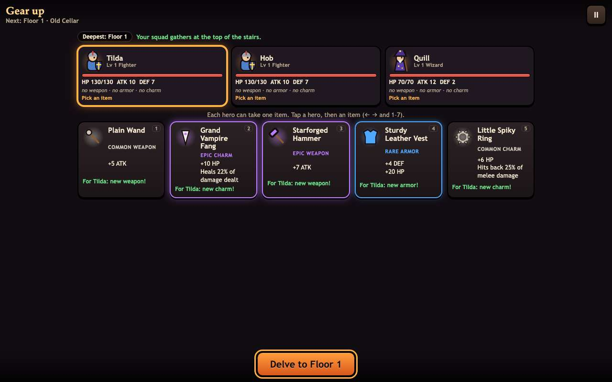 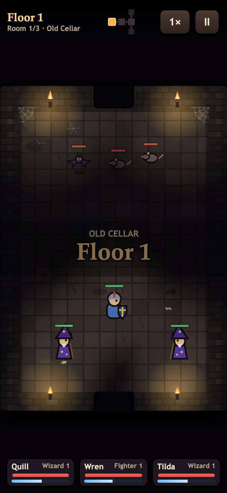

## 12. Trampoline Battle (games/trampoline-battle/jeremy.v2/) measured against the phone bar

- desktop: a works, d works, ArrowLeft works, ArrowRight works
- phone: 812x375: tapped Red's ▶ (held): 0 -> 1
- phone: 19 targets on the title screen, 12 in play; 47 short of the bar: title: "Battle" is 139x40 (needs 48x48); title: "Party Levels" is 142x40 (needs 48x48); title: "Survival" is 142x40 (needs 48x48); title: "Pile-Up" is 142x40 (needs 48x48); title: "Endless" is 142x40 (needs 48x48)

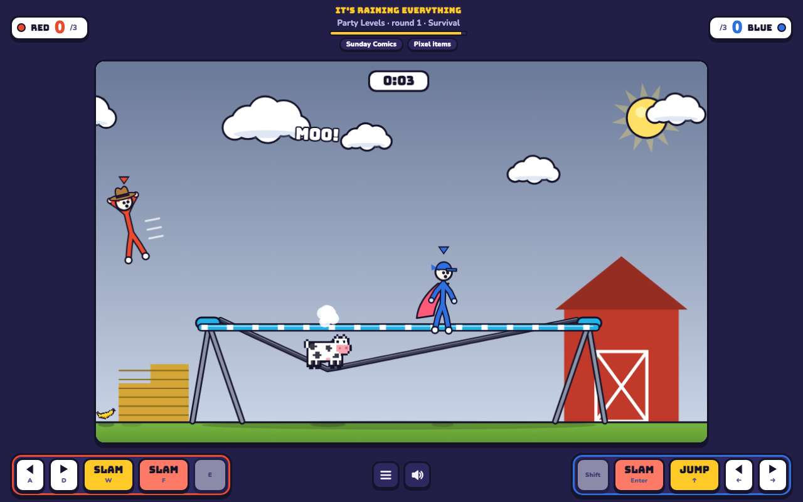 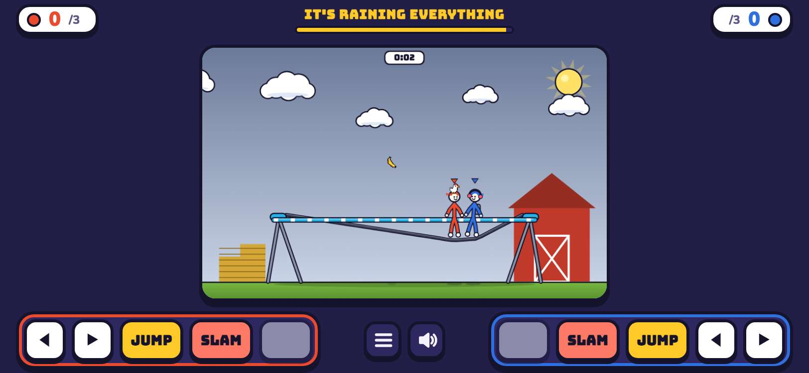

## 13. Princess Lady Drive (games/princess-lady-drive/jeremy.v2/) measured against the phone bar

- desktop: d works, a works, ArrowRight works, ArrowLeft works, s works, w works, ArrowDown works, ArrowUp works
- phone: 375x812: tapped the road (drive there): "{\"x\":-386.71875,\"y\":0}" -> "{\"x\":-316.9795511002412,\"y\":0}"
- phone: 1 targets on the title screen, 5 in play; 1 short of the bar: help: "Start over" is 106x43 (needs 48x48)

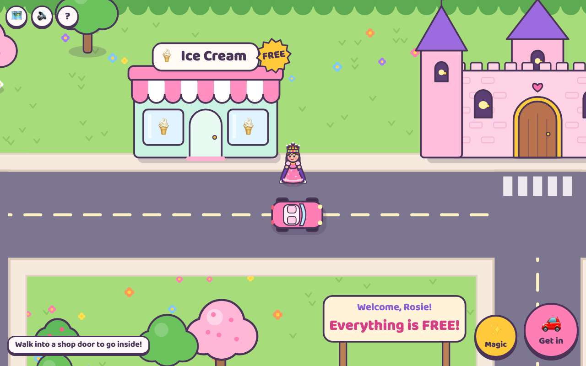 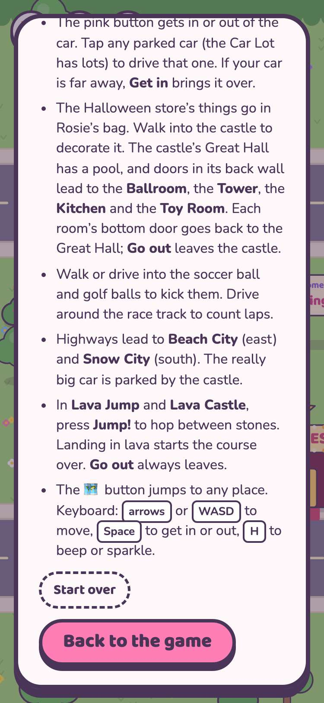

## 14. Stretcher Bearer (games/stretcher-bearer/jeremy.v1/) measured against the phone bar

- desktop: d works, ArrowRight works, a works, ArrowLeft works, w works, ArrowUp works, s works, ArrowDown works
- phone: 375x812: tapped Mask: "Off" -> "On"
- phone: 0 targets on the title screen, 10 in play; 19 short of the bar: play: "ORDERS" is 62x30 (needs 48x48); play: "SOUND ON" is 74x30 (needs 48x48); play: "PAUSE" is 55x30 (needs 48x48); play: "ORDERS" and "SOUND ON" are 6 px apart (need 8); play: "SOUND ON" and "PAUSE" are 6 px apart (need 8)

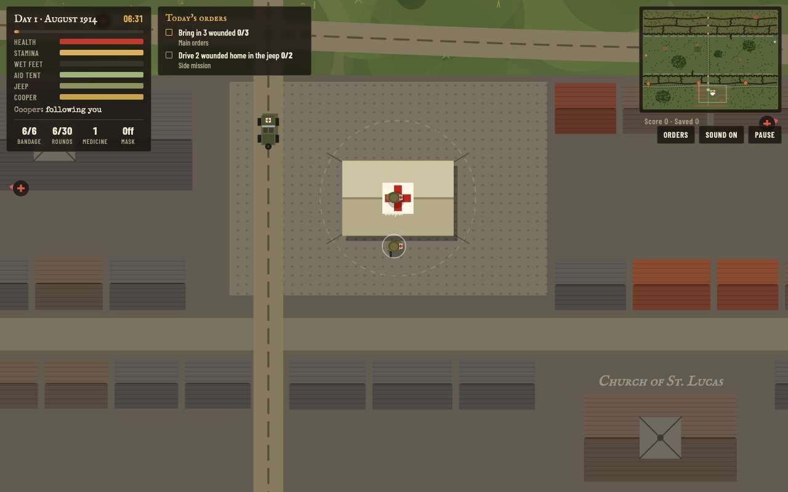 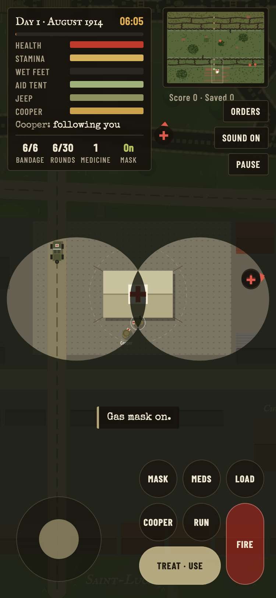

## 15. Angry Dudes (games/angry-dudes/jeremy.v1/) measured against the phone bar

- desktop: w does nothing, ArrowUp does nothing, a does nothing, ArrowLeft does nothing, s does nothing, ArrowDown does nothing, d does nothing, ArrowRight does nothing, Space does nothing, Enter does nothing, p does nothing, Escape does nothing
- phone: 812x375: tapped the second dude in the bar: "legionary" -> "centurion"
- phone: 9 targets on the title screen, 8 in play; 3 short of the bar: play: "Restart" is 86x32 (needs 48x48); play: "Menu" is 60x32 (needs 48x48); play: "Sound on" is 85x32 (needs 48x48)

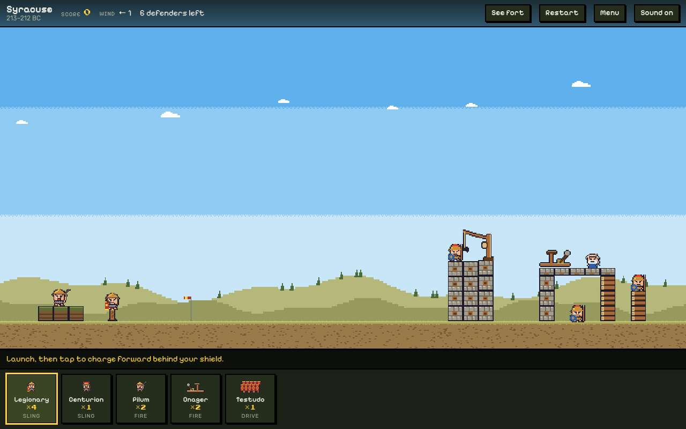 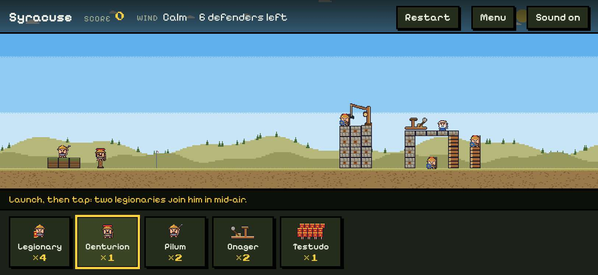

## 16. Magic Friends, Up We Go! (games/magic-friends/jeremy.v1/) measured against the phone bar

- desktop: d works, ArrowRight works, a works, ArrowLeft works
- desktop: p does nothing, Escape does nothing
- phone: 375x812: tapped the pad's ▶ (held): 40 -> 88
- phone: 5 targets on the title screen, 3 in play; 11 short of the bar: title: "Easy" is 64x44 (needs 48x48); title: "Normal" is 79x44 (needs 48x48); title: "Sound" is 38x38 (needs 48x48); title: "Sound" is 6 px from the edge (needs 8); title: "Easy" and "Normal" are 4 px apart (need 8)

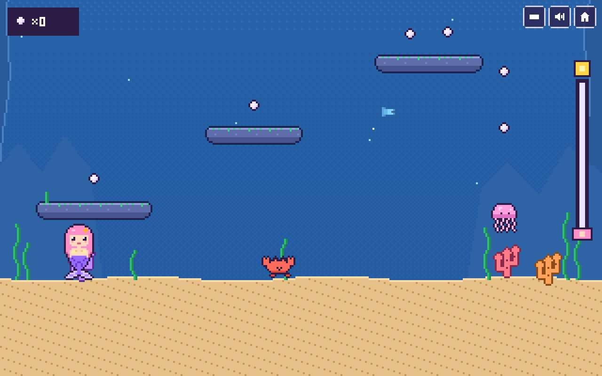 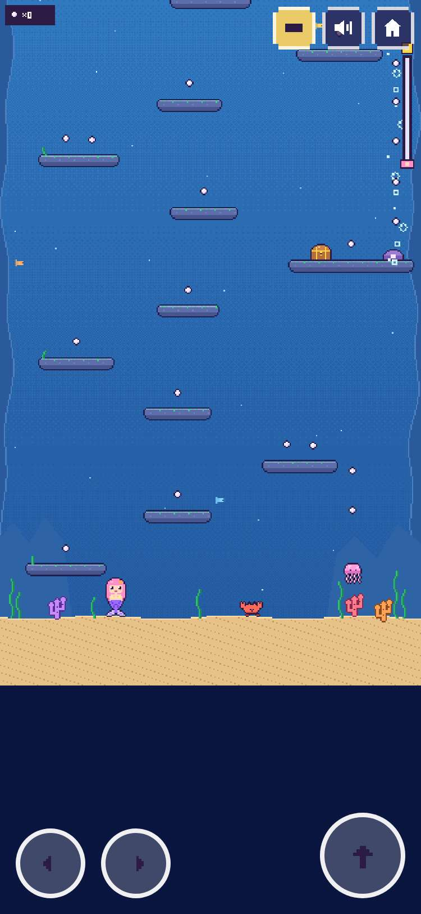

## 17. Timed Out (games/timedout/jeremy.v1/) measured against the phone bar

- desktop: w does nothing, ArrowUp does nothing, a does nothing, ArrowLeft does nothing, s does nothing, ArrowDown does nothing, d does nothing, ArrowRight does nothing, Space does nothing, Enter does nothing, p does nothing, Escape does nothing
- phone: 375x812: tapped the first drop zone: "18" -> "17"
- phone: 8 targets on the title screen, 4 in play; 7 short of the bar: title: "# of Events: 20" is 109x17 (needs 48x48); title: "20" is 311x6 (needs 48x48); title: "🇺🇸 Presidents" is 152x44 (needs 48x48); title: "🚀 Space" is 152x44 (needs 48x48); play: "✕" is 28x28 (needs 48x48)

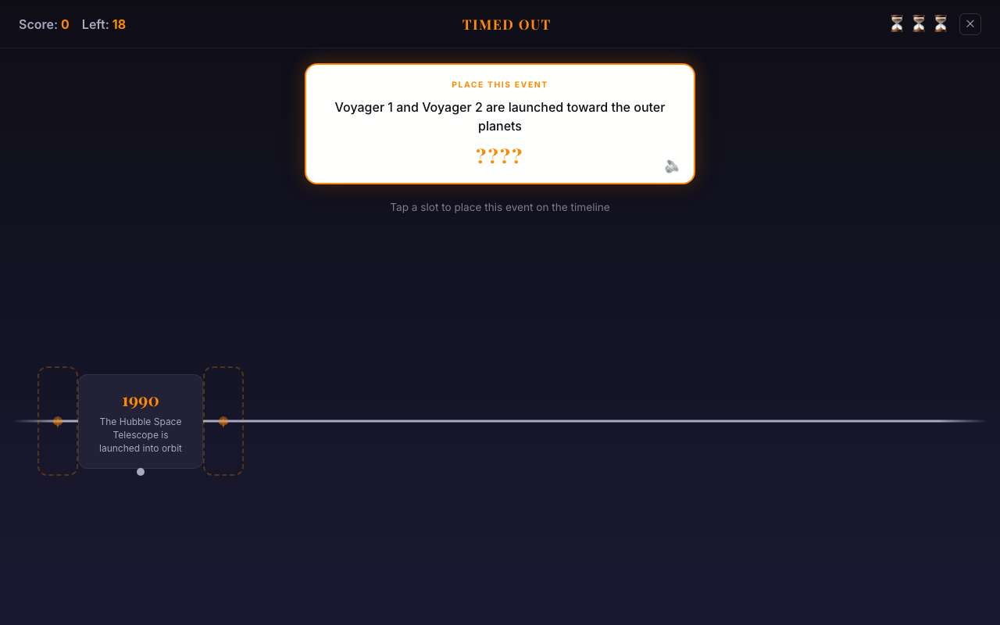 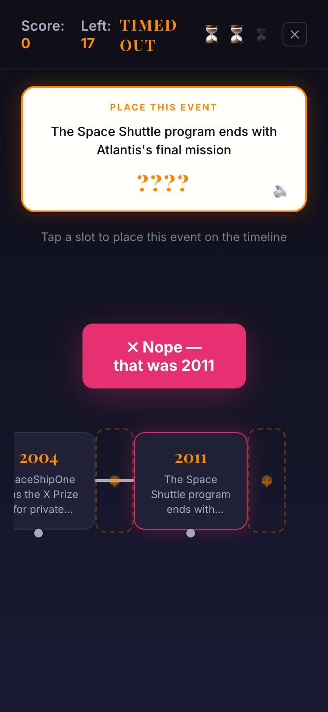

## 18. the audit covers every game's default version on dev today

- desktop: 17 versions audited; 17 of 17 games' defaults
- phone: 17 versions audited; 17 of 17 games' defaults
