# Evidence: 200-claw-of-cool

**PASS: 8 of 8 checks pass at desktop and phone widths.**

Generated by `npm run evidence -- 200-claw-of-cool` from [`tests/evidence/200-claw-of-cool.spec.mjs`](../../tests/evidence/200-claw-of-cool.spec.mjs) against the local server (python3 -m http.server) on this branch, starting from commit ba8f860, 2026-10-26 18:09 UTC. Rules: [docs/evidence.md](../../docs/evidence.md).

| Check | Desktop 1280 | Phone 375 |
|---|---|---|
| the title screen shows the game, its four coolness tiers and the best score, with nothing loaded from the internet | pass | pass |
| DROP puts in a coin, the timer starts, and the keypad and keyboard steer the claw | pass | pass |
| a centred grab carries a prize to the chute and scores its tier's points, and it goes on the collection shelf | pass | pass |
| an off-centre grab slips out on the way and the prize falls back into the pile | pass | pass |
| five wins refill the machine for round 2, with more of the coolest prizes and a shorter timer | pass | pass |
| P pauses and freezes the game, Esc resumes, and Start over brings back 10 coins | pass | pass |
| running out of coins ends the game, the best score and found prizes survive a reload, and it still plays with storage blocked | pass | pass |
| Claw of Cool has a card in the arcade and plays in its frame | pass | pass |

## 1. the title screen shows the game, its four coolness tiers and the best score, with nothing loaded from the internet

- desktop: 4 tiers (10, 25, 60, 150 points), 12 prizes on the shelf, best score 0; no requests outside the site, no outside links, no sideways scrolling
- phone: 4 tiers (10, 25, 60, 150 points), 12 prizes on the shelf, best score 0; no requests outside the site, no outside links, no sideways scrolling

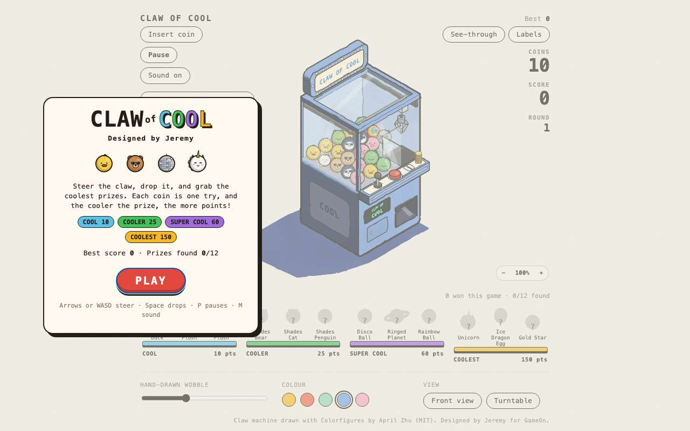 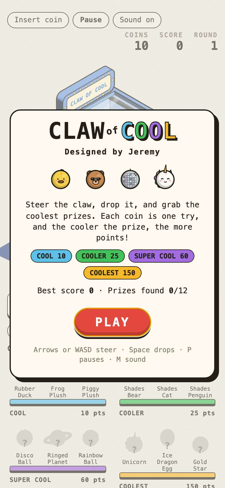

## 2. DROP puts in a coin, the timer starts, and the keypad and keyboard steer the claw

- desktop: a coin went in (10 to 9 coins) and the 15 s timer started; 3 taps on ◀ moved the claw 18 units left; holding W moved it 13.9 units forward; the aim line reads "Steer over a prize, then DROP"
- phone: a coin went in (10 to 9 coins) and the 15 s timer started; 3 taps on ◀ moved the claw 18 units left; holding W moved it 13.9 units forward; the aim line reads "Steer over a prize, then DROP"

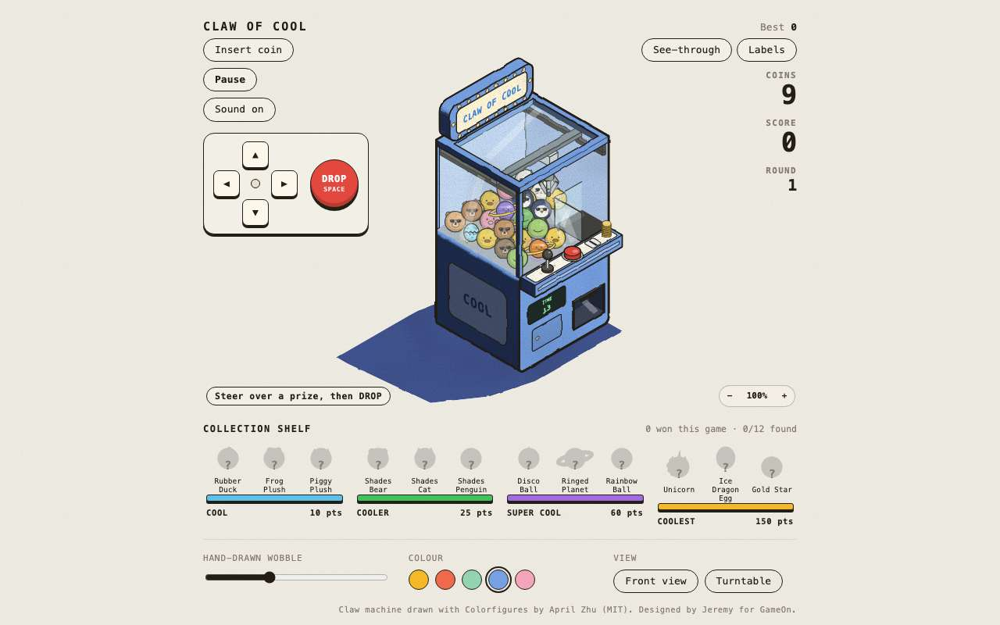 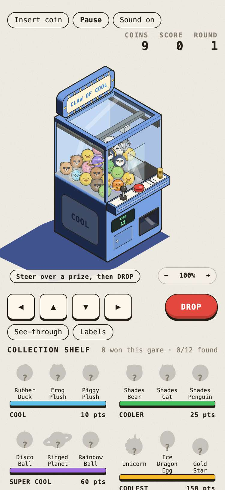

## 3. a centred grab carries a prize to the chute and scores its tier's points, and it goes on the collection shelf

- desktop: grabbed the planet dead centre: it held, rode to the chute, scored 60 and gave a coin back (10 coins); the shelf shows it x1
- phone: grabbed the planet dead centre: it held, rode to the chute, scored 60 and gave a coin back (10 coins); the shelf shows it x1

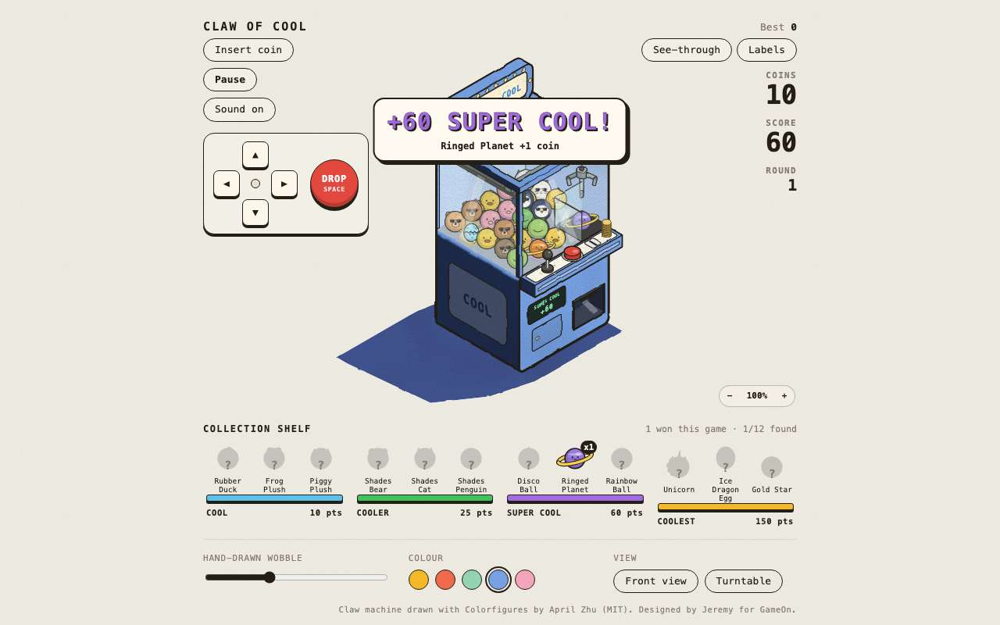 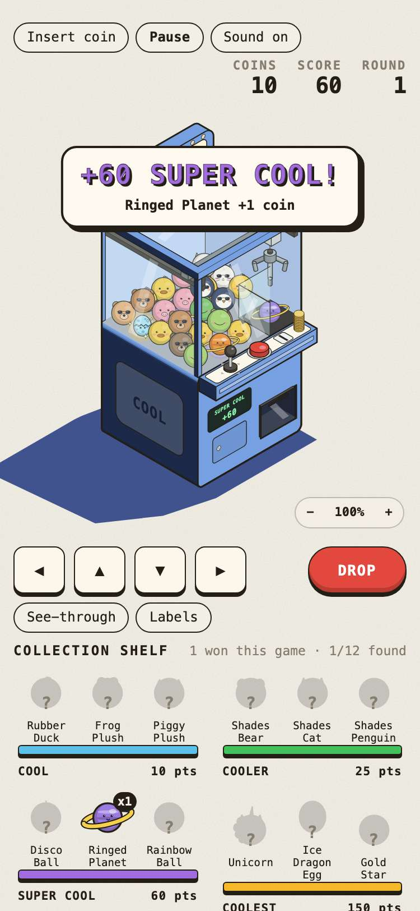

## 4. an off-centre grab slips out on the way and the prize falls back into the pile

- desktop: dropped 7.5 units off the centre of a duck: the claw closed on it, it slipped out on the way up ("SO CLOSE" on the display), and all 27 prizes are back in the machine; 0 points, 9 coins left
- phone: dropped 7.5 units off the centre of a duck: the claw closed on it, it slipped out on the way up ("SO CLOSE" on the display), and all 27 prizes are back in the machine; 0 points, 9 coins left

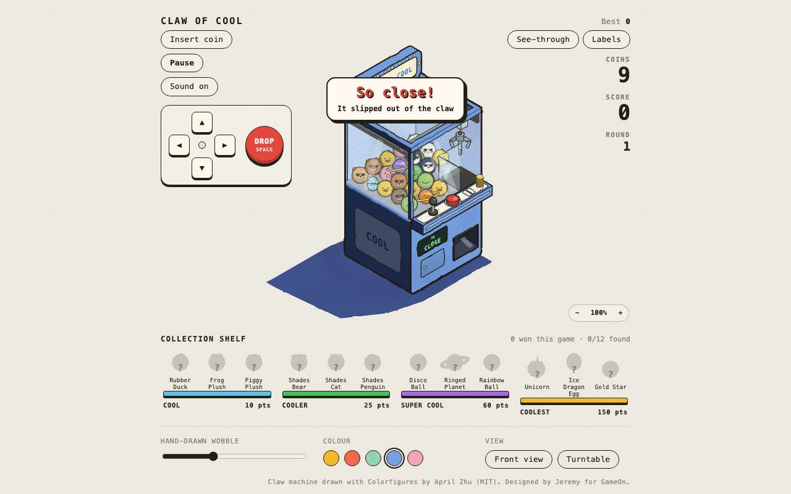 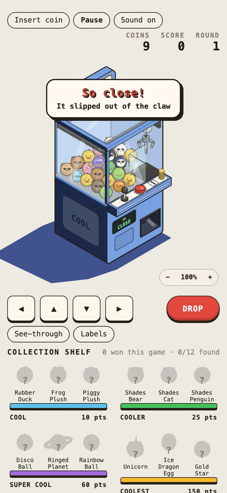

## 5. five wins refill the machine for round 2, with more of the coolest prizes and a shorter timer

- desktop: 5 cool prizes won (score 50); the machine refilled for round 2: by tier (cool, cooler, super cool, coolest) it went from 15, 8, 3, 1 to 10, 10, 5, 2; the timer is 13 s now (15 s in round 1)
- phone: 5 cool prizes won (score 50); the machine refilled for round 2: by tier (cool, cooler, super cool, coolest) it went from 15, 8, 3, 1 to 10, 10, 5, 2; the timer is 13 s now (15 s in round 1)

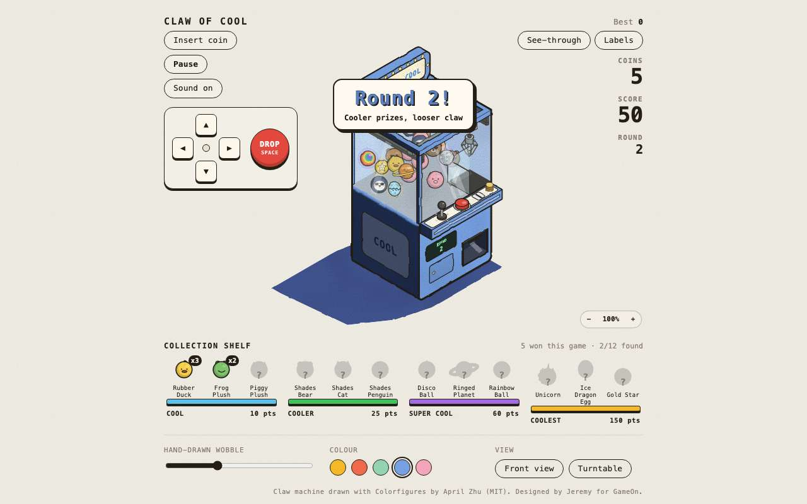 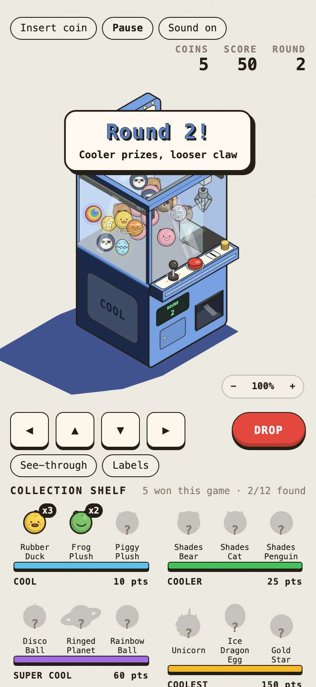

## 6. P pauses and freezes the game, Esc resumes, and Start over brings back 10 coins

- desktop: paused with 14.1 s on the timer and 3 s of stepping changed nothing; after Esc it counted down again; the Pause button then Start over gave a fresh machine with 10 coins
- phone: paused with 14.1 s on the timer and 3 s of stepping changed nothing; after Esc it counted down again; the Pause button then Start over gave a fresh machine with 10 coins

## 7. running out of coins ends the game, the best score and found prizes survive a reload, and it still plays with storage blocked

- desktop: one coin left: a cat won 25, then OUT OF COINS with NEW BEST; after a reload the title shows best 25 and 1/12 found; save keys: gameon.claw-of-cool.best, gameon.claw-of-cool.collection; with storage blocked a new game still played and scored
- phone: one coin left: a cat won 25, then OUT OF COINS with NEW BEST; after a reload the title shows best 25 and 1/12 found; save keys: gameon.claw-of-cool.best, gameon.claw-of-cool.collection; with storage blocked a new game still played and scored

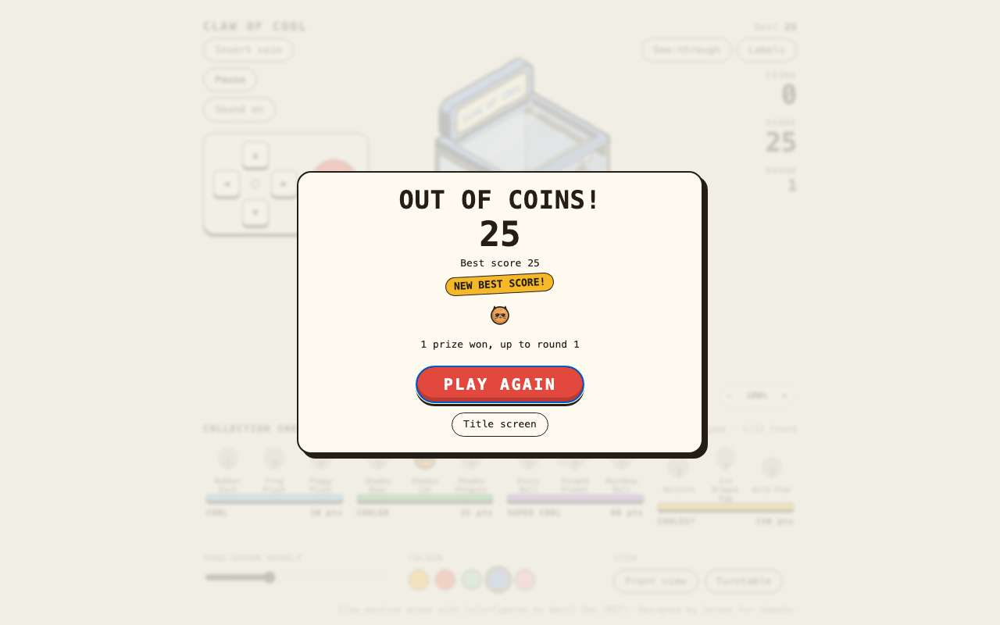 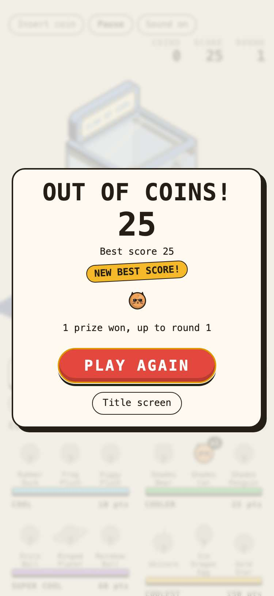

## 8. Claw of Cool has a card in the arcade and plays in its frame

- desktop: card at position 2, after the 1 Editor's Choice card(s), with its 800x450 cover and "Made by Jeremy"; PLAY in the frame starts the game
- phone: card at position 2, after the 1 Editor's Choice card(s), with its 800x450 cover and "Made by Jeremy"; PLAY in the frame starts the game

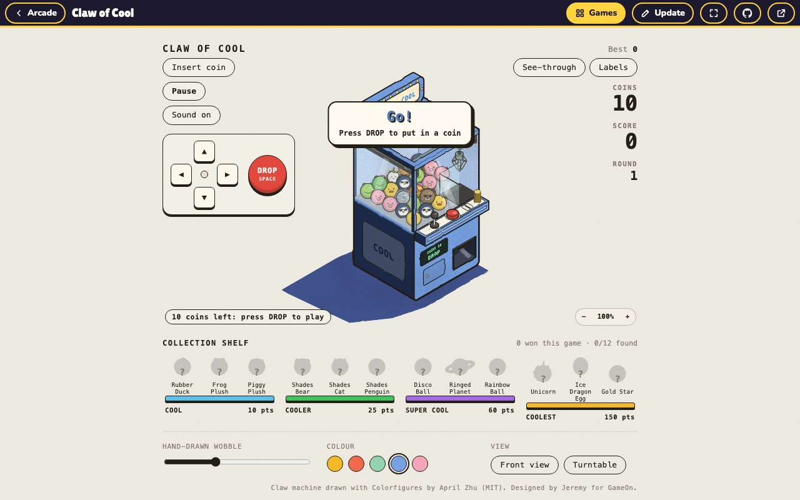 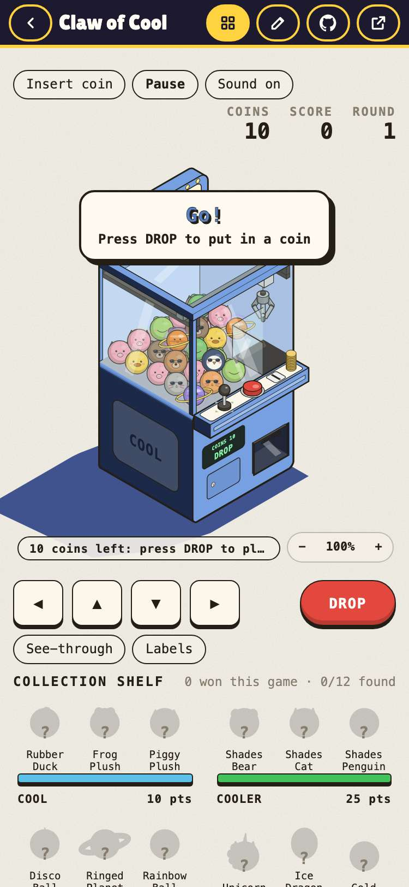
