# Evidence: 203-claw-of-cool-jeremy-v2

**PASS: 11 of 11 checks pass at desktop and phone widths.**

Generated by `npm run evidence -- 203-claw-of-cool-jeremy-v2` from [`tests/evidence/203-claw-of-cool-jeremy-v2.spec.mjs`](../../tests/evidence/203-claw-of-cool-jeremy-v2.spec.mjs) against the local server (python3 -m http.server) on this branch, starting from commit 13def30, 2026-10-26 20:21 UTC. Rules: [docs/evidence.md](../../docs/evidence.md).

| Check | Desktop 1280 | Phone 375 |
|---|---|---|
| jeremy.v2 opens to its title screen with a machine picker (only Classic unlocked), and loads nothing from the internet | pass | pass |
| a coin zooms the camera way in on the prize pit, in the top-down view | pass | pass |
| the View button, the V key and the chip on the machine cycle the front, claw-cam and side views, and the camera zooms out when the try ends | pass | pass |
| the 5th win refills the machine for round 2 straight away, zooms out for the new round and unlocks the Aquarium | pass | pass |
| Aquarium: its own cabinet, odd-shaped prizes (no balls) and twist, and a centred grab wins an odd shape | pass | pass |
| Dino Dig: its own cabinet, odd-shaped prizes (no balls) and twist, and a centred grab wins an odd shape | pass | pass |
| Space Station: its own cabinet, odd-shaped prizes (no balls) and twist, and a centred grab wins an odd shape | pass | pass |
| Snack Attack: its own cabinet, odd-shaped prizes (no balls) and twist, and a centred grab wins an odd shape | pass | pass |
| jeremy.v1's saves load in jeremy.v2 and are never changed; v2 saves under gameon.claw-of-cool.jeremy.v2.; it still plays with storage blocked | pass | pass |
| jeremy.v1 still plays at games/claw-of-cool/ | pass | pass |
| in the arcade, Claw of Cool plays jeremy.v2 by default and the picker still offers jeremy.v1 | pass | pass |

## 1. jeremy.v2 opens to its title screen with a machine picker (only Classic unlocked), and loads nothing from the internet

- desktop: 5 machines in the picker: Classic (picked) and 4 locked; a locked one says how to unlock it; no requests outside the site, no outside links, no sideways scrolling
- phone: 5 machines in the picker: Classic (picked) and 4 locked; a locked one says how to unlock it; no requests outside the site, no outside links, no sideways scrolling

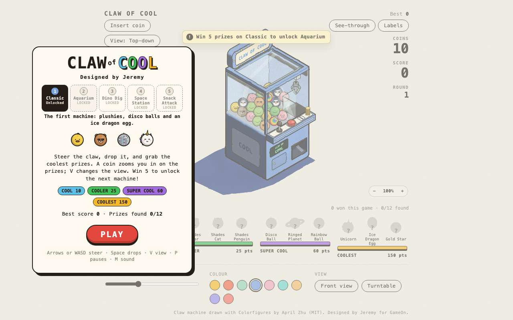 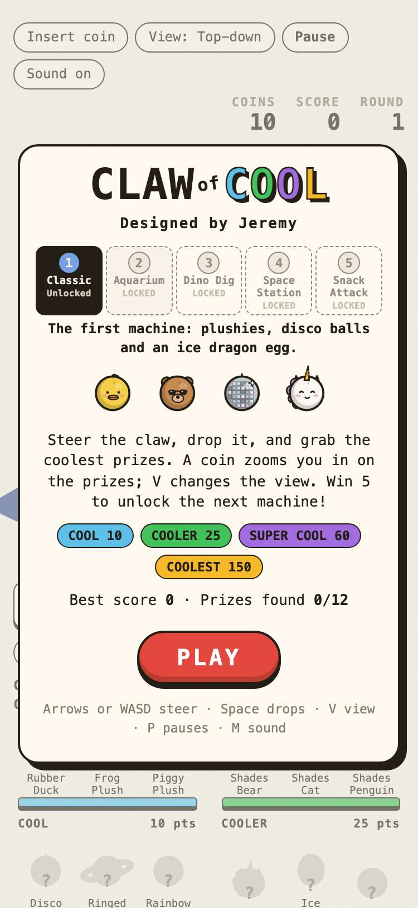

## 2. a coin zooms the camera way in on the prize pit, in the top-down view

- desktop: DROP put a coin in (10 to 9 coins); when it landed the camera turned to look down at 82 degrees and zoomed 2.4x onto the pit; the pad's left key still moved the claw 6 units left
- phone: DROP put a coin in (10 to 9 coins); when it landed the camera turned to look down at 82 degrees and zoomed 2.5x onto the pit; the pad's left key still moved the claw 6 units left

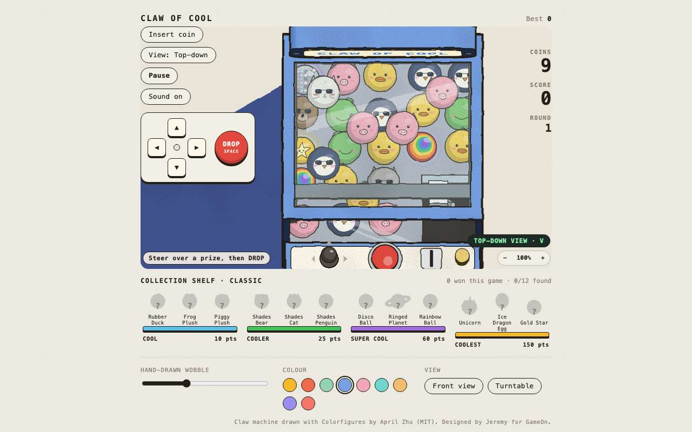 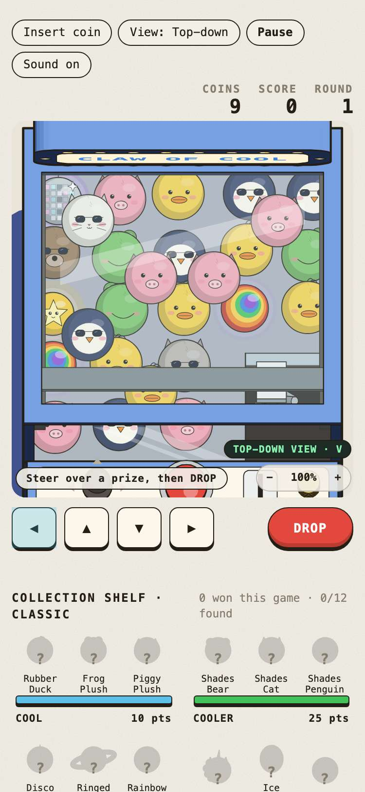

## 3. the View button, the V key and the chip on the machine cycle the front, claw-cam and side views, and the camera zooms out when the try ends

- desktop: View button: front (yaw 0, pitch 9); V: claw-cam (pitch 90, follows the claw: ▲ moved the view up with it); the chip: side (yaw 90); V: back to top-down. After the drop (score 0) the claw came home and the camera zoomed back out to the starting view
- phone: View button: front (yaw 0, pitch 9); V: claw-cam (pitch 90, follows the claw: ▲ moved the view up with it); the chip: side (yaw 90); V: back to top-down. After the drop (score 0) the claw came home and the camera zoomed back out to the starting view

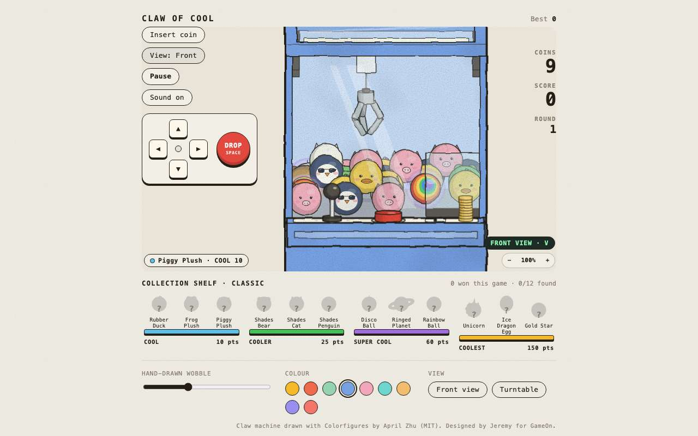 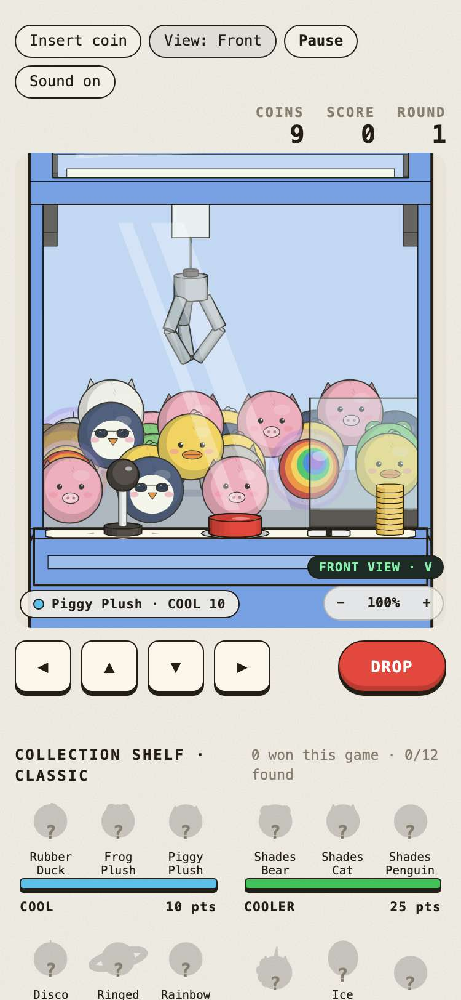

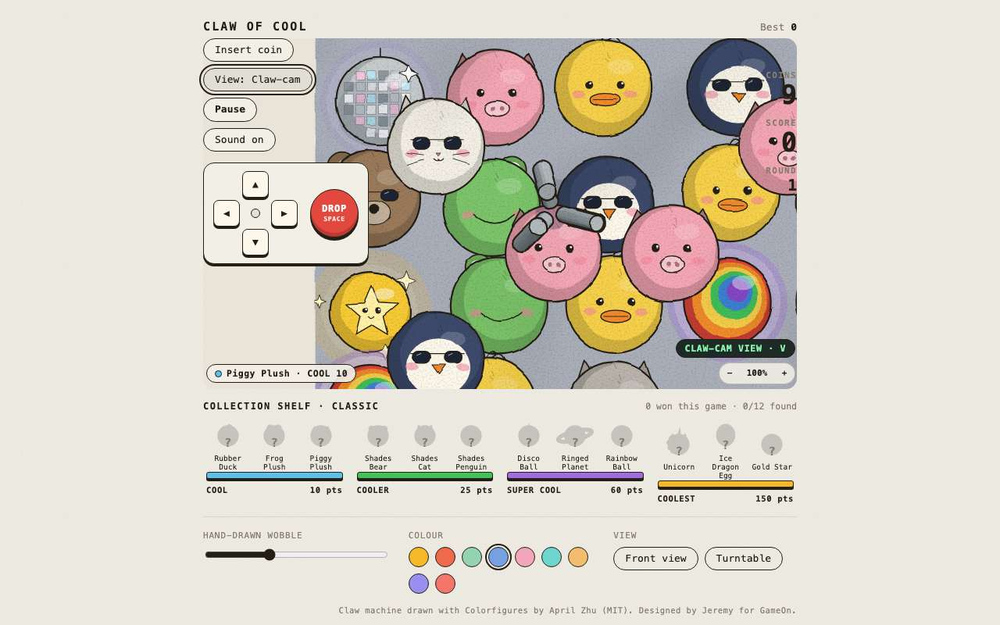 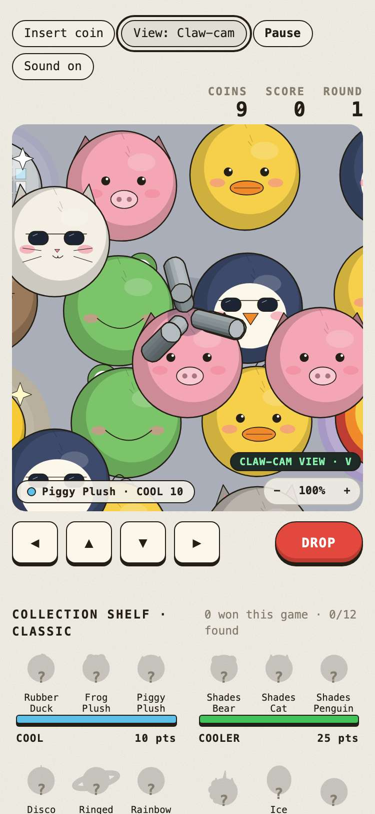

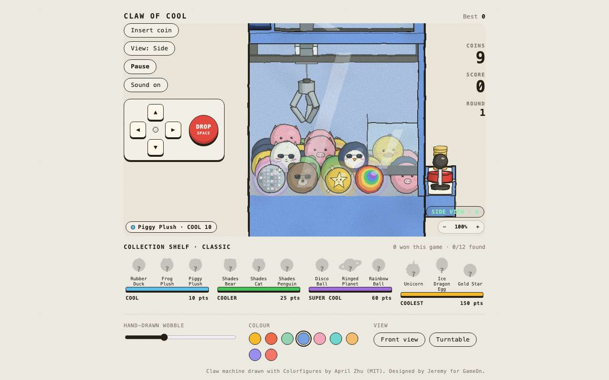 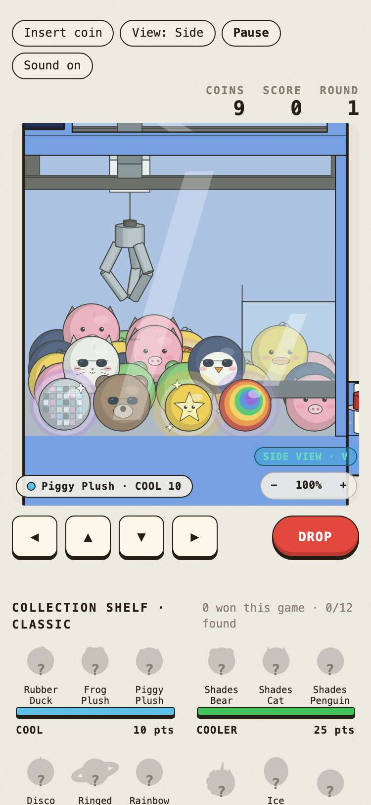

## 4. the 5th win refills the machine for round 2 straight away, zooms out for the new round and unlocks the Aquarium

- desktop: 5 cool prizes won (score 50); the round turned to 2 the moment the 5th prize dropped (the claw was still in "release"), the camera zoomed out for the new round, 27 new prizes rained in, and the Aquarium is unlocked in the picker
- phone: 5 cool prizes won (score 50); the round turned to 2 the moment the 5th prize dropped (the claw was still in "release"), the camera zoomed out for the new round, 27 new prizes rained in, and the Aquarium is unlocked in the picker

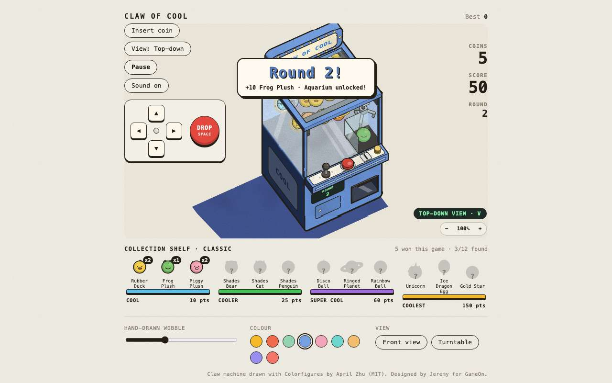 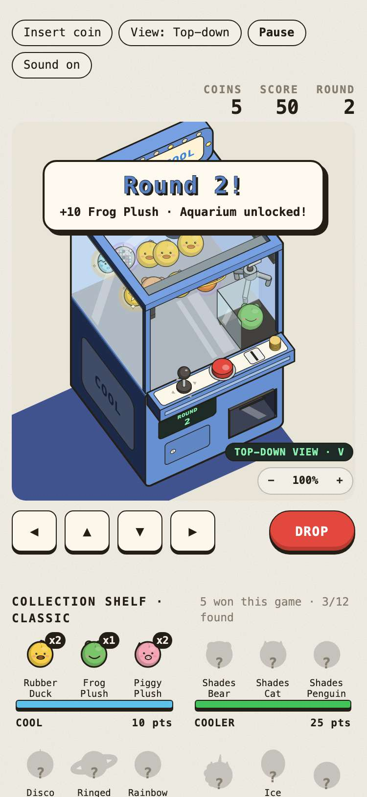

## 5. Aquarium: its own cabinet, odd-shaped prizes (no balls) and twist, and a centred grab wins an odd shape

- desktop: Aquarium: prize shapes chunky, figure, flat, long, round, one legendary; the chest drifted 1.35 units and bobbed 0.18 in a second. Watched from the front view: a centred grab held the starfish (flat) and won 60 points
- phone: Aquarium: prize shapes chunky, figure, flat, long, round, one legendary; the chest drifted 1.35 units and bobbed 0.18 in a second. Watched from the front view: a centred grab held the starfish (flat) and won 60 points

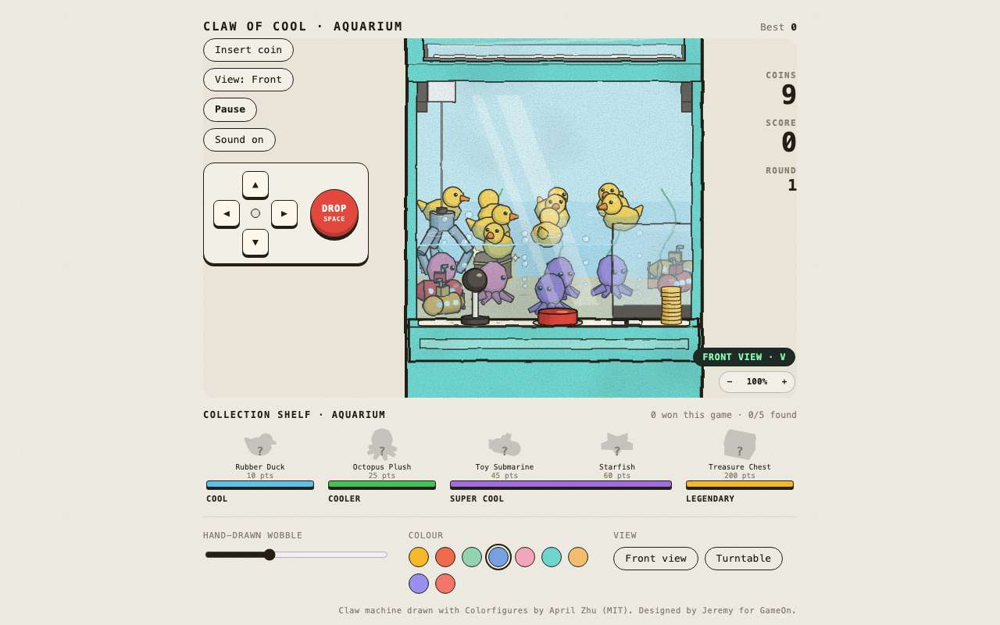 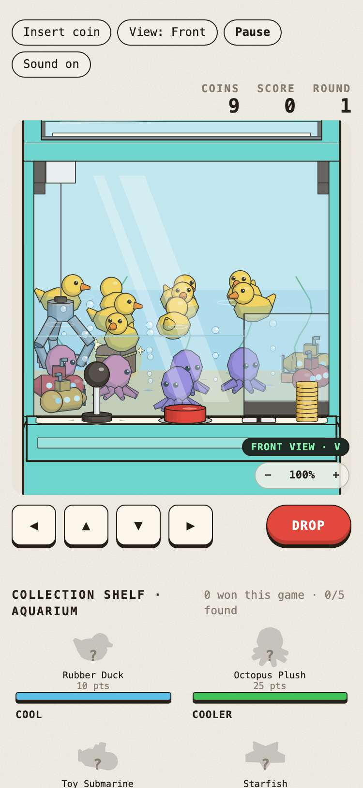

## 6. Dino Dig: its own cabinet, odd-shaped prizes (no balls) and twist, and a centred grab wins an odd shape

- desktop: Dino Dig: prize shapes chunky, figure, long, round, one legendary; all 21 prizes start below the sand's surface (base z 82.4 to 84.6, sand at 86). Watched from the side view: a centred grab held the bone (long) and won 50 points
- phone: Dino Dig: prize shapes chunky, figure, long, round, one legendary; all 21 prizes start below the sand's surface (base z 82.4 to 84.6, sand at 86). Watched from the side view: a centred grab held the bone (long) and won 50 points

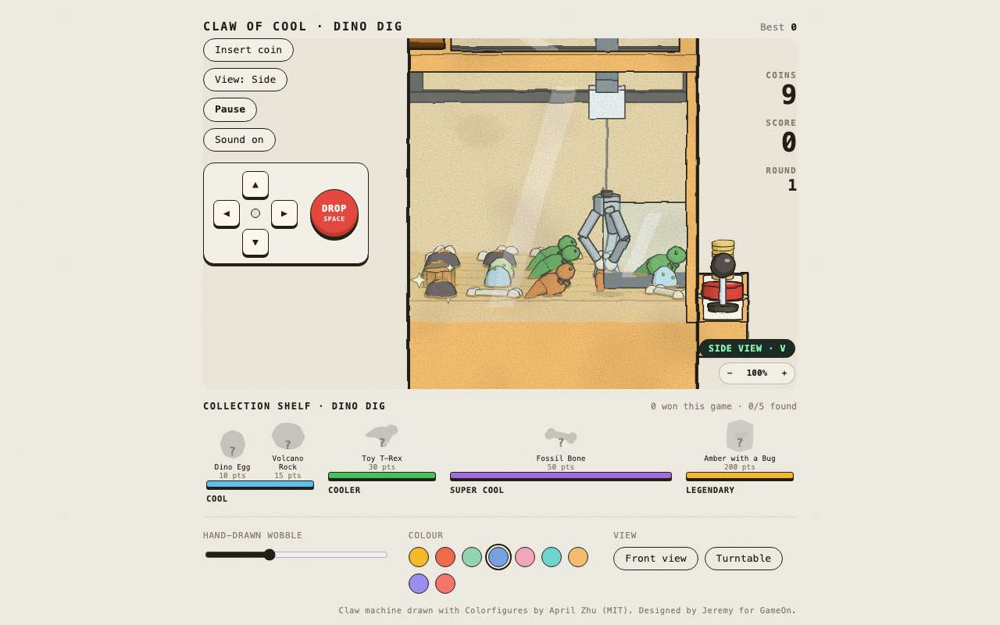 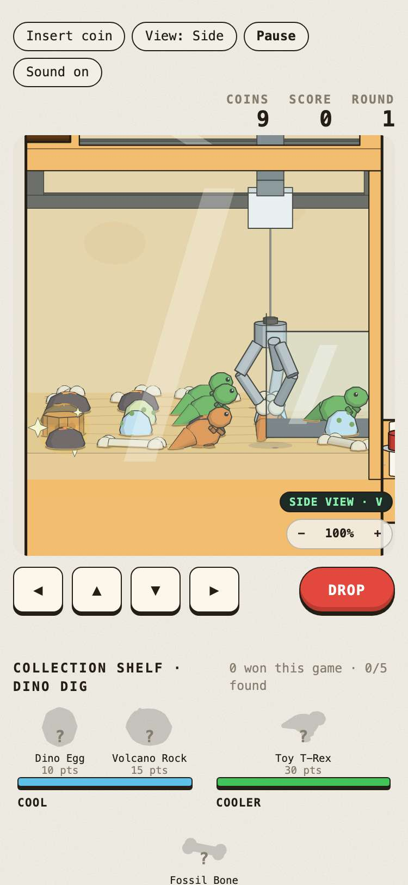

## 7. Space Station: its own cabinet, odd-shaped prizes (no balls) and twist, and a centred grab wins an odd shape

- desktop: Space Station: prize shapes figure, flat, long, round, one legendary; prizes float 1.0 to 11.0 units off the floor. Watched from the top view: a centred grab held the ufo (flat) and won 60 points
- phone: Space Station: prize shapes figure, flat, long, round, one legendary; prizes float 1.0 to 11.0 units off the floor. Watched from the top view: a centred grab held the ufo (flat) and won 60 points

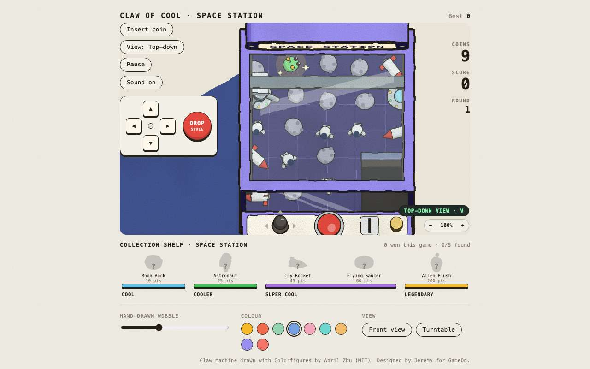 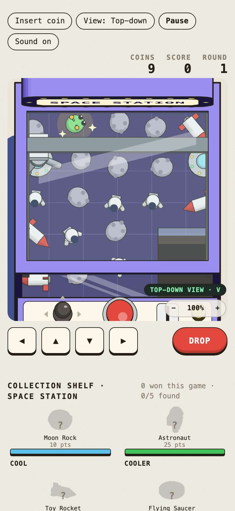

## 8. Snack Attack: its own cabinet, odd-shaped prizes (no balls) and twist, and a centred grab wins an odd shape

- desktop: Snack Attack: prize shapes chunky, figure, flat, long, ring, one legendary; 2 rings and 4 flat snacks in the machine. Watched from the claw view: a centred grab held the donut (ring) and won 60 points
- phone: Snack Attack: prize shapes chunky, figure, flat, long, ring, one legendary; 2 rings and 4 flat snacks in the machine. Watched from the claw view: a centred grab held the donut (ring) and won 60 points

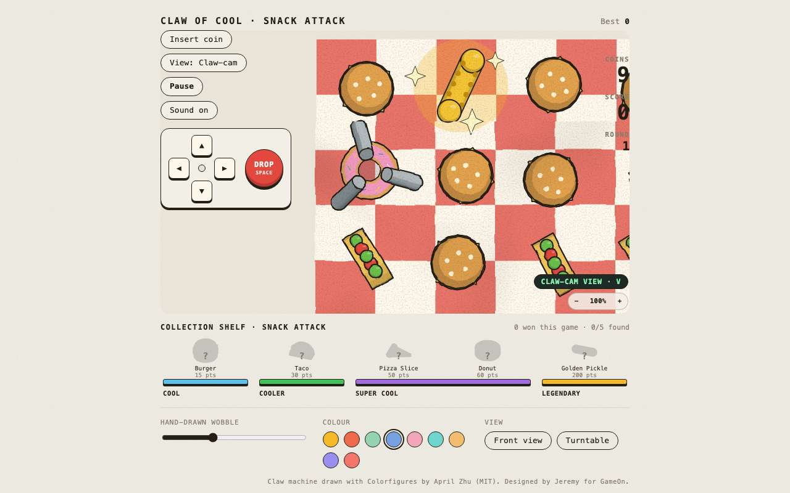 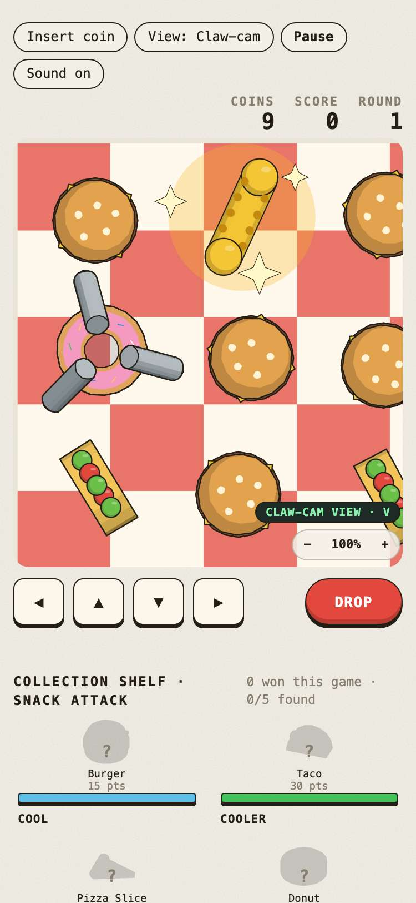

## 9. jeremy.v1's saves load in jeremy.v2 and are never changed; v2 saves under gameon.claw-of-cool.jeremy.v2.; it still plays with storage blocked

- desktop: seeded v1's best 345, collection {duck:2, egg:1} and sound off: v2's Classic title shows best 345, 2 found and Sound off. After a game (a cat for 25, then out of coins) the v1 keys are byte for byte the same; v2 wrote only gameon.claw-of-cool.jeremy.v2.collection. With storage blocked it still plays
- phone: seeded v1's best 345, collection {duck:2, egg:1} and sound off: v2's Classic title shows best 345, 2 found and Sound off. After a game (a cat for 25, then out of coins) the v1 keys are byte for byte the same; v2 wrote only gameon.claw-of-cool.jeremy.v2.collection. With storage blocked it still plays

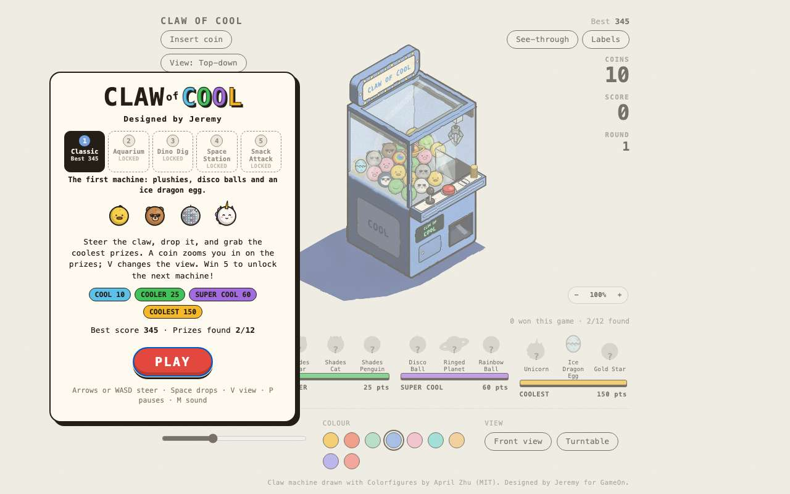 

## 10. jeremy.v1 still plays at games/claw-of-cool/

- desktop: jeremy.v1 at games/claw-of-cool/: its own title (no machine picker), PLAY, a coin in and the timer running
- phone: jeremy.v1 at games/claw-of-cool/: its own title (no machine picker), PLAY, a coin in and the timer running

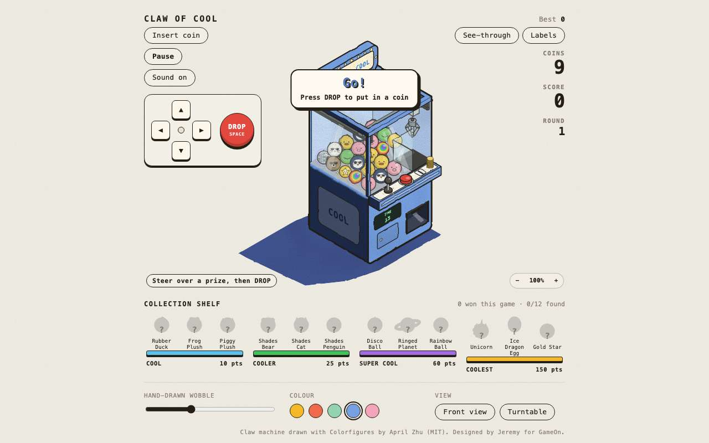 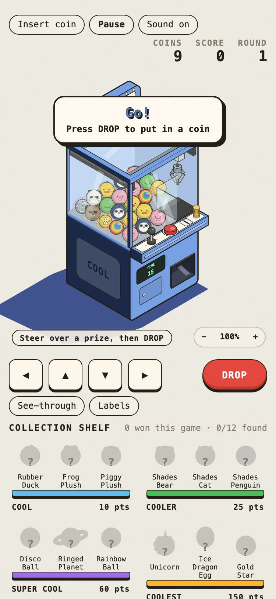

## 11. in the arcade, Claw of Cool plays jeremy.v2 by default and the picker still offers jeremy.v1

- desktop: card (2 versions) → picker: jeremy.v2 first, then jeremy.v1 → jeremy.v2 plays in the frame (machine picker, PLAY); #claw-of-cool@jeremy.v1 opens jeremy.v1
- phone: card (2 versions) → picker: jeremy.v2 first, then jeremy.v1 → jeremy.v2 plays in the frame (machine picker, PLAY); #claw-of-cool@jeremy.v1 opens jeremy.v1

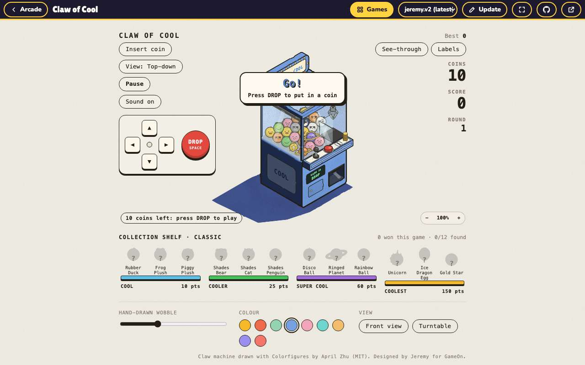 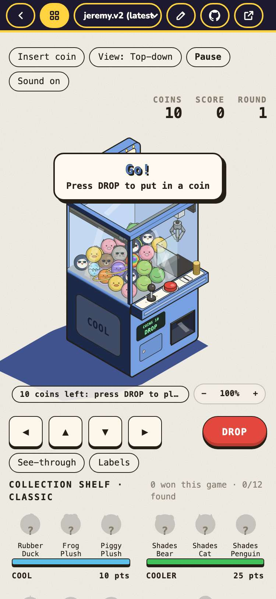
