# Evidence: 211-claw-of-cool-jeremy-v3

**PASS: 6 of 6 checks pass at desktop and phone widths.**

Generated by `npm run evidence -- 211-claw-of-cool-jeremy-v3` from [`tests/evidence/211-claw-of-cool-jeremy-v3.spec.mjs`](../../tests/evidence/211-claw-of-cool-jeremy-v3.spec.mjs) against the local server (python3 -m http.server) on this branch, starting from commit 73b0733, 2026-10-29 15:55 UTC. Rules: [docs/evidence.md](../../docs/evidence.md).

| Check | Desktop 1280 | Phone 375 |
|---|---|---|
| jeremy.v3 opens to its title screen, plays, and loads nothing from the internet | pass | pass |
| at 375 px wide every button is at least 48 x 48 px and 8 px clear of the others and the screen edges (wider screens are unchanged from jeremy.v2) | pass | pass |
| W A S D and the arrow keys both steer the claw, and the keypad still does | pass | pass |
| jeremy.v2's and jeremy.v1's saves load in jeremy.v3, and it saves nothing new | pass | pass |
| jeremy.v2 and jeremy.v1 still play from their own folders | pass | pass |
| in the arcade, Claw of Cool plays jeremy.v3 by default, and its buttons pass the bar inside the frame | pass | pass |

## 1. jeremy.v3 opens to its title screen, plays, and loads nothing from the internet

- desktop: title with the 5 machines, PLAY, DROP put a coin in (10 to 9 coins) and the try started; no requests outside the site, no outside links, no sideways scrolling
- phone: title with the 5 machines, PLAY, DROP put a coin in (10 to 9 coins) and the try started; no requests outside the site, no outside links, no sideways scrolling

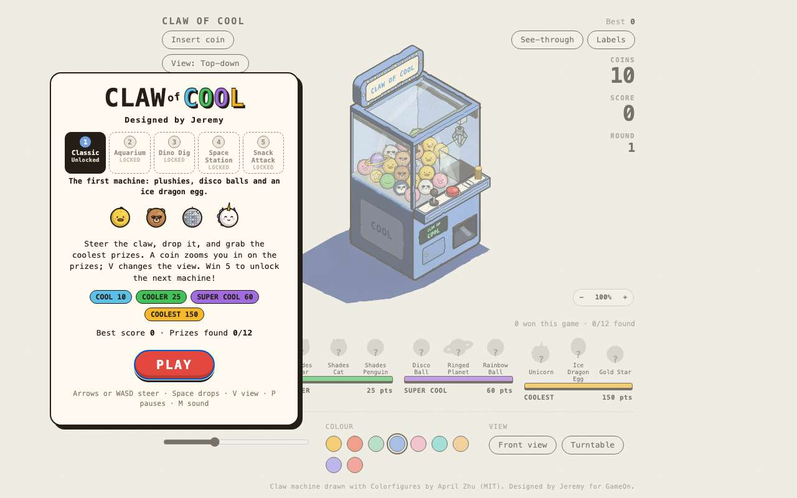 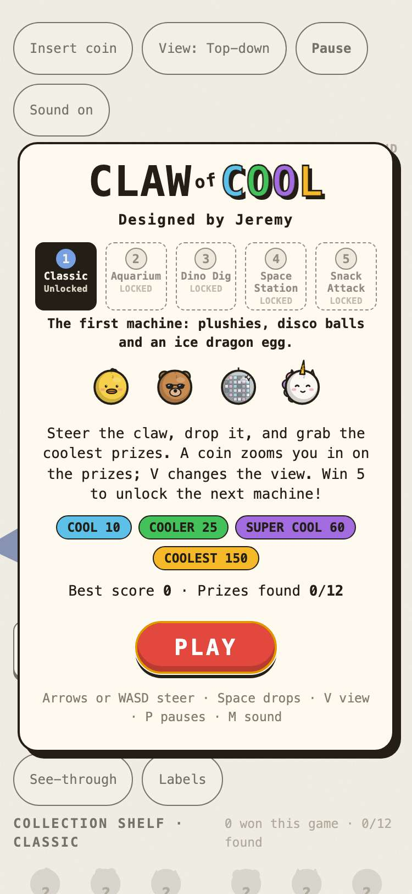

## 2. at 375 px wide every button is at least 48 x 48 px and 8 px clear of the others and the screen edges (wider screens are unchanged from jeremy.v2)

- desktop: title, playing, labels on, zoomed, paused and game over: 158 button boxes, every one the same size and in the same place as jeremy.v2's
- phone: the listed buttons now: top buttons 109x48, 131x48, 66x48, 88x48, 109x48, 73x48 (Insert coin, View, Pause, Sound, See-through, Labels); pad keys 52x52, DROP 96x52; zoom 48x48, 64x48, 48x48; Start over 108x48, Pick a machine 140x48; machine buttons 56x62 with 8 px gaps; the view chip on the machine 154x48
- phone: title: 6 buttons, smallest 130x48, closest gap 8 px, closest to an edge 32 px
- phone: play: 25 buttons, smallest 109x48, closest gap 8 px, closest to an edge 12 px
- phone: labels: 29 buttons, smallest 109x48, closest gap 8 px, closest to an edge 12 px
- phone: zoomed: 24 buttons, smallest 109x48, closest gap 8 px, closest to an edge 12 px
- phone: paused: 3 buttons, smallest 159x48, closest gap 8 px, closest to an edge 60 px
- phone: over: 2 buttons, smallest 216x48, closest gap 12 px, closest to an edge 79 px

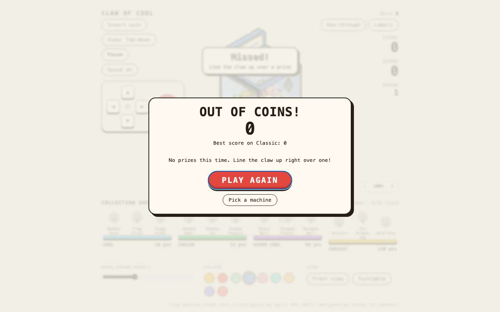

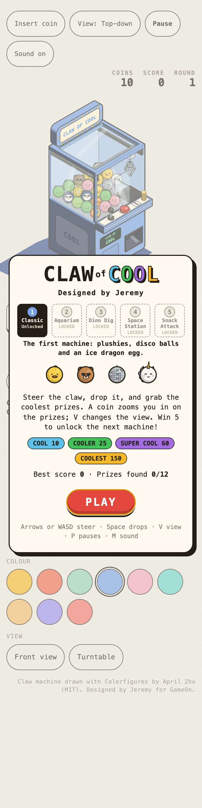

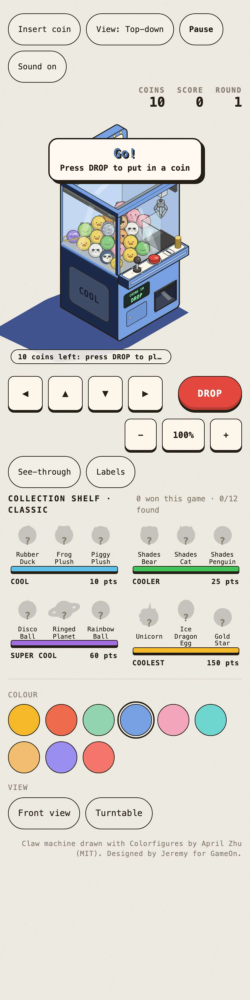

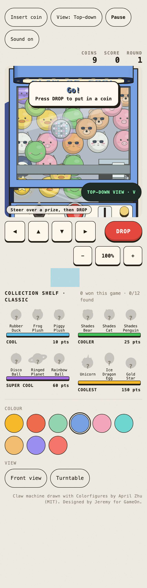

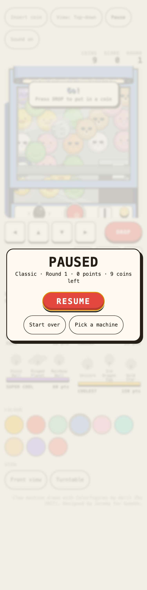

## 3. W A S D and the arrow keys both steer the claw, and the keypad still does

- desktop: one press each: w x -6, a y +6, s x +6, d y -6, ArrowUp x -6, ArrowLeft y +6, ArrowDown x +6, ArrowRight y -6; holding D moved the claw 27.9 units; the pad's ▲ key moved it forward
- phone: one press each: w x -6, a y +6, s x +6, d y -6, ArrowUp x -6, ArrowLeft y +6, ArrowDown x +6, ArrowRight y -6; holding D moved the claw 27.9 units; the pad's ▲ key moved it forward

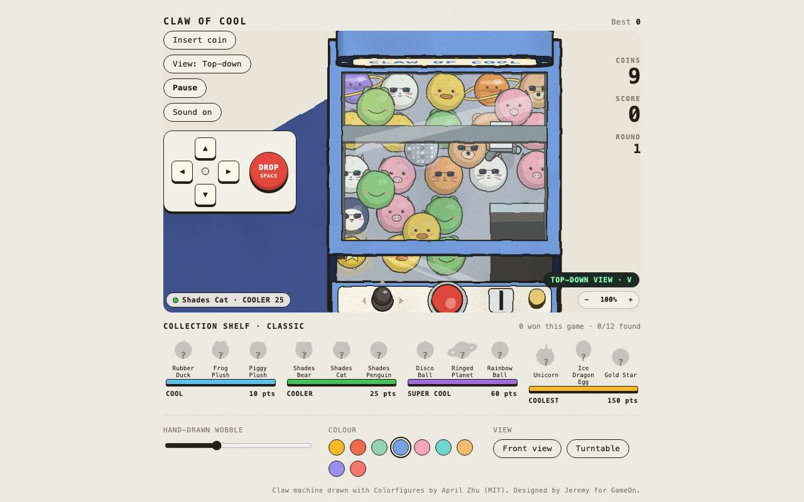 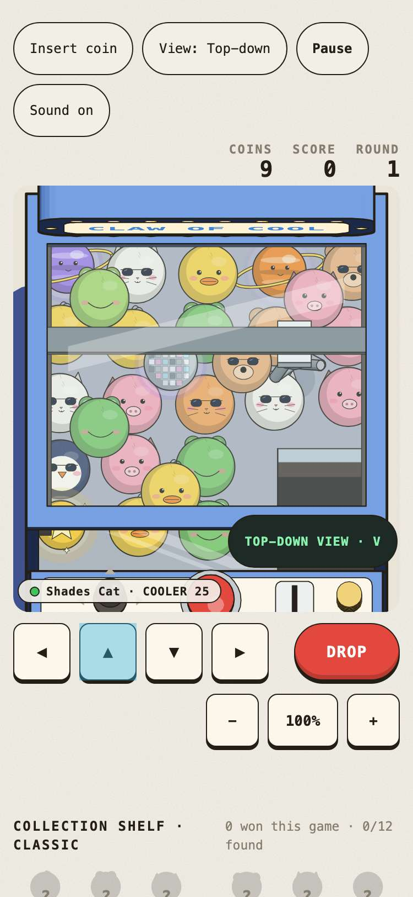

## 4. jeremy.v2's and jeremy.v1's saves load in jeremy.v3, and it saves nothing new

- desktop: seeded jeremy.v2's saves (Aquarium picked, 3 machines unlocked, Aquarium best 410, view 2) and jeremy.v1's (sound off): jeremy.v3 opens on the Aquarium with 2 machines locked, best 410, Sound off and the same view. After a game every key is one jeremy.v1 or jeremy.v2 already used (7 keys); jeremy.v1's are unchanged
- phone: seeded jeremy.v2's saves (Aquarium picked, 3 machines unlocked, Aquarium best 410, view 2) and jeremy.v1's (sound off): jeremy.v3 opens on the Aquarium with 2 machines locked, best 410, Sound off and the same view. After a game every key is one jeremy.v1 or jeremy.v2 already used (7 keys); jeremy.v1's are unchanged

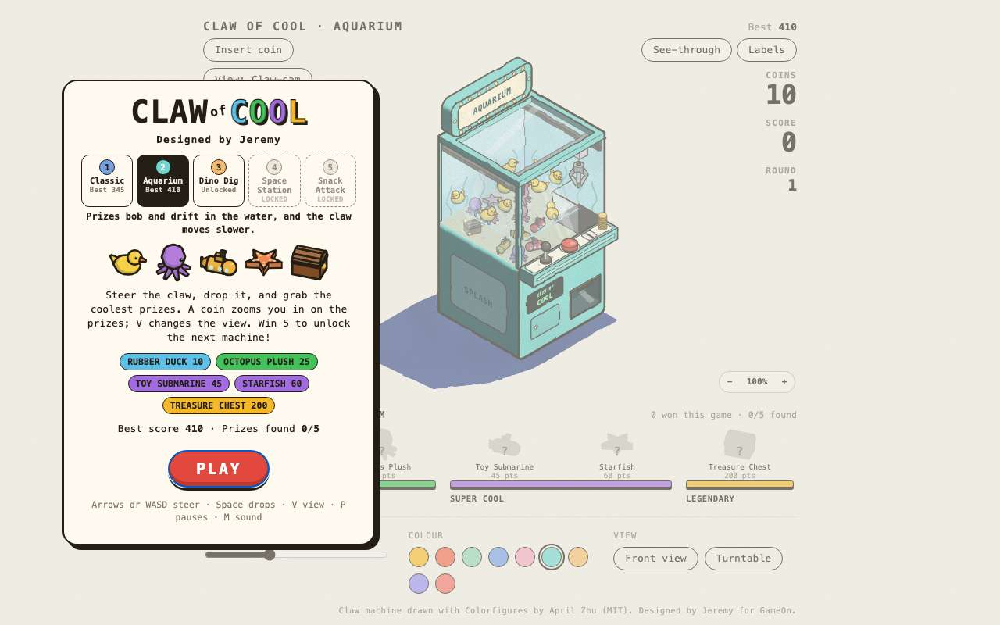 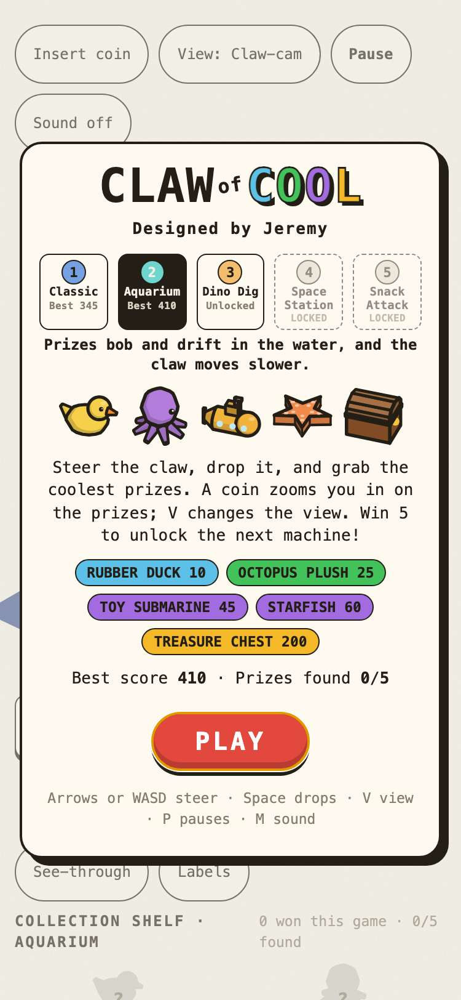

## 5. jeremy.v2 and jeremy.v1 still play from their own folders

- desktop: jeremy.v2 at games/claw-of-cool/jeremy.v2/ and jeremy.v1 at games/claw-of-cool/ each open, start, and take a coin; games.json still points at both
- phone: jeremy.v2 at games/claw-of-cool/jeremy.v2/ and jeremy.v1 at games/claw-of-cool/ each open, start, and take a coin; games.json still points at both

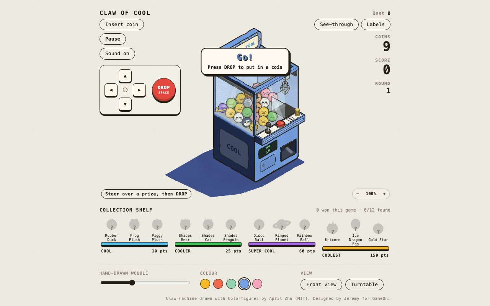 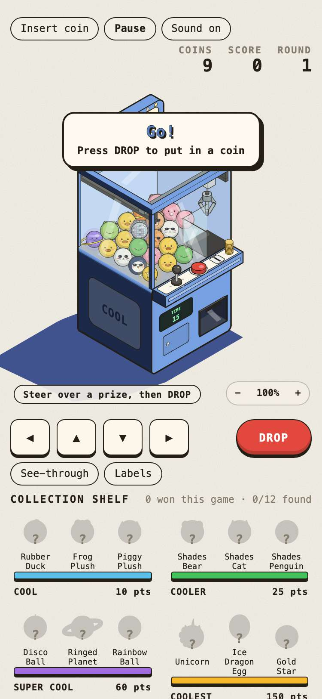

## 6. in the arcade, Claw of Cool plays jeremy.v3 by default, and its buttons pass the bar inside the frame

- desktop: card (3 versions) → picker: jeremy.v3 first, "Bigger buttons, easier on a phone" → jeremy.v3 plays in the frame; #claw-of-cool@jeremy.v2 still opens jeremy.v2
- phone: card (3 versions) → picker: jeremy.v3 first, "Bigger buttons, easier on a phone" → jeremy.v3 plays in the frame; inside the 375 px wide frame, 14 buttons a tap can reach all pass the bar; #claw-of-cool@jeremy.v2 still opens jeremy.v2

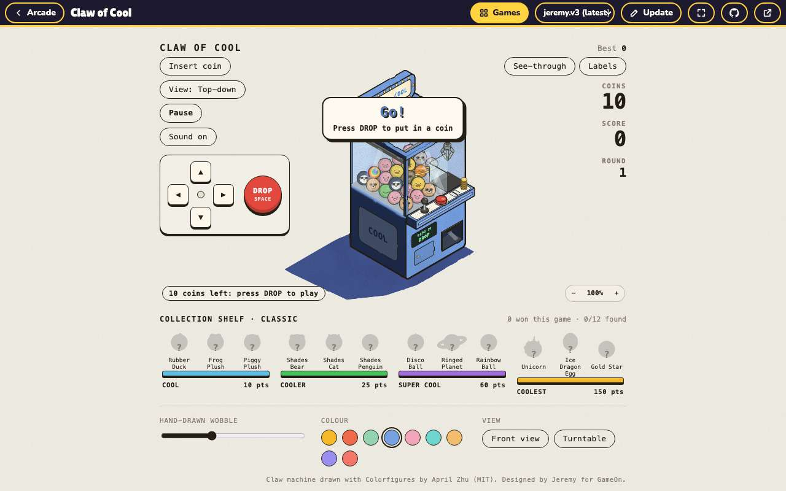 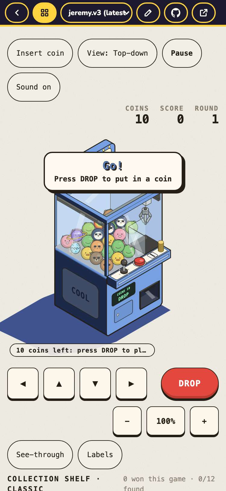
