# Evidence: 213-ant-farm-wars-jeremy-v2

**PASS: 7 of 7 checks pass at desktop and phone widths.**

Generated by `npm run evidence -- 213-ant-farm-wars-jeremy-v2` from [`tests/evidence/213-ant-farm-wars-jeremy-v2.spec.mjs`](../../tests/evidence/213-ant-farm-wars-jeremy-v2.spec.mjs) against the local server (python3 -m http.server) on this branch, starting from commit eb0c235, 2026-10-29 16:52 UTC. Rules: [docs/evidence.md](../../docs/evidence.md).

| Check | Desktop 1280 | Phone 375 |
|---|---|---|
| jeremy.v2 opens to its title screen and starts a game, with nothing loaded from the internet | pass | pass |
| every button meets the phone bar: Speed, Sound and Pause are 48 x 48, 8 px apart and from the edge, and the menu buttons are 48 px tall | pass | pass |
| WASD and the arrows both steer: in a battle they move the cursor and the farm scrolls to follow it; between rounds they scroll the farm | pass | pass |
| the keyboard cursor and Enter plant the rally flag, take it away, and send the soldiers at a rival's nest, like a tap | pass | pass |
| jeremy.v1's saves carry over: v2 shows its record and sound setting, adds to the same record, and v1 reads it back | pass | pass |
| jeremy.v1 still plays at games/ant-farm-wars/, unchanged | pass | pass |
| in the arcade, Ant Farm Wars plays jeremy.v2 by default and the picker still offers jeremy.v1 | pass | pass |

## 1. jeremy.v2 opens to its title screen and starts a game, with nothing loaded from the internet

- desktop: clicked Play and the first card, and the farm ran; no requests outside the site; no sideways scrolling
- phone: tapped Play and the first card, and the farm ran; no requests outside the site; no sideways scrolling

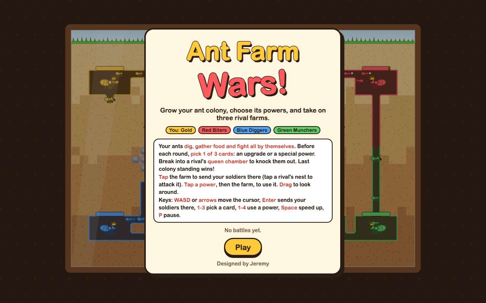 

## 2. every button meets the phone bar: Speed, Sound and Pause are 48 x 48, 8 px apart and from the edge, and the menu buttons are 48 px tall

- desktop: Speed 48x48, Sound 48x48, Pause 48x48; gaps 8 and 8 px; Pause 8 px from the right edge, 8 px from the top. Measured against the phone bar: title: 1 buttons, smallest 48 px; picking a card: 6 buttons, smallest 48 px; battle (4 powers): 7 buttons, smallest 48 px; paused: 3 buttons, smallest 48 px; game over: 2 buttons, smallest 48 px. Speed, Sound, Pause, Keep fighting and Play again each did their job when clicked
- phone: Speed 48x48, Sound 48x48, Pause 48x48; gaps 8 and 8 px; Pause 8 px from the right edge, 8 px from the top. Measured against the phone bar: title: 1 buttons, smallest 48 px; picking a card: 6 buttons, smallest 48 px; battle (4 powers): 7 buttons, smallest 48 px; paused: 3 buttons, smallest 48 px; game over: 2 buttons, smallest 48 px. Speed, Sound, Pause, Keep fighting and Play again each did their job when tapped

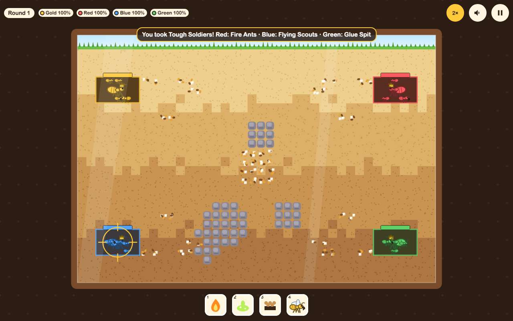 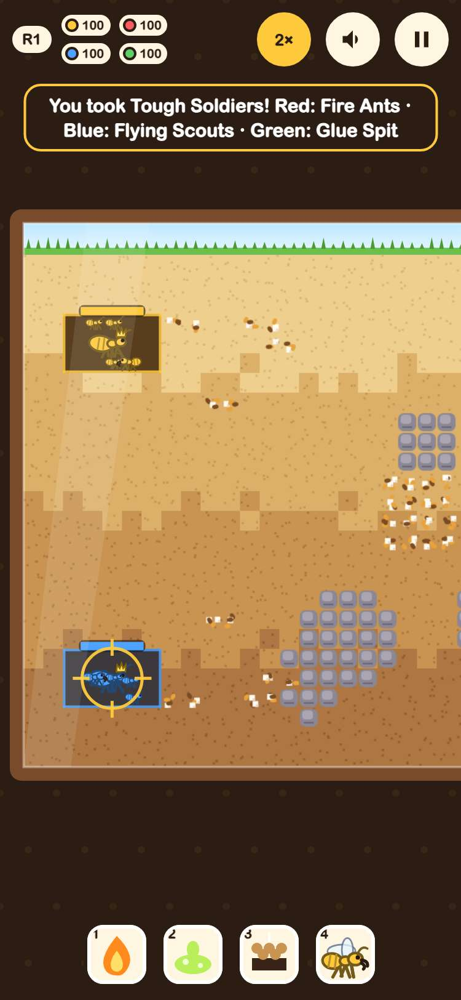

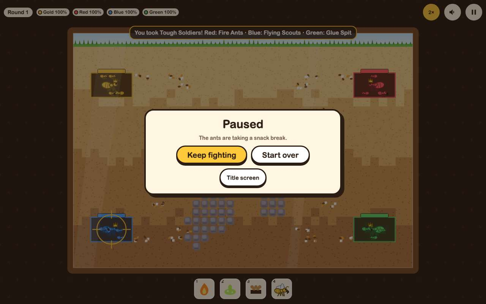 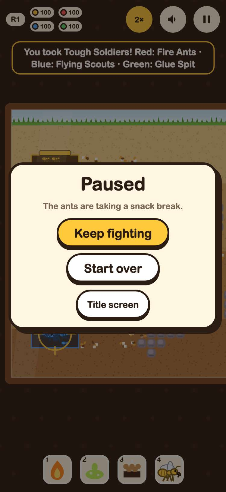

## 3. WASD and the arrows both steer: in a battle they move the cursor and the farm scrolls to follow it; between rounds they scroll the farm

- desktop: first key showed the cursor at 20,12; holding D, then single presses, took it to the middle (20,12); d: cursor 20,12→21,12; ArrowRight: cursor 21,12→22,12; a: cursor 22,12→21,12; ArrowLeft: cursor 21,12→20,12; s: cursor 20,12→20,13; ArrowDown: cursor 20,13→20,14; w: cursor 20,14→20,13; ArrowUp: cursor 20,13→20,12. the whole farm fits, so there's nothing to scroll between rounds
- phone: first key showed the cursor at 10,12; holding D, then single presses, took it to the middle (20,12); d: cursor 20,12→21,12, farm scrolled -16px; ArrowRight: cursor 21,12→22,12, farm scrolled -16px; a: cursor 22,12→21,12, farm scrolled 16px; ArrowLeft: cursor 21,12→20,12, farm scrolled 16px; s: cursor 20,12→20,13; ArrowDown: cursor 20,13→20,14; w: cursor 20,14→20,13; ArrowUp: cursor 20,13→20,12. picking a card, the keys scrolled the farm: a +154px, ArrowLeft +150px, d -155px, ArrowRight -155px

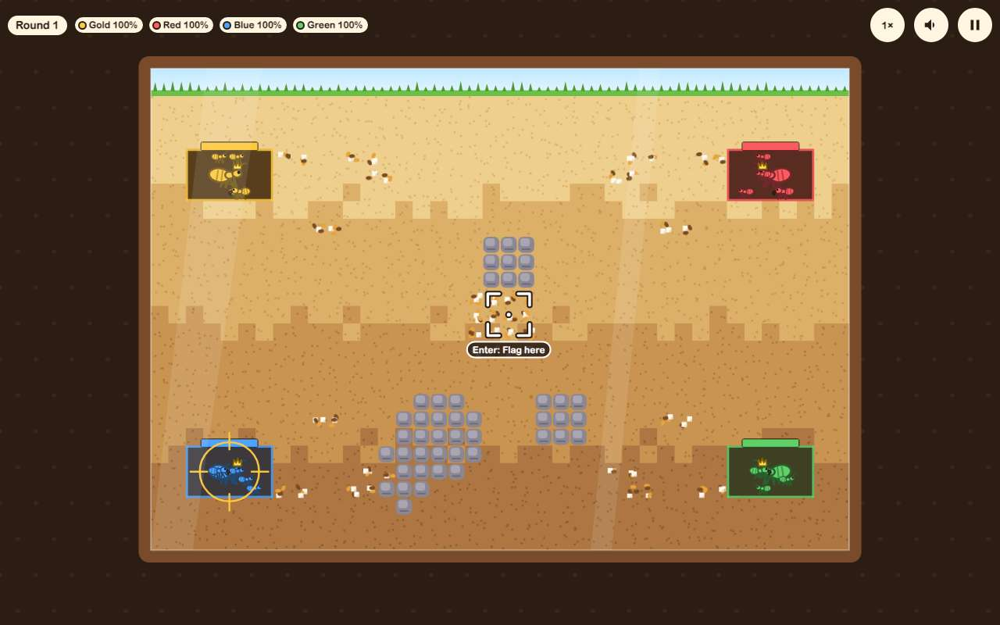 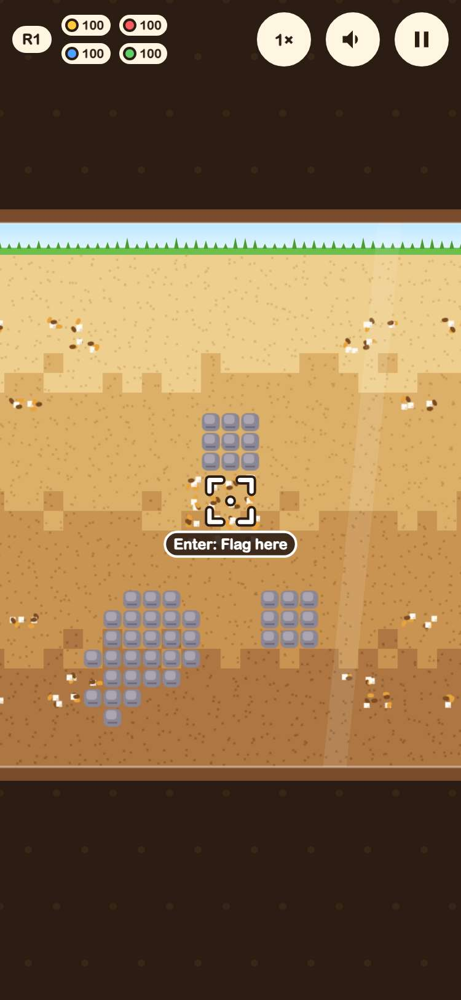

## 4. the keyboard cursor and Enter plant the rally flag, take it away, and send the soldiers at a rival's nest, like a tap

- desktop: Enter with no cursor showed it; walked to 9,12 and Enter planted the flag there; Enter again took it away; walked to Red's nest (35,5) and Enter made Red the target; key 1 dropped Glue Spit at the cursor (20,14); then a tap on the farm hid the cursor and planted the flag at 9,12 as in jeremy.v1
- phone: Enter with no cursor showed it; walked to 9,12 and Enter planted the flag there; Enter again took it away; walked to Red's nest (35,5) and Enter made Red the target; key 1 dropped Glue Spit at the cursor (20,14); then a tap on the farm hid the cursor and planted the flag at 9,12 as in jeremy.v1

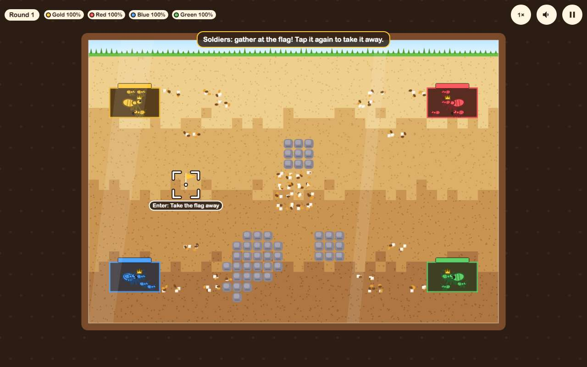 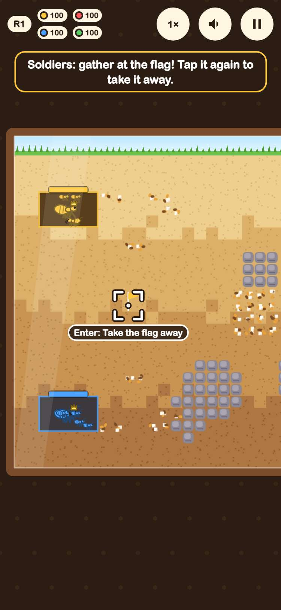

## 5. jeremy.v1's saves carry over: v2 shows its record and sound setting, adds to the same record, and v1 reads it back

- desktop: seeded jeremy.v1's record (3 battles, 1 win in 7 rounds) and sound off: v2's title showed the record and its Sound button was off in the game; after a lost game the record said 4 battles with the best kept; the only keys are gameon.ant-farm-wars.record, gameon.ant-farm-wars.sound (no new ones); jeremy.v1 then showed the same record
- phone: seeded jeremy.v1's record (3 battles, 1 win in 7 rounds) and sound off: v2's title showed the record and its Sound button was off in the game; after a lost game the record said 4 battles with the best kept; the only keys are gameon.ant-farm-wars.record, gameon.ant-farm-wars.sound (no new ones); jeremy.v1 then showed the same record

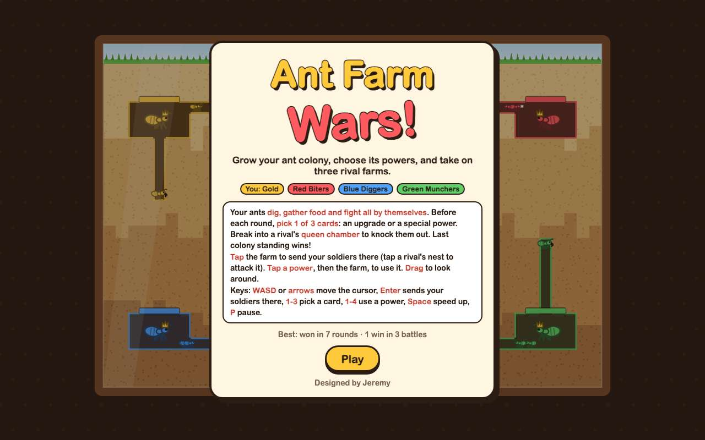 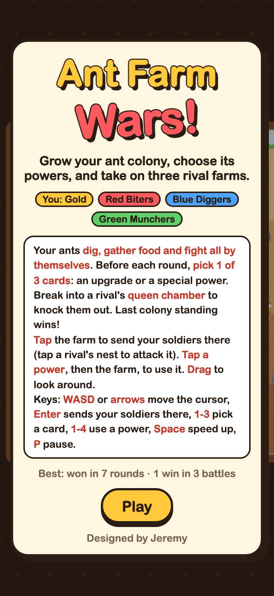

## 6. jeremy.v1 still plays at games/ant-farm-wars/, unchanged

- desktop: jeremy.v1 at games/ant-farm-wars/: its own title (no WASD line), Play, a card, and the farm ran; its Pause button is still 34x34, as before
- phone: jeremy.v1 at games/ant-farm-wars/: its own title (no WASD line), Play, a card, and the farm ran; its Pause button is still 30x30, as before

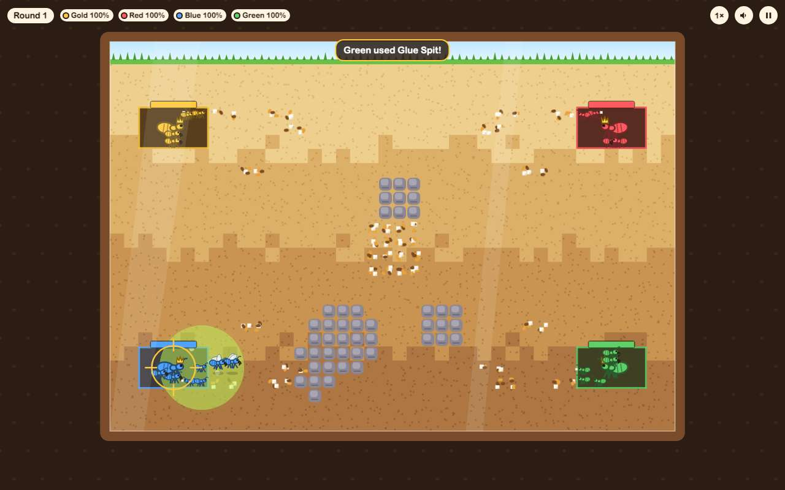 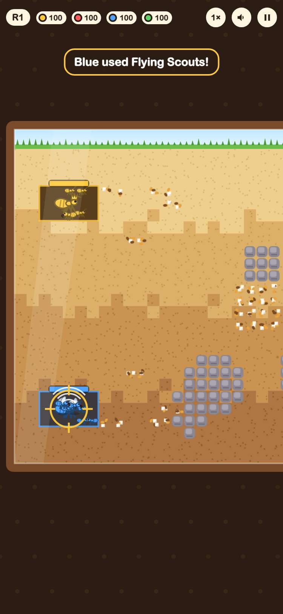

## 7. in the arcade, Ant Farm Wars plays jeremy.v2 by default and the picker still offers jeremy.v1

- desktop: card (2 versions) → picker: jeremy.v2 first with its note, then jeremy.v1 → jeremy.v2 plays in the frame; #ant-farm-wars@jeremy.v1 opens jeremy.v1
- phone: card (2 versions) → picker: jeremy.v2 first with its note, then jeremy.v1 → jeremy.v2 plays in the frame; #ant-farm-wars@jeremy.v1 opens jeremy.v1

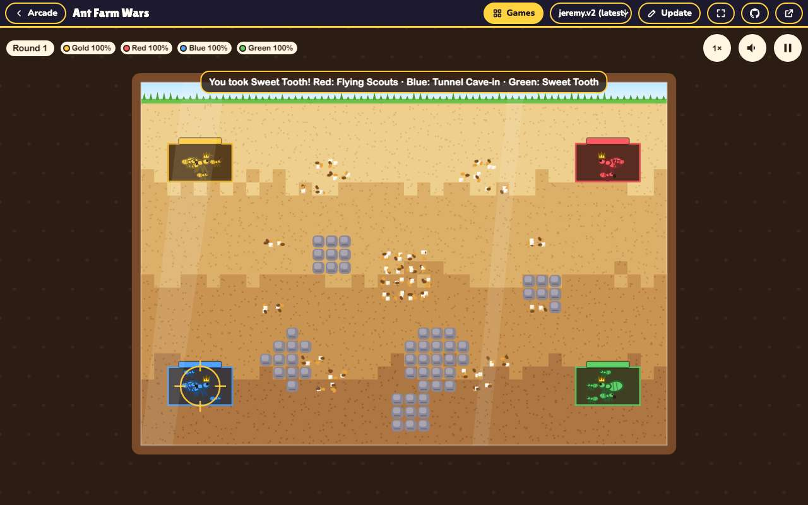 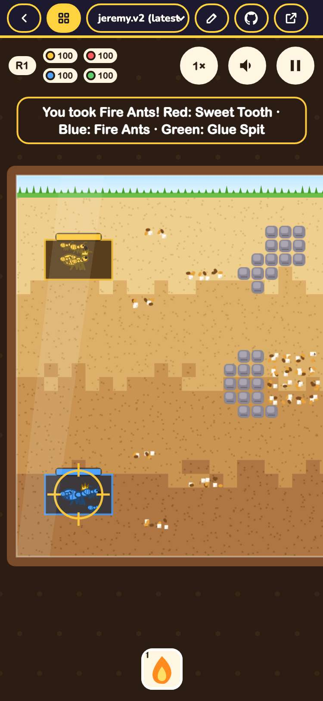
