# Evidence: 216-pet-wash-payback-jeremy-v4

**PASS: 10 of 10 checks pass at desktop and phone widths.**

Generated by `npm run evidence -- 216-pet-wash-payback-jeremy-v4` from [`tests/evidence/216-pet-wash-payback-jeremy-v4.spec.mjs`](../../tests/evidence/216-pet-wash-payback-jeremy-v4.spec.mjs) against the local server (python3 -m http.server) on this branch, starting from commit 6f20658, 2026-10-29 18:37 UTC. Rules: [docs/evidence.md](../../docs/evidence.md).

| Check | Desktop 1280 | Phone 375 |
|---|---|---|
| jeremy.v4 opens to its title screen, starts a wash round, and loads nothing from outside the site | pass | pass |
| every button meets the phone bar: at least 48 x 48 px, 8 px from the others and from the screen edges, and real taps work them | pass | pass |
| the HUD in every round: the Clean/Wet meter is at least as wide as in jeremy.v3, no name jeremy.v3 showed whole is cut, and it stays in its band | pass | pass |
| in the wash round, the arrows and WASD move a visible scrub brush, and it rides along with the pet | pass | pass |
| Space held scrubs, rinses and dries with the brush, and a whole wash plays from the keyboard | pass | pass |
| Enter or Space catches Pickles when the brush reaches him, and he can be washed from the keyboard | pass | pass |
| what stays: touch and mouse wash, the payback rounds and Survival play exactly as in jeremy.v3 | pass | pass |
| saves: what jeremy.v3 saved loads and carries on in jeremy.v4, and the older keys stay as they were | pass | pass |
| the older versions still play: jeremy.v3, jeremy.v2, jeremy.v1 and Kiki's kiki.v1 | pass | pass |
| in the arcade, Pet Wash Payback plays jeremy.v4 by default, and its wash round takes the keyboard there | pass | pass |

## 1. jeremy.v4 opens to its title screen, starts a wash round, and loads nothing from outside the site

- desktop: title (Play!, Survival!, Pick a pet; the keys line now covers the brush) → "Wash Biscuit the Dog!", whose how-to adds the keys → Go! → Biscuit's wash with the tool bar; no requests outside the site (jeremy.v3 made none either); no sideways scrolling
- phone: title (Play!, Survival!, Pick a pet; the keys line now covers the brush) → "Wash Biscuit the Dog!", whose how-to adds the keys → Go! → Biscuit's wash with the tool bar; no requests outside the site (jeremy.v3 made none either); no sideways scrolling

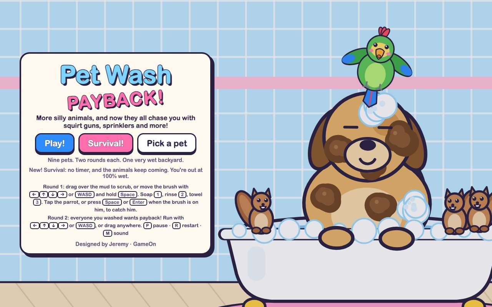 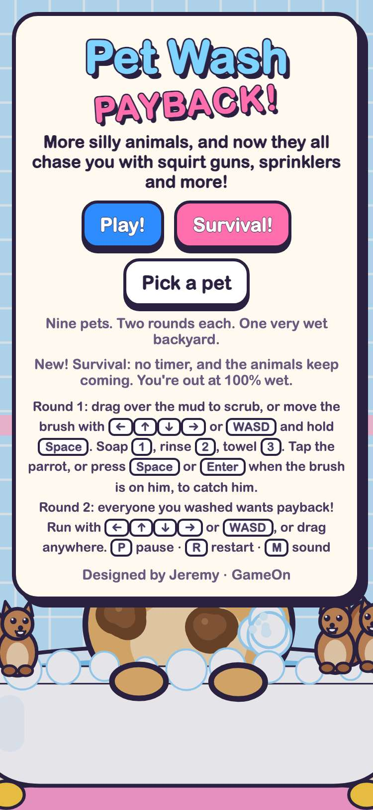

## 2. every button meets the phone bar: at least 48 x 48 px, 8 px from the others and from the screen edges, and real taps work them

- desktop: 1280 px wide, with clicks (Pick a pet, Back, Play!, Go!, Rinse, Soap, Sound (twice), Pause, Keep going, each doing its job): 32 buttons on 10 screens (title 3, Pick a pet 10, round intro 1, wash round 5, pause 4, round result 2, final score 2, Survival intro 1, Survival run 2, Survival end 2), none smaller than 48 px, none closer than 8 px to another or to an edge. Sound 48x48 and Pause 48x48, 8 px apart; Back 73x48; Title screen 125x48 and Sound: on 112x48 on the pause screen; Keep going 52 px tall
- phone: 375 px wide (phone), with real taps (Pick a pet, Back, Play!, Go!, Rinse, Soap, Sound (twice), Pause, Keep going, each doing its job): 32 buttons on 10 screens (title 3, Pick a pet 10, round intro 1, wash round 5, pause 4, round result 2, final score 2, Survival intro 1, Survival run 2, Survival end 2), none smaller than 48 px, none closer than 8 px to another or to an edge. Sound 48x48 and Pause 48x48, 8 px apart; Back 73x48; Title screen 125x48 and Sound: on 112x48 on the pause screen; Keep going 48 px tall

 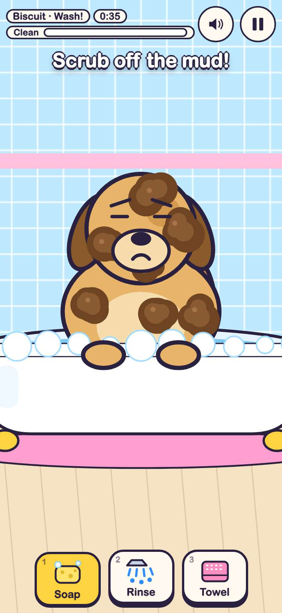

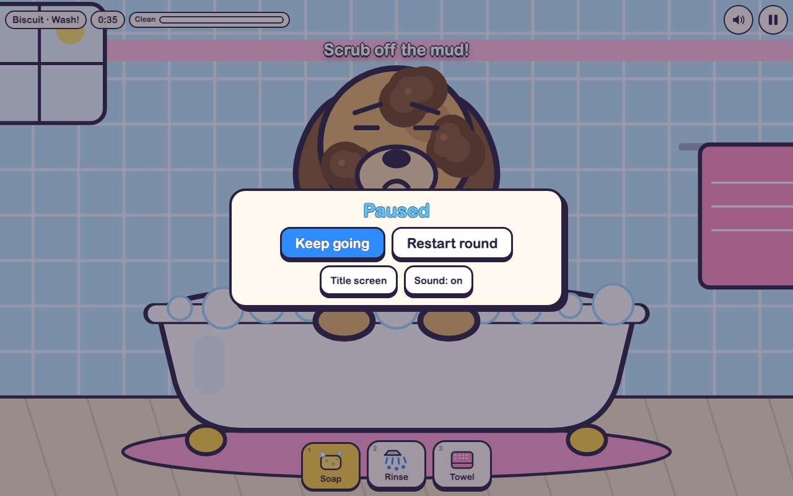 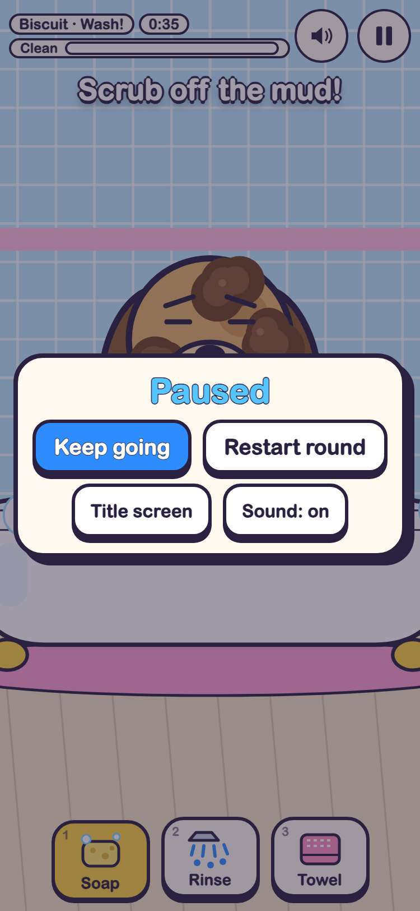

## 3. the HUD in every round: the Clean/Wet meter is at least as wide as in jeremy.v3, no name jeremy.v3 showed whole is cut, and it stays in its band

- desktop: 1280 px wide, meter bar width in px, jeremy.v3 → jeremy.v4: Biscuit · Wash! [wash 1] 200 → 200; Biscuit · Payback! [payback 1, from Play!] 212 → 212; Biscuit · Payback! [payback 1, from Pick a pet] 212 → 212; Mittens · Wash! [wash 2] 200 → 200; 2 pets · Payback! [payback 2, from Play!] 212 → 212; Mittens · Payback! [payback 2, from Pick a pet] 212 → 212; The Nutty Gang · Wash! [wash 3] 200 → 200; 3 pets · Payback! [payback 3, from Play!] 212 → 212; The Nutty Gang · Payback! [payback 3, from Pick a pet] 212 → 212; Clover · Wash! [wash 4] 200 → 200; 4 pets · Payback! [payback 4, from Play!] 212 → 212; Clover · Payback! [payback 4, from Pick a pet] 212 → 212; Pickles · Wash! [wash 5] 200 → 200; 5 pets · Payback! [payback 5, from Play!] 212 → 212; Pickles · Payback! [payback 5, from Pick a pet] 212 → 212; Truffle · Wash! [wash 6] 200 → 200; 6 pets · Payback! [payback 6, from Play!] 212 → 212; Truffle · Payback! [payback 6, from Pick a pet] 212 → 212; Bubbles · Wash! [wash 7] 200 → 200; 7 pets · Payback! [payback 7, from Play!] 212 → 212; Bubbles · Payback! [payback 7, from Pick a pet] 212 → 212; Inky · Wash! [wash 8] 200 → 200; 8 pets · Payback! [payback 8, from Play!] 212 → 212; Inky · Payback! [payback 8, from Pick a pet] 212 → 212; Sir Quackers · Wash! [wash 9] 200 → 200; 9 pets · Payback! [payback 9, from Play!] 212 → 212; Sir Quackers · Payback! [payback 9, from Pick a pet] 212 → 212; 1 chasing [Survival] 212 → 212. Names cut: jeremy.v3 none; jeremy.v4 none. HUD bottom: jeremy.v3 44 px, jeremy.v4 56 px (the game keeps 58)
- phone: 375 px wide, meter bar width in px, jeremy.v3 → jeremy.v4: Biscuit · Wash! [wash 1] 44 → 191; Biscuit · Payback! [payback 1, from Play!] 46 → 203; Biscuit · Payback! [payback 1, from Pick a pet] 46 → 203; Mittens · Wash! [wash 2] 43 → 191; 2 pets · Payback! [payback 2, from Play!] 49 → 203; Mittens · Payback! [payback 2, from Pick a pet] 45 → 203; The Nutty Gang · Wash! [wash 3] 22 (name cut, 144 px shown) → 191; 3 pets · Payback! [payback 3, from Play!] 49 → 203; The Nutty Gang · Payback! [payback 3, from Pick a pet] 28 (name cut, 149 px shown) → 203; Clover · Wash! [wash 4] 46 → 191; 4 pets · Payback! [payback 4, from Play!] 49 → 203; Clover · Payback! [payback 4, from Pick a pet] 48 → 203; Pickles · Wash! [wash 5] 44 → 191; 5 pets · Payback! [payback 5, from Play!] 49 → 203; Pickles · Payback! [payback 5, from Pick a pet] 46 → 203; Truffle · Wash! [wash 6] 45 → 191; 6 pets · Payback! [payback 6, from Play!] 49 → 203; Truffle · Payback! [payback 6, from Pick a pet] 47 → 203; Bubbles · Wash! [wash 7] 40 → 191; 7 pets · Payback! [payback 7, from Play!] 49 → 203; Bubbles · Payback! [payback 7, from Pick a pet] 42 → 203; Inky · Wash! [wash 8] 53 → 191; 8 pets · Payback! [payback 8, from Play!] 49 → 203; Inky · Payback! [payback 8, from Pick a pet] 55 → 203; Sir Quackers · Wash! [wash 9] 27 (name cut, 139 px shown) → 191; 9 pets · Payback! [payback 9, from Play!] 49 → 203; Sir Quackers · Payback! [payback 9, from Pick a pet] 33 (name cut, 145 px shown) → 203; 1 chasing [Survival] 63 → 203. Names cut: jeremy.v3 The Nutty Gang · Wash!, The Nutty Gang · Payback!, Sir Quackers · Wash!, Sir Quackers · Payback!; jeremy.v4 none. HUD bottom: jeremy.v3 40 px, jeremy.v4 56 px (the game keeps 58)

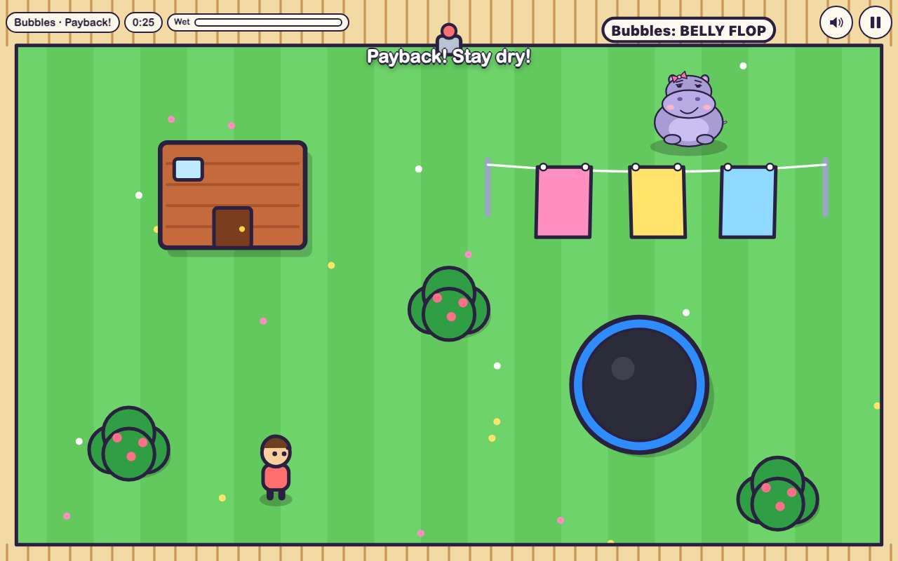 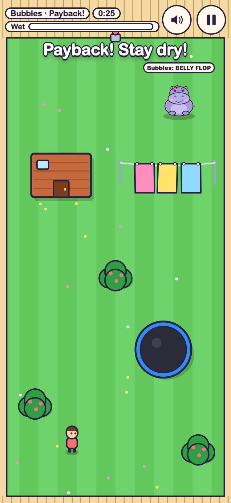

## 4. in the wash round, the arrows and WASD move a visible scrub brush, and it rides along with the pet

- desktop: Enter on the title and Enter on Go! started Biscuit's wash with the brush already on him. Held for a quarter second each, the brush moved (px): ArrowLeft 129, a 138, ArrowRight 161, d 150, ArrowUp 155, w 138, ArrowDown 160, s 157; moving alone scrubbed nothing. Over 1.5 s Biscuit swayed 54 px and the brush, with no key down, stayed within 7 px of the same spot on him. P and Escape each pause and unpause
- phone: Enter on the title and Enter on Go! started Biscuit's wash with the brush already on him. Held for a quarter second each, the brush moved (px): ArrowLeft 75, a 78, ArrowRight 83, d 81, ArrowUp 82, w 79, ArrowDown 85, s 83; moving alone scrubbed nothing. Over 1.5 s Biscuit swayed 15 px and the brush, with no key down, stayed within 2 px of the same spot on him. P and Escape each pause and unpause

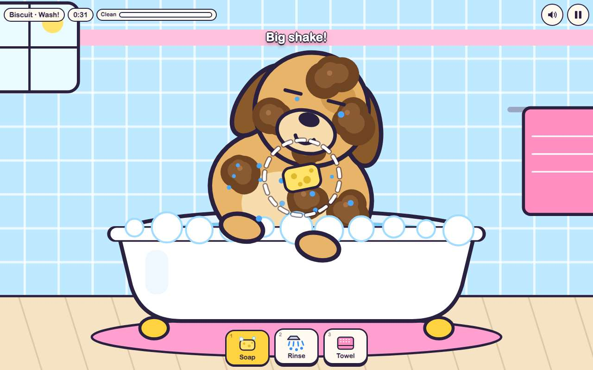 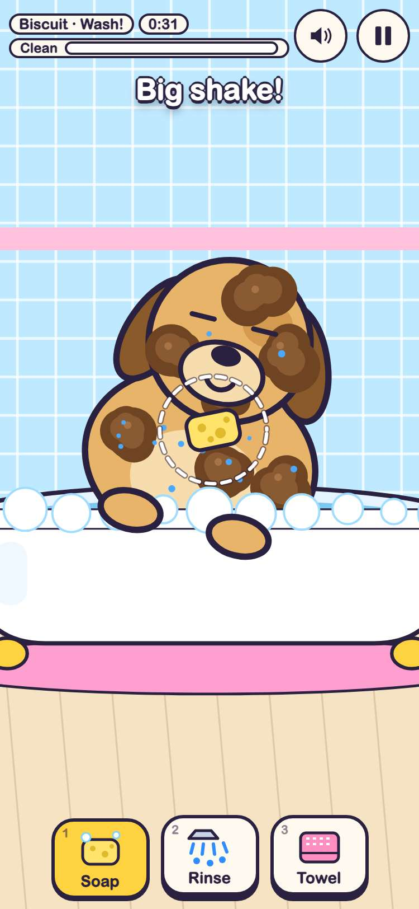

## 5. Space held scrubs, rinses and dries with the brush, and a whole wash plays from the keyboard

- desktop: brush steered onto a spot with the arrows, then real key presses: Space held 50 frames soaped it to bubbles (the screenshot, mid-scrub), 2 + Space rinsed it, 3 + Space dried it sparkling. Then a keyboard-only player (arrows and WASD taking turns, Space, 1 2 3) finished Biscuit "Super speedy scrub!" with 21.3 s left and 3 stars. From the keyboard every pet but Pickles washed in time: Biscuit 21 s left, Mittens 21 s left, The Nutty Gang 30.1 s left, Clover 22.1 s left, Truffle 16.7 s left, Bubbles 19.1 s left, Inky 26.9 s left, Sir Quackers 21.7 s left
- phone: brush steered onto a spot with the arrows, then real key presses: Space held 50 frames soaped it to bubbles (the screenshot, mid-scrub), 2 + Space rinsed it, 3 + Space dried it sparkling. Then a keyboard-only player (arrows and WASD taking turns, Space, 1 2 3) finished Biscuit "Super speedy scrub!" with 20.8 s left and 3 stars. From the keyboard every pet but Pickles washed in time: Biscuit 19.7 s left, Mittens 21.9 s left, The Nutty Gang 26.6 s left, Clover 21.4 s left, Truffle 14 s left, Bubbles 18 s left, Inky 26.3 s left, Sir Quackers 21.1 s left

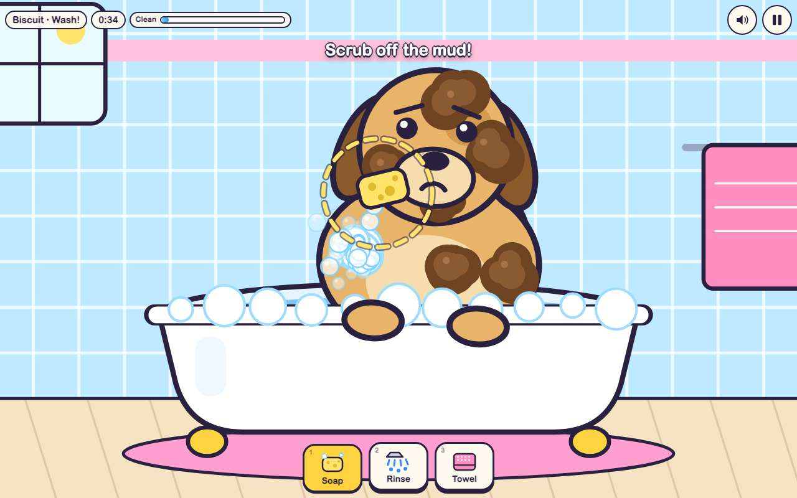 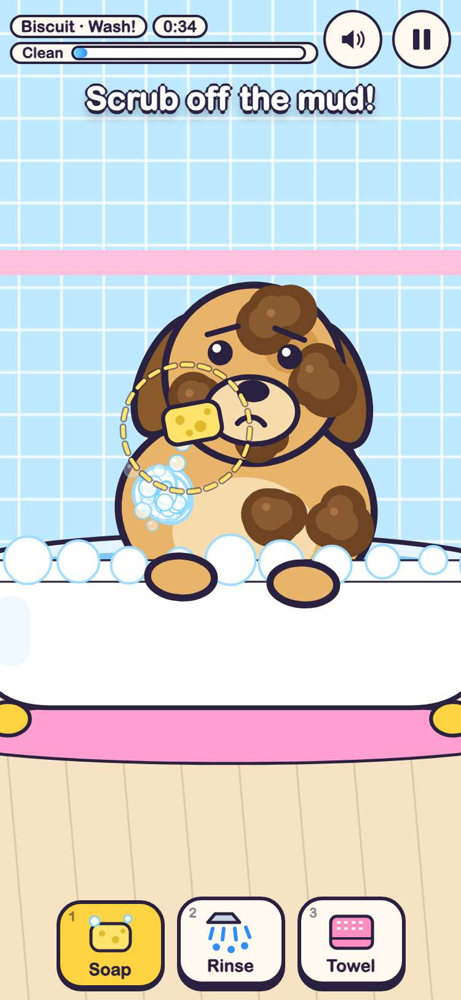

## 6. Enter or Space catches Pickles when the brush reaches him, and he can be washed from the keyboard

- desktop: Pickles' wash: the brush starts under his flight path; Space from too far away said "Missed!" and he kept flying. Chasing him with the arrows put him in the ring after 0.7 s (the screenshot: the ring turns yellow and says "Space!"), and Enter caught him ("Gotcha!"); the brush carried him back to the tub. Then a keyboard-only player washed him clean with 26 s left, catching him 3 times in all (Enter (above), Enter, Space)
- phone: Pickles' wash: the brush starts under his flight path; Space from too far away said "Missed!" and he kept flying. Chasing him with the arrows put him in the ring after 1.6 s (the screenshot: the ring turns yellow and says "Space!"), and Enter caught him ("Gotcha!"); the brush carried him back to the tub. Then a keyboard-only player washed him clean with 24.4 s left, catching him 3 times in all (Enter (above), Enter, Space)

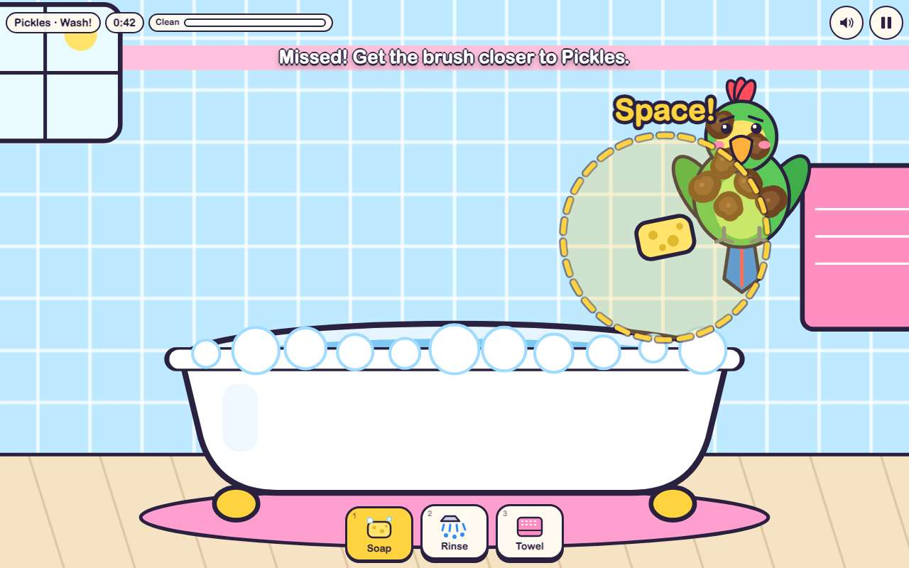 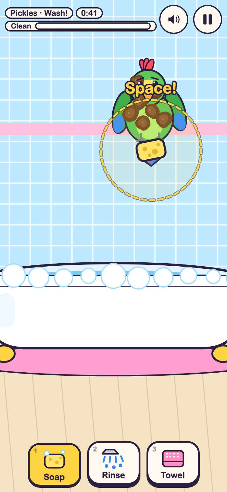

## 7. what stays: touch and mouse wash, the payback rounds and Survival play exactly as in jeremy.v3

- desktop: pets, weapons, speeds, scrub work and Survival's pace are byte for byte jeremy.v3's. With the same seeds, the pointer player and the arrow-key dodger got identical results in jeremy.v3 and jeremy.v4: Biscuit, Pickles and Inky washed with 21.88, 27.75 and 27.35 s left; the nine-pet payback ended at 100% wet from 124 hits; a Survival run reached 38.25 s at 100% wet. Started by tapping, the brush stays hidden and tapping Towel picks the towel
- phone: pets, weapons, speeds, scrub work and Survival's pace are byte for byte jeremy.v3's. With the same seeds, the pointer player and the arrow-key dodger got identical results in jeremy.v3 and jeremy.v4: Biscuit, Pickles and Inky washed with 20.05, 25.23 and 25.95 s left; the nine-pet payback ended at 75% wet from 50 hits; a Survival run reached 80.47 s at 100% wet. Started by tapping, the brush stays hidden and tapping Towel picks the towel

## 8. saves: what jeremy.v3 saved loads and carries on in jeremy.v4, and the older keys stay as they were

- desktop: seeded jeremy.v3's keys (best 12345, reached 7, survival 61.3 s with 13) and jeremy.v1's and jeremy.v2's: jeremy.v4's title shows 12345 and "1:01 with 13 animals chasing", Pick a pet shows the best stars and the first 7 pets open, sound off. After washing Bubbles from the keyboard, her payback and a Survival run: no new keys, jeremy.v3.reached is now 8 and survival runs 5 (best kept), Bubbles' stars {"wash":3,"hose":2}; jeremy.v1's and jeremy.v2's keys byte for byte the same; jeremy.v3 opens Inky from that save too
- phone: seeded jeremy.v3's keys (best 12345, reached 7, survival 61.3 s with 13) and jeremy.v1's and jeremy.v2's: jeremy.v4's title shows 12345 and "1:01 with 13 animals chasing", Pick a pet shows the best stars and the first 7 pets open, sound off. After washing Bubbles from the keyboard, her payback and a Survival run: no new keys, jeremy.v3.reached is now 8 and survival runs 5 (best kept), Bubbles' stars {"wash":3,"hose":2}; jeremy.v1's and jeremy.v2's keys byte for byte the same; jeremy.v3 opens Inky from that save too

## 9. the older versions still play: jeremy.v3, jeremy.v2, jeremy.v1 and Kiki's kiki.v1

- desktop: each opens to its title and Play! → Go! starts a wash round: jeremy.v3 at games/pet-wash-payback/jeremy.v3/: "Biscuit · Wash!"; jeremy.v2 at games/pet-wash-payback/jeremy.v2/: "Biscuit · Wash!"; jeremy.v1 at games/pet-wash-payback/: "Biscuit · Wash!"; kiki.v1 at games/pet-wash-payback/kiki.v1/: "Biscuit · Wash!". games.json still points every older version at its own folder
- phone: each opens to its title and Play! → Go! starts a wash round: jeremy.v3 at games/pet-wash-payback/jeremy.v3/: "Biscuit · Wash!"; jeremy.v2 at games/pet-wash-payback/jeremy.v2/: "Biscuit · Wash!"; jeremy.v1 at games/pet-wash-payback/: "Biscuit · Wash!"; kiki.v1 at games/pet-wash-payback/kiki.v1/: "Biscuit · Wash!". games.json still points every older version at its own folder

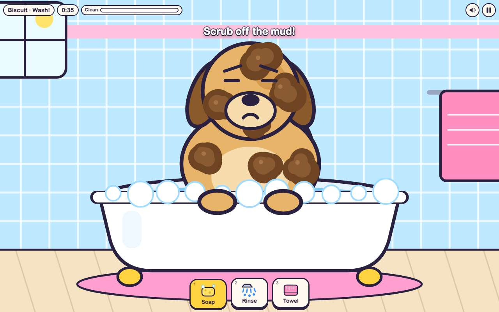 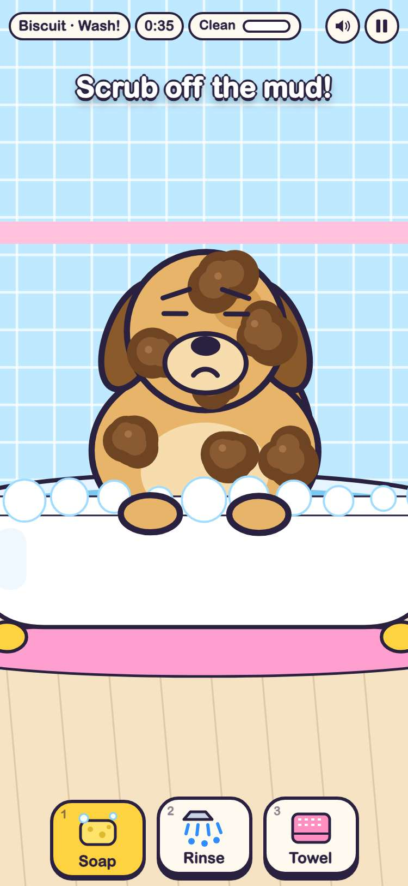

## 10. in the arcade, Pet Wash Payback plays jeremy.v4 by default, and its wash round takes the keyboard there

- desktop: card (5 versions) → picker: jeremy.v4 Latest first with its note "Wash pets with the keyboard", then jeremy.v3 → jeremy.v4 in the frame: Play! → Go! → an arrow key shows the brush; #pet-wash-payback@jeremy.v3 still opens jeremy.v3
- phone: card (5 versions) → picker: jeremy.v4 Latest first with its note "Wash pets with the keyboard", then jeremy.v3 → jeremy.v4 in the frame: Play! → Go! → an arrow key shows the brush; #pet-wash-payback@jeremy.v3 still opens jeremy.v3

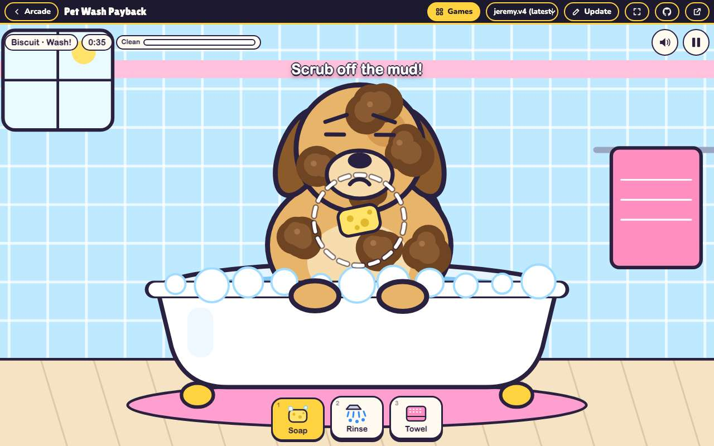 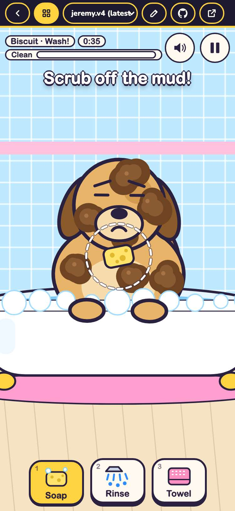
