# Evidence: 217-big-weird-dig-jeremy-v2

**PASS: 7 of 7 checks pass at desktop and phone widths.**

Generated by `npm run evidence -- 217-big-weird-dig-jeremy-v2` from [`tests/evidence/217-big-weird-dig-jeremy-v2.spec.mjs`](../../tests/evidence/217-big-weird-dig-jeremy-v2.spec.mjs) against the local server (python3 -m http.server) on this branch, starting from commit 10cdd8c, 2026-10-29 18:08 UTC. Rules: [docs/evidence.md](../../docs/evidence.md).

| Check | Desktop 1280 | Phone 375 |
|---|---|---|
| jeremy.v2 opens to its title screen and starts level 1, with nothing loaded from the internet | pass | pass |
| every button meets the phone bar: Pause is 48 x 48 and 8 px from the edges, and Sound, Back, Levels and Title screen are 48 px tall | pass | pass |
| Enter and Space each press the main button on the title, pause, level-done and out-of-fuel screens | pass | pass |
| WASD and the arrow keys both drive the bulldozer, and P pauses | pass | pass |
| jeremy.v1's saves carry over: v2 shows its museum, levels and sound setting, and v1 reads back what v2 adds | pass | pass |
| jeremy.v1 still plays at games/big-weird-dig/, unchanged | pass | pass |
| in the arcade, Big Weird Dig plays jeremy.v2 by default and the picker still offers jeremy.v1 | pass | pass |

## 1. jeremy.v2 opens to its title screen and starts level 1, with nothing loaded from the internet

- desktop: clicked Dig! and level 1 started; no requests outside the site; no sideways scrolling
- phone: tapped Dig! and level 1 started; no requests outside the site; no sideways scrolling

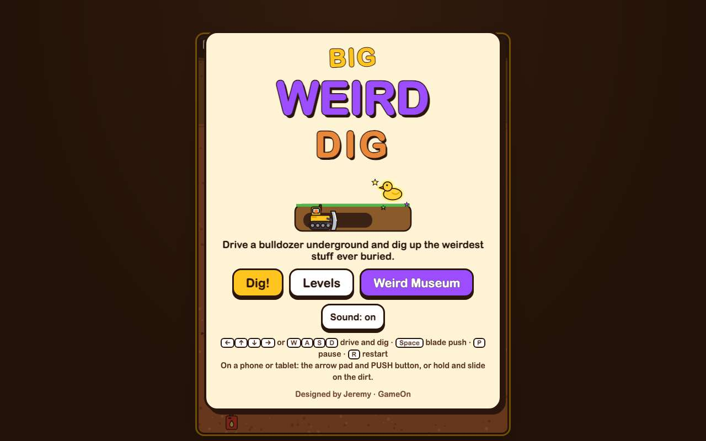 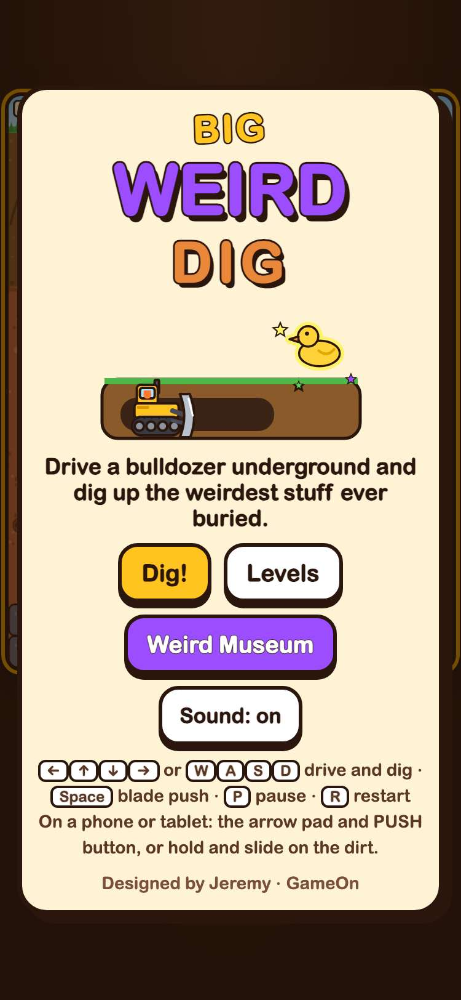

## 2. every button meets the phone bar: Pause is 48 x 48 and 8 px from the edges, and Sound, Back, Levels and Title screen are 48 px tall

- desktop: Pause 48x48, 320 px from the right edge and 8 px from the top. #play-btn 93x52, #levels-btn 118x52, #museum-btn 207x52, #sound-btn 117x48, #levels-back 76x48, #museum-back 76x48, .slot >> nth=0 71x64, #resume-btn 190x52, #restart-btn 183x52, #pause-levels-btn 87x48, #pause-title-btn 131x48, #pause-sound-btn 117x48, #next-btn 168x52, #retry-btn 159x52, #done-museum-btn 155x48, #done-levels-btn 87x48, #empty-retry-btn 148x52, #empty-levels-btn 118x52. touchTargets() found no problems: title: 4 (smallest side 48 px); levels: 9 (smallest side 48 px); museum: 31 (smallest side 48 px); playing: 1 (smallest side 48 px); paused: 5 (smallest side 48 px); level done: 4 (smallest side 48 px); out of fuel: 2 (smallest side 52 px). Sound, Levels, Back, a museum slot, Dig!, Pause, Keep digging and Dig deeper each did their job when clicked
- phone: Pause 48x48, 8 px from the right edge and 8 px from the top. #play-btn 75x48, #levels-btn 97x48, #museum-btn 173x48, #sound-btn 117x48, #levels-back 76x48, #museum-back 76x48, .slot >> nth=0 52x53, #resume-btn 159x48, #restart-btn 153x48, #pause-levels-btn 87x48, #pause-title-btn 131x48, #pause-sound-btn 117x48, #next-btn 140x48, #retry-btn 132x48, #done-museum-btn 155x48, #done-levels-btn 87x48, #empty-retry-btn 123x48, #empty-levels-btn 97x48. touchTargets() found no problems: title: 4 (smallest side 48 px); levels: 9 (smallest side 48 px); museum: 31 (smallest side 48 px); playing: 3 (smallest side 48 px); paused: 5 (smallest side 48 px); level done: 4 (smallest side 48 px); out of fuel: 2 (smallest side 48 px). Sound, Levels, Back, a museum slot, Dig!, Pause, Keep digging and Dig deeper each did their job when tapped; the d-pad drove the bulldozer down

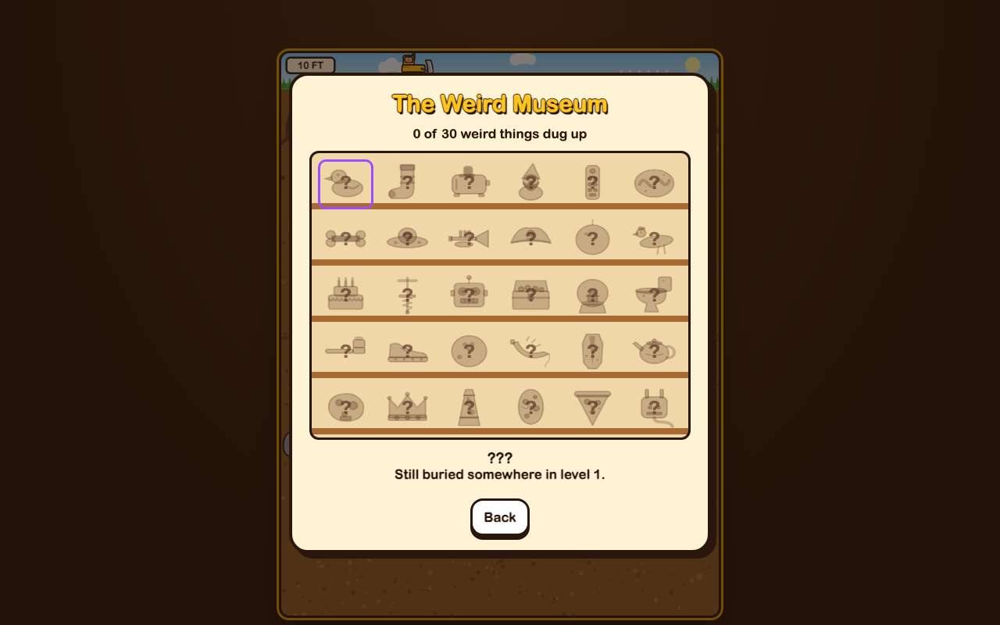 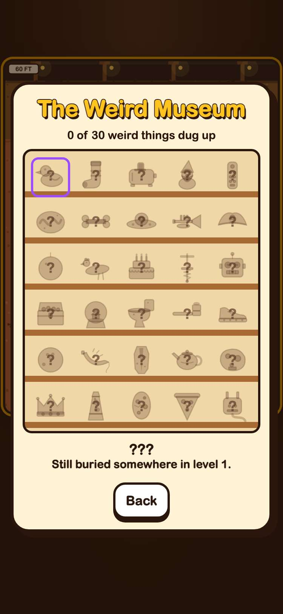

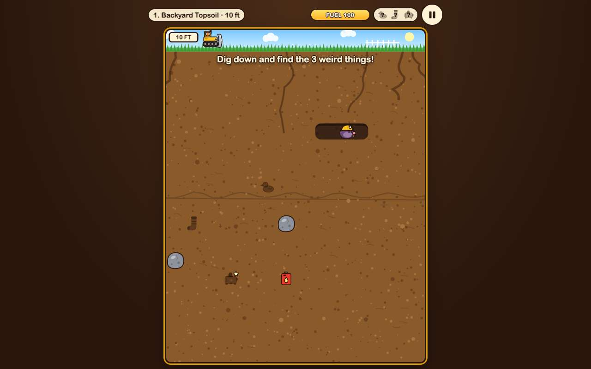 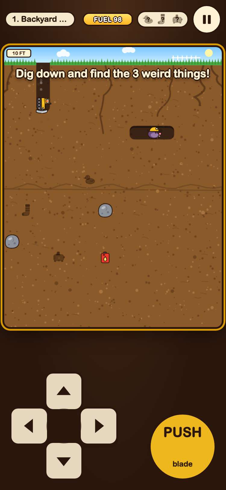

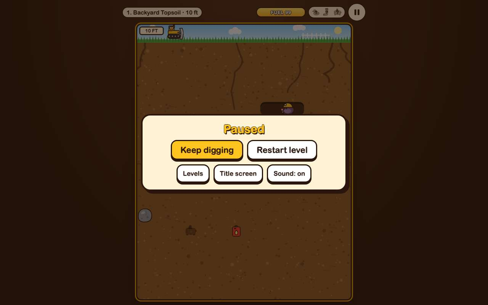 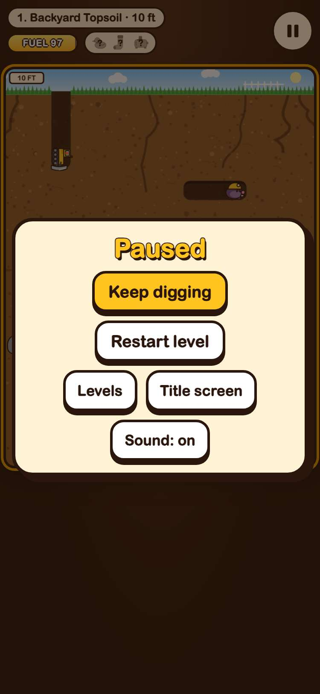

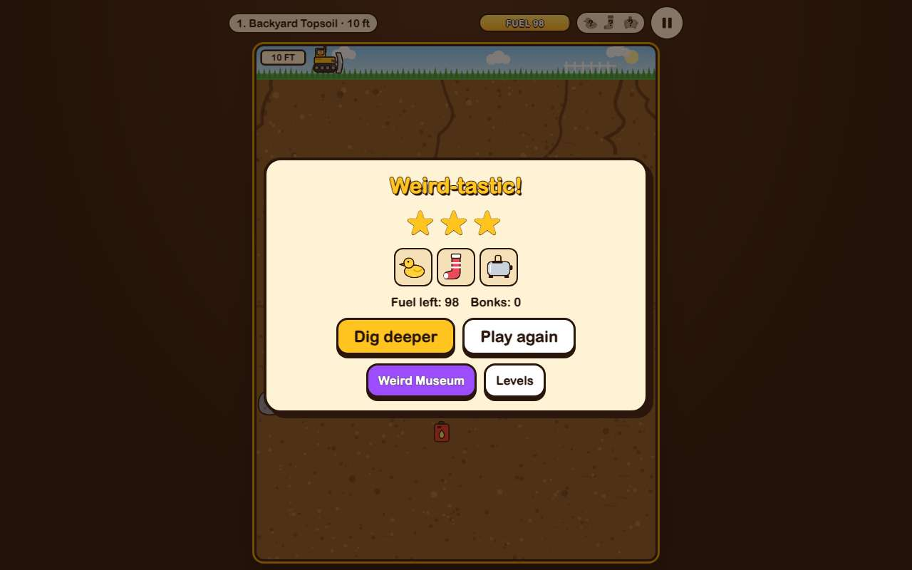 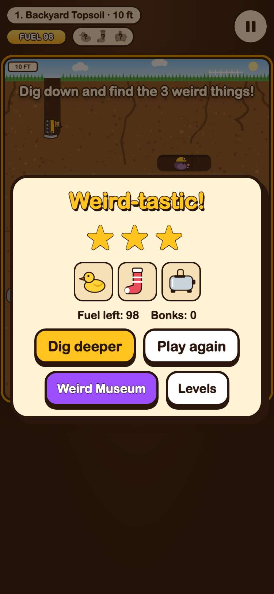

## 3. Enter and Space each press the main button on the title, pause, level-done and out-of-fuel screens

- desktop: Enter: title → level 1, pause → playing, level done → level 2, out of fuel → level 2 again with a full tank. Space: title → level 1, pause → playing, level done → level 2, out of fuel → level 2 again with a full tank. with Restart level focused, Enter restarted the level instead; a Space pressed as the done screen opened left it open
- phone: Enter: title → level 1, pause → playing, level done → level 2, out of fuel → level 2 again with a full tank. Space: title → level 1, pause → playing, level done → level 2, out of fuel → level 2 again with a full tank. with Restart level focused, Enter restarted the level instead; a Space pressed as the done screen opened left it open

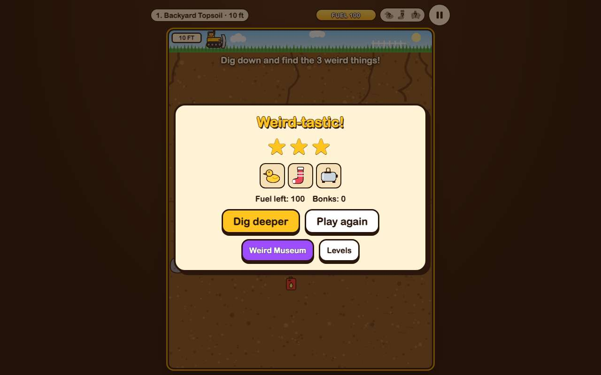 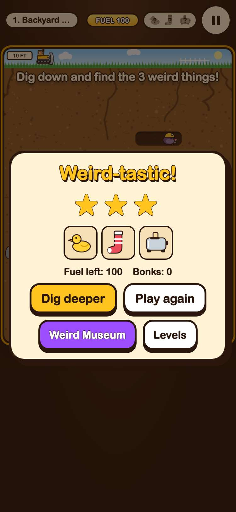

## 4. WASD and the arrow keys both drive the bulldozer, and P pauses

- desktop: x, y, facing: s: 2.00,0.00,r → 2.00,1.30,d; ArrowDown: 2.00,1.30,d → 2.00,2.61,d; d: 2.00,2.61,d → 2.91,3.00,r; ArrowRight: 2.91,3.00,r → 4.21,3.00,r; a: 4.21,3.00,r → 2.38,3.00,l; ArrowLeft: 2.38,3.00,l → 0.95,3.00,l; w: 0.95,3.00,l → 1.00,1.87,u; ArrowUp: 1.00,1.87,u → 1.00,0.44,u. P paused and P again carried on
- phone: x, y, facing: s: 2.00,0.00,r → 2.00,1.36,d; ArrowDown: 2.00,1.36,d → 2.00,2.72,d; d: 2.00,2.72,d → 3.02,3.00,r; ArrowRight: 3.02,3.00,r → 4.27,3.00,r; a: 4.27,3.00,r → 2.35,3.00,l; ArrowLeft: 2.35,3.00,l → 0.93,3.00,l; w: 0.93,3.00,l → 1.00,1.81,u; ArrowUp: 1.00,1.81,u → 1.00,0.27,u. P paused and P again carried on

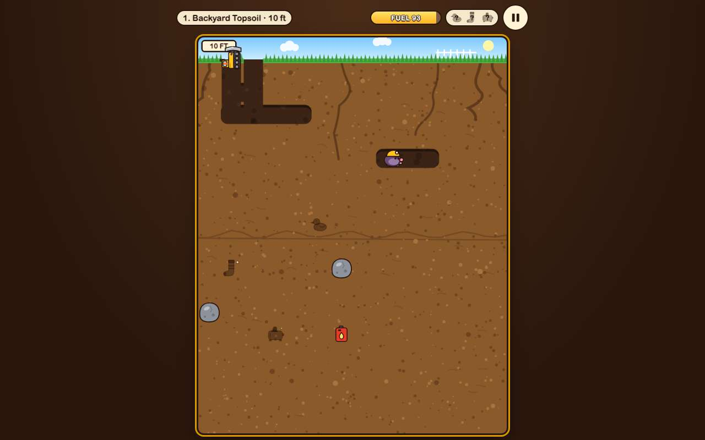 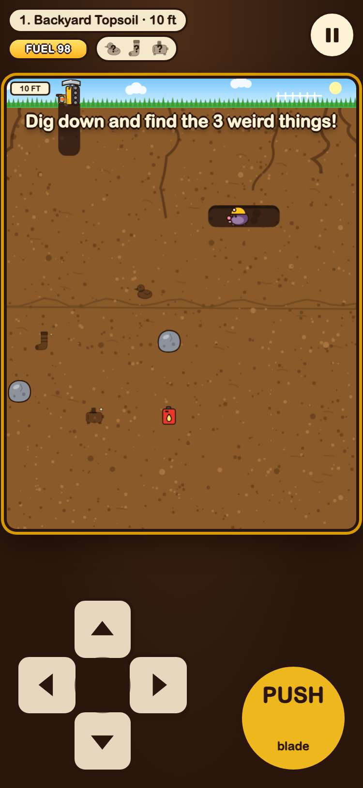

## 5. jeremy.v1's saves carry over: v2 shows its museum, levels and sound setting, and v1 reads back what v2 adds

- desktop: seeded jeremy.v1's museum (duck, sock, toaster), level 2 unlocked with 3 stars on level 1, and sound off: v2 showed all three; Dig! went on at level 2, and clearing it unlocked level 3 under the same keys (gameon.big-weird-dig.museum, gameon.big-weird-dig.progress, gameon.big-weird-dig.sound; nothing new); jeremy.v1 then showed level 3 unlocked and sound off
- phone: seeded jeremy.v1's museum (duck, sock, toaster), level 2 unlocked with 3 stars on level 1, and sound off: v2 showed all three; Dig! went on at level 2, and clearing it unlocked level 3 under the same keys (gameon.big-weird-dig.museum, gameon.big-weird-dig.progress, gameon.big-weird-dig.sound; nothing new); jeremy.v1 then showed level 3 unlocked and sound off

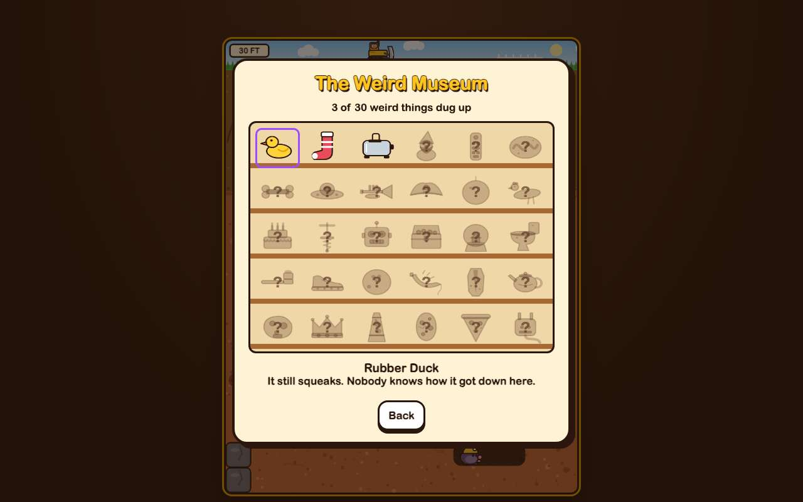 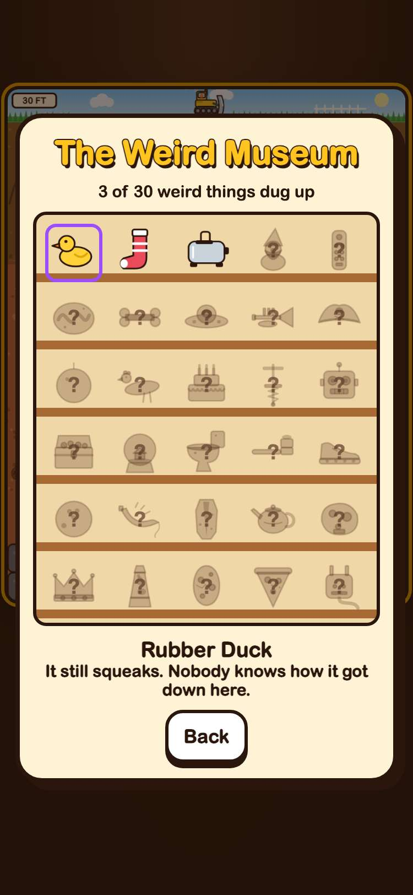

## 6. jeremy.v1 still plays at games/big-weird-dig/, unchanged

- desktop: jeremy.v1 at games/big-weird-dig/: its title, Dig!, and the arrow keys dug a tunnel; its Pause button is still 28x28, as before
- phone: jeremy.v1 at games/big-weird-dig/: its title, Dig!, and the arrow keys dug a tunnel; its Pause button is still 28x28, as before

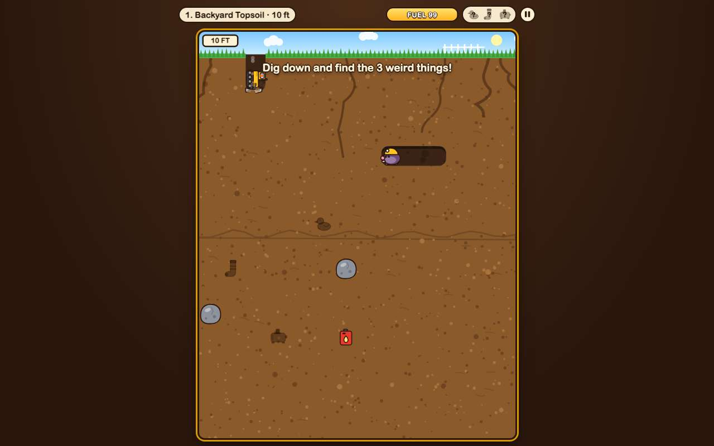 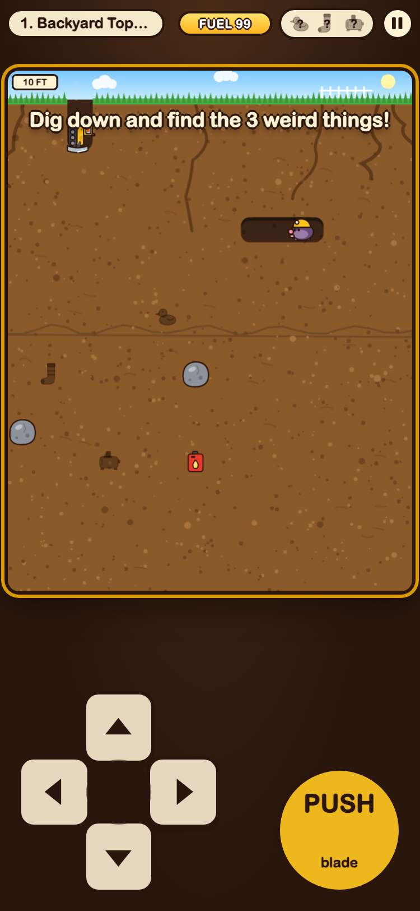

## 7. in the arcade, Big Weird Dig plays jeremy.v2 by default and the picker still offers jeremy.v1

- desktop: card (2 versions) → picker: jeremy.v2 first with its note, then jeremy.v1 → jeremy.v2 plays in the frame; #big-weird-dig@jeremy.v1 opens jeremy.v1
- phone: card (2 versions) → picker: jeremy.v2 first with its note, then jeremy.v1 → jeremy.v2 plays in the frame; #big-weird-dig@jeremy.v1 opens jeremy.v1

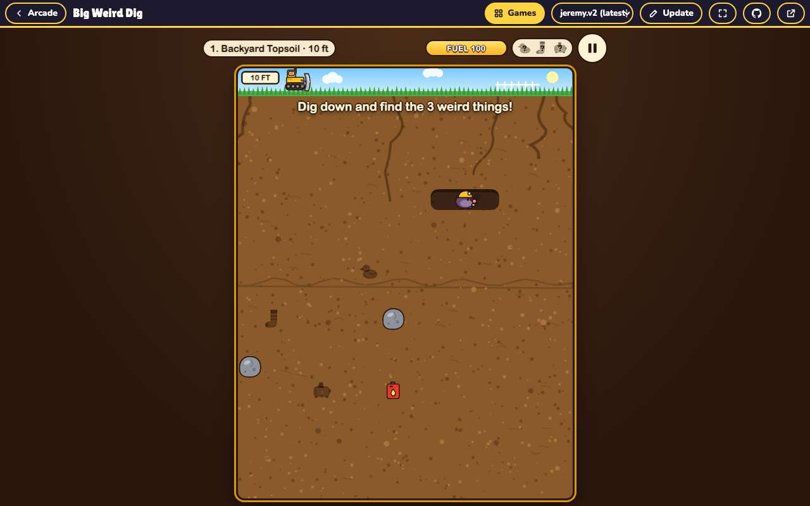 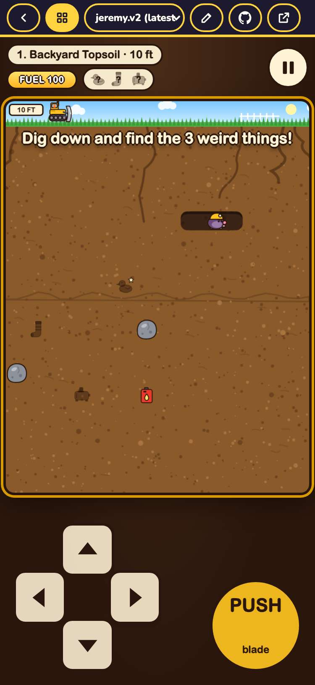
