# Evidence: 219-fancy-food-fight-jeremy-v2

**PASS: 11 of 11 checks pass at desktop and phone widths.**

Generated by `npm run evidence -- 219-fancy-food-fight-jeremy-v2` from [`tests/evidence/219-fancy-food-fight-jeremy-v2.spec.mjs`](../../tests/evidence/219-fancy-food-fight-jeremy-v2.spec.mjs) against the local server (python3 -m http.server) on this branch, starting from commit 2b38c33, 2026-10-29 20:41 UTC. Rules: [docs/evidence.md](../../docs/evidence.md).

| Check | Desktop 1280 | Phone 375 |
|---|---|---|
| jeremy.v2 opens to its title screen and starts, with nothing loaded from the internet | pass | pass |
| upright at 375 px wide, every button is at least 48 x 48, 8 px apart and 8 px from the edges, and each does its job when tapped | pass | pass |
| held sideways at 812 x 375, every button is at least 48 x 48, 8 px apart and 8 px from the edges, and each does its job when tapped | pass | pass |
| the HUD isn't squeezed: every pill and the Mess meter are as big as in jeremy.v1 or bigger, nothing jeremy.v1 showed whole is cut off, and no button covers them | pass | pass |
| Sound, Pause, the tray and Duck! cover no more of the throw zone or the portraits than in jeremy.v1, at every phone size, and still pass the phone bar | pass | pass |
| new keys: M turns the sound off and on, and H opens How to play from the title, in play and between rounds | pass | pass |
| the keyboard still plays: WASD and the arrows each move the aim, Space throws, P pauses and Escape plays on | pass | pass |
| what stays still works: a throw splats a guest and scores, a real tap throws, Duck! makes a throw miss, and the round ends with a crown | pass | pass |
| saves carry over: jeremy.v1's best night and sound-off load in jeremy.v2, and every save stays under gameon.fancy-food-fight. | pass | pass |
| jeremy.v1 still plays at games/fancy-food-fight/, and games.json keeps both versions | pass | pass |
| in the arcade, Fancy Food Fight offers both versions and plays jeremy.v2 by default; #fancy-food-fight@jeremy.v1 still opens jeremy.v1 | pass | pass |

## 1. jeremy.v2 opens to its title screen and starts, with nothing loaded from the internet

- desktop: clicked Let's get messy and the round clock ran; 4 foods, Duck!, Sound and Pause showing; no requests outside the site; no sideways scrolling
- phone: tapped Let's get messy and the round clock ran; 4 foods, Duck!, Sound and Pause showing; no requests outside the site; no sideways scrolling

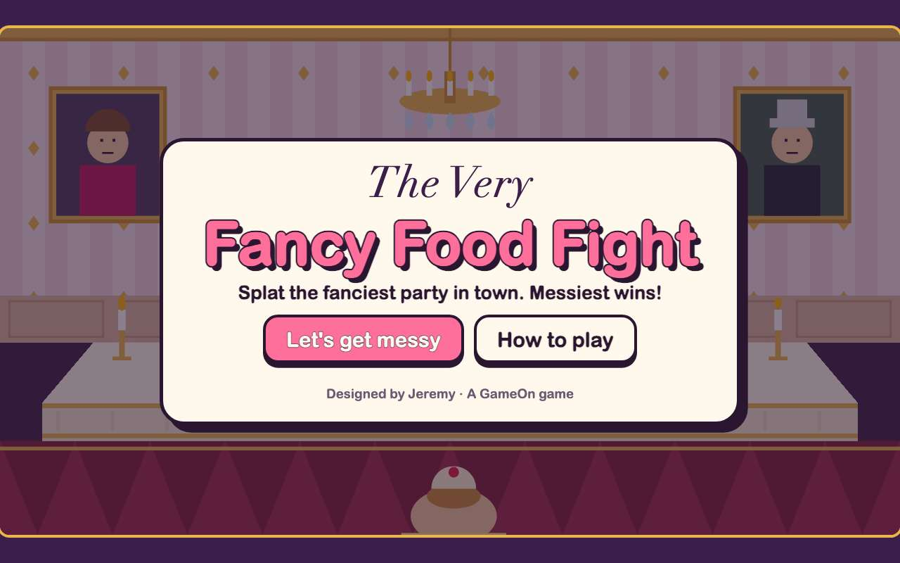 

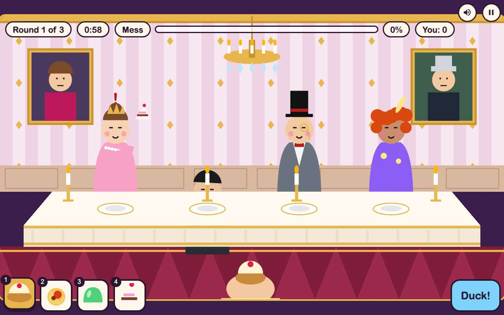 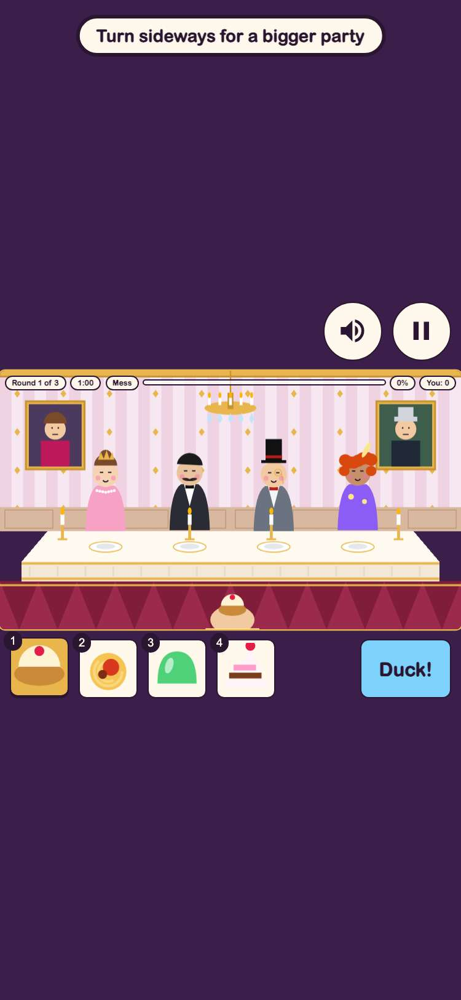

## 2. upright at 375 px wide, every button is at least 48 x 48, 8 px apart and 8 px from the edges, and each does its job when tapped

- desktop: 1280 x 800, clicked: Sound 48x48 and Pause 48x48, 13 px apart (side by side), Pause 8 px from the right edge and 8 px from the top; foods 83x83, 11 px apart, 8 px from the left edge; Duck! 128x83, 8 px from the right and 8 px from the bottom. Buttons per screen: title 2 (smallest 69 px), how to play 1 (smallest 69 px), playing 7 (smallest 48 px), paused 2 (smallest 69 px), between rounds 1 (smallest 69 px). A food, Sound (off and on), Duck! (held), Pause, Keep splatting and Next round each did their job
- phone: 375 x 812, tapped: Sound 48x48 and Pause 48x48, 8 px apart (side by side), Pause 8 px from the right edge and 245 px from the top; foods 48x48, 8 px apart, 8 px from the left edge; Duck! 74x48, 8 px from the right and 245 px from the bottom. Buttons per screen: title 2 (smallest 48 px), how to play 1 (smallest 48 px), playing 7 (smallest 48 px), paused 2 (smallest 48 px), between rounds 1 (smallest 48 px). A food, Sound (off and on), Duck! (held), Pause, Keep splatting and Next round each did their job

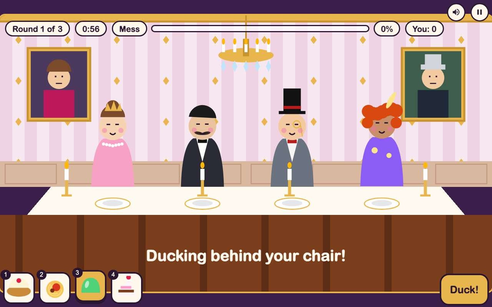

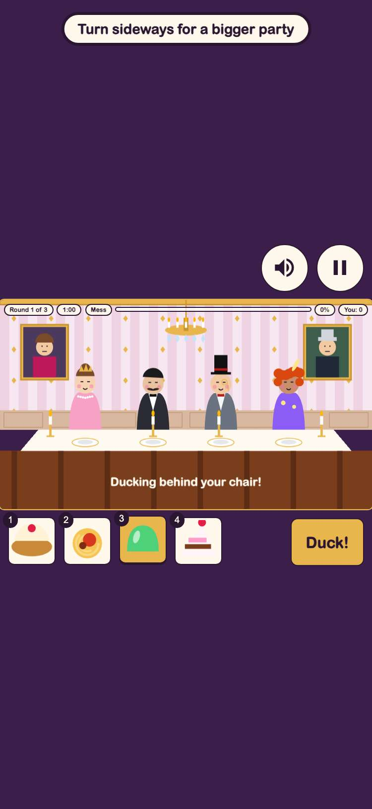

## 3. held sideways at 812 x 375, every button is at least 48 x 48, 8 px apart and 8 px from the edges, and each does its job when tapped

- desktop: 812 x 375, clicked: Sound 48x48 and Pause 48x48, 8 px apart (Sound above Pause), Pause 8 px from the right edge and 64 px from the top; foods 48x48, 8 px apart, 8 px from the left edge; Duck! 74x48, 8 px from the right and 8 px from the bottom. Buttons per screen: title 2 (smallest 48 px), how to play 1 (smallest 48 px), playing 7 (smallest 48 px), paused 2 (smallest 48 px), between rounds 1 (smallest 48 px)
- phone: 812 x 375, tapped: Sound 48x48 and Pause 48x48, 8 px apart (Sound above Pause), Pause 8 px from the right edge and 64 px from the top; foods 48x48, 8 px apart, 8 px from the left edge; Duck! 74x48, 8 px from the right and 8 px from the bottom. Buttons per screen: title 2 (smallest 48 px), how to play 1 (smallest 48 px), playing 7 (smallest 48 px), paused 2 (smallest 48 px), between rounds 1 (smallest 48 px)

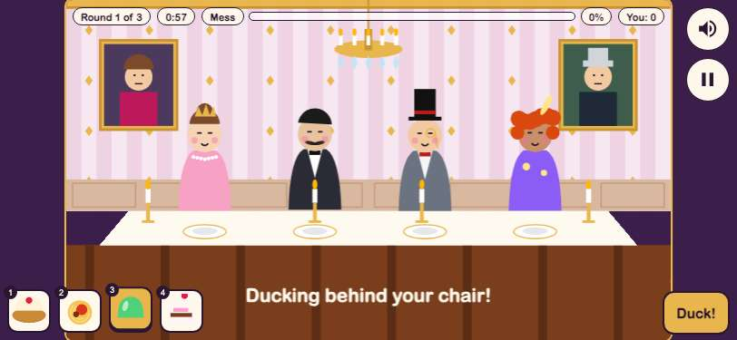 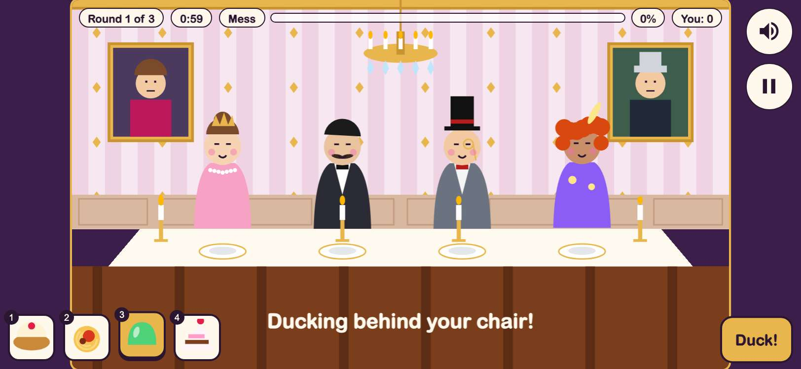

## 4. the HUD isn't squeezed: every pill and the Mess meter are as big as in jeremy.v1 or bigger, nothing jeremy.v1 showed whole is cut off, and no button covers them

- desktop: 1280 x 800: 6 of 6 whole in v1, all still whole in v2; Mess meter 557→568 px wide; the rest the same size. 812 x 375: 6 of 6 whole in v1, all still whole in v2; Mess meter 296→360 px wide; the rest the same size
- phone: 375 x 812: 6 of 6 whole in v1, all still whole in v2; Mess meter 162→198 px wide; the rest the same size. 568 x 320: 6 of 6 whole in v1, all still whole in v2; Mess meter 251→305 px wide; the rest the same size. 640 x 360: 6 of 6 whole in v1, all still whole in v2; Mess meter 284→345 px wide; the rest the same size. 667 x 375: 6 of 6 whole in v1, all still whole in v2; Mess meter 296→360 px wide; the rest the same size. 740 x 360: 6 of 6 whole in v1, all still whole in v2; Mess meter 284→345 px wide; the rest the same size. 812 x 375: 6 of 6 whole in v1, all still whole in v2; Mess meter 296→360 px wide; the rest the same size. 844 x 390: 6 of 6 whole in v1, all still whole in v2; Mess meter 308→375 px wide; the rest the same size

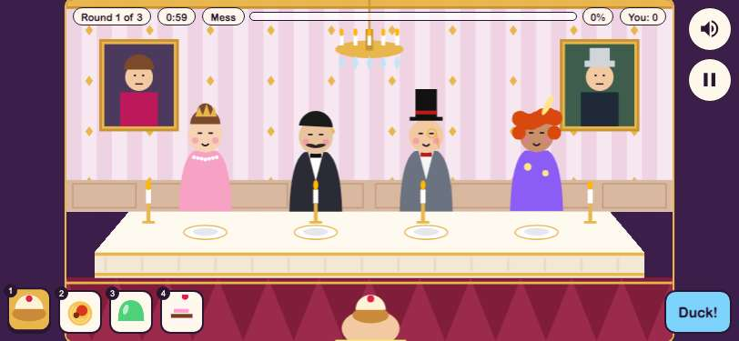 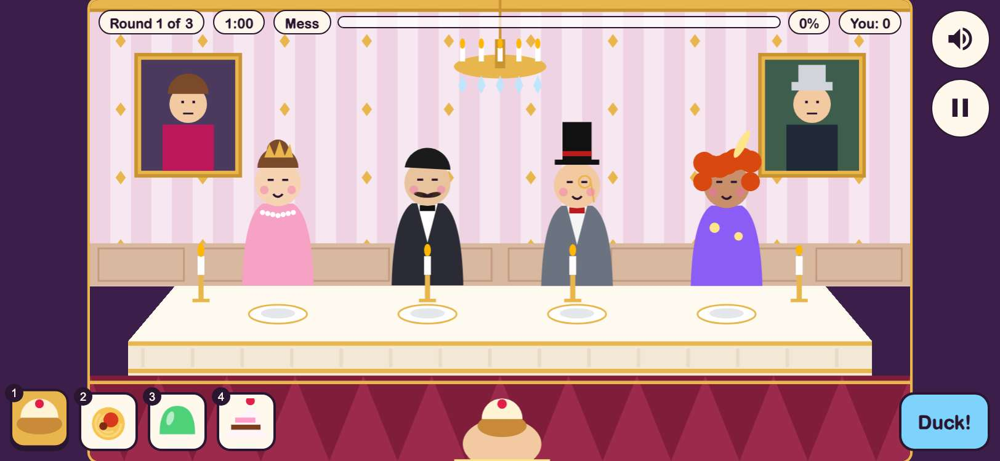

## 5. Sound, Pause, the tray and Duck! cover no more of the throw zone or the portraits than in jeremy.v1, at every phone size, and still pass the phone bar

- desktop: v1 → v2 button area over the throw zone and the portraits (screen px²): 375 x 812: throw zone 38 → 0 px², portraits 0 → 0 px² (Sound 263,245 Pause 319,245); 568 x 320: throw zone 86 → 0 px², portraits 0 → 0 px² (Sound 374,264 Pause 430,264); 640 x 360: throw zone 110 → 0 px², portraits 0 → 0 px² (Sound 446,304 Pause 502,304); 667 x 375: throw zone 119 → 0 px², portraits 0 → 0 px² (Sound 473,319 Pause 529,319); 740 x 360: throw zone 110 → 0 px², portraits 0 → 0 px² (Sound 546,304 Pause 602,304); 812 x 375: throw zone 119 → 0 px², portraits 0 → 0 px² (Sound 756,8 Pause 756,64); 844 x 390: throw zone 129 → 0 px², portraits 0 → 0 px² (Sound 788,8 Pause 788,64); 1280 x 800: throw zone 440 → 0 px², portraits 0 → 0 px² (Sound 1163,8 Pause 1224,8). At 667 x 375 a click on the right-hand portrait (587,76) threw and scored Art! with the sound still on
- phone: v1 → v2 button area over the throw zone and the portraits (screen px²): 375 x 812: throw zone 38 → 0 px², portraits 0 → 0 px² (Sound 263,245 Pause 319,245); 568 x 320: throw zone 86 → 0 px², portraits 0 → 0 px² (Sound 374,264 Pause 430,264); 640 x 360: throw zone 110 → 0 px², portraits 0 → 0 px² (Sound 446,304 Pause 502,304); 667 x 375: throw zone 119 → 0 px², portraits 0 → 0 px² (Sound 473,319 Pause 529,319); 740 x 360: throw zone 110 → 0 px², portraits 0 → 0 px² (Sound 546,304 Pause 602,304); 812 x 375: throw zone 119 → 0 px², portraits 0 → 0 px² (Sound 756,8 Pause 756,64); 844 x 390: throw zone 129 → 0 px², portraits 0 → 0 px² (Sound 788,8 Pause 788,64); 1280 x 800: throw zone 440 → 0 px², portraits 0 → 0 px² (Sound 1163,8 Pause 1224,8). At 667 x 375 a tap on the right-hand portrait (587,76) threw and scored Art! with the sound still on

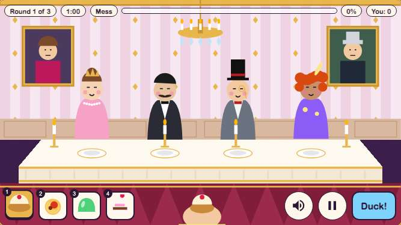 

## 6. new keys: M turns the sound off and on, and H opens How to play from the title, in play and between rounds

- desktop: M: sound off (saved as gameon.fancy-food-fight.muted = 1) then on again in play. H: help from the title and back; in play it paused the clock and H again showed the pause card, Escape played on; between rounds it came back to the scores
- phone: M: sound off (saved as gameon.fancy-food-fight.muted = 1) then on again in play. H: help from the title and back; in play it paused the clock and H again showed the pause card, Escape played on; between rounds it came back to the scores

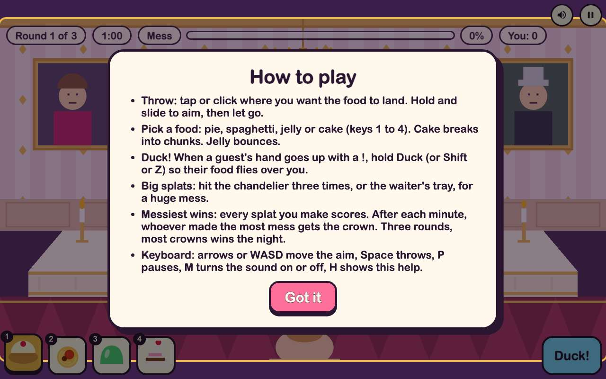 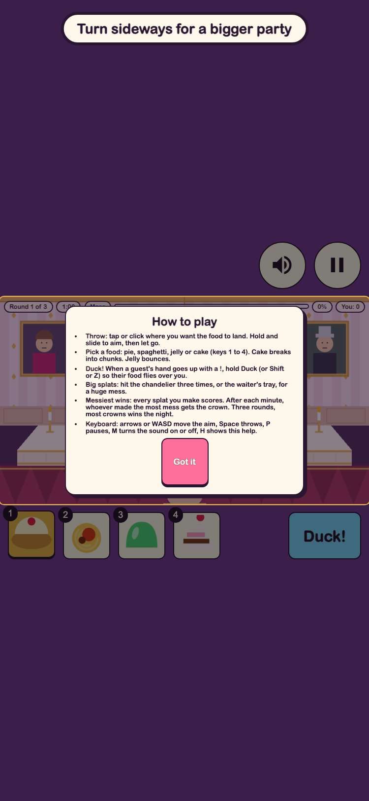

## 7. the keyboard still plays: WASD and the arrows each move the aim, Space throws, P pauses and Escape plays on

- desktop: aim moved (world px): d +259, a -200, ArrowRight +138, ArrowLeft -192, w -176, s +77, ArrowUp -111, ArrowDown +59; Space threw and scored; P paused, Escape played on, Escape paused again
- phone: aim moved (world px): d +56, a -67, ArrowRight +58, ArrowLeft -55, w -43, s +43, ArrowUp -43, ArrowDown +48; Space threw and scored; P paused, Escape played on, Escape paused again

## 8. what stays still works: a throw splats a guest and scores, a real tap throws, Duck! makes a throw miss, and the round ends with a crown

- desktop: a guest splat scored 25; a click on the wall splatted; holding Duck! the pie flew over, letting go it landed; the round ended with a crown
- phone: a guest splat scored 25; a tap on the wall splatted; holding Duck! the pie flew over, letting go it landed; the round ended with a crown

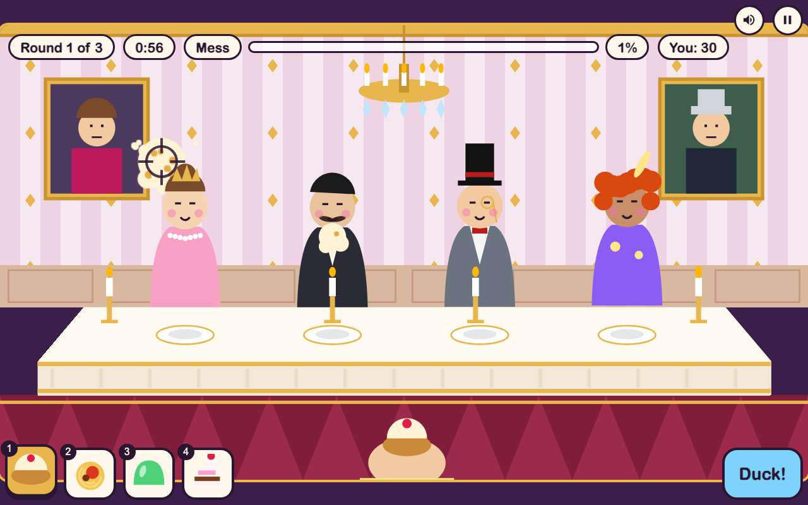 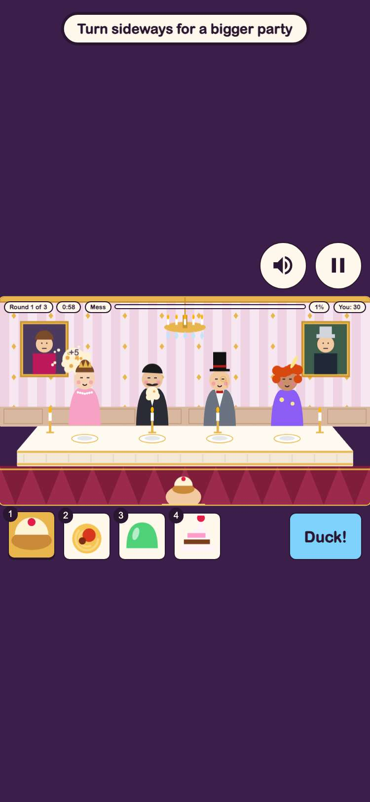

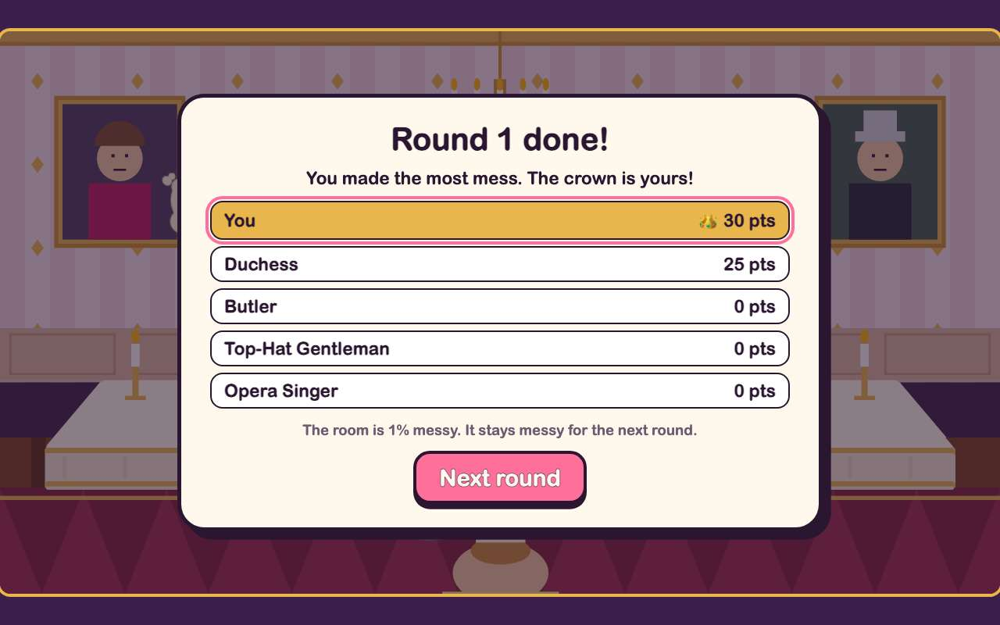 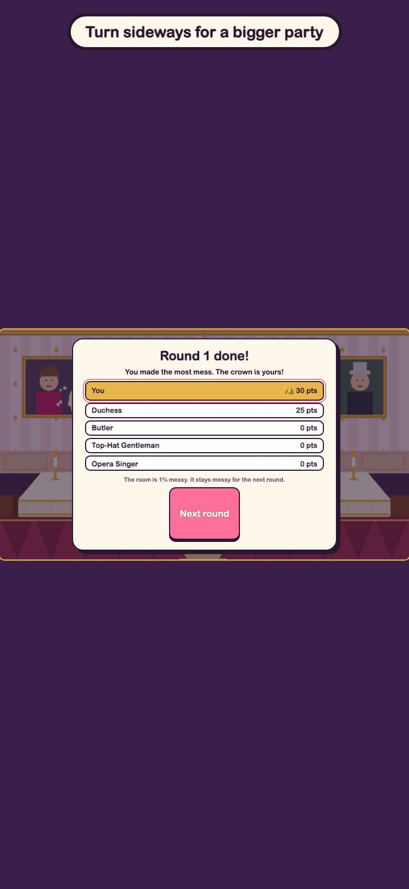

## 9. saves carry over: jeremy.v1's best night and sound-off load in jeremy.v2, and every save stays under gameon.fancy-food-fight.

- desktop: seeded jeremy.v1's saves (best 432, sound off): jeremy.v2 showed the best night and started muted; its Sound button saved under the same key, which jeremy.v1 then read. Keys: gameon.fancy-food-fight.muted, gameon.fancy-food-fight.best
- phone: seeded jeremy.v1's saves (best 432, sound off): jeremy.v2 showed the best night and started muted; its Sound button saved under the same key, which jeremy.v1 then read. Keys: gameon.fancy-food-fight.muted, gameon.fancy-food-fight.best

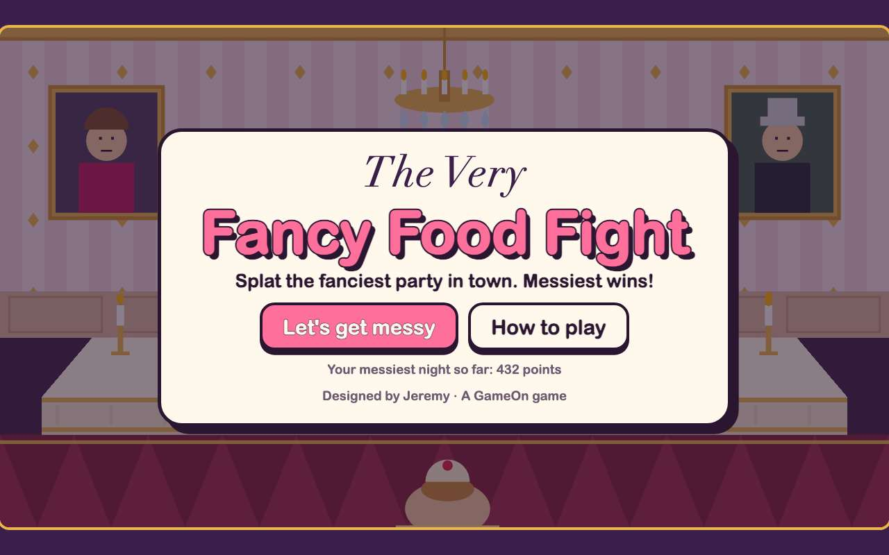 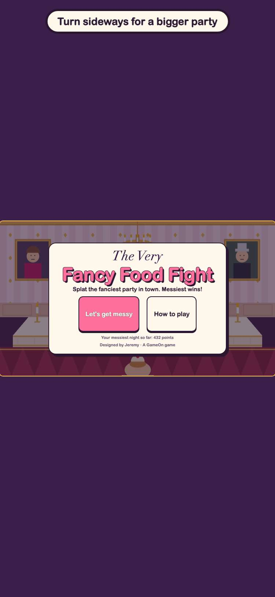

## 10. jeremy.v1 still plays at games/fancy-food-fight/, and games.json keeps both versions

- desktop: jeremy.v1 at games/fancy-food-fight/ opened, started and splatted a guest; games.json: default jeremy.v2, versions jeremy.v1 and jeremy.v2
- phone: jeremy.v1 at games/fancy-food-fight/ opened, started and splatted a guest; games.json: default jeremy.v2, versions jeremy.v1 and jeremy.v2

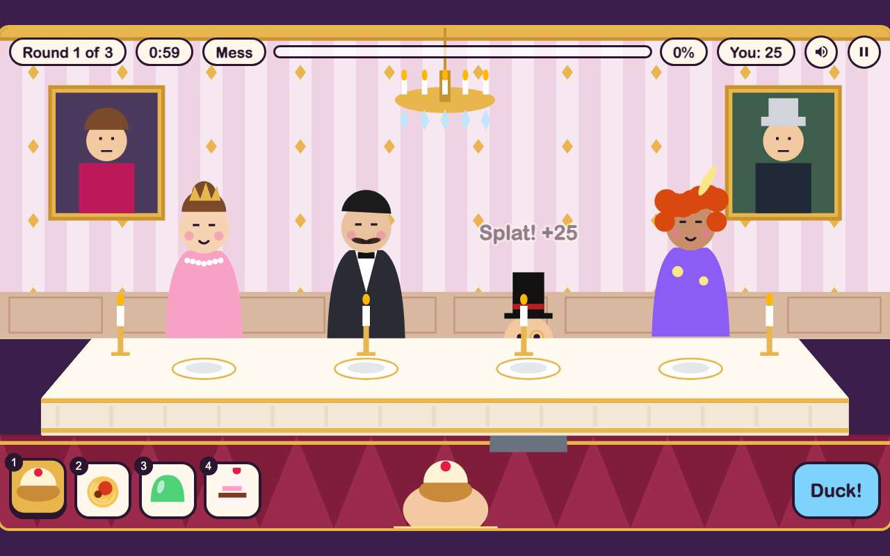 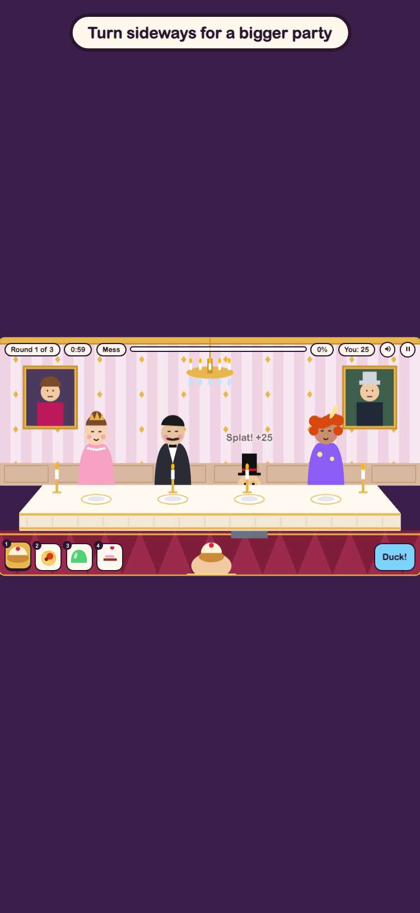

## 11. in the arcade, Fancy Food Fight offers both versions and plays jeremy.v2 by default; #fancy-food-fight@jeremy.v1 still opens jeremy.v1

- desktop: card (2 versions) → picker: jeremy.v2 first, "Buttons that stay big on a phone" → jeremy.v2 plays in the frame; #fancy-food-fight@jeremy.v1 still opens jeremy.v1
- phone: card (2 versions) → picker: jeremy.v2 first, "Buttons that stay big on a phone" → jeremy.v2 plays in the frame; #fancy-food-fight@jeremy.v1 still opens jeremy.v1

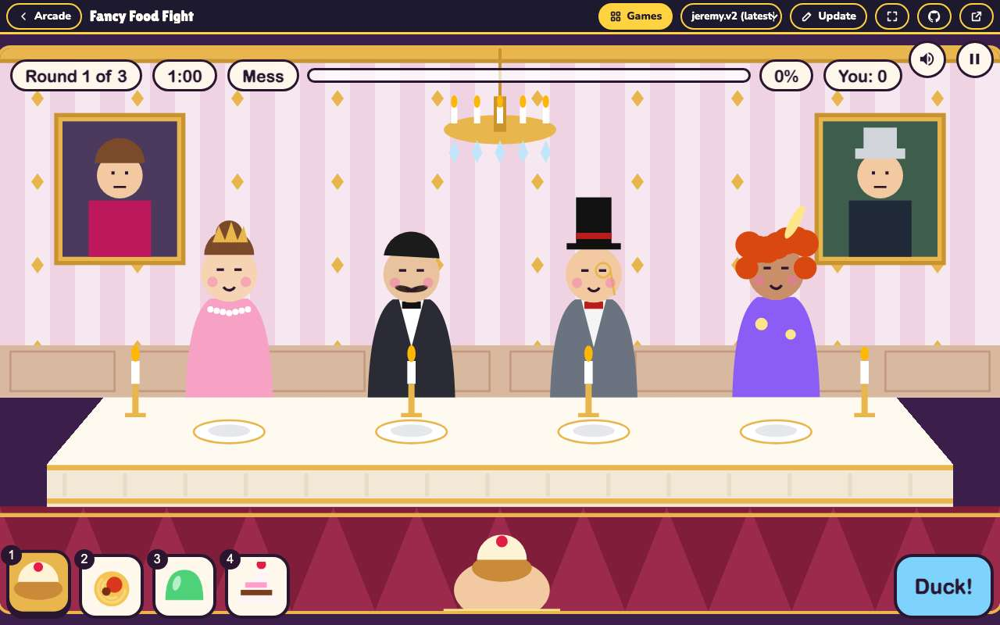 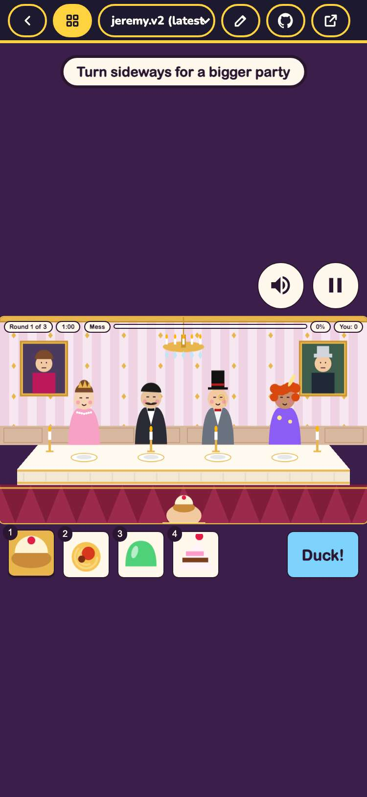
