# Evidence: 222-princess-lady-drive-jeremy-v3

**PASS: 11 of 11 checks pass at desktop and phone widths.**

Generated by `npm run evidence -- 222-princess-lady-drive-jeremy-v3` from [`tests/evidence/222-princess-lady-drive-jeremy-v3.spec.mjs`](../../tests/evidence/222-princess-lady-drive-jeremy-v3.spec.mjs) against the local server (python3 -m http.server) on this branch, starting from commit 02c5c22, 2026-10-29 21:25 UTC. Rules: [docs/evidence.md](../../docs/evidence.md).

| Check | Desktop 1280 | Phone 375 |
|---|---|---|
| jeremy.v3 opens to its title screen and starts, with no new outside requests | pass | pass |
| at 375 px wide every button is at least 48 x 48 px and 8 px clear of the others and the screen edges, Start over included | pass | pass |
| Enter or Space starts from the title card, without a Tab or a tap | pass | pass |
| M, V and ? open Map, Sound and Help, P pauses, and none of them clashes with WASD or the arrows | pass | pass |
| the HUD isn't squeezed: everything jeremy.v2 showed whole is still whole in jeremy.v3, and no smaller | pass | pass |
| Help, opened and with Start over armed, shows everything jeremy.v2 showed as the player lands in it, at six screen sizes | pass | pass |
| what stays still works: drive, get out, take free ice cream, go out and get back in | pass | pass |
| a jeremy.v2 save loads in jeremy.v3, under the same key with the same fields | pass | pass |
| jeremy.v2 and jeremy.v1 still open and play | pass | pass |
| games.json makes jeremy.v3 the default and still offers jeremy.v2 and jeremy.v1 | pass | pass |
| the arcade plays jeremy.v3 by default, and the version picker still offers jeremy.v2 and jeremy.v1 | pass | pass |

## 1. jeremy.v3 opens to its title screen and starts, with no new outside requests

- desktop: clicked Let's go! and the car is ready; outside hosts seen: fonts.googleapis.com, fonts.gstatic.com (Google Fonts, inherited from jeremy.v1)
- phone: tapped Let's go! and the car is ready; outside hosts seen: fonts.googleapis.com, fonts.gstatic.com (Google Fonts, inherited from jeremy.v1)

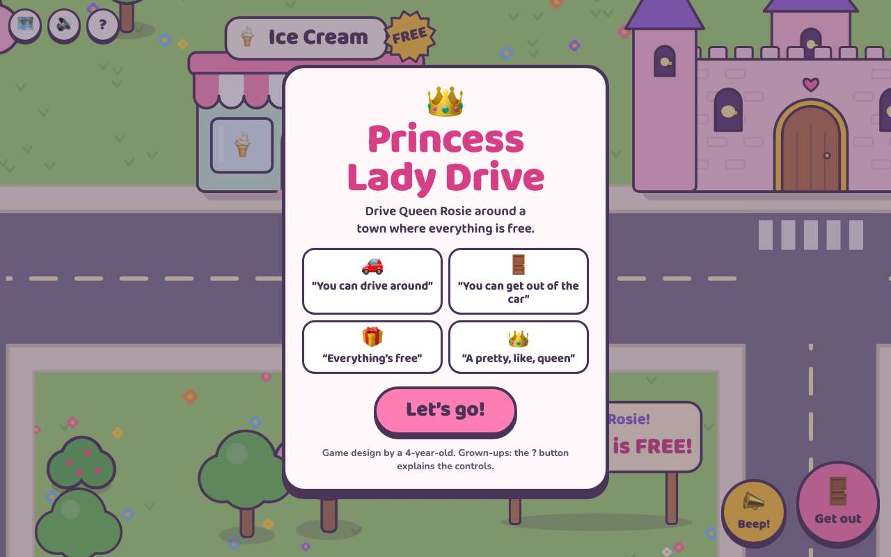 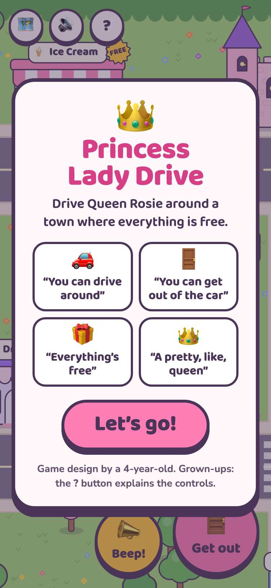

## 2. at 375 px wide every button is at least 48 x 48 px and 8 px clear of the others and the screen edges, Start over included

- desktop: Start over is 106x48 at 1280 (jeremy.v2: 106x43)
- phone: Start over in Help is now 106x48 (jeremy.v2: 106x43)
- phone: title: Let’s go! 206x70
- phone: drive: Map of the town 48x48, Sound off 48x48, Help for grown-ups 48x48, Beep the horn 94x94, Get out of the car 120x120
- phone: walk: Map of the town 48x48, Sound off 48x48, Help for grown-ups 48x48, Make magic sparkles 94x94, Get in the car 120x120
- phone: map, top: 🏰 Castle 139x76, 🍦 Ice Cream 139x76, 🎈 Balloons 139x76, 👗 Dresses 139x76, 🎬 Movies 139x76, 🐶 Pets 139x76, 🚗 Cars 139x76, 🌷 Flowers 139x76, and 8 more
- phone: map, bottom: 🏁 Race Track 139x76, 🧸 Toys 139x76, 🍭 Candy 139x76, 🐠 Aquarium 139x76, 💇 Hair Salon 139x76, 🌋 Lava Jump 139x76, 🤸 Bounce House 139x76, 🏖️ Beach 139x76, and 6 more
- phone: help: Start over 106x48, Back to the game 228x54
- phone: help, Start over armed: Tap again to clear all t 281x48, Back to the game 228x54
- phone: inside the castle: Map of the town 48x48, Sound off 48x48, Help for grown-ups 48x48, Make magic sparkles 94x94, Go back outside 120x120

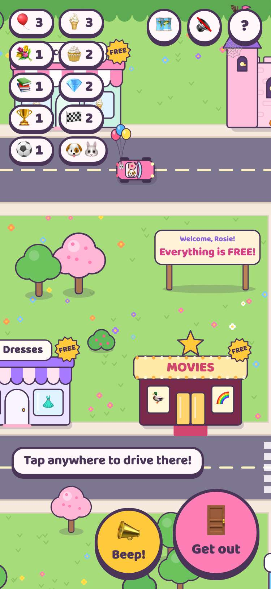

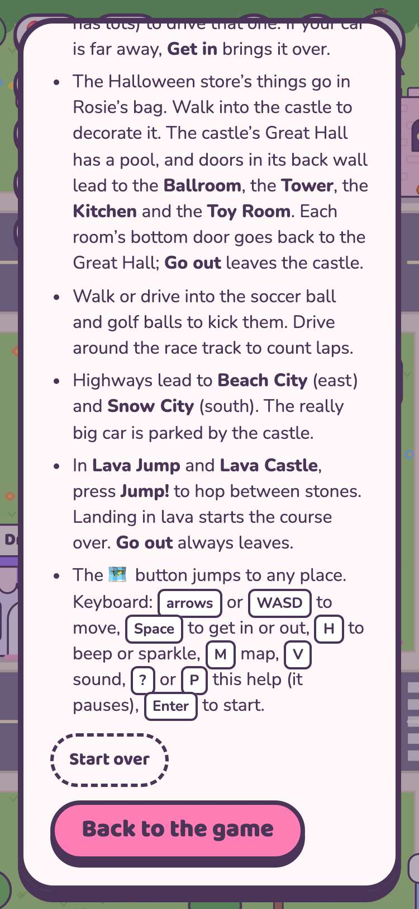

## 3. Enter or Space starts from the title card, without a Tab or a tap

- desktop: a fresh title card: Enter starts the game; Space starts it too; Rosie stays in the car either way
- phone: a fresh title card: Enter starts the game; Space starts it too; Rosie stays in the car either way

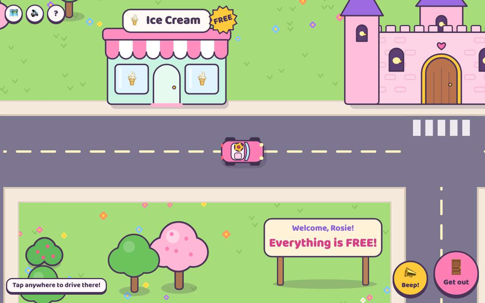 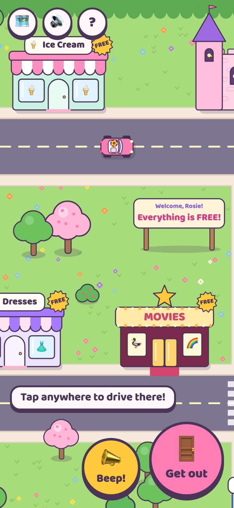

## 4. M, V and ? open Map, Sound and Help, P pauses, and none of them clashes with WASD or the arrows

- desktop: driving: from a stop, S, W, the down arrow and the up arrow each moved the car, and the sound stayed off
- desktop: walking: D, A, the right arrow, the left arrow, S, W, the down arrow and the up arrow each moved Rosie; none of them changed the sound or opened anything
- desktop: walking: V turned the sound off and on, M opened and closed the map (Escape too), ? opened and closed Help; Rosie didn't move for any of them
- desktop: P opened Help and a held D did nothing; P again closed it and D walked
- phone: driving: from a stop, S, W, the down arrow and the up arrow each moved the car, and the sound stayed off
- phone: walking: D, A, the right arrow, the left arrow, S, W, the down arrow and the up arrow each moved Rosie; none of them changed the sound or opened anything
- phone: walking: V turned the sound off and on, M opened and closed the map (Escape too), ? opened and closed Help; Rosie didn't move for any of them
- phone: P opened Help and a held D did nothing; P again closed it and D walked

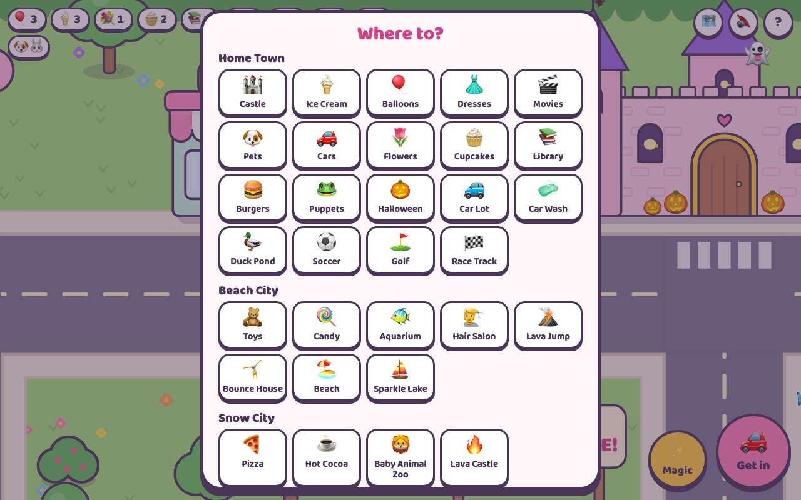 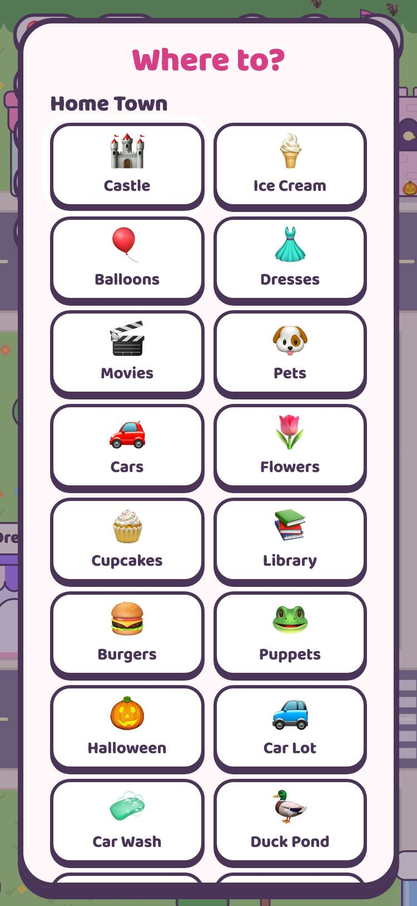

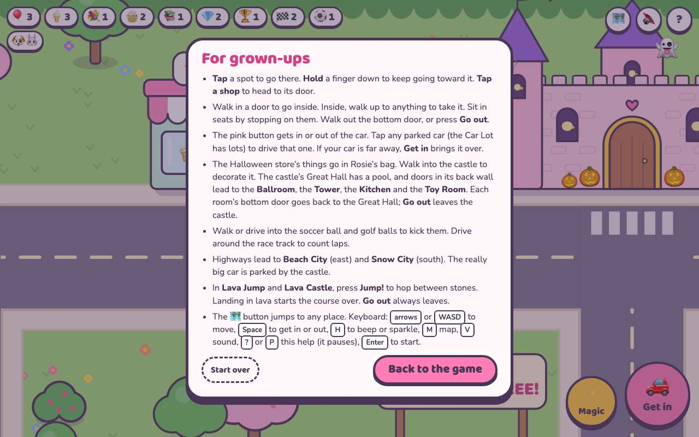 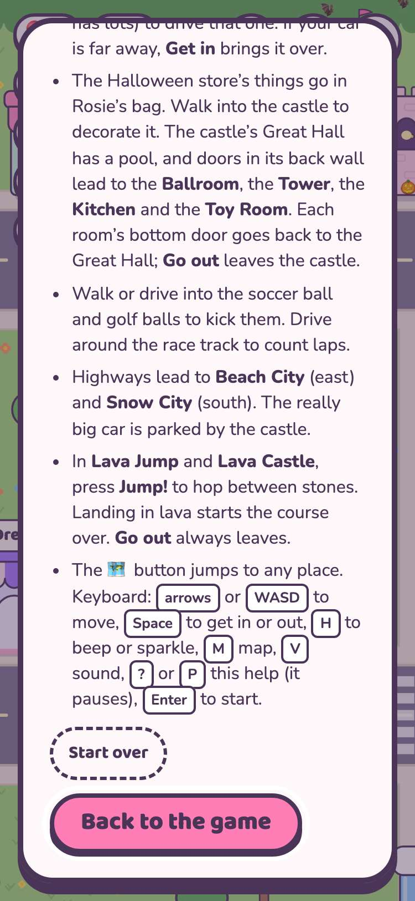

## 5. the HUD isn't squeezed: everything jeremy.v2 showed whole is still whole in jeremy.v3, and no smaller

- desktop: 347 boxes jeremy.v2 showed whole (title, driving, walking, map, help, help with Start over armed; the cards at the top and scrolled down) are all still whole in jeremy.v3 and none is smaller
- desktop: bigger in jeremy.v3: #map .spot (31 of them, up to 0 px wider and 2 px taller); #help .card (1, up to 60 px wider and 0 px taller); #help h2 (1, up to 60 px wider and 0 px taller); #help li (8 of them, up to 60 px wider and 0 px taller); #resetBtn (1, up to 0 px wider and 5 px taller)
- phone: 347 boxes jeremy.v2 showed whole (title, driving, walking, map, help, help with Start over armed; the cards at the top and scrolled down) are all still whole in jeremy.v3 and none is smaller
- phone: bigger in jeremy.v3: #map .spot (31 of them, up to 0 px wider and 1 px taller); #help li (1, up to 0 px wider and 46 px taller); #resetBtn (1, up to 0 px wider and 5 px taller)

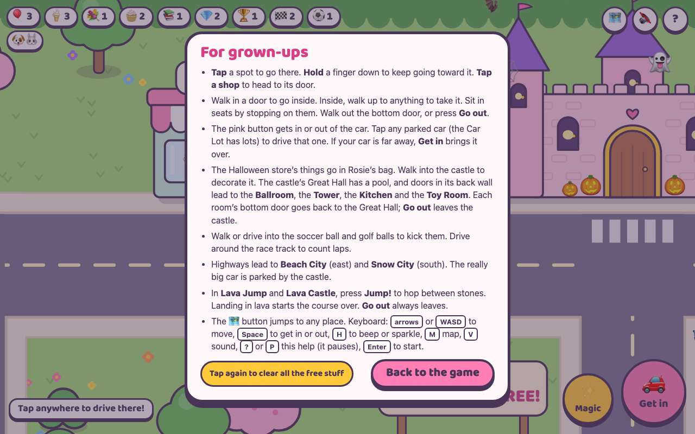 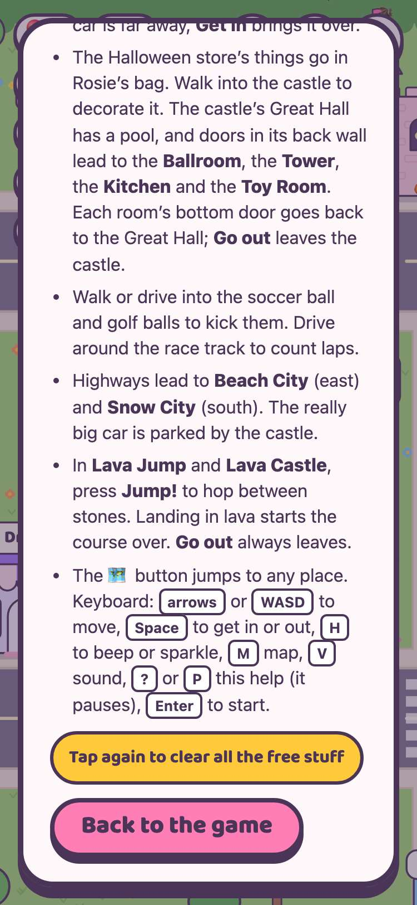

## 6. Help, opened and with Start over armed, shows everything jeremy.v2 showed as the player lands in it, at six screen sizes

- desktop: 428 boxes jeremy.v2 showed whole on screen (Help opened, and armed), with the fallback fonts and the real ones, are whole in jeremy.v3 too, and none is smaller
- desktop: 1024x768: Help scrolls 0 px opened and 28 px armed in jeremy.v2, 0 and 0 px in jeremy.v3; armed, Back to the game shows 48/54 px in jeremy.v2 and 54/54 px in jeremy.v3
- desktop: 1280x800: Help scrolls 0 px opened and 0 px armed in jeremy.v2, 0 and 0 px in jeremy.v3; armed, Back to the game shows 54/54 px in jeremy.v2 and 54/54 px in jeremy.v3
- desktop: 1366x768: Help scrolls 0 px opened and 28 px armed in jeremy.v2, 0 and 0 px in jeremy.v3; armed, Back to the game shows 48/54 px in jeremy.v2 and 54/54 px in jeremy.v3
- phone: 368 boxes jeremy.v2 showed whole on screen (Help opened, and armed), with the fallback fonts and the real ones, are whole in jeremy.v3 too, and none is smaller
- phone: 375x812: Help scrolls 239 px opened and 239 px armed in jeremy.v2, 291 and 291 px in jeremy.v3; armed, Back to the game shows 54/54 px in jeremy.v2 and 54/54 px in jeremy.v3
- phone: 667x375: Help scrolls 366 px opened and 421 px armed in jeremy.v2, 320 and 320 px in jeremy.v3; armed, Back to the game shows 21/54 px in jeremy.v2 and 54/54 px in jeremy.v3
- phone: 812x375: Help scrolls 366 px opened and 421 px armed in jeremy.v2, 320 and 320 px in jeremy.v3; armed, Back to the game shows 21/54 px in jeremy.v2 and 54/54 px in jeremy.v3

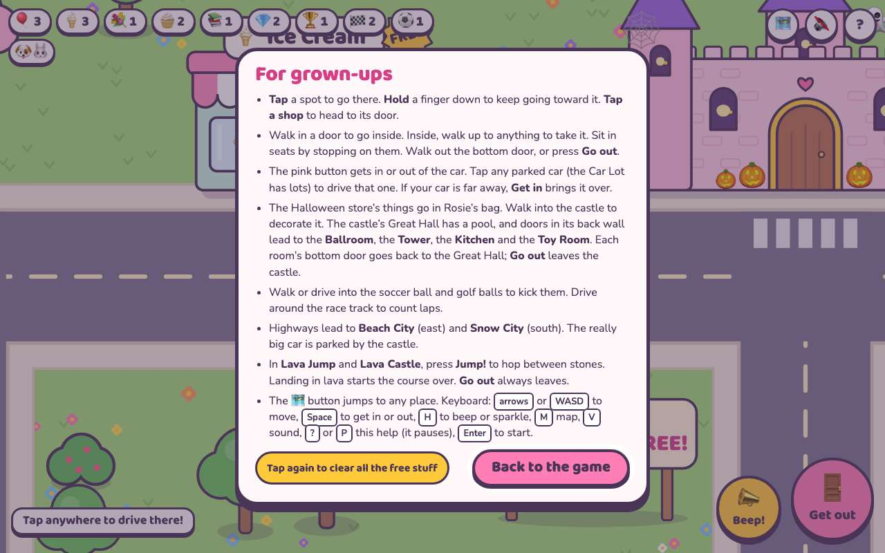 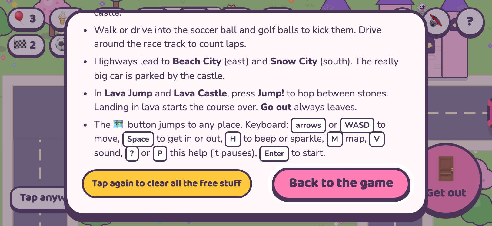

## 7. what stays still works: drive, get out, take free ice cream, go out and get back in

- desktop: Get out → Ice Cream shop → free cone → Go out → Get in
- phone: Get out → Ice Cream shop → free cone → Go out → Get in

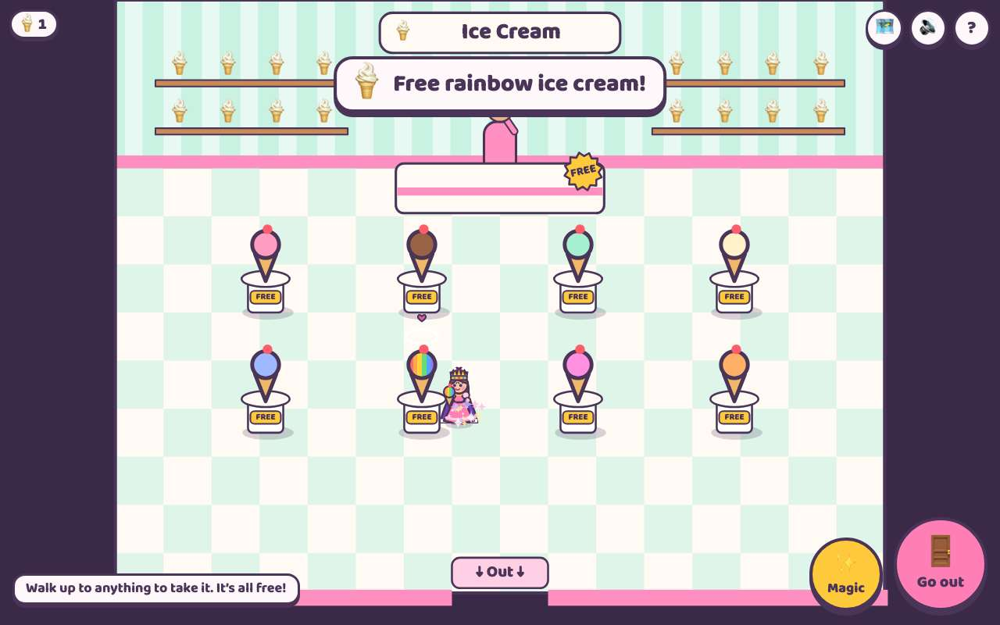 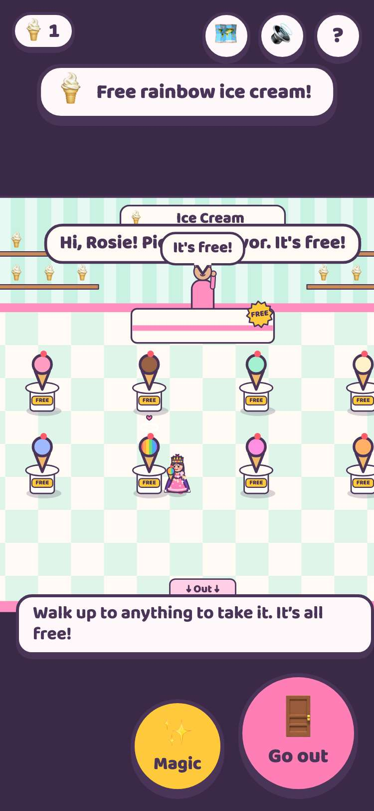

## 8. a jeremy.v2 save loads in jeremy.v3, under the same key with the same fields

- desktop: castle, 3 balloons, two pets, four decorations and the sound setting all loaded; keys afterwards: princess-lady-drive:v2, with exactly jeremy.v2's fields, so jeremy.v2 and jeremy.v1 can still read it
- phone: castle, 3 balloons, two pets, four decorations and the sound setting all loaded; keys afterwards: princess-lady-drive:v2, with exactly jeremy.v2's fields, so jeremy.v2 and jeremy.v1 can still read it

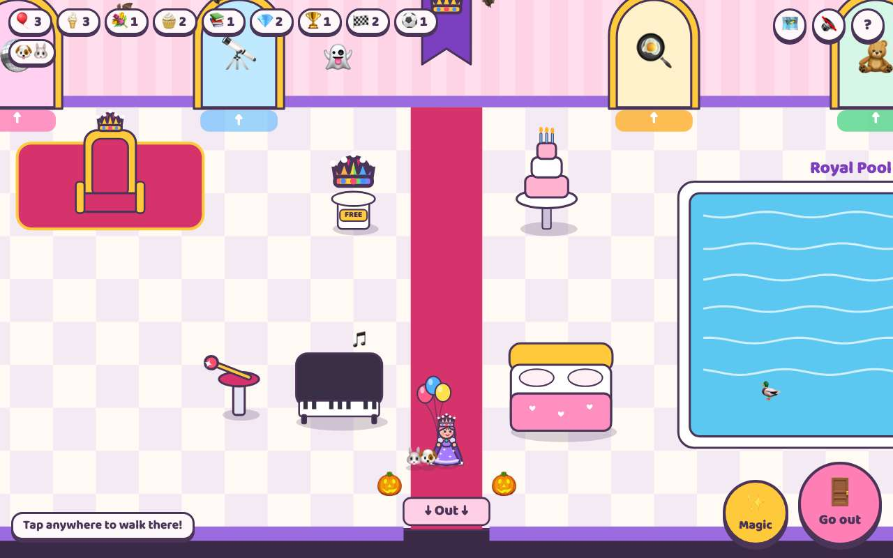 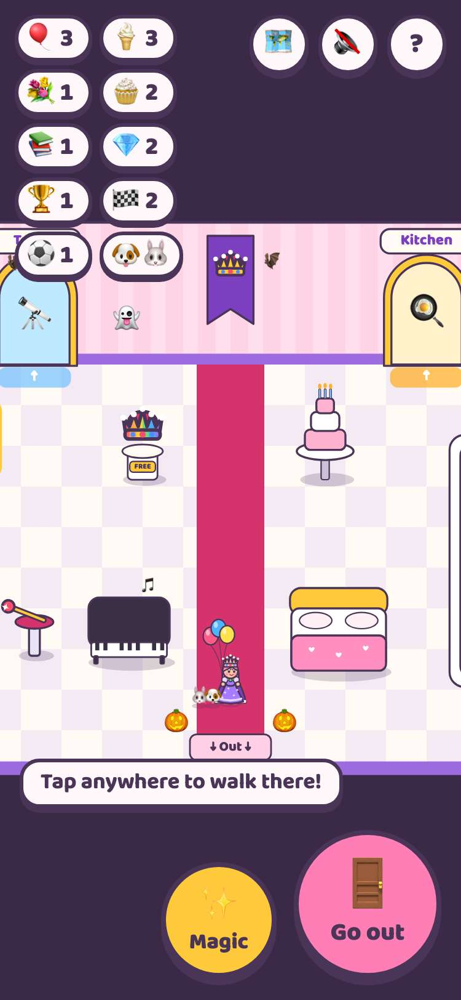

## 9. jeremy.v2 and jeremy.v1 still open and play

- desktop: games/princess-lady-drive/jeremy.v2/ and games/princess-lady-drive/jeremy.v1/: Let's go!, then the big button gets Rosie out of the car (or back in)
- phone: games/princess-lady-drive/jeremy.v2/ and games/princess-lady-drive/jeremy.v1/: Let's go!, then the big button gets Rosie out of the car (or back in)

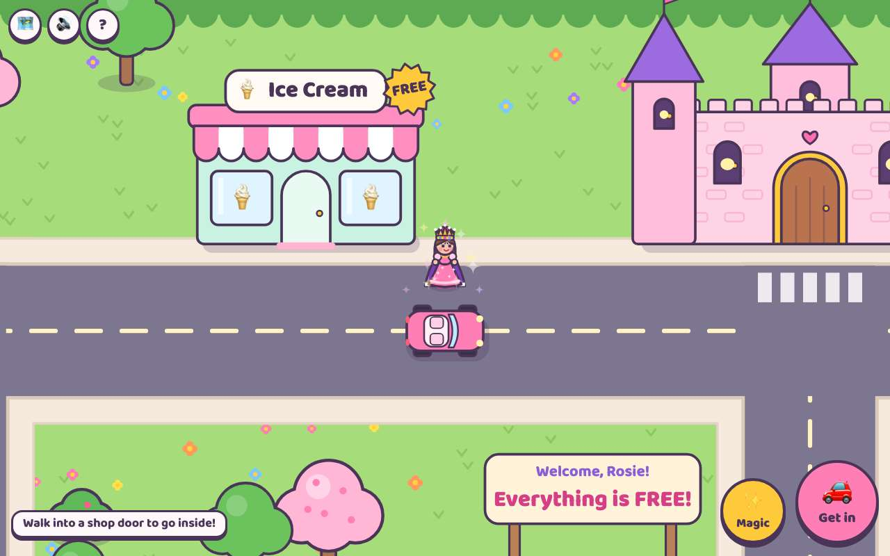 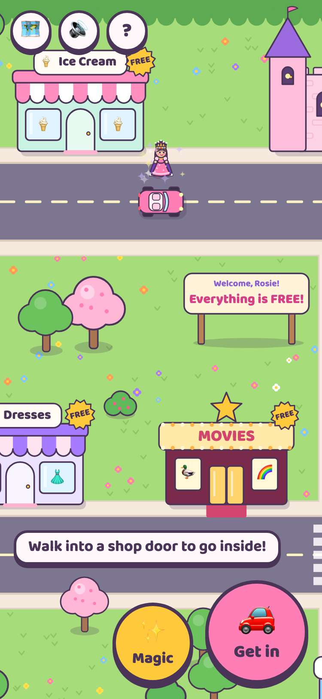

## 10. games.json makes jeremy.v3 the default and still offers jeremy.v2 and jeremy.v1

- desktop: default jeremy.v3; jeremy.v2 at games/princess-lady-drive/jeremy.v2/, jeremy.v1 at games/princess-lady-drive/jeremy.v1/
- phone: default jeremy.v3; jeremy.v2 at games/princess-lady-drive/jeremy.v2/, jeremy.v1 at games/princess-lady-drive/jeremy.v1/

## 11. the arcade plays jeremy.v3 by default, and the version picker still offers jeremy.v2 and jeremy.v1

- desktop: card → picker (jeremy.v3 Latest, jeremy.v2, jeremy.v1) → jeremy.v3 plays in the frame
- phone: card → picker (jeremy.v3 Latest, jeremy.v2, jeremy.v1) → jeremy.v3 plays in the frame

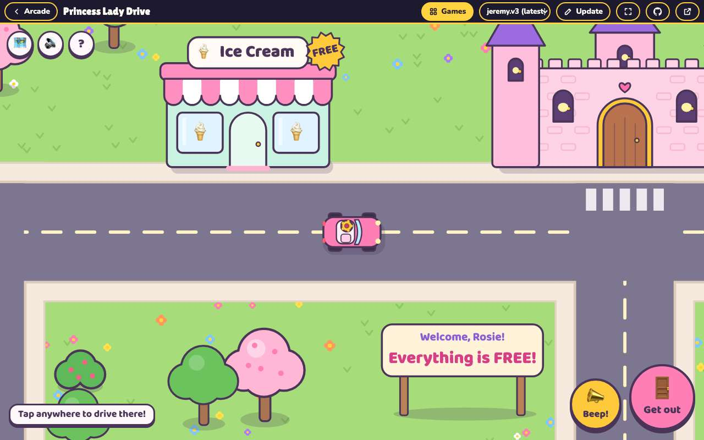 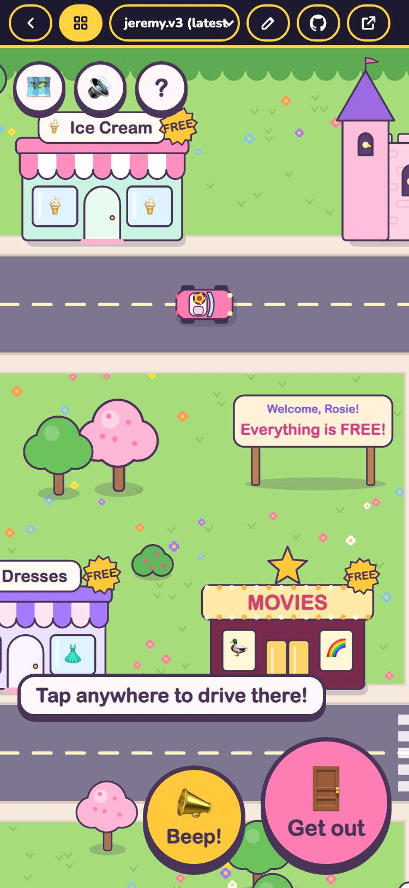
