# Evidence: 223-stretcher-bearer-jeremy-v2

**PASS: 9 of 9 checks pass at desktop and phone widths.**

Generated by `npm run evidence -- 223-stretcher-bearer-jeremy-v2` from [`tests/evidence/223-stretcher-bearer-jeremy-v2.spec.mjs`](../../tests/evidence/223-stretcher-bearer-jeremy-v2.spec.mjs) against the local server (python3 -m http.server) on this branch, starting from commit 95ede1a, 2026-10-29 21:48 UTC. Rules: [docs/evidence.md](../../docs/evidence.md).

| Check | Desktop 1280 | Phone 375 |
|---|---|---|
| jeremy.v2 opens to its title and starts a day, with nothing from the internet but jeremy.v1's fonts | pass | pass |
| Report for duty is on screen without scrolling (jeremy.v1's was below the bottom), and so are each screen's buttons | pass | pass |
| every screen meets the phone bar: Orders, Sound and Pause 48 px tall and 8 px apart, the action buttons 8 px apart, the screen buttons 48 px tall | pass | pass |
| WASD and the arrow keys both move the medic, Enter and Space press the screen's button, and P or Escape pauses | pass | skipped |
| the HUD keeps everything jeremy.v1 showed whole: nothing is cut off, smaller or covered, side by side at each size | pass | pass |
| the controls cover no more of the battlefield than jeremy.v1's, beyond the 18 px the idea adds to Orders, Sound and Pause, and none moves into the middle | pass | pass |
| jeremy.v1's best score carries over: v2 shows it, keeps it under sb-best, and v1 reads back a new best | pass | pass |
| jeremy.v1 still plays at games/stretcher-bearer/jeremy.v1/, unchanged | pass | pass |
| in the arcade, Stretcher Bearer plays jeremy.v2 by default and the picker still offers jeremy.v1 | pass | pass |

## 1. jeremy.v2 opens to its title and starts a day, with nothing from the internet but jeremy.v1's fonts

- desktop: clicked Report for duty and Move out: day 1 started and its clock ran (06:01 → 06:11); outside requests: fonts.googleapis.com, fonts.gstatic.com (Google Fonts, as jeremy.v1); no sideways scrolling
- phone: tapped Report for duty and Move out: day 1 started and its clock ran (06:00 → 06:02); outside requests: fonts.googleapis.com, fonts.gstatic.com (Google Fonts, as jeremy.v1); no sideways scrolling

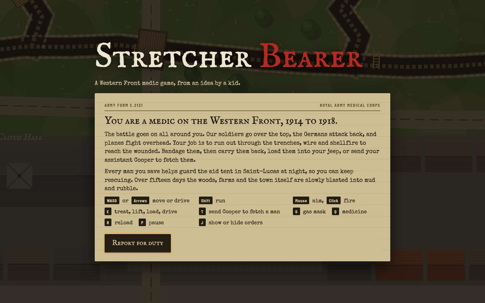 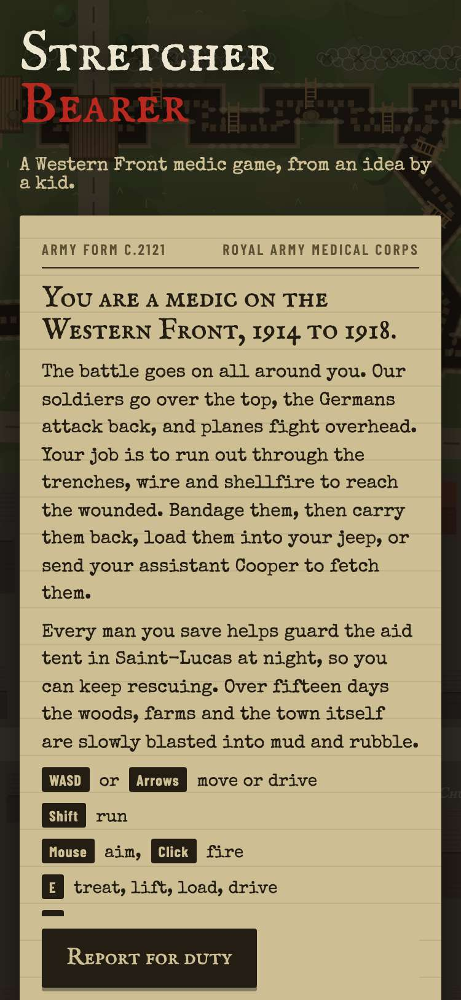

 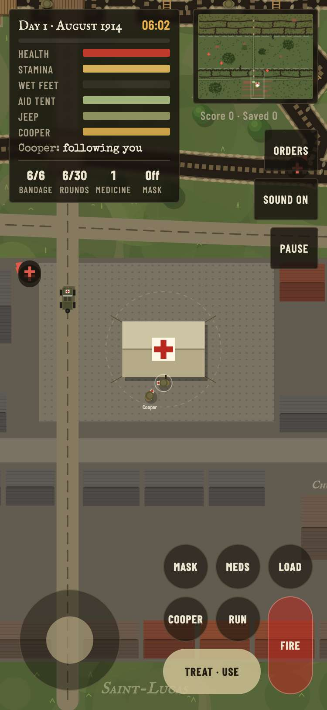

## 2. Report for duty is on screen without scrolling (jeremy.v1's was below the bottom), and so are each screen's buttons

- desktop: 1280x800: Report for duty at y 618–666 (jeremy.v1: y 621–663, on screen); Move out ends at 724, Back to the front at 623
- phone: 375x812: Report for duty at y 754–802 (jeremy.v1: y 965–1007, below the screen); Move out ends at 802, Back to the front at 689. 812x375: Report for duty at y 317–365 (jeremy.v1: y 575–617, below the screen); Move out ends at 365, Back to the front at 365. 667x375: Report for duty at y 317–365 (jeremy.v1: y 644–686, below the screen); Move out ends at 365, Back to the front at 365

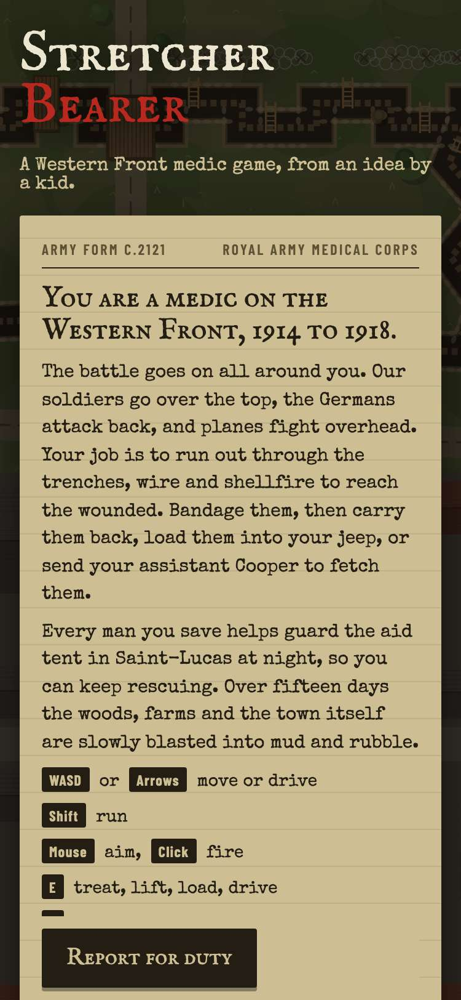

## 3. every screen meets the phone bar: Orders, Sound and Pause 48 px tall and 8 px apart, the action buttons 8 px apart, the screen buttons 48 px tall

- desktop: 1280x800: #ordersBtn 62x48, #muteBtn 74x48, #pauseBtn 55x48, [data-a=resume] 189x48, #screen [data-a=new] 167x48, [data-a=next] 114x48, [data-a=retry] 158x48, #screen [data-a=new] 167x48, #screen [data-a=new] 122x48, Orders/Sound/Pause 8 and 8 px apart; touchTargets() found no problems on: title 1 (smallest 48 px), orders slip 1 (smallest 48 px), playing 3 (smallest 48 px), orders open 3 (smallest 48 px), paused 2 (smallest 48 px), night report 1 (smallest 48 px), casualty notice 2 (smallest 48 px), armistice 1 (smallest 48 px). Clicked: Report for duty, Move out, Sound (Sound off), Orders (open and shut), Pause, Back to the front, Start a new war
- phone: 375x812: #ordersBtn 62x48, #muteBtn 74x48, #pauseBtn 55x48, action buttons 8 px apart, [data-a=resume] 189x48, #screen [data-a=new] 167x48, [data-a=next] 114x48, [data-a=retry] 158x48, #screen [data-a=new] 167x48, #screen [data-a=new] 122x48, Orders/Sound/Pause 8 and 8 px apart; touchTargets() found no problems on: title 1 (smallest 48 px), orders slip 1 (smallest 48 px), playing 11 (smallest 48 px), orders open 11 (smallest 48 px), paused 2 (smallest 48 px), night report 1 (smallest 48 px), casualty notice 2 (smallest 48 px), armistice 1 (smallest 48 px). 812x375: #ordersBtn 62x48, #muteBtn 74x48, #pauseBtn 55x48, action buttons 8 px apart, [data-a=resume] 189x48, #screen [data-a=new] 167x48, [data-a=next] 114x48, [data-a=retry] 158x48, #screen [data-a=new] 167x48, #screen [data-a=new] 122x48, Orders/Sound/Pause 8 and 8 px apart; touchTargets() found no problems on: title 1 (smallest 48 px), orders slip 1 (smallest 48 px), playing 11 (smallest 48 px), orders open 11 (smallest 48 px), paused 2 (smallest 48 px), night report 1 (smallest 48 px), casualty notice 2 (smallest 48 px), armistice 1 (smallest 48 px). 667x375: #ordersBtn 62x48, #muteBtn 74x48, #pauseBtn 55x48, action buttons 8 px apart, [data-a=resume] 189x48, #screen [data-a=new] 167x48, [data-a=next] 114x48, [data-a=retry] 158x48, #screen [data-a=new] 167x48, #screen [data-a=new] 122x48, Orders/Sound/Pause 8 and 8 px apart; touchTargets() found no problems on: title 1 (smallest 48 px), orders slip 1 (smallest 48 px), playing 11 (smallest 48 px), orders open 11 (smallest 48 px), paused 2 (smallest 48 px), night report 1 (smallest 48 px), casualty notice 2 (smallest 48 px), armistice 1 (smallest 48 px). Tapped: Report for duty, Move out, Mask (mask on), Sound (Sound off), Orders (open and shut), Pause, Back to the front, Start a new war

 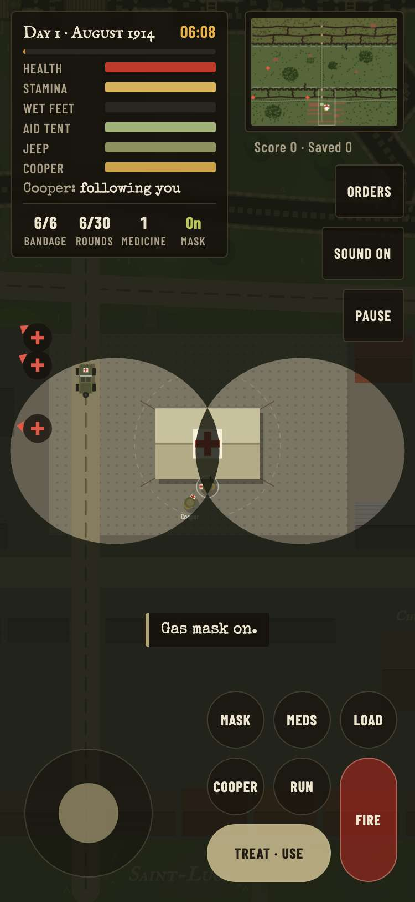

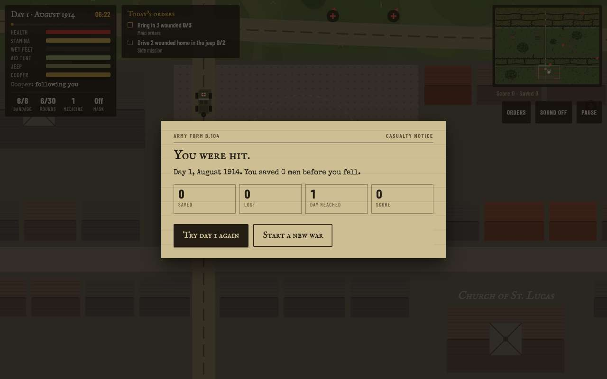 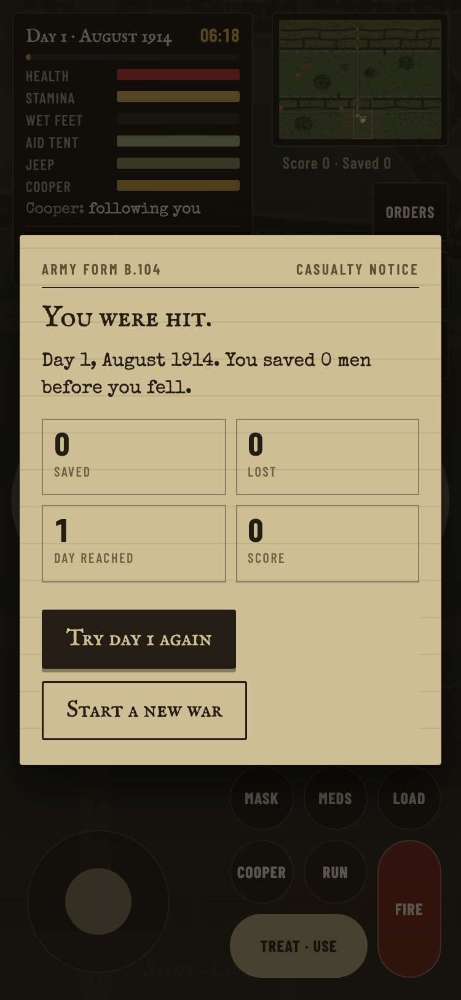

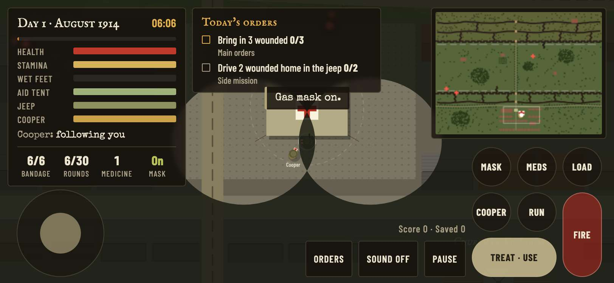

## 4. WASD and the arrow keys both move the medic, Enter and Space press the screen's button, and P or Escape pauses

- desktop: Enter pressed Report for duty and Space pressed Move out. Moves from the same spot (dx,dy): d 62,0; ArrowRight 73,0; a -93,0; ArrowLeft -120,0; w 0,-81; ArrowUp 0,-76; s 0,64; ArrowDown 0,63. P paused and Escape went back; Escape paused and P went back

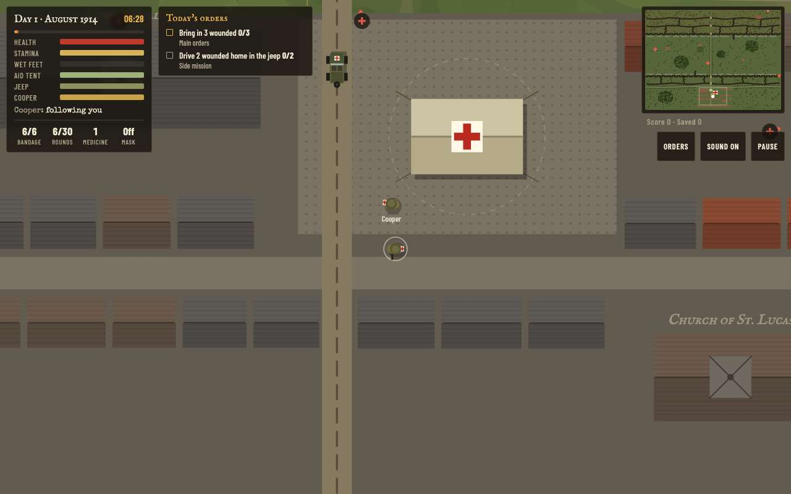

## 5. the HUD keeps everything jeremy.v1 showed whole: nothing is cut off, smaller or covered, side by side at each size

- desktop: 1280x800: 25 HUD parts, 25 shown whole in jeremy.v1 and 25 in jeremy.v2; jeremy.v1's controls overlapped: ordersBtn/score, muteBtn/score. 1280x800 with Orders open: 24 HUD parts, 24 shown whole in jeremy.v1 and 24 in jeremy.v2; jeremy.v1's controls overlapped: ordersBtn/score, muteBtn/score
- phone: 375x812: 24 HUD parts, 23 shown whole in jeremy.v1 and 24 in jeremy.v2 (uncovered now: score 95%→100%); jeremy.v1's controls overlapped: ordersBtn/score. 375x812 with Orders open: 25 HUD parts, 24 shown whole in jeremy.v1 and 25 in jeremy.v2 (uncovered now: score 95%→100%); jeremy.v1's controls overlapped: ordersBtn/score. 812x375: 24 HUD parts, 18 shown whole in jeremy.v1 and 24 in jeremy.v2 (uncovered now: status 94%→100%, .inv > div 87%→100%, .inv > div 63%→100%, miniWrap 89%→100%, mini 87%→100%, score 22%→100%); jeremy.v1's controls overlapped: ordersBtn/tMask, ordersBtn/tCoop, ordersBtn/score, muteBtn/tMed, muteBtn/tReload, muteBtn/tRun, muteBtn/tFire, muteBtn/score, pauseBtn/tReload, pauseBtn/tFire, stick/status, tMask/miniWrap, tMask/score, tMed/miniWrap, tReload/miniWrap. 812x375 with Orders open: 24 HUD parts, 18 shown whole in jeremy.v1 and 24 in jeremy.v2 (uncovered now: status 94%→100%, .inv > div 87%→100%, .inv > div 63%→100%, miniWrap 89%→100%, mini 87%→100%, score 22%→100%); jeremy.v1's controls overlapped: ordersBtn/tMask, ordersBtn/tCoop, ordersBtn/score, muteBtn/tMed, muteBtn/tReload, muteBtn/tRun, muteBtn/tFire, muteBtn/score, pauseBtn/tReload, pauseBtn/tFire, stick/status, tMask/miniWrap, tMask/score, tMed/miniWrap, tReload/miniWrap. 667x375: 24 HUD parts, 18 shown whole in jeremy.v1 and 24 in jeremy.v2 (uncovered now: status 94%→100%, .inv > div 87%→100%, .inv > div 63%→100%, miniWrap 89%→100%, mini 87%→100%, score 22%→100%); jeremy.v1's controls overlapped: ordersBtn/tMask, ordersBtn/tCoop, ordersBtn/score, muteBtn/tMed, muteBtn/tReload, muteBtn/tRun, muteBtn/tFire, muteBtn/score, pauseBtn/tReload, pauseBtn/tFire, stick/status, tMask/miniWrap, tMask/score, tMed/miniWrap, tReload/miniWrap. 667x375 with Orders open: 24 HUD parts, 18 shown whole in jeremy.v1 and 24 in jeremy.v2 (uncovered now: status 94%→100%, .inv > div 87%→100%, .inv > div 63%→100%, miniWrap 89%→100%, mini 87%→100%, score 22%→100%); jeremy.v1's controls overlapped: ordersBtn/tMask, ordersBtn/tCoop, ordersBtn/score, muteBtn/tMed, muteBtn/tReload, muteBtn/tRun, muteBtn/tFire, muteBtn/score, pauseBtn/tReload, pauseBtn/tFire, stick/status, tMask/miniWrap, tMask/score, tMed/miniWrap, tReload/miniWrap

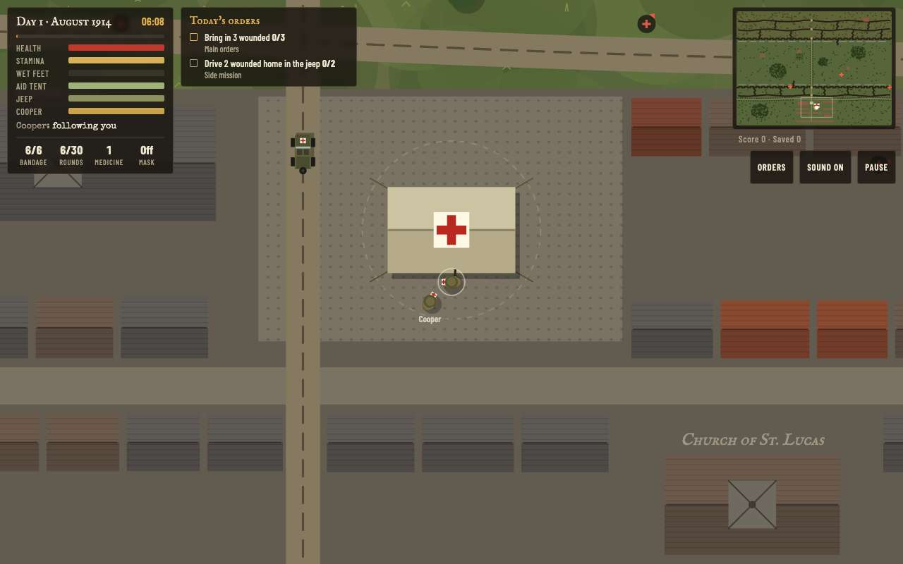

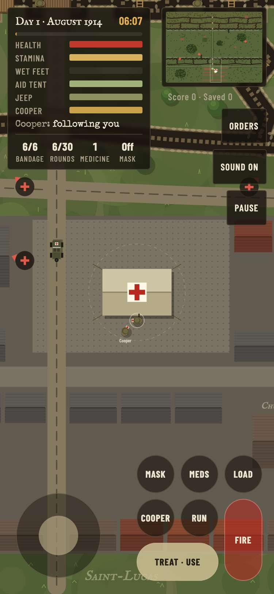

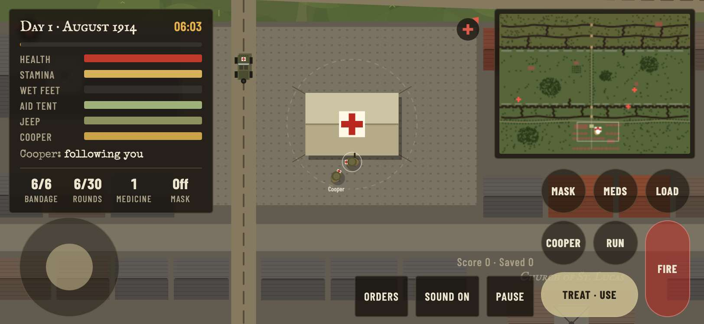

## 6. the controls cover no more of the battlefield than jeremy.v1's, beyond the 18 px the idea adds to Orders, Sound and Pause, and none moves into the middle

- desktop: 1280x800: controls cover 5730 px² (0.6%) in jeremy.v1 and 9168 px² (0.9%) in jeremy.v2, +3438 (the 48 px heights add up to 3439); in the middle quarter of the screen 0 → 0 px²
- phone: 375x812: controls cover 44250 px² (14.5%) in jeremy.v1 and 47792 px² (15.7%) in jeremy.v2, +3542 (the 48 px heights add up to 3543); in the middle quarter of the screen 0 → 0 px². 812x375: controls cover 52686 px² (17.3%) in jeremy.v1 and 47792 px² (15.7%) in jeremy.v2, -4894; in the middle quarter of the screen 1119 → 0 px². 667x375: controls cover 52686 px² (21.1%) in jeremy.v1 and 47792 px² (19.1%) in jeremy.v2, -4894; in the middle quarter of the screen 5596 → 1738 px²

## 7. jeremy.v1's best score carries over: v2 shows it, keeps it under sb-best, and v1 reads back a new best

- desktop: seeded jeremy.v1's sb-best (4321, day 7): jeremy.v2's title showed it; a game over at 0 left it; one at 5000 replaced it as {score: 5000, day: 1}; keys afterwards: sb-best (jeremy.v1's own key, nothing new); jeremy.v1 then showed 5000, day 1
- phone: seeded jeremy.v1's sb-best (4321, day 7): jeremy.v2's title showed it; a game over at 0 left it; one at 5000 replaced it as {score: 5000, day: 1}; keys afterwards: sb-best (jeremy.v1's own key, nothing new); jeremy.v1 then showed 5000, day 1

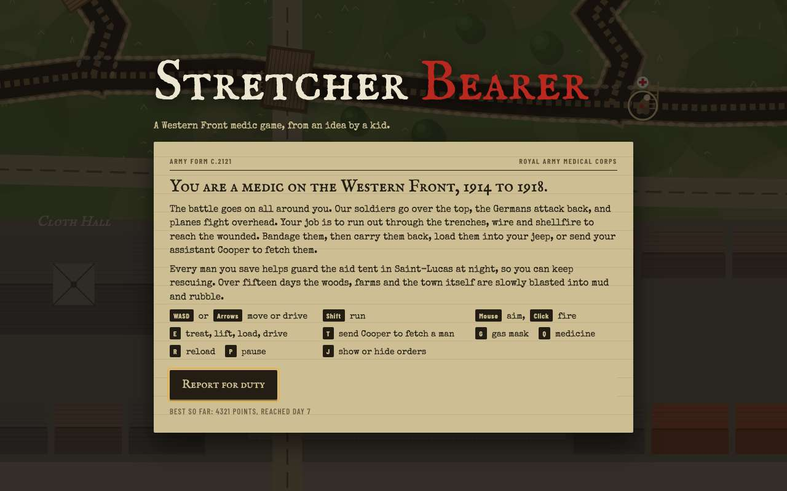 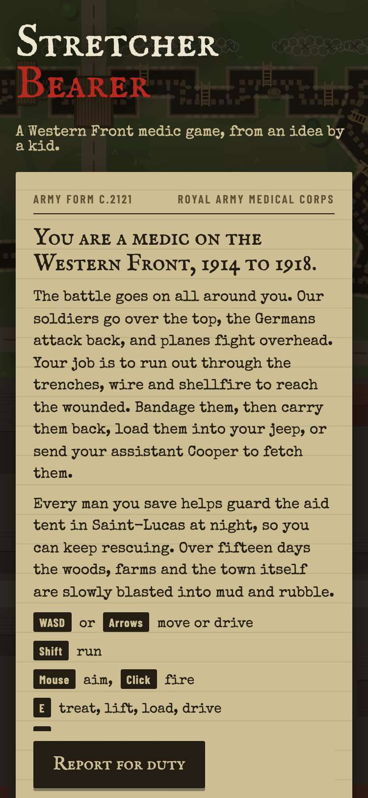

## 8. jeremy.v1 still plays at games/stretcher-bearer/jeremy.v1/, unchanged

- desktop: jeremy.v1 at games/stretcher-bearer/jeremy.v1/: Report for duty, Move out, and its clock ran; its Pause is still 55x30
- phone: jeremy.v1 at games/stretcher-bearer/jeremy.v1/: Report for duty, Move out, and its clock ran; its Pause is still 55x30

 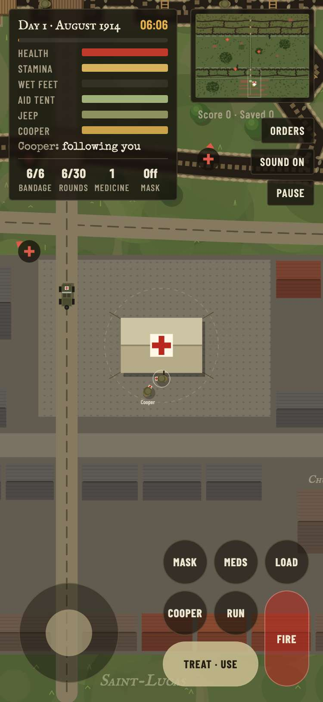

## 9. in the arcade, Stretcher Bearer plays jeremy.v2 by default and the picker still offers jeremy.v1

- desktop: card (2 versions) → picker: jeremy.v2 first with its note, then jeremy.v1 → jeremy.v2 plays in the frame (Report for duty → the day's orders); #stretcher-bearer@jeremy.v1 opens jeremy.v1
- phone: card (2 versions) → picker: jeremy.v2 first with its note, then jeremy.v1 → jeremy.v2 plays in the frame (Report for duty → the day's orders); #stretcher-bearer@jeremy.v1 opens jeremy.v1

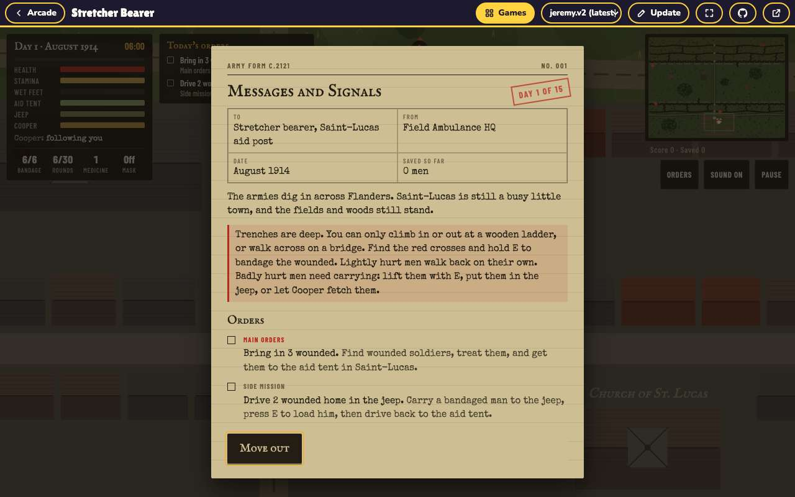 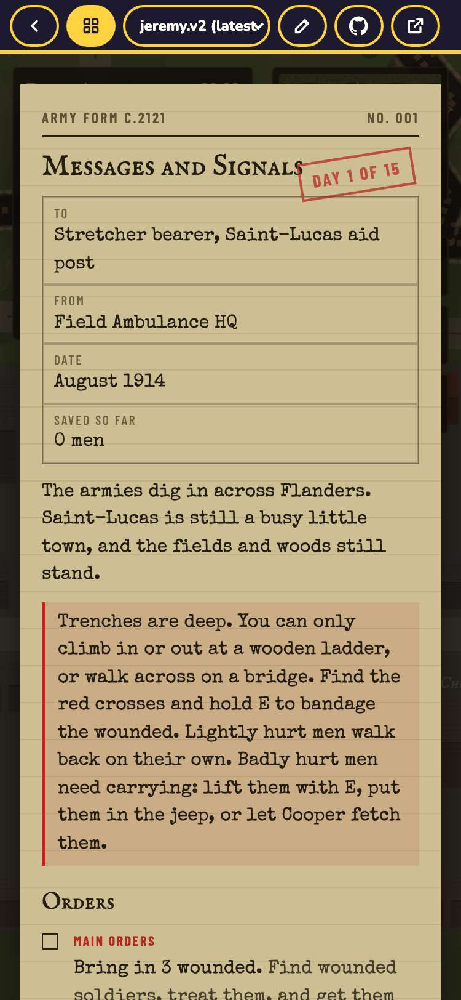
