# Evidence: 224-angry-dudes-jeremy-v2

**PASS: 11 of 11 checks pass at desktop and phone widths.**

Generated by `npm run evidence -- 224-angry-dudes-jeremy-v2` from [`tests/evidence/224-angry-dudes-jeremy-v2.spec.mjs`](../../tests/evidence/224-angry-dudes-jeremy-v2.spec.mjs) against the local server (python3 -m http.server) on this branch, starting from commit a834d2e, 2026-10-29 22:30 UTC. Rules: [docs/evidence.md](../../docs/evidence.md).

| Check | Desktop 1280 | Phone 375 |
|---|---|---|
| jeremy.v2 opens to its title screen and starts a battle, loading nothing from outside that jeremy.v1 didn't | pass | pass |
| keys: W and ↑ both tilt the aim up, S and ↓ down, D and → add power, A and ← take it away, Space or Enter launches and does the special move, and E, Q and 1-9 pick a dude | pass | pass |
| P, Escape and the Menu button pause the battle and hold it still; P, Escape and Play on carry on; Restart and Leave battle work from the pause menu | pass | pass |
| every button on every screen is at least 48 x 48 px, 8 px apart and 8 px from the edges, and tapping them works | pass | pass |
| the HUD isn't squeezed: in all 37 battles every piece jeremy.v1 showed whole is still whole, uncovered and as big, with the top buttons 48 px tall | pass | pass |
| no button covers the battlefield in any of the 37 battles, and the battlefield is drawn at least as big as in jeremy.v1 | pass | pass |
| the briefing, title, battle report and campaign screens keep everything jeremy.v1 showed whole, and Start battle is on screen sideways in all 37 briefings | pass | pass |
| what stays still works: drag back and let go launches, a win shows the battle report with stars, and the best score is saved | pass | pass |
| saves carry over: jeremy.v1's pack, sound, best scores and campaign load in jeremy.v2, which saves under the same keys and adds none | pass | pass |
| jeremy.v1 still plays at games/angry-dudes/jeremy.v1/, and games.json keeps both versions with jeremy.v2 the default | pass | pass |
| in the arcade, Angry Dudes offers both versions and plays jeremy.v2 by default; #angry-dudes@jeremy.v1 still opens jeremy.v1 | pass | pass |

## 1. jeremy.v2 opens to its title screen and starts a battle, loading nothing from outside that jeremy.v1 didn't

- desktop: clicked the first battle and Start battle; Restart, Menu and Sound showing; outside hosts: fonts.googleapis.com, cdnjs.cloudflare.com, fonts.gstatic.com (all loaded by jeremy.v1 too: its fonts and matter.js); no sideways scrolling
- phone: tapped the first battle and Start battle (held sideways, 812 x 375); Restart, Menu and Sound showing; outside hosts: fonts.googleapis.com, cdnjs.cloudflare.com, fonts.gstatic.com (all loaded by jeremy.v1 too: its fonts and matter.js); no sideways scrolling

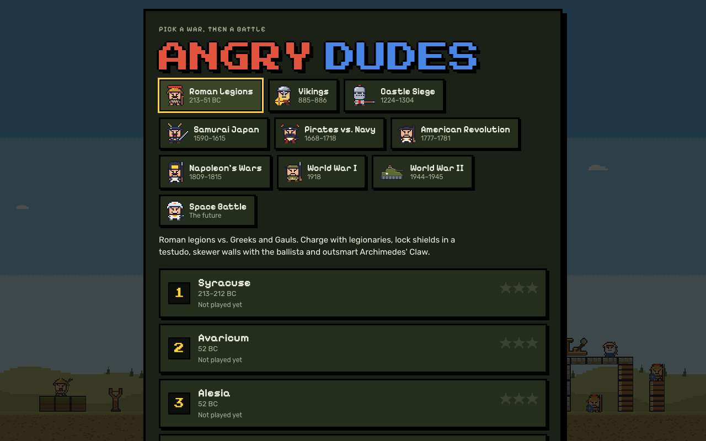 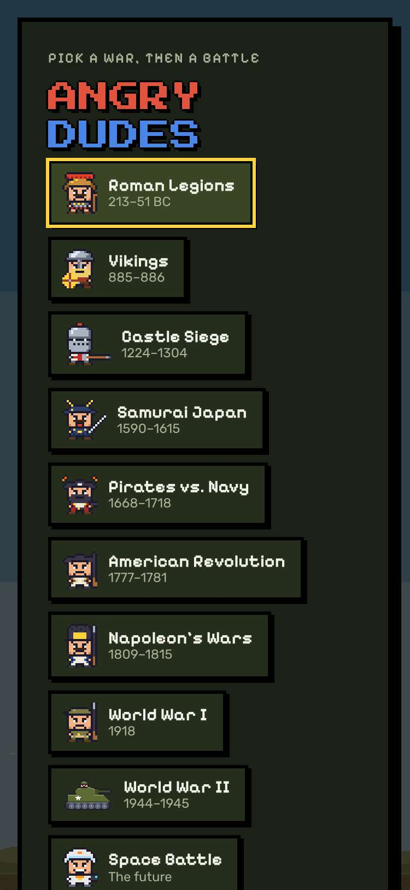

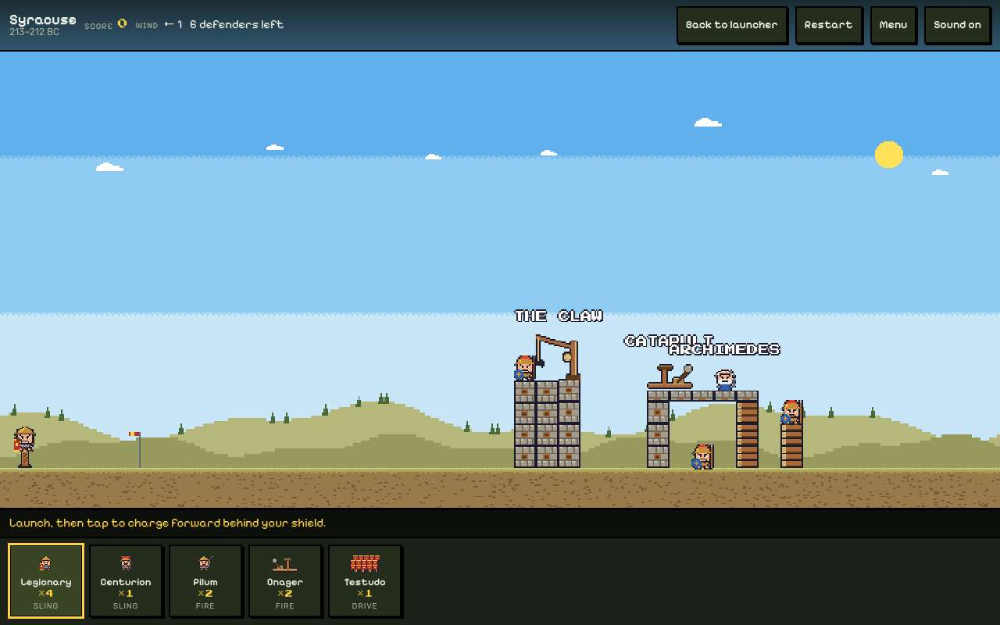 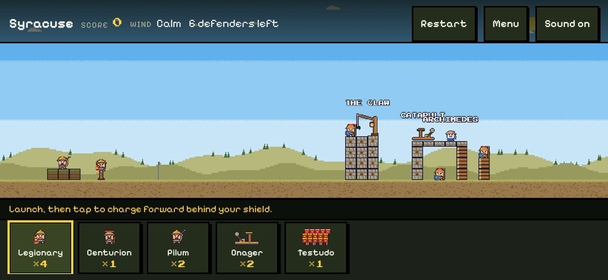

## 2. keys: W and ↑ both tilt the aim up, S and ↓ down, D and → add power, A and ← take it away, Space or Enter launches and does the special move, and E, Q and 1-9 pick a dude

- desktop: from the title ↓, Enter, Enter started Syracuse. w 35→36.5, ArrowUp 36.5→38; s 38→36.5, ArrowDown 36.5→35; d 0.7→0.72, ArrowRight 0.72→0.74; a 0.74→0.72, ArrowLeft 0.72→0.67 (degrees and power). Holding W 35→62.8°. Space launched a legionary, Enter made him charge; E, Q and 3 picked centurion, legionary, pilum; Enter, Enter fired a pilum; 5 then Space sent the testudo; F looked at the fort and back; M turned the sound off and on; at Fort du Roule → and D moved the Mustang's target 516→520 and Space called it in
- phone: 812 x 375: from the title ↓, Enter, Enter started Syracuse. w 35→36.5, ArrowUp 36.5→38; s 38→32.8, ArrowDown 32.8→30.5; d 0.7→0.76, ArrowRight 0.76→0.79; a 0.79→0.76, ArrowLeft 0.76→0.73 (degrees and power). Holding W 30.5→59°. Space launched a legionary, Enter made him charge; E, Q and 3 picked centurion, legionary, pilum; Enter, Enter fired a pilum; 5 then Space sent the testudo; M turned the sound off and on; at Fort du Roule → and D moved the Mustang's target 512→516 and Space called it in

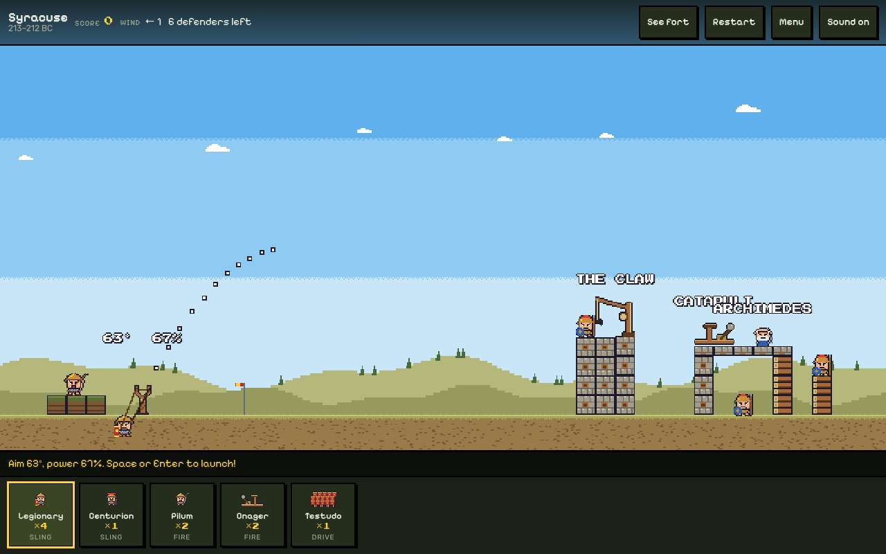 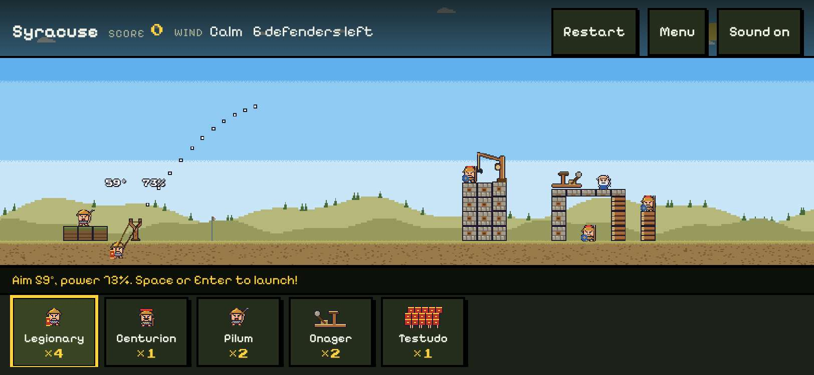

## 3. P, Escape and the Menu button pause the battle and hold it still; P, Escape and Play on carry on; Restart and Leave battle work from the pause menu

- desktop: p paused, p carried on; Escape paused, Escape carried on; clicked Menu paused, clicked Play on carried on; the clock and every piece stood still for 0.5 s each time; Restart from the pause menu gave a full arsenal (4 legionaries); Leave battle went back to the title
- phone: 812 x 375: p paused, p carried on; Escape paused, Escape carried on; tapped Menu paused, tapped Play on carried on; the clock and every piece stood still for 0.5 s each time; Restart from the pause menu gave a full arsenal (4 legionaries); Leave battle went back to the title

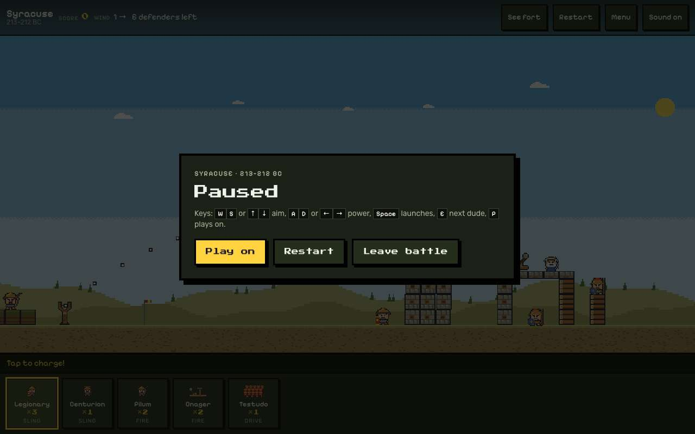 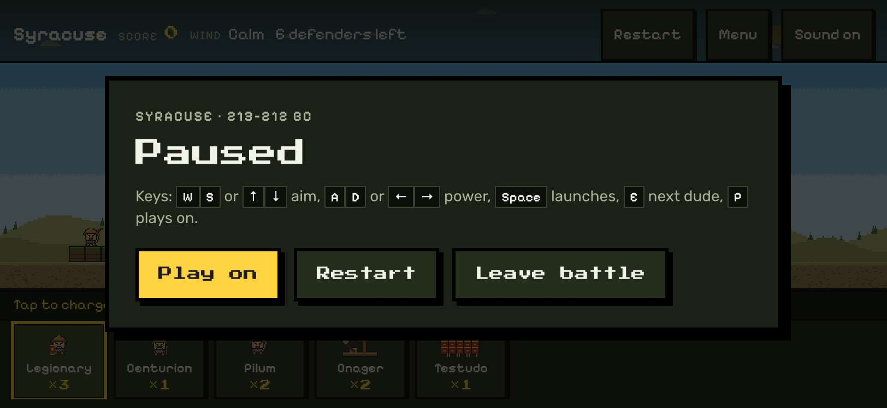

## 4. every button on every screen is at least 48 x 48 px, 8 px apart and 8 px from the edges, and tapping them works

- desktop: targets measured on each screen (0 means none on screen: upright, the battle and the pause menu sit behind jeremy.v1's "Turn your phone sideways" card): 1024x768: title 13, briefing 2, battle 9, paused 3, battle with 9 13, battle report 2, campaign map 4, Start over armed 4. 1280x800: title 13, briefing 2, battle 8, paused 3, battle with 9 13, battle report 2, campaign map 4, Start over armed 4. 1366x768: title 13, briefing 2, battle 8, paused 3, battle with 9 13, battle report 2, campaign map 4, Start over armed 4. Clicks worked: a battle, Start battle, a dude in the bar, Sound off and on, See fort, Menu (pause), Play on, a pin on the campaign map, Start over (asks again)
- phone: targets measured on each screen (0 means none on screen: upright, the battle and the pause menu sit behind jeremy.v1's "Turn your phone sideways" card): 375x812: title 10, briefing 0, battle 0, paused 0, battle with 9 0, battle report 2, campaign map 4, Start over armed 3. 812x375: title 10, briefing 2, battle 8, paused 3, battle with 9 12, battle report 2, campaign map 1, Start over armed 1. 667x375: title 10, briefing 2, battle 8, paused 3, battle with 9 11, battle report 2, campaign map 0, Start over armed 0. Taps worked: a battle, Start battle, a dude in the bar, Sound off and on, See fort, Menu (pause), Play on, a pin on the campaign map, Start over (asks again)

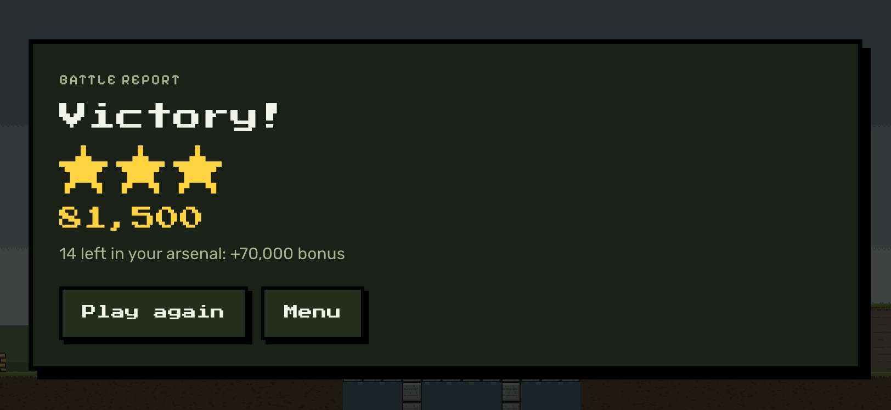

## 5. the HUD isn't squeezed: in all 37 battles every piece jeremy.v1 showed whole is still whole, uncovered and as big, with the top buttons 48 px tall

- desktop: 1024x768: 582 pieces whole in jeremy.v1 across 37 battles, all still whole and as big in jeremy.v2; top buttons 32 → 48 px tall (Syracuse: Restart 86x48, Menu 60x48, Sound 85x48). 1280x800: 582 pieces whole in jeremy.v1 across 37 battles, all still whole and as big in jeremy.v2; top buttons 32 → 48 px tall (Syracuse: Restart 86x48, Menu 60x48, Sound 85x48). 1366x768: 582 pieces whole in jeremy.v1 across 37 battles, all still whole and as big in jeremy.v2; top buttons 32 → 48 px tall (Syracuse: Restart 86x48, Menu 60x48, Sound 85x48). Upright phones show the Turn sideways card in battle, in both versions
- phone: 375x812: 0 pieces whole in jeremy.v1 across 37 battles, all still whole and as big in jeremy.v2; top buttons 32 → 48 px tall (Syracuse: Restart 86x48, Menu 60x48, Sound 85x48). 812x375: 529 pieces whole in jeremy.v1 across 37 battles, all still whole and as big in jeremy.v2; top buttons 32 → 48 px tall (Syracuse: Restart 86x48, Menu 60x48, Sound 85x48). 667x375: 521 pieces whole in jeremy.v1 across 37 battles, all still whole and as big in jeremy.v2; top buttons 32 → 48 px tall (Syracuse: Restart 86x48, Menu 60x48, Sound 85x48). Upright phones show the Turn sideways card in battle, in both versions

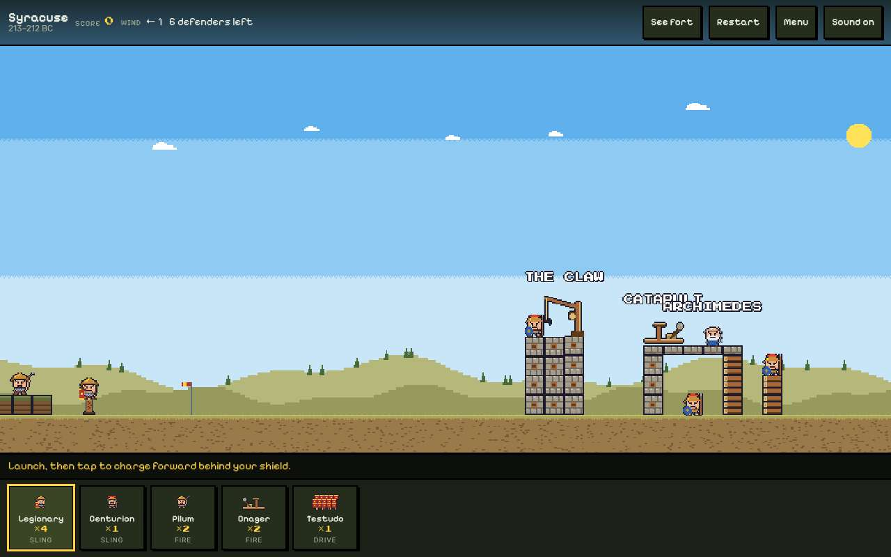 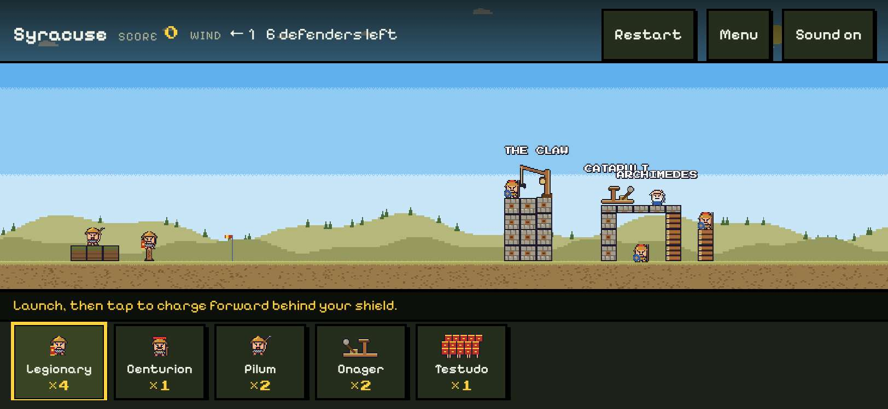

## 6. no button covers the battlefield in any of the 37 battles, and the battlefield is drawn at least as big as in jeremy.v1

- desktop: 1024x768: button area over the battlefield 0 px² in jeremy.v2 (37 battles); battlefield 100.0-100.0% of jeremy.v1's size (Syracuse: rows 291-618 → 291-618, scale 1.422 → 1.422). 1280x800: button area over the battlefield 0 px² in jeremy.v2 (37 battles); battlefield 100.0-100.0% of jeremy.v1's size (Syracuse: rows 241-650 → 241-650, scale 1.778 → 1.778). 1366x768: button area over the battlefield 0 px² in jeremy.v2 (37 battles); battlefield 100.0-100.0% of jeremy.v1's size (Syracuse: rows 182-618 → 182-618, scale 1.897 → 1.897)
- phone: 375x812: button area over the battlefield 0 px² in jeremy.v2 (37 battles); battlefield 100.0-100.0% of jeremy.v1's size (Syracuse: rows 542-662 → 542-662, scale 0.521 → 0.521). 812x375: button area over the battlefield 0 px² in jeremy.v2 (37 battles); battlefield 100.5-126.8% of jeremy.v1's size (Syracuse: rows 46-257 → 56-268, scale 0.917 → 0.922). 667x375: button area over the battlefield 0 px² in jeremy.v2 (37 battles); battlefield 100.5-126.8% of jeremy.v1's size (Syracuse: rows 87-257 → 86-268, scale 0.739 → 0.791)

## 7. the briefing, title, battle report and campaign screens keep everything jeremy.v1 showed whole, and Start battle is on screen sideways in all 37 briefings

- desktop: 1024x768: 736 pieces whole across the 37 briefings in jeremy.v1, all still whole; Start battle on screen in 37 → 37 of 37; title, battle report, campaign map and Start over: 18/8/20/20 whole, all kept. 1280x800: 736 pieces whole across the 37 briefings in jeremy.v1, all still whole; Start battle on screen in 37 → 37 of 37; title, battle report, campaign map and Start over: 19/8/20/20 whole, all kept. 1366x768: 736 pieces whole across the 37 briefings in jeremy.v1, all still whole; Start battle on screen in 37 → 37 of 37; title, battle report, campaign map and Start over: 18/8/20/20 whole, all kept
- phone: 375x812: 526 pieces whole across the 37 briefings in jeremy.v1, all still whole; Start battle on screen in 4 → 6 of 37; title, battle report, campaign map and Start over: 11/8/20/19 whole, all kept. 812x375: 237 pieces whole across the 37 briefings in jeremy.v1, all still whole; Start battle on screen in 0 → 37 of 37; title, battle report, campaign map and Start over: 11/8/14/14 whole, all kept. 667x375: 200 pieces whole across the 37 briefings in jeremy.v1, all still whole; Start battle on screen in 0 → 37 of 37; title, battle report, campaign map and Start over: 9/8/9/9 whole, all kept

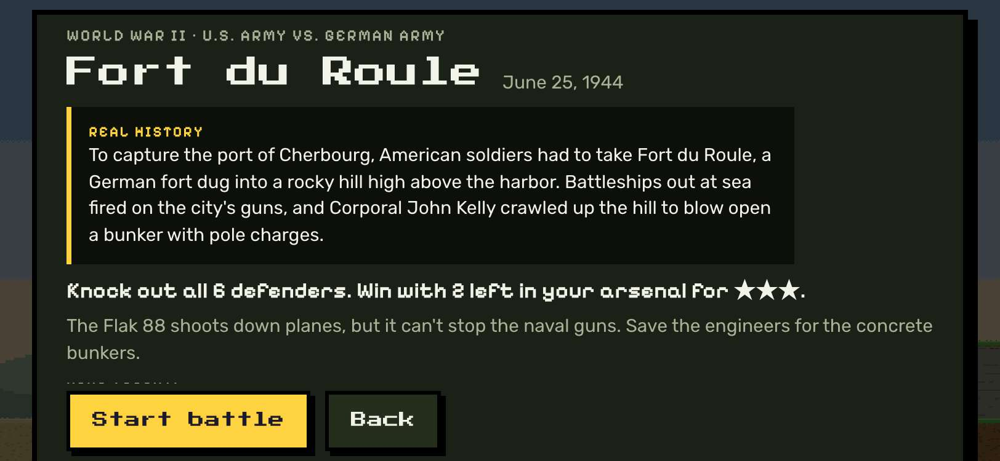

## 8. what stays still works: drag back and let go launches, a win shows the battle report with stars, and the best score is saved

- desktop: the mouse dragged back from the launcher and let go: a legionary flew (4→3 left); a win showed "Victory!" with stars and saved angrydudes.best.rome.syracuse = {"score":56500,"stars":3}
- phone: a finger dragged back from the launcher and let go: a legionary flew (4→3 left); a win showed "Victory!" with stars and saved angrydudes.best.rome.syracuse = {"score":56500,"stars":3}

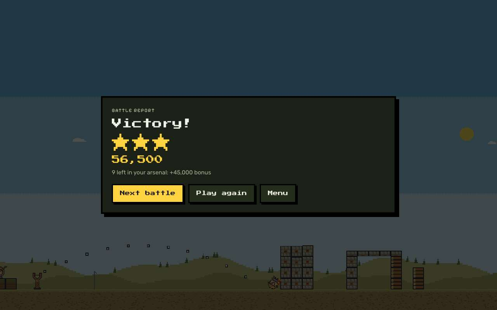 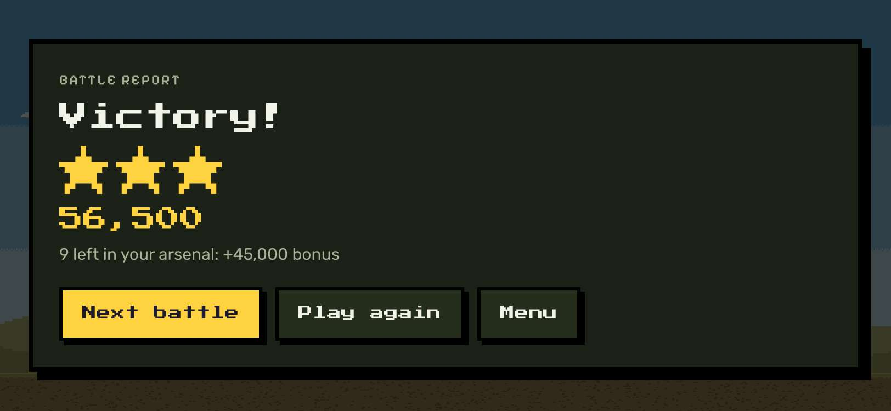

## 9. saves carry over: jeremy.v1's pack, sound, best scores and campaign load in jeremy.v2, which saves under the same keys and adds none

- desktop: seeded jeremy.v1's keys (Vikings pack, sound off, Rochester best 12,345 with 2 stars, a World War II campaign with Bazooka team) → all shown in jeremy.v2; after picking Castle Siege and M: angrydudes.best.vikings.rochester, angrydudes.campaign.ww2, angrydudes.pack, angrydudes.sound; no new keys; jeremy.v1 then opened on Castle Siege
- phone: seeded jeremy.v1's keys (Vikings pack, sound off, Rochester best 12,345 with 2 stars, a World War II campaign with Bazooka team) → all shown in jeremy.v2; after picking Castle Siege and M: angrydudes.best.vikings.rochester, angrydudes.campaign.ww2, angrydudes.pack, angrydudes.sound; no new keys; jeremy.v1 then opened on Castle Siege

## 10. jeremy.v1 still plays at games/angry-dudes/jeremy.v1/, and games.json keeps both versions with jeremy.v2 the default

- desktop: jeremy.v1 at games/angry-dudes/jeremy.v1/ opened and started a battle; games.json: default jeremy.v2, versions jeremy.v1 (games/angry-dudes/jeremy.v1/) and jeremy.v2 (games/angry-dudes/jeremy.v2/)
- phone: jeremy.v1 at games/angry-dudes/jeremy.v1/ opened and started a battle; games.json: default jeremy.v2, versions jeremy.v1 (games/angry-dudes/jeremy.v1/) and jeremy.v2 (games/angry-dudes/jeremy.v2/)

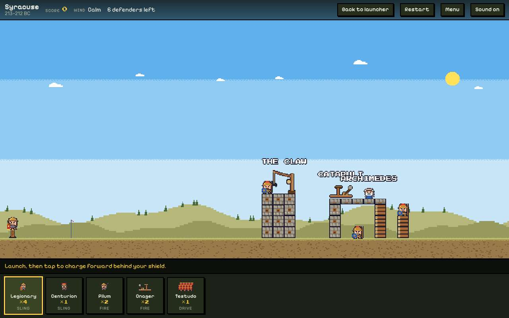 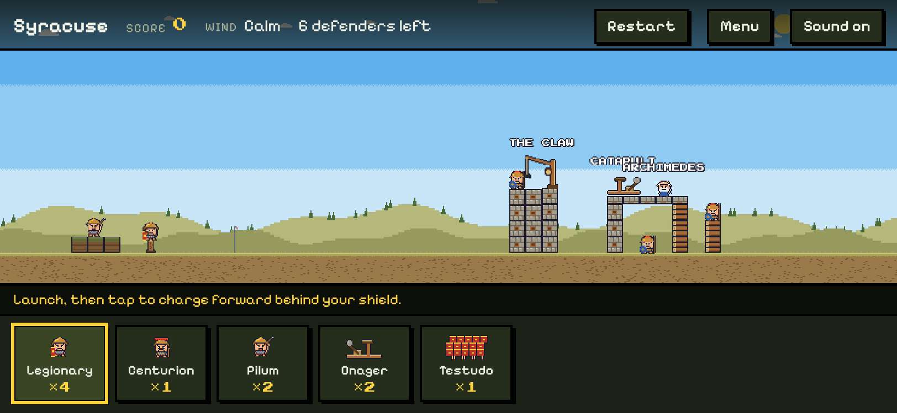

## 11. in the arcade, Angry Dudes offers both versions and plays jeremy.v2 by default; #angry-dudes@jeremy.v1 still opens jeremy.v1

- desktop: card (2 versions) → picker: jeremy.v2 first, "Launch with the keyboard" → jeremy.v2 plays in the frame and opens a briefing; #angry-dudes@jeremy.v1 still opens jeremy.v1
- phone: card (2 versions) → picker: jeremy.v2 first, "Launch with the keyboard" → jeremy.v2 plays in the frame and opens a briefing; #angry-dudes@jeremy.v1 still opens jeremy.v1

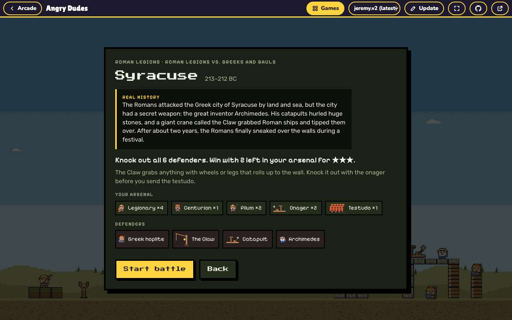 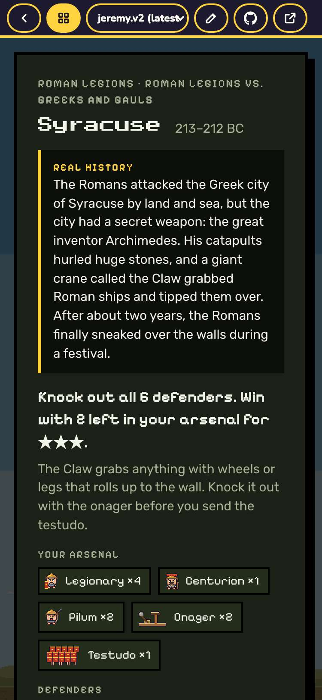
