# Evidence: 225-magic-friends-jeremy-v2

**PASS: 35 of 35 checks pass at desktop and phone widths.**

Generated by `npm run evidence -- 225-magic-friends-jeremy-v2` from [`tests/evidence/225-magic-friends-jeremy-v2.spec.mjs`](../../tests/evidence/225-magic-friends-jeremy-v2.spec.mjs) against the local server (python3 -m http.server) on this branch, starting from commit 8c78995, 2026-10-30 08:07 UTC. Rules: [docs/evidence.md](../../docs/evidence.md).

| Check | Desktop 1280 | Phone 375 |
|---|---|---|
| jeremy.v2 opens to its title and starts a level, with nothing from the internet but jeremy.v1's fonts | pass | pass |
| every screen at 375x812 with real fonts, side by side with jeremy.v1 as the player lands on it: no word jeremy.v1 showed is cut off more or covered, and nothing it showed whole is cut off, covered or smaller | skipped | pass |
| every screen at 375x812 with fallback fonts, side by side with jeremy.v1 as the player lands on it: no word jeremy.v1 showed is cut off more or covered, and nothing it showed whole is cut off, covered or smaller | skipped | pass |
| every screen at 812x375 with real fonts, side by side with jeremy.v1 as the player lands on it: no word jeremy.v1 showed is cut off more or covered, and nothing it showed whole is cut off, covered or smaller | skipped | pass |
| every screen at 812x375 with fallback fonts, side by side with jeremy.v1 as the player lands on it: no word jeremy.v1 showed is cut off more or covered, and nothing it showed whole is cut off, covered or smaller | skipped | pass |
| every screen at 667x375 with real fonts, side by side with jeremy.v1 as the player lands on it: no word jeremy.v1 showed is cut off more or covered, and nothing it showed whole is cut off, covered or smaller | skipped | pass |
| every screen at 667x375 with fallback fonts, side by side with jeremy.v1 as the player lands on it: no word jeremy.v1 showed is cut off more or covered, and nothing it showed whole is cut off, covered or smaller | skipped | pass |
| every screen at 740x360 with real fonts, side by side with jeremy.v1 as the player lands on it: no word jeremy.v1 showed is cut off more or covered, and nothing it showed whole is cut off, covered or smaller | skipped | pass |
| every screen at 740x360 with fallback fonts, side by side with jeremy.v1 as the player lands on it: no word jeremy.v1 showed is cut off more or covered, and nothing it showed whole is cut off, covered or smaller | skipped | pass |
| every screen at 1024x768 with real fonts, side by side with jeremy.v1 as the player lands on it: no word jeremy.v1 showed is cut off more or covered, and nothing it showed whole is cut off, covered or smaller | pass | skipped |
| every screen at 1024x768 with fallback fonts, side by side with jeremy.v1 as the player lands on it: no word jeremy.v1 showed is cut off more or covered, and nothing it showed whole is cut off, covered or smaller | pass | skipped |
| every screen at 1280x800 with real fonts, side by side with jeremy.v1 as the player lands on it: no word jeremy.v1 showed is cut off more or covered, and nothing it showed whole is cut off, covered or smaller | pass | skipped |
| every screen at 1280x800 with fallback fonts, side by side with jeremy.v1 as the player lands on it: no word jeremy.v1 showed is cut off more or covered, and nothing it showed whole is cut off, covered or smaller | pass | skipped |
| every screen at 1366x768 with real fonts, side by side with jeremy.v1 as the player lands on it: no word jeremy.v1 showed is cut off more or covered, and nothing it showed whole is cut off, covered or smaller | pass | skipped |
| every screen at 1366x768 with fallback fonts, side by side with jeremy.v1 as the player lands on it: no word jeremy.v1 showed is cut off more or covered, and nothing it showed whole is cut off, covered or smaller | pass | skipped |
| Pick a level at 375x812, word by word: every world card's words show as much as in jeremy.v1, with real fonts and with fallback fonts, with and without the arrow buttons | skipped | pass |
| Pick a level at 812x375, word by word: every world card's words show as much as in jeremy.v1, with real fonts and with fallback fonts, with and without the arrow buttons | skipped | pass |
| Pick a level at 667x375, word by word: every world card's words show as much as in jeremy.v1, with real fonts and with fallback fonts, with and without the arrow buttons | skipped | pass |
| Pick a level at 740x360, word by word: every world card's words show as much as in jeremy.v1, with real fonts and with fallback fonts, with and without the arrow buttons | skipped | pass |
| Pick a level at 1024x768, word by word: every world card's words show as much as in jeremy.v1, with real fonts and with fallback fonts, with and without the arrow buttons | pass | skipped |
| Pick a level at 1280x800, word by word: every world card's words show as much as in jeremy.v1, with real fonts and with fallback fonts, with and without the arrow buttons | pass | skipped |
| Pick a level at 1366x768, word by word: every world card's words show as much as in jeremy.v1, with real fonts and with fallback fonts, with and without the arrow buttons | pass | skipped |
| at 375x812 the buttons cover less of the game in play than jeremy.v1's did, and none of its counter or climb meter | skipped | pass |
| at 812x375 the buttons cover less of the game in play than jeremy.v1's did, and none of its counter or climb meter | skipped | pass |
| at 667x375 the buttons cover less of the game in play than jeremy.v1's did, and none of its counter or climb meter | skipped | pass |
| at 740x360 the buttons cover less of the game in play than jeremy.v1's did, and none of its counter or climb meter | skipped | pass |
| at 1024x768 the buttons cover less of the game in play than jeremy.v1's did, and none of its counter or climb meter | pass | skipped |
| at 1280x800 the buttons cover less of the game in play than jeremy.v1's did, and none of its counter or climb meter | pass | skipped |
| at 1366x768 the buttons cover less of the game in play than jeremy.v1's did, and none of its counter or climb meter | pass | skipped |
| every screen meets the phone bar: 48 px buttons with 8 px gaps on whole pixels, 8 px from the edges | pass | pass |
| by touch: Play, Pause and Keep going, the arrow buttons, Sound, a world's level, and the start screen | skipped | pass |
| by keyboard: WASD and the arrows both move and jump, P or Escape pauses, M is Sound, H is Home, B the arrow buttons, and the arrows walk the menus | pass | skipped |
| saves from jeremy.v1 load under the same keys: progress, Normal, Sound off and the arrow buttons | pass | pass |
| jeremy.v1 still plays from its folder, and games.json keeps it while jeremy.v2 becomes the default | pass | pass |
| in the arcade, Magic Friends offers both versions and plays jeremy.v2 by default; #magic-friends@jeremy.v1 still opens jeremy.v1 | pass | pass |

## 1. jeremy.v2 opens to its title and starts a level, with nothing from the internet but jeremy.v1's fonts

- desktop: clicked Play: the witch's intro ran into level 1 and its toast showed; outside requests: fonts.googleapis.com, fonts.gstatic.com (Google Fonts, as jeremy.v1); no sideways scrolling
- phone: tapped Play: the witch's intro ran into level 1 and its toast showed; outside requests: fonts.googleapis.com, fonts.gstatic.com (Google Fonts, as jeremy.v1); no sideways scrolling

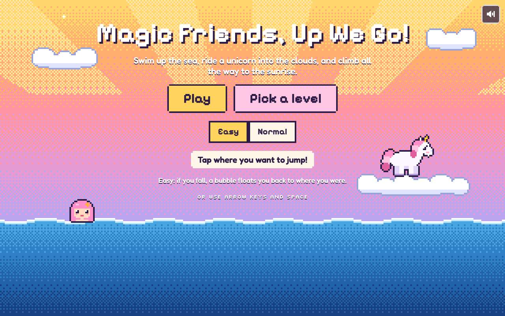 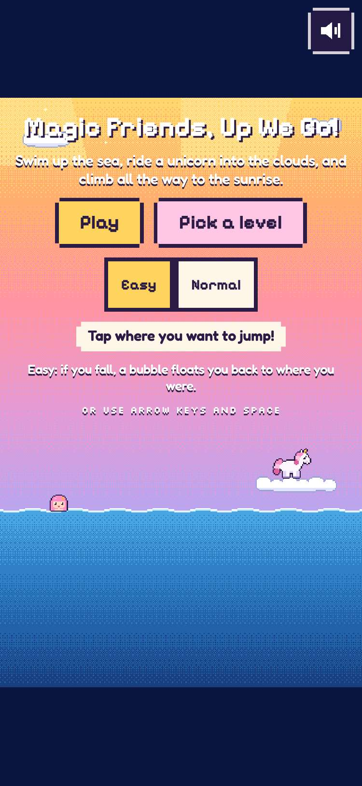

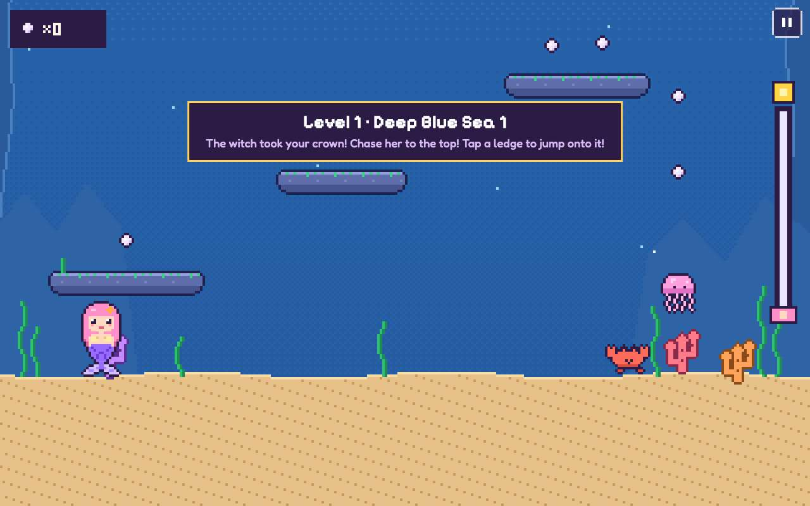 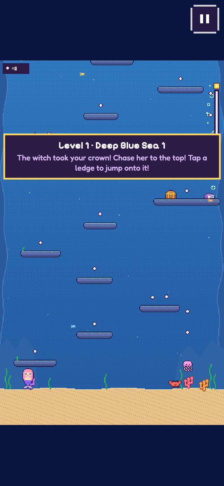

## 2. every screen at 375x812 with real fonts, side by side with jeremy.v1 as the player lands on it: no word jeremy.v1 showed is cut off more or covered, and nothing it showed whole is cut off, covered or smaller

- phone: 375x812: 12 screens; 89 pictures, buttons and blocks of words, and 228 words one by one

## 3. every screen at 375x812 with fallback fonts, side by side with jeremy.v1 as the player lands on it: no word jeremy.v1 showed is cut off more or covered, and nothing it showed whole is cut off, covered or smaller

- phone: 375x812 fallback fonts: 12 screens; 89 pictures, buttons and blocks of words, and 228 words one by one

## 4. every screen at 812x375 with real fonts, side by side with jeremy.v1 as the player lands on it: no word jeremy.v1 showed is cut off more or covered, and nothing it showed whole is cut off, covered or smaller

- phone: 812x375: 12 screens; 115 pictures, buttons and blocks of words, and 281 words one by one

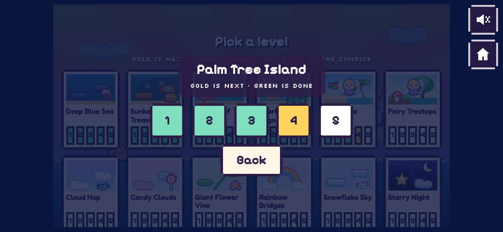

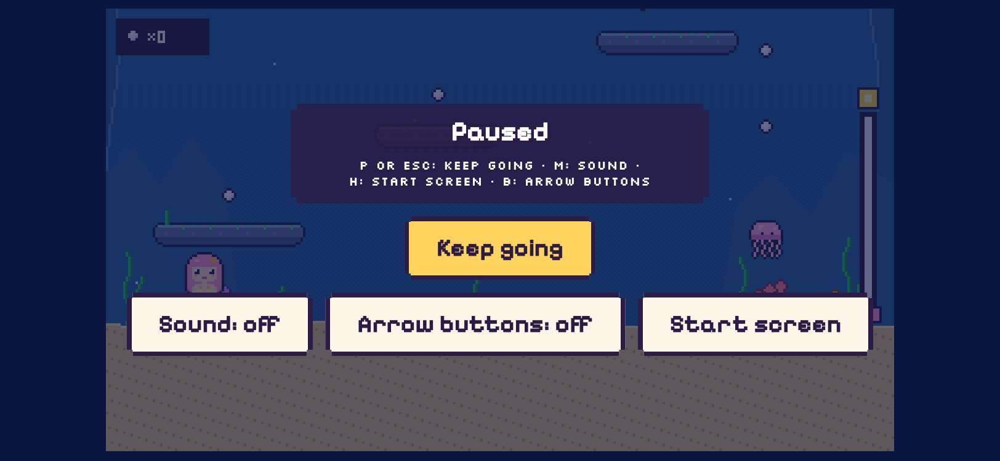

## 5. every screen at 812x375 with fallback fonts, side by side with jeremy.v1 as the player lands on it: no word jeremy.v1 showed is cut off more or covered, and nothing it showed whole is cut off, covered or smaller

- phone: 812x375 fallback fonts: 12 screens; 115 pictures, buttons and blocks of words, and 281 words one by one

## 6. every screen at 667x375 with real fonts, side by side with jeremy.v1 as the player lands on it: no word jeremy.v1 showed is cut off more or covered, and nothing it showed whole is cut off, covered or smaller

- phone: 667x375: 12 screens; 115 pictures, buttons and blocks of words, and 281 words one by one

## 7. every screen at 667x375 with fallback fonts, side by side with jeremy.v1 as the player lands on it: no word jeremy.v1 showed is cut off more or covered, and nothing it showed whole is cut off, covered or smaller

- phone: 667x375 fallback fonts: 12 screens; 115 pictures, buttons and blocks of words, and 281 words one by one

## 8. every screen at 740x360 with real fonts, side by side with jeremy.v1 as the player lands on it: no word jeremy.v1 showed is cut off more or covered, and nothing it showed whole is cut off, covered or smaller

- phone: 740x360: 12 screens; 115 pictures, buttons and blocks of words, and 281 words one by one

## 9. every screen at 740x360 with fallback fonts, side by side with jeremy.v1 as the player lands on it: no word jeremy.v1 showed is cut off more or covered, and nothing it showed whole is cut off, covered or smaller

- phone: 740x360 fallback fonts: 12 screens; 115 pictures, buttons and blocks of words, and 281 words one by one

## 10. every screen at 1024x768 with real fonts, side by side with jeremy.v1 as the player lands on it: no word jeremy.v1 showed is cut off more or covered, and nothing it showed whole is cut off, covered or smaller

- desktop: 1024x768: 12 screens; 149 pictures, buttons and blocks of words, and 285 words one by one

## 11. every screen at 1024x768 with fallback fonts, side by side with jeremy.v1 as the player lands on it: no word jeremy.v1 showed is cut off more or covered, and nothing it showed whole is cut off, covered or smaller

- desktop: 1024x768 fallback fonts: 12 screens; 149 pictures, buttons and blocks of words, and 285 words one by one

## 12. every screen at 1280x800 with real fonts, side by side with jeremy.v1 as the player lands on it: no word jeremy.v1 showed is cut off more or covered, and nothing it showed whole is cut off, covered or smaller

- desktop: 1280x800: 12 screens; 149 pictures, buttons and blocks of words, and 285 words one by one

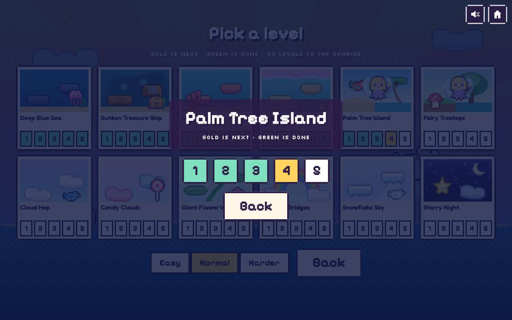

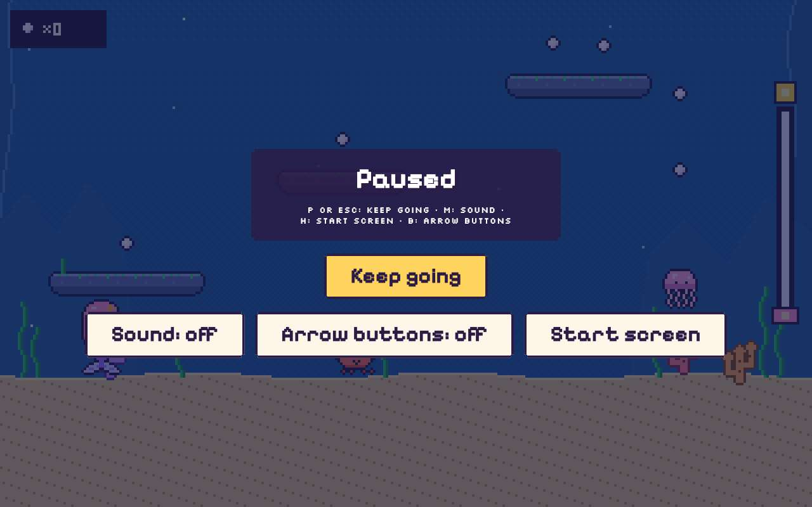

## 13. every screen at 1280x800 with fallback fonts, side by side with jeremy.v1 as the player lands on it: no word jeremy.v1 showed is cut off more or covered, and nothing it showed whole is cut off, covered or smaller

- desktop: 1280x800 fallback fonts: 12 screens; 149 pictures, buttons and blocks of words, and 285 words one by one

## 14. every screen at 1366x768 with real fonts, side by side with jeremy.v1 as the player lands on it: no word jeremy.v1 showed is cut off more or covered, and nothing it showed whole is cut off, covered or smaller

- desktop: 1366x768: 12 screens; 149 pictures, buttons and blocks of words, and 285 words one by one

## 15. every screen at 1366x768 with fallback fonts, side by side with jeremy.v1 as the player lands on it: no word jeremy.v1 showed is cut off more or covered, and nothing it showed whole is cut off, covered or smaller

- desktop: 1366x768 fallback fonts: 12 screens; 149 pictures, buttons and blocks of words, and 285 words one by one

## 16. Pick a level at 375x812, word by word: every world card's words show as much as in jeremy.v1, with real fonts and with fallback fonts, with and without the arrow buttons

- phone: 375x812 real fonts: 35 words; lowest names jeremy.v1 "Palm Tree Island Fairy Treetops" 699.8..714.8 of 710.5 (71% showing), jeremy.v2 "Palm Tree Island Fairy Treetops" 699.3..714.3 of 710.0 (71% showing); 375x812 real fonts, arrow buttons on: 35 words; lowest names jeremy.v1 "Palm Tree Island Fairy Treetops" 598.3..613.3 of 609.0 (71% showing), jeremy.v2 "Palm Tree Island Fairy Treetops" 662.3..677.3 of 673.0 (71% showing); 375x812 fallback fonts: 35 words; lowest names jeremy.v1 "Palm Tree Island Fairy Treetops" 695.8..709.8 of 710.5 (100% showing), jeremy.v2 "Palm Tree Island Fairy Treetops" 695.3..709.3 of 710.0 (100% showing); 375x812 fallback fonts, arrow buttons on: 35 words; lowest names jeremy.v1 "Palm Tree Island Fairy Treetops" 594.3..608.3 of 609.0 (100% showing), jeremy.v2 "Palm Tree Island Fairy Treetops" 658.3..672.3 of 673.0 (100% showing)

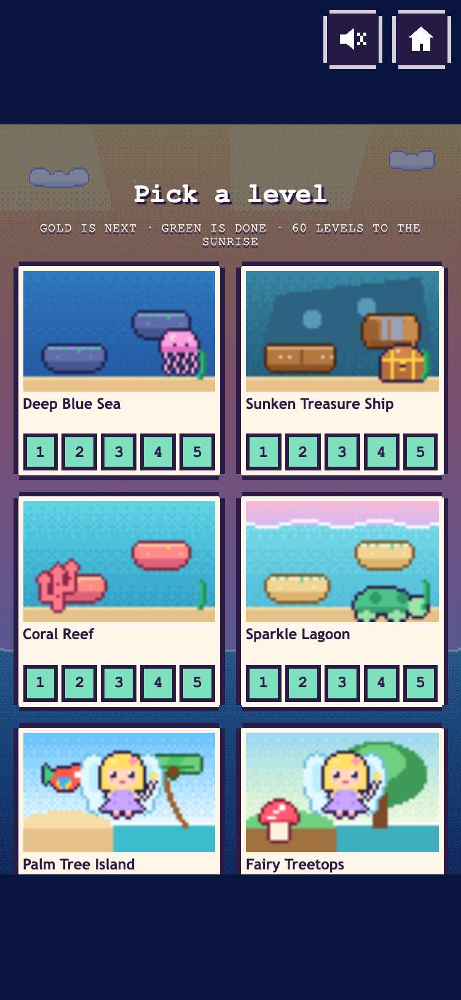

## 17. Pick a level at 812x375, word by word: every world card's words show as much as in jeremy.v1, with real fonts and with fallback fonts, with and without the arrow buttons

- phone: 812x375 real fonts: 88 words; lowest names jeremy.v1 "Vine Bridges" 324.9..339.9 of 367.5 (100% showing), jeremy.v2 "Vine Bridges" 324.4..339.4 of 367.0 (100% showing); 812x375 real fonts, arrow buttons on: 88 words; lowest names jeremy.v1 "Vine Bridges" 324.9..339.9 of 367.5 (100% showing), jeremy.v2 "Vine Bridges" 324.4..339.4 of 367.0 (100% showing); 812x375 fallback fonts: 88 words; lowest names jeremy.v1 "Vine Bridges Sky" 322.9..336.9 of 367.5 (100% showing), jeremy.v2 "Vine Bridges Sky" 322.4..336.4 of 367.0 (100% showing); 812x375 fallback fonts, arrow buttons on: 88 words; lowest names jeremy.v1 "Vine Bridges Sky" 322.9..336.9 of 367.5 (100% showing), jeremy.v2 "Vine Bridges Sky" 322.4..336.4 of 367.0 (100% showing)

## 18. Pick a level at 667x375, word by word: every world card's words show as much as in jeremy.v1, with real fonts and with fallback fonts, with and without the arrow buttons

- phone: 667x375 real fonts: 88 words; lowest names jeremy.v1 "Vine Bridges" 324.9..339.9 of 367.5 (100% showing), jeremy.v2 "Vine Bridges" 324.4..339.4 of 367.0 (100% showing); 667x375 real fonts, arrow buttons on: 88 words; lowest names jeremy.v1 "Vine Bridges" 324.9..339.9 of 367.5 (100% showing), jeremy.v2 "Vine Bridges" 324.4..339.4 of 367.0 (100% showing); 667x375 fallback fonts: 88 words; lowest names jeremy.v1 "Vine Bridges Sky" 322.9..336.9 of 367.5 (100% showing), jeremy.v2 "Vine Bridges Sky" 322.4..336.4 of 367.0 (100% showing); 667x375 fallback fonts, arrow buttons on: 88 words; lowest names jeremy.v1 "Vine Bridges Sky" 322.9..336.9 of 367.5 (100% showing), jeremy.v2 "Vine Bridges Sky" 322.4..336.4 of 367.0 (100% showing)

## 19. Pick a level at 740x360, word by word: every world card's words show as much as in jeremy.v1, with real fonts and with fallback fonts, with and without the arrow buttons

- phone: 740x360 real fonts: 88 words; lowest names jeremy.v1 "Vine Bridges" 317.4..332.4 of 360.0 (100% showing), jeremy.v2 "Vine Bridges" 317.4..332.4 of 360.0 (100% showing); 740x360 real fonts, arrow buttons on: 88 words; lowest names jeremy.v1 "Vine Bridges" 317.4..332.4 of 360.0 (100% showing), jeremy.v2 "Vine Bridges" 317.4..332.4 of 360.0 (100% showing); 740x360 fallback fonts: 88 words; lowest names jeremy.v1 "Vine Bridges Sky" 315.4..329.4 of 360.0 (100% showing), jeremy.v2 "Vine Bridges Sky" 315.4..329.4 of 360.0 (100% showing); 740x360 fallback fonts, arrow buttons on: 88 words; lowest names jeremy.v1 "Vine Bridges Sky" 315.4..329.4 of 360.0 (100% showing), jeremy.v2 "Vine Bridges Sky" 315.4..329.4 of 360.0 (100% showing)

## 20. Pick a level at 1024x768, word by word: every world card's words show as much as in jeremy.v1, with real fonts and with fallback fonts, with and without the arrow buttons

- desktop: 1024x768 real fonts: 88 words; lowest names jeremy.v1 "Cloud Hop Candy Clouds Giant Flower Vine Rainbow Bridges Snowflake Sky Starry Night" 414.2..429.2 of 744.0 (100% showing), jeremy.v2 "Cloud Hop Candy Clouds Giant Flower Vine Rainbow Bridges Snowflake Sky Starry Night" 414.2..429.2 of 744.0 (100% showing); 1024x768 real fonts, arrow buttons on: 88 words; lowest names jeremy.v1 "Cloud Hop Candy Clouds Giant Flower Vine Rainbow Bridges Snowflake Sky Starry Night" 414.2..429.2 of 744.0 (100% showing), jeremy.v2 "Cloud Hop Candy Clouds Giant Flower Vine Rainbow Bridges Snowflake Sky Starry Night" 414.2..429.2 of 744.0 (100% showing); 1024x768 fallback fonts: 88 words; lowest names jeremy.v1 "Cloud Hop Candy Clouds Giant Flower Vine Rainbow Bridges Snowflake Sky Starry Night" 411.2..425.2 of 744.0 (100% showing), jeremy.v2 "Cloud Hop Candy Clouds Giant Flower Vine Rainbow Bridges Snowflake Sky Starry Night" 411.2..425.2 of 744.0 (100% showing); 1024x768 fallback fonts, arrow buttons on: 88 words; lowest names jeremy.v1 "Cloud Hop Candy Clouds Giant Flower Vine Rainbow Bridges Snowflake Sky Starry Night" 411.2..425.2 of 744.0 (100% showing), jeremy.v2 "Cloud Hop Candy Clouds Giant Flower Vine Rainbow Bridges Snowflake Sky Starry Night" 411.2..425.2 of 744.0 (100% showing)

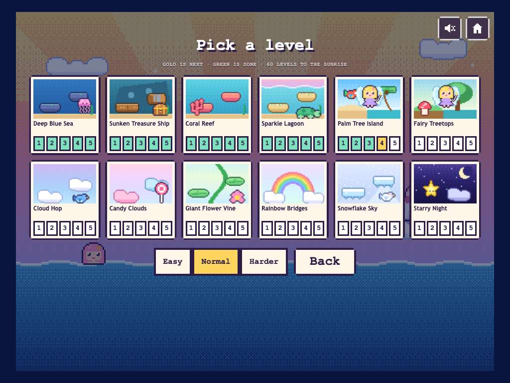

## 21. Pick a level at 1280x800, word by word: every world card's words show as much as in jeremy.v1, with real fonts and with fallback fonts, with and without the arrow buttons

- desktop: 1280x800 real fonts: 88 words; lowest names jeremy.v1 "Cloud Hop Candy Clouds Giant Flower Vine Rainbow Bridges Snowflake Sky Starry Night" 507.9..527.9 of 800.0 (100% showing), jeremy.v2 "Cloud Hop Candy Clouds Giant Flower Vine Rainbow Bridges Snowflake Sky Starry Night" 507.9..527.9 of 800.0 (100% showing); 1280x800 real fonts, arrow buttons on: 88 words; lowest names jeremy.v1 "Cloud Hop Candy Clouds Giant Flower Vine Rainbow Bridges Snowflake Sky Starry Night" 507.9..527.9 of 800.0 (100% showing), jeremy.v2 "Cloud Hop Candy Clouds Giant Flower Vine Rainbow Bridges Snowflake Sky Starry Night" 507.9..527.9 of 800.0 (100% showing); 1280x800 fallback fonts: 88 words; lowest names jeremy.v1 "Cloud Hop Candy Clouds Giant Flower Vine Rainbow Bridges Snowflake Sky Starry Night" 506.9..525.9 of 800.0 (100% showing), jeremy.v2 "Cloud Hop Candy Clouds Giant Flower Vine Rainbow Bridges Snowflake Sky Starry Night" 506.9..525.9 of 800.0 (100% showing); 1280x800 fallback fonts, arrow buttons on: 88 words; lowest names jeremy.v1 "Cloud Hop Candy Clouds Giant Flower Vine Rainbow Bridges Snowflake Sky Starry Night" 506.9..525.9 of 800.0 (100% showing), jeremy.v2 "Cloud Hop Candy Clouds Giant Flower Vine Rainbow Bridges Snowflake Sky Starry Night" 506.9..525.9 of 800.0 (100% showing)

## 22. Pick a level at 1366x768, word by word: every world card's words show as much as in jeremy.v1, with real fonts and with fallback fonts, with and without the arrow buttons

- desktop: 1366x768 real fonts: 88 words; lowest names jeremy.v1 "Cloud Hop Candy Clouds Giant Flower Vine Rainbow Bridges Snowflake Sky Starry Night" 531.9..551.9 of 744.0 (100% showing), jeremy.v2 "Cloud Hop Candy Clouds Giant Flower Vine Rainbow Bridges Snowflake Sky Starry Night" 531.9..551.9 of 744.0 (100% showing); 1366x768 real fonts, arrow buttons on: 88 words; lowest names jeremy.v1 "Cloud Hop Candy Clouds Giant Flower Vine Rainbow Bridges Snowflake Sky Starry Night" 531.9..551.9 of 744.0 (100% showing), jeremy.v2 "Cloud Hop Candy Clouds Giant Flower Vine Rainbow Bridges Snowflake Sky Starry Night" 531.9..551.9 of 744.0 (100% showing); 1366x768 fallback fonts: 88 words; lowest names jeremy.v1 "Cloud Hop Candy Clouds Giant Flower Vine Rainbow Bridges Snowflake Sky Starry Night" 530.9..549.9 of 744.0 (100% showing), jeremy.v2 "Cloud Hop Candy Clouds Giant Flower Vine Rainbow Bridges Snowflake Sky Starry Night" 530.9..549.9 of 744.0 (100% showing); 1366x768 fallback fonts, arrow buttons on: 88 words; lowest names jeremy.v1 "Cloud Hop Candy Clouds Giant Flower Vine Rainbow Bridges Snowflake Sky Starry Night" 530.9..549.9 of 744.0 (100% showing), jeremy.v2 "Cloud Hop Candy Clouds Giant Flower Vine Rainbow Bridges Snowflake Sky Starry Night" 530.9..549.9 of 744.0 (100% showing)

## 23. at 375x812 the buttons cover less of the game in play than jeremy.v1's did, and none of its counter or climb meter

- phone: 375x812, game covered by buttons, jeremy.v1 → jeremy.v2: no arrow buttons, in play: 1.90% → 0.00% (HUD 76 → 0 px²); with arrow buttons, in play: 1.90% → 0.00% (HUD 76 → 0 px²)
- phone: 375x812 menu screens (the game is a backdrop there; Sound and Home are bigger where there's no room beside the game): title 0.63% → 0.00%; level complete 1.26% → 0.00%

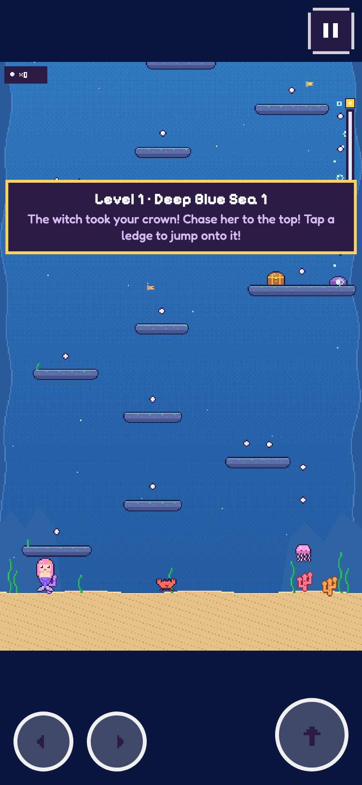

## 24. at 812x375 the buttons cover less of the game in play than jeremy.v1's did, and none of its counter or climb meter

- phone: 812x375, game covered by buttons, jeremy.v1 → jeremy.v2: no arrow buttons, in play: 1.88% → 0.00% (HUD 0 → 0 px²); with arrow buttons, in play: 3.68% → 1.80% (HUD 0 → 0 px²)
- phone: 812x375 menu screens (the game is a backdrop there; Sound and Home are bigger where there's no room beside the game): title 0.63% → 0.00%; level complete 1.25% → 0.00%

## 25. at 667x375 the buttons cover less of the game in play than jeremy.v1's did, and none of its counter or climb meter

- phone: 667x375, game covered by buttons, jeremy.v1 → jeremy.v2: no arrow buttons, in play: 1.88% → 1.00% (HUD 0 → 0 px²); with arrow buttons, in play: 7.72% → 6.84% (HUD 0 → 0 px²)
- phone: 667x375 menu screens (the game is a backdrop there; Sound and Home are bigger where there's no room beside the game): title 0.63% → 1.00%; level complete 1.25% → 2.00%

## 26. at 740x360 the buttons cover less of the game in play than jeremy.v1's did, and none of its counter or climb meter

- phone: 740x360, game covered by buttons, jeremy.v1 → jeremy.v2: no arrow buttons, in play: 1.88% → 1.00% (HUD 0 → 0 px²); with arrow buttons, in play: 5.57% → 4.69% (HUD 0 → 0 px²)
- phone: 740x360 menu screens (the game is a backdrop there; Sound and Home are bigger where there's no room beside the game): title 0.63% → 1.00%; level complete 1.25% → 2.00%

## 27. at 1024x768 the buttons cover less of the game in play than jeremy.v1's did, and none of its counter or climb meter

- desktop: 1024x768, game covered by buttons, jeremy.v1 → jeremy.v2: no arrow buttons, in play: 0.63% → 0.33% (HUD 0 → 0 px²); with arrow buttons, in play: 4.08% → 3.85% (HUD 0 → 0 px²)
- desktop: 1024x768 menu screens (the game is a backdrop there; Sound and Home are bigger where there's no room beside the game): title 0.21% → 0.33%; level complete 0.42% → 0.67%

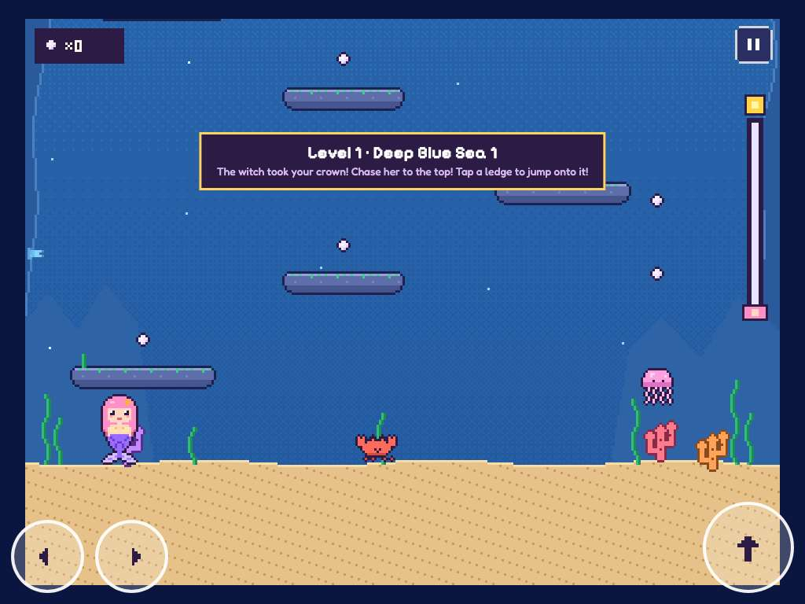

## 28. at 1280x800 the buttons cover less of the game in play than jeremy.v1's did, and none of its counter or climb meter

- desktop: 1280x800, game covered by buttons, jeremy.v1 → jeremy.v2: no arrow buttons, in play: 0.68% → 0.23% (HUD 0 → 0 px²); with arrow buttons, in play: 3.79% → 3.34% (HUD 0 → 0 px²)
- desktop: 1280x800 menu screens (the game is a backdrop there; Sound and Home are bigger where there's no room beside the game): title 0.23% → 0.23%; level complete 0.45% → 0.45%

## 29. at 1366x768 the buttons cover less of the game in play than jeremy.v1's did, and none of its counter or climb meter

- desktop: 1366x768, game covered by buttons, jeremy.v1 → jeremy.v2: no arrow buttons, in play: 0.75% → 0.25% (HUD 0 → 0 px²); with arrow buttons, in play: 3.12% → 2.66% (HUD 0 → 0 px²)
- desktop: 1366x768 menu screens (the game is a backdrop there; Sound and Home are bigger where there's no room beside the game): title 0.25% → 0.25%; level complete 0.50% → 0.50%

## 30. every screen meets the phone bar: 48 px buttons with 8 px gaps on whole pixels, 8 px from the edges

- desktop: 1024x768: title 6 (smallest 48 px), how to play (pick a level) 18 (smallest 48 px), a world's levels 8 (smallest 48 px), the witch's intro 1 (smallest 48 px), playing (sea) 1 (smallest 48 px), playing (island) 1 (smallest 48 px), playing (sky) 1 (smallest 48 px), paused 4 (smallest 56.4375 px), level complete 4 (smallest 48 px), world complete 2 (smallest 48 px), cartoon 2 (smallest 48 px), game won (game over) 4 (smallest 48 px). 1024x768 with arrow buttons: playing (sea) 4 (smallest 48 px), playing (island) 4 (smallest 48 px), playing (sky) 4 (smallest 48 px), paused 4 (smallest 56.4375 px). 1280x800: title 6 (smallest 48 px), how to play (pick a level) 18 (smallest 48 px), a world's levels 8 (smallest 48 px), the witch's intro 1 (smallest 48 px), playing (sea) 1 (smallest 48 px), playing (island) 1 (smallest 48 px), playing (sky) 1 (smallest 48 px), paused 4 (smallest 72.59375 px), level complete 4 (smallest 48 px), world complete 2 (smallest 48 px), cartoon 2 (smallest 48 px), game won (game over) 4 (smallest 48 px). 1280x800 with arrow buttons: playing (sea) 4 (smallest 48 px), playing (island) 4 (smallest 48 px), playing (sky) 4 (smallest 48 px), paused 4 (smallest 72.59375 px). 1366x768: title 6 (smallest 48 px), how to play (pick a level) 18 (smallest 48 px), a world's levels 8 (smallest 48 px), the witch's intro 1 (smallest 48 px), playing (sea) 1 (smallest 48 px), playing (island) 1 (smallest 48 px), playing (sky) 1 (smallest 48 px), paused 4 (smallest 72.59375 px), level complete 4 (smallest 48 px), world complete 2 (smallest 48 px), cartoon 2 (smallest 48 px), game won (game over) 4 (smallest 48 px). 1366x768 with arrow buttons: playing (sea) 4 (smallest 48 px), playing (island) 4 (smallest 48 px), playing (sky) 4 (smallest 48 px), paused 4 (smallest 72.59375 px)
- phone: 375x812: title 6 (smallest 48 px), how to play (pick a level) 8 (smallest 48 px), a world's levels 8 (smallest 48 px), the witch's intro 1 (smallest 48 px), playing (sea) 1 (smallest 48 px), playing (island) 1 (smallest 48 px), playing (sky) 1 (smallest 48 px), paused 4 (smallest 52 px), level complete 4 (smallest 48 px), world complete 2 (smallest 48 px), cartoon 2 (smallest 48 px), game won (game over) 4 (smallest 48 px). 375x812 with arrow buttons: playing (sea) 4 (smallest 48 px), playing (island) 4 (smallest 48 px), playing (sky) 4 (smallest 48 px), paused 4 (smallest 52 px). 812x375: title 6 (smallest 48 px), how to play (pick a level) 14 (smallest 48 px), a world's levels 8 (smallest 48 px), the witch's intro 1 (smallest 48 px), playing (sea) 1 (smallest 48 px), playing (island) 1 (smallest 48 px), playing (sky) 1 (smallest 48 px), paused 4 (smallest 52 px), level complete 4 (smallest 48 px), world complete 2 (smallest 48 px), cartoon 2 (smallest 48 px), game won (game over) 4 (smallest 48 px). 812x375 with arrow buttons: playing (sea) 4 (smallest 48 px), playing (island) 4 (smallest 48 px), playing (sky) 4 (smallest 48 px), paused 4 (smallest 52 px). 667x375: title 6 (smallest 48 px), how to play (pick a level) 14 (smallest 48 px), a world's levels 8 (smallest 48 px), the witch's intro 1 (smallest 48 px), playing (sea) 1 (smallest 48 px), playing (island) 1 (smallest 48 px), playing (sky) 1 (smallest 48 px), paused 4 (smallest 52 px), level complete 4 (smallest 48 px), world complete 2 (smallest 48 px), cartoon 2 (smallest 48 px), game won (game over) 4 (smallest 48 px). 667x375 with arrow buttons: playing (sea) 4 (smallest 48 px), playing (island) 4 (smallest 48 px), playing (sky) 4 (smallest 48 px), paused 4 (smallest 52 px). 740x360: title 6 (smallest 48 px), how to play (pick a level) 14 (smallest 48 px), a world's levels 8 (smallest 48 px), the witch's intro 1 (smallest 48 px), playing (sea) 1 (smallest 48 px), playing (island) 1 (smallest 48 px), playing (sky) 1 (smallest 48 px), paused 4 (smallest 52 px), level complete 4 (smallest 48 px), world complete 2 (smallest 48 px), cartoon 2 (smallest 48 px), game won (game over) 4 (smallest 48 px). 740x360 with arrow buttons: playing (sea) 4 (smallest 48 px), playing (island) 4 (smallest 48 px), playing (sky) 4 (smallest 48 px), paused 4 (smallest 52 px)

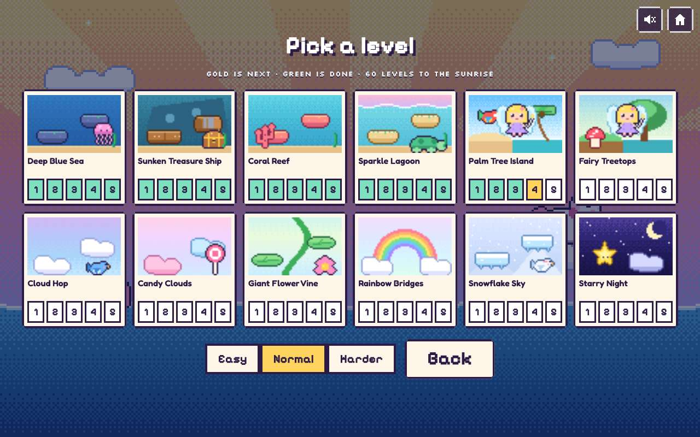 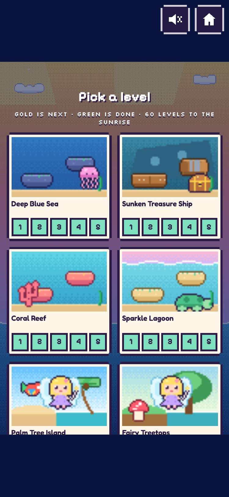

## 31. by touch: Play, Pause and Keep going, the arrow buttons, Sound, a world's level, and the start screen

- phone: Play → the intro → a tap skipped it; Pause stopped the game (tick held at 69); in the pause card, Arrow buttons → on, Sound → "Sound: off", Keep going → playing again; held ▶ (x 40 → 81) and ◀ (→ 51); Start screen → Pick a level → Sunken Treasure Ship → level 8 started; Home on the level picker → the start screen

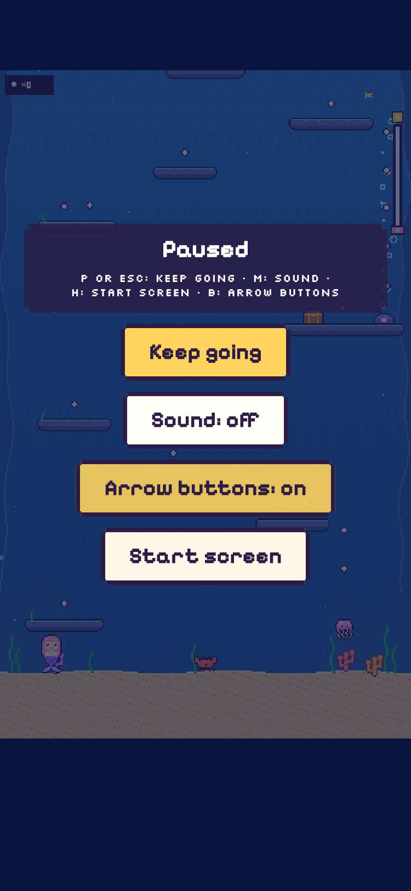

## 32. by keyboard: WASD and the arrows both move and jump, P or Escape pauses, M is Sound, H is Home, B the arrow buttons, and the arrows walk the menus

- desktop: menus: ArrowDown focused "Play", D moved to "Pick a level"; play: D 29, → 34, A -22, ← -31 px; W rose 31, ↑ 28 px; P paused, Escape kept going, Escape paused, P kept going; M switched Sound, B showed and hid the arrow buttons, H went to the start screen; Pick a level → → Enter opened Sunken Treasure Ship, Escape closed it, Enter and → Enter started one of its levels

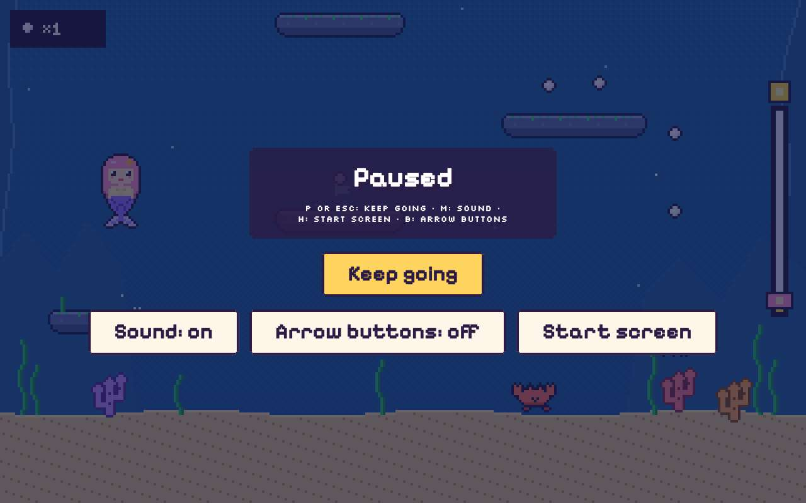

## 33. saves from jeremy.v1 load under the same keys: progress, Normal, Sound off and the arrow buttons

- desktop: seeded jeremy.v1's mfuwg2 (12 levels done, Normal, arrow buttons on), mfuwg-muted=1 and mfuwg {crown} → Normal and Harder shown, Sound off, 12 green squares and level 13 gold, the arrow buttons on in play; after a short play the keys are still mfuwg, mfuwg-muted, mfuwg2 (no new ones)
- phone: seeded jeremy.v1's mfuwg2 (12 levels done, Normal, arrow buttons on), mfuwg-muted=1 and mfuwg {crown} → Normal and Harder shown, Sound off, 12 green squares and level 13 gold, the arrow buttons on in play; after a short play the keys are still mfuwg, mfuwg-muted, mfuwg2 (no new ones)

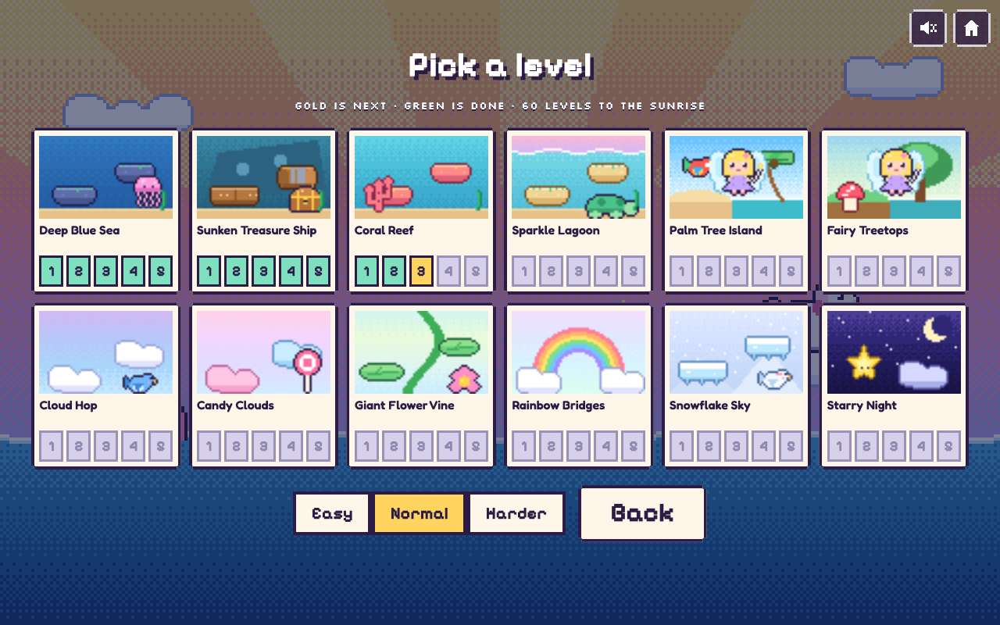 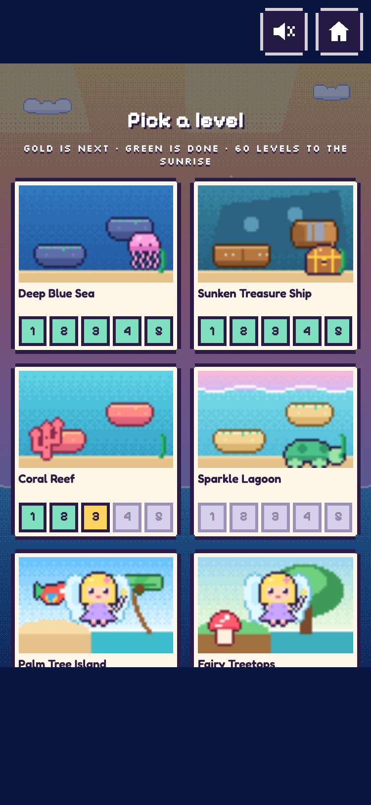

## 34. jeremy.v1 still plays from its folder, and games.json keeps it while jeremy.v2 becomes the default

- desktop: games.json: default jeremy.v2, url games/magic-friends/jeremy.v2/; jeremy.v1 at games/magic-friends/jeremy.v1/ opened and started
- phone: games.json: default jeremy.v2, url games/magic-friends/jeremy.v2/; jeremy.v1 at games/magic-friends/jeremy.v1/ opened and started

## 35. in the arcade, Magic Friends offers both versions and plays jeremy.v2 by default; #magic-friends@jeremy.v1 still opens jeremy.v1

- desktop: card (2 versions) → picker: jeremy.v2 first, "Bigger buttons and a pause" → jeremy.v2 plays in the frame; #magic-friends@jeremy.v1 still opens jeremy.v1
- phone: card (2 versions) → picker: jeremy.v2 first, "Bigger buttons and a pause" → jeremy.v2 plays in the frame; #magic-friends@jeremy.v1 still opens jeremy.v1

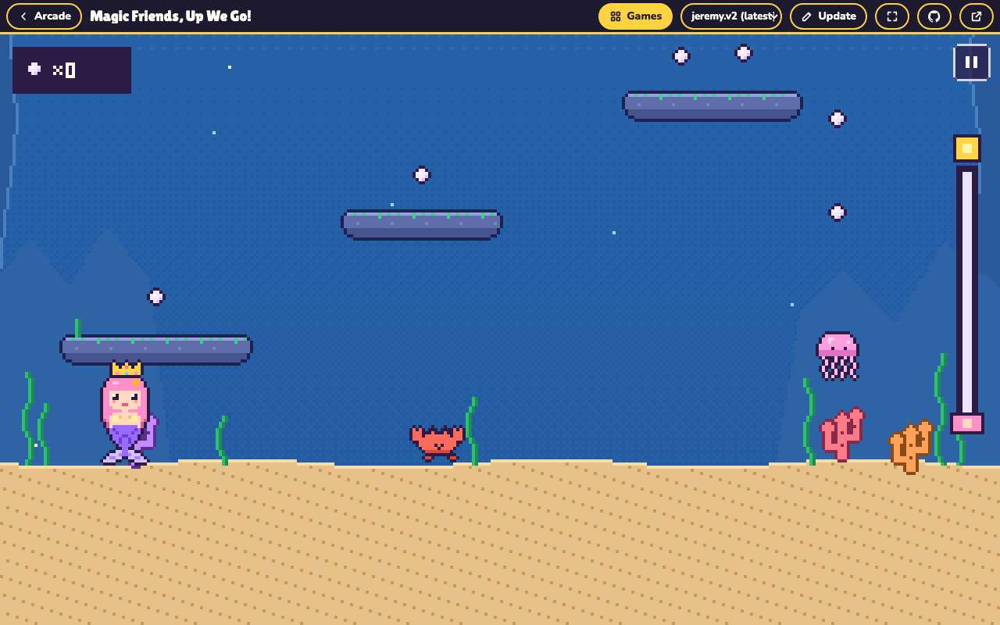 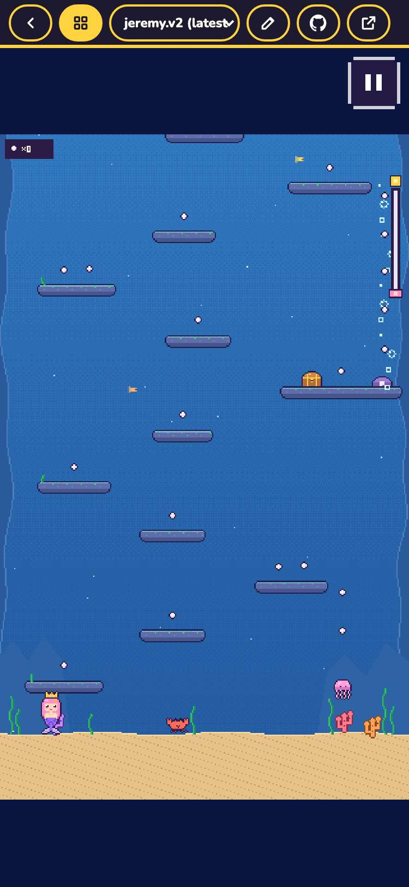
