# Evidence: 226-timedout-jeremy-v2

**PASS: 13 of 13 checks pass at desktop and phone widths.**

Generated by `npm run evidence -- 226-timedout-jeremy-v2` from [`tests/evidence/226-timedout-jeremy-v2.spec.mjs`](../../tests/evidence/226-timedout-jeremy-v2.spec.mjs) against the local server (python3 -m http.server) on this branch, starting from commit c84b314, 2026-10-30 09:08 UTC. Rules: [docs/evidence.md](../../docs/evidence.md).

| Check | Desktop 1280 | Phone 375 |
|---|---|---|
| jeremy.v2 opens to its title screen and starts, with no new outside requests | pass | pass |
| at 375 px wide every button is at least 48 x 48 px, 8 px clear of the others and the edges, and real taps work | pass | pass |
| keys: WASD and the arrows pick a slot and place the card, Enter or Space too, and Escape or P pause | pass | skipped |
| every screen shows everything jeremy.v1 showed, line by line, at seven sizes, with fallback, wide and real fonts, Dad Mode on and off, and the play area is no smaller | pass | pass |
| the phone bar holds with Dad Mode on and off, at all seven sizes, on every screen and state, with cards that wrap to two lines | pass | pass |
| the longest Wikipedia cards on a sideways phone: the timeline keeps room for whole zones, and a real tap reaches them | skipped | pass |
| pausing right after the last wrong guess leaves the game over screen clear | pass | pass |
| what stays still works: a topic game played to the end, the same cards and scoring as jeremy.v1 | pass | pass |
| a jeremy.v1 save loads in jeremy.v2, under the same key, and jeremy.v1 reads what jeremy.v2 writes | pass | pass |
| storage that throws doesn't stop jeremy.v2 | pass | pass |
| jeremy.v1 still opens and plays | pass | pass |
| games.json makes jeremy.v2 the default and still offers jeremy.v1 | pass | pass |
| the arcade plays jeremy.v2 by default, and the version picker still offers jeremy.v1 | pass | pass |

## 1. jeremy.v2 opens to its title screen and starts, with no new outside requests

- desktop: clicked the Space topic and the first card is up; outside hosts: fonts.googleapis.com, fonts.gstatic.com (Google Fonts, inherited from jeremy.v1)
- phone: tapped the Space topic and the first card is up; outside hosts: fonts.googleapis.com, fonts.gstatic.com (Google Fonts, inherited from jeremy.v1)

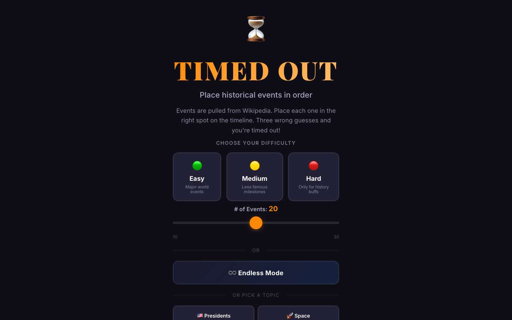 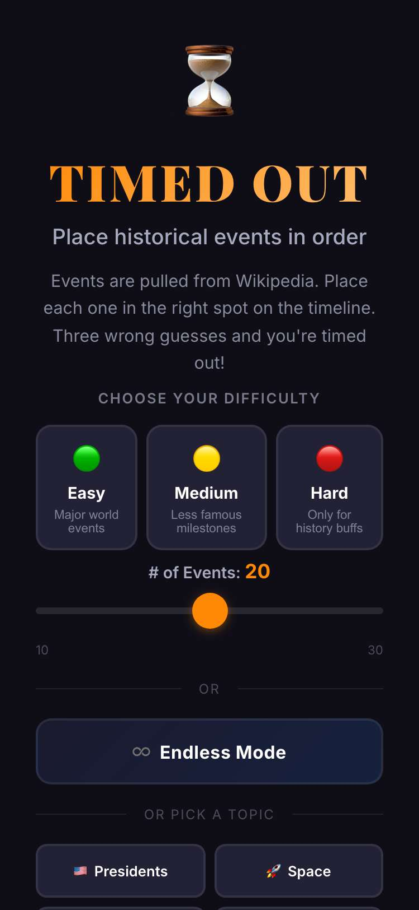

## 2. at 375 px wide every button is at least 48 x 48 px, 8 px clear of the others and the edges, and real taps work

- desktop: at 1280: the X, Read clue and the drop zones are all at least 48 x 48
- phone: the idea's buttons now: ✕ 48x48, Read clue 48x48, a topic 152x48, a drop zone 48x120, the slider 311x48 (jeremy.v1: 28x28, 30x23, 152x44, 44x120, 311x6)
- phone: tapped: the slider (30 events), Dad Mode on and off, Space, a drop zone (score +1), Read clue, ✕ (paused), Keep playing, three wrong drop zones (game over), Main Menu, then ✕ and the pause menu's Main Menu
- phone: title: 7 targets, 0 problems
- phone: title, slider in view: 7 targets, 0 problems
- phone: title, topics in view: 16 targets, 0 problems
- phone: play: 4 targets, 0 problems
- phone: play, after a card: 4 targets, 0 problems
- phone: pause: 2 targets, 0 problems
- phone: game over: 2 targets, 0 problems

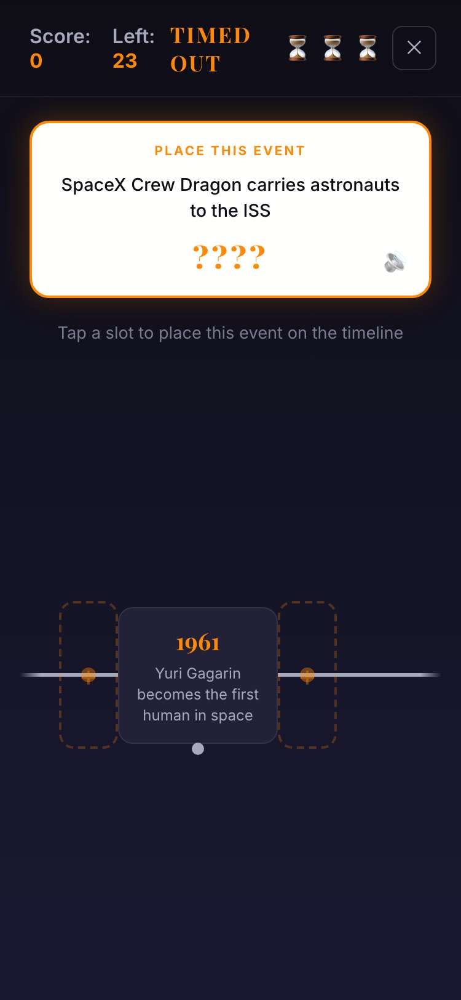

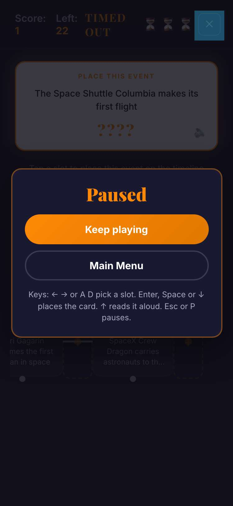

## 3. keys: WASD and the arrows pick a slot and place the card, Enter or Space too, and Escape or P pause

- desktop: title: ArrowDown → easy, ArrowRight → medium, d → hard, a → medium, ArrowLeft → easy, s → event-count, w → medium; on the slider ArrowLeft → 15 events and D → 20
- desktop: in play: D, ArrowRight, A and ArrowLeft each moved the picked slot; W and ArrowUp each read the clue; S, ArrowDown, Enter and Space each placed the card (score +1, one fewer left)
- desktop: P paused (D did nothing) and P unpaused; Escape the same; Escape, ArrowDown, Enter went to the Main Menu, and Enter there started an Easy game

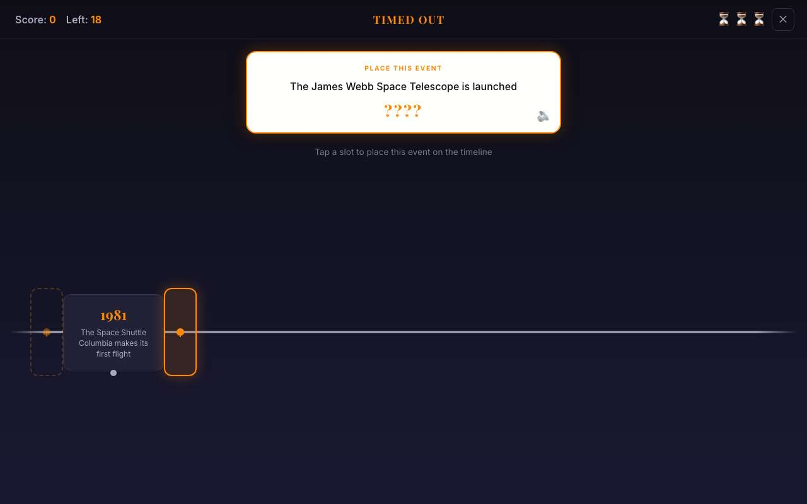

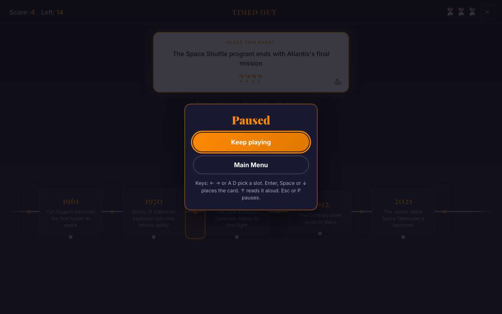

## 4. every screen shows everything jeremy.v1 showed, line by line, at seven sizes, with fallback, wide and real fonts, Dad Mode on and off, and the play area is no smaller

- desktop: 2726 boxes and 2807 lines of text that jeremy.v1 showed whole and uncovered as the player lands (title, play, a card placed with its toast, the next card, game over; fallback fonts, a wider stand-in font and the real fonts, each with Dad Mode on and off, the Dad Mode games on the two-line Presidents cards) are whole, uncovered and no smaller in jeremy.v2; nothing scrolls sideways
- desktop: bigger in jeremy.v2: #event-count, #btn-menu-game, #btn-read-clue, #btn-menu-gameover
- desktop: 1024x768: play area 249–768 (519 px, 14706 of 14877 points clear) in jeremy.v1, 249–768 (519 px, 14706 of 14877) in jeremy.v2
- desktop: 1280x800: play area 249–800 (551 px, 19596 of 19596 points clear) in jeremy.v1, 249–800 (551 px, 19596 of 19596) in jeremy.v2
- desktop: 1366x768: play area 249–768 (519 px, 19608 of 19836 points clear) in jeremy.v1, 249–768 (519 px, 19608 of 19836) in jeremy.v2
- desktop: touch targets in jeremy.v2 on every screen, the pause menu included: 0 problems
- phone: 2432 boxes and 2636 lines of text that jeremy.v1 showed whole and uncovered as the player lands (title, play, a card placed with its toast, the next card, game over; fallback fonts, a wider stand-in font and the real fonts, each with Dad Mode on and off, the Dad Mode games on the two-line Presidents cards) are whole, uncovered and no smaller in jeremy.v2; nothing scrolls sideways
- phone: bigger in jeremy.v2: #event-count, .btn-category, #btn-menu-game, #btn-read-clue, .drop-zone, #btn-menu-gameover
- phone: 375x812: play area 273–812 (539 px, 5580 of 5580 points clear) in jeremy.v1, 273–812 (539 px, 5580 of 5580) in jeremy.v2
- phone: 812x375: play area 249–375 (126 px, 2835 of 2835 points clear) in jeremy.v1, 249–375 (126 px, 2835 of 2835) in jeremy.v2
- phone: 667x375: play area 249–375 (126 px, 2331 of 2331 points clear) in jeremy.v1, 249–375 (126 px, 2331 of 2331) in jeremy.v2
- phone: 740x360: play area 249–360 (111 px, 2214 of 2337 points clear) in jeremy.v1, 249–360 (111 px, 2214 of 2337) in jeremy.v2
- phone: touch targets in jeremy.v2 on every screen, the pause menu included: 0 problems

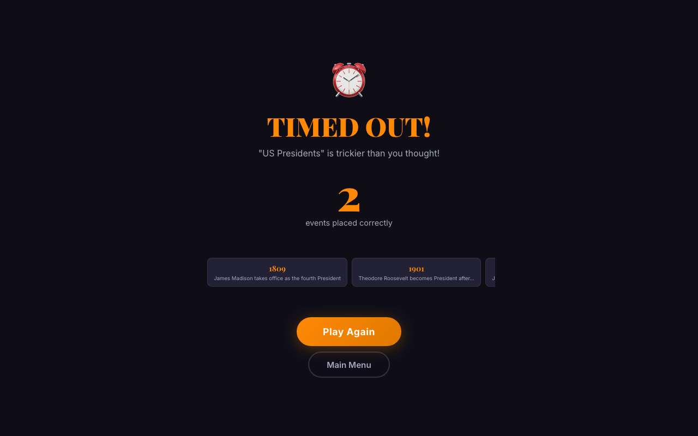

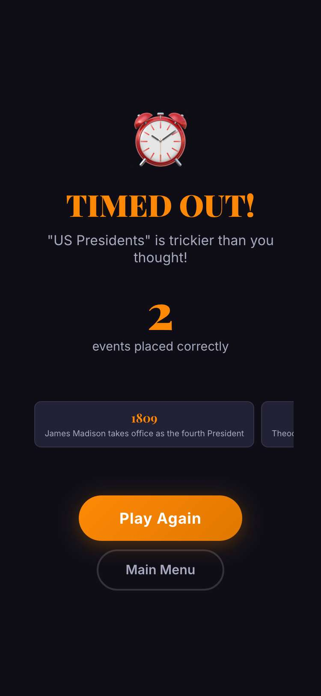

## 5. the phone bar holds with Dad Mode on and off, at all seven sizes, on every screen and state, with cards that wrap to two lines

- desktop: 228 touchTargets() runs on Dad Mode on and off, fallback and real fonts, 3 sizes: title, title scrolled to the end, play, pause, each card placed with its toast, the next card, wrong guesses, game over, Endless and its Reset Events: 0 problems
- desktop: 27 of the cards dealt ran to two lines or more; every drop zone stayed at least 48 px tall and whole inside the timeline
- phone: Dad Mode on, 740x360, Presidents, fallback fonts: timeline 299–360, zones 304–352, 48 px tall, 9 px from the bottom edge, 2 lines of clue
- phone: Dad Mode on, 740x360, Presidents, real fonts: timeline 304–360, zones 304–352, 48 px tall, 8 px from the bottom edge, 2 lines of clue
- phone: 304 touchTargets() runs on Dad Mode on and off, fallback and real fonts, 4 sizes: title, title scrolled to the end, play, pause, each card placed with its toast, the next card, wrong guesses, game over, Endless and its Reset Events: 0 problems
- phone: 51 of the cards dealt ran to two lines or more; every drop zone stayed at least 48 px tall and whole inside the timeline

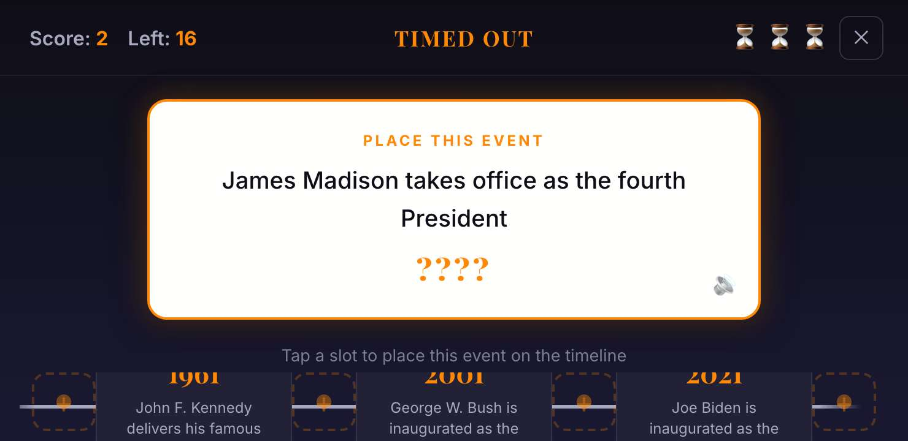

## 6. the longest Wikipedia cards on a sideways phone: the timeline keeps room for whole zones, and a real tap reaches them

- phone: 812x375, Dad Mode on, the same first card of over 150 characters: timeline 15 px tall in jeremy.v1, 56 px in jeremy.v2
- phone: 812x375, Dad Mode off, the same first card of over 150 characters: timeline 78 px tall in jeremy.v1, 78 px in jeremy.v2
- phone: 667x375, Dad Mode on, the same first card of over 150 characters: timeline 15 px tall in jeremy.v1, 56 px in jeremy.v2
- phone: 667x375, Dad Mode off, the same first card of over 150 characters: timeline 78 px tall in jeremy.v1, 78 px in jeremy.v2
- phone: 740x360, Dad Mode on, the same first card of over 150 characters: timeline 0 px tall in jeremy.v1, 56 px in jeremy.v2
- phone: 740x360, Dad Mode off, the same first card of over 150 characters: timeline 63 px tall in jeremy.v1, 63 px in jeremy.v2
- phone: the longest card ran to 4 lines

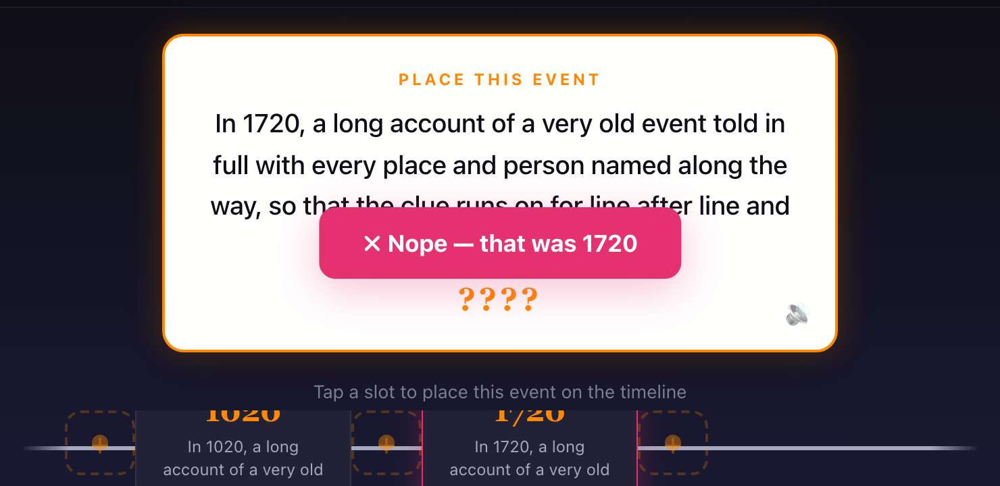

## 7. pausing right after the last wrong guess leaves the game over screen clear

- desktop: the X and Escape during the last wrong guess's 1.5 s do nothing; the game over screen comes up clear
- phone: the X and Escape during the last wrong guess's 1.5 s do nothing; the game over screen comes up clear

## 8. what stays still works: a topic game played to the end, the same cards and scoring as jeremy.v1

- desktop: 10 Space events: 8 right and 1 wrong, then YOU WIN! with all 10 on the final timeline
- phone: 10 Space events: 8 right and 1 wrong, then YOU WIN! with all 10 on the final timeline

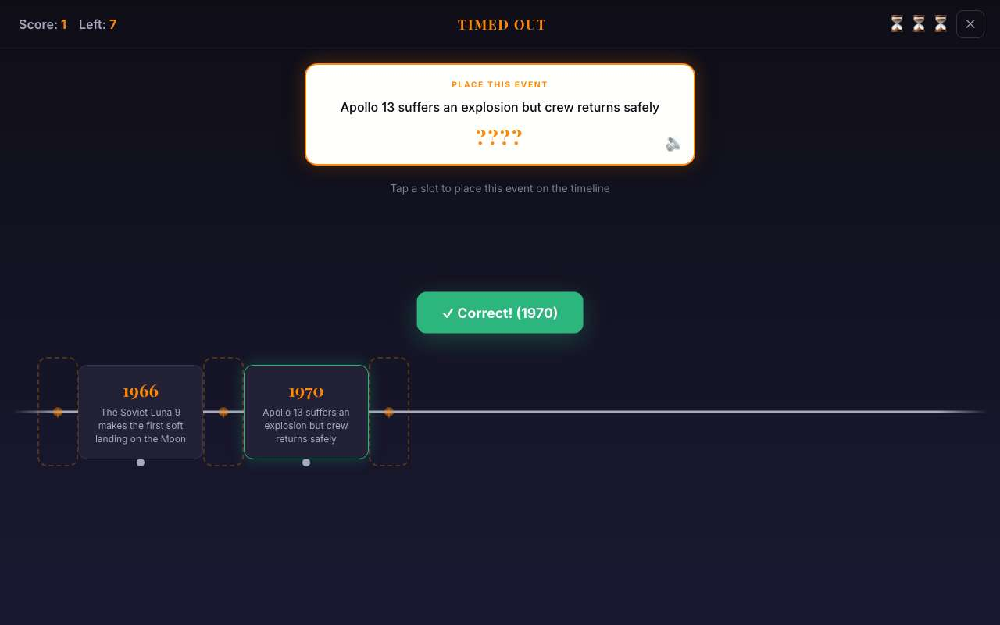 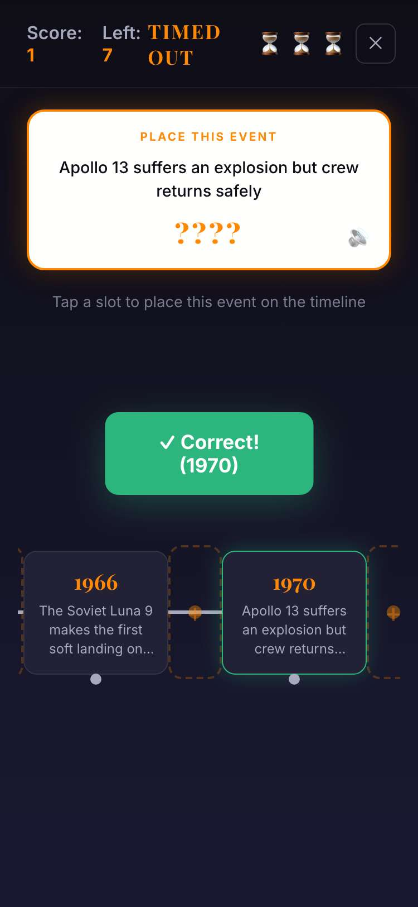

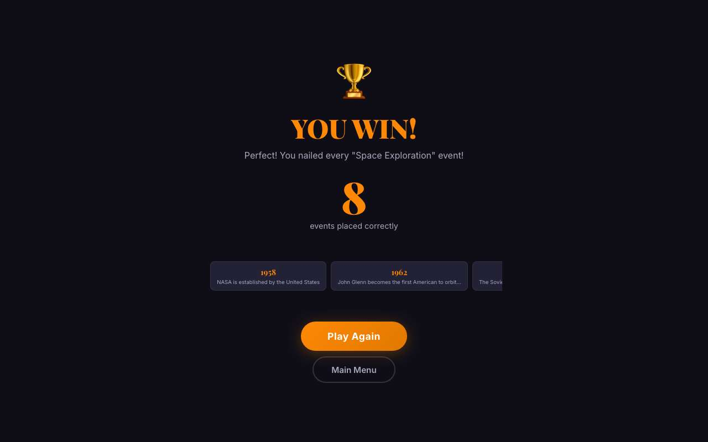 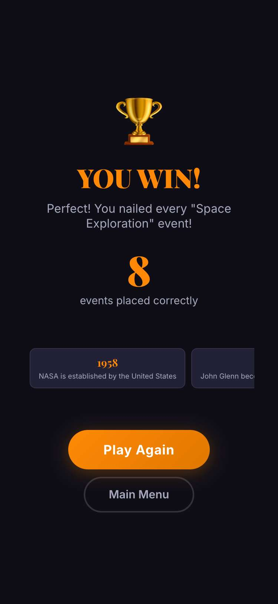

## 9. a jeremy.v1 save loads in jeremy.v2, under the same key, and jeremy.v1 reads what jeremy.v2 writes

- desktop: seeded dadMode = "true" → jeremy.v2 opened in Dad Mode; turning it off saved dadMode = "false" (the only key), and jeremy.v1 then opened with Dad Mode off
- phone: seeded dadMode = "true" → jeremy.v2 opened in Dad Mode; turning it off saved dadMode = "false" (the only key), and jeremy.v1 then opened with Dad Mode off

## 10. storage that throws doesn't stop jeremy.v2

- desktop: with localStorage throwing, the title opens, Dad Mode toggles and a game starts
- phone: with localStorage throwing, the title opens, Dad Mode toggles and a game starts

## 11. jeremy.v1 still opens and plays

- desktop: games/timedout/jeremy.v1/: Space topic, then a drop zone placed the card (Left: 18 → 17)
- phone: games/timedout/jeremy.v1/: Space topic, then a drop zone placed the card (Left: 18 → 17)

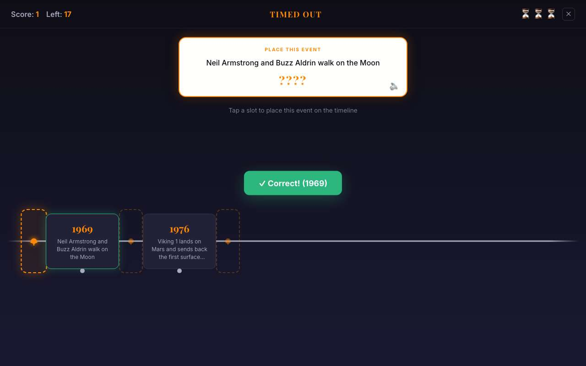 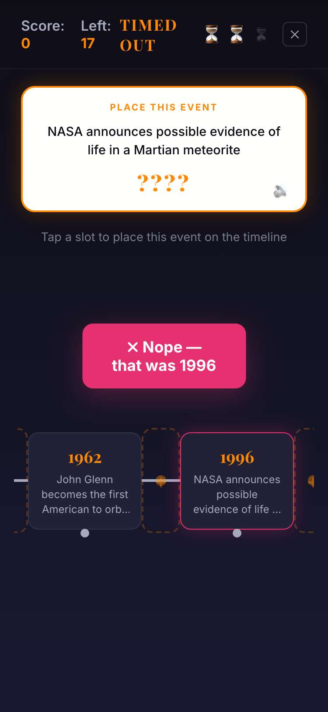

## 12. games.json makes jeremy.v2 the default and still offers jeremy.v1

- desktop: default jeremy.v2 at games/timedout/jeremy.v2/; jeremy.v1 still at games/timedout/jeremy.v1/
- phone: default jeremy.v2 at games/timedout/jeremy.v2/; jeremy.v1 still at games/timedout/jeremy.v1/

## 13. the arcade plays jeremy.v2 by default, and the version picker still offers jeremy.v1

- desktop: card → picker (jeremy.v2 Latest, jeremy.v1) → jeremy.v2 plays in the frame; #timedout@jeremy.v1 opens jeremy.v1
- phone: card → picker (jeremy.v2 Latest, jeremy.v1) → jeremy.v2 plays in the frame; #timedout@jeremy.v1 opens jeremy.v1

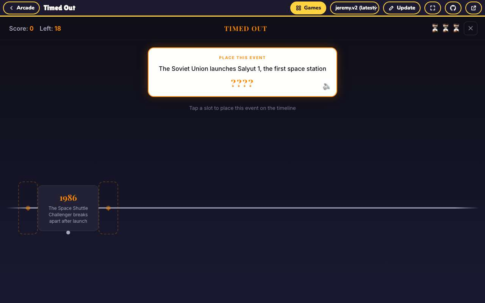 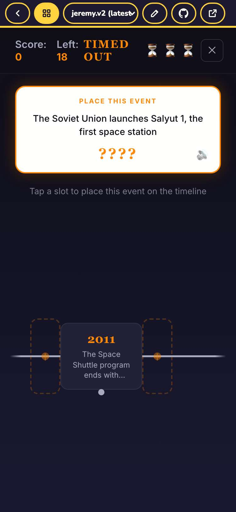
