# Evidence: 231-delve-squad-jeremy-v2

**PASS: 14 of 14 checks pass at desktop and phone widths.**

Generated by `npm run evidence -- 231-delve-squad-jeremy-v2` from [`tests/evidence/231-delve-squad-jeremy-v2.spec.mjs`](../../tests/evidence/231-delve-squad-jeremy-v2.spec.mjs) against the local server (python3 -m http.server) on this branch, starting from commit d58b013, 2026-10-30 08:00 UTC. Rules: [docs/evidence.md](../../docs/evidence.md).

| Check | Desktop 1280 | Phone 375 |
|---|---|---|
| jeremy.v2 opens to its title screen and starts, with nothing loaded from the internet | pass | pass |
| every button is 48 x 48 or bigger, 8 px apart and from the edges, and each tap does its job | pass | pass |
| WASD and the arrows both pick heroes and loot, Space takes a card, and P or Escape pauses | pass | skipped |
| at 375 x 812 every screen shows everything jeremy.v1 showed, with real, fallback and wide fonts | skipped | pass |
| at 812 x 375 every screen shows everything jeremy.v1 showed, with real, fallback and wide fonts | skipped | pass |
| at 667 x 375 every screen shows everything jeremy.v1 showed, with real, fallback and wide fonts | skipped | pass |
| at 740 x 360 every screen shows everything jeremy.v1 showed, with real, fallback and wide fonts | skipped | pass |
| at 1024 x 768 every screen shows everything jeremy.v1 showed, with real, fallback and wide fonts | pass | skipped |
| at 1280 x 800 every screen shows everything jeremy.v1 showed, with real, fallback and wide fonts | pass | skipped |
| at 1366 x 768 every screen shows everything jeremy.v1 showed, with real, fallback and wide fonts | pass | skipped |
| what stays still works: the squad clears the first room, the Rat King waits on Floor 5 | pass | pass |
| jeremy.v1's saves load in jeremy.v2 under the same keys | pass | pass |
| jeremy.v1 still plays at games/delve-squad/ | pass | pass |
| in the arcade, Delve Squad offers both versions and plays jeremy.v2 by default; #delve-squad@jeremy.v1 still opens jeremy.v1 | pass | pass |

## 1. jeremy.v2 opens to its title screen and starts, with nothing loaded from the internet

- desktop: clicked Start a delve, three classes, Delve! and Delve to Floor 1: the fight is on; 5 requests, all to this site; no sideways scrolling
- phone: tapped Start a delve, three classes, Delve! and Delve to Floor 1: the fight is on; 5 requests, all to this site; no sideways scrolling

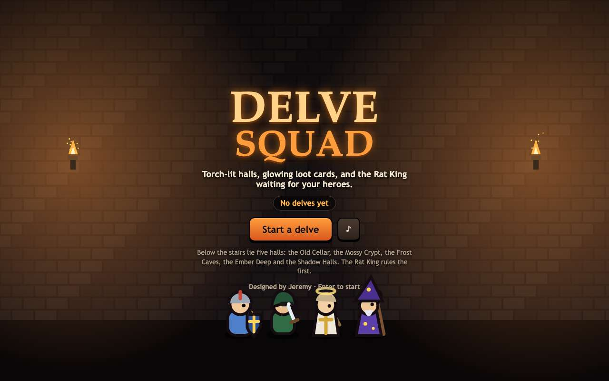 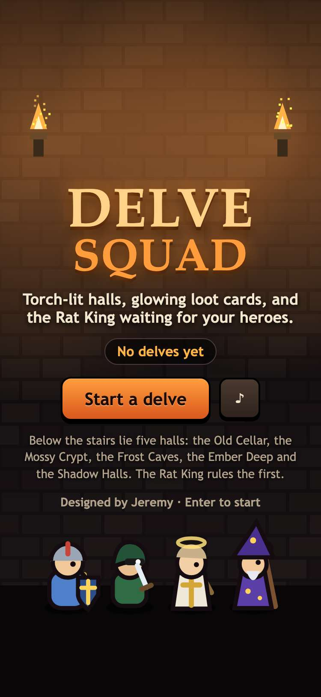

 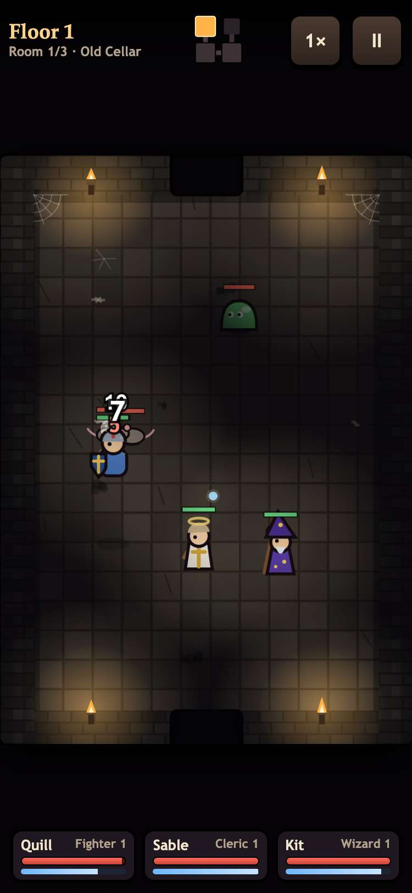

## 2. every button is 48 x 48 or bigger, 8 px apart and from the edges, and each tap does its job

- desktop: clicked Sound (48x48, off and on), Start, three classes, Delve!, a hero, a card, Pause and Keep going, Delve, speed (1x to 2x), Pause, Start over, Same squad; touch targets with no problems: title 2; squad 10; squad, three picked 10; campfire 10; campfire, one card taken 10; paused at the campfire 4; delve 2; paused in the delve 4; game over 3
- desktop: campfire: Pause 48x48 at 8 px from the top and 8 from the right; hero cards 8 and 8 px apart; loot cards 10 px apart; delve: speed 48x48 and Pause 48x48, 8 px apart
- phone: tapped (touchscreen) Sound (48x48, off and on), Start, three classes, Delve!, a hero, a card, Pause and Keep going, Delve, speed (1x to 2x), Pause, Start over, Same squad; touch targets with no problems: title 2; squad 10; squad, three picked 10; campfire 10; campfire, one card taken 10; paused at the campfire 4; delve 2; paused in the delve 4; game over 3
- phone: campfire: Pause 48x48 at 8 px from the top and 8 from the right; hero cards 8 and 8 px apart; loot cards 8 px apart; delve: speed 48x48 and Pause 48x48, 8 px apart

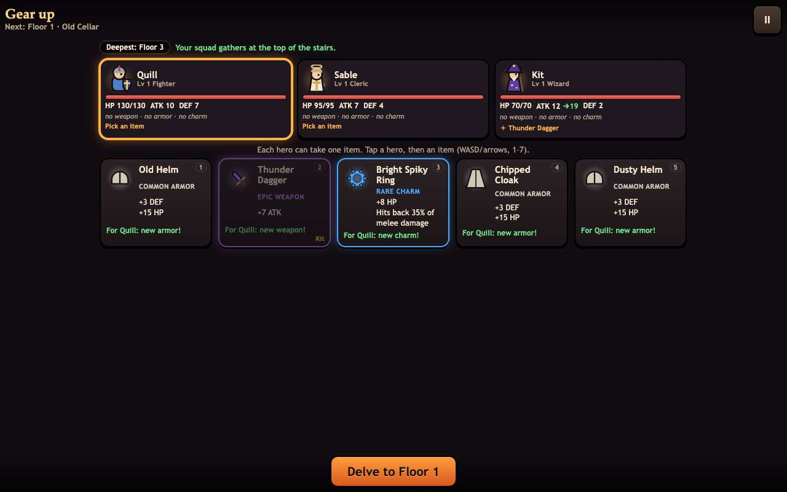 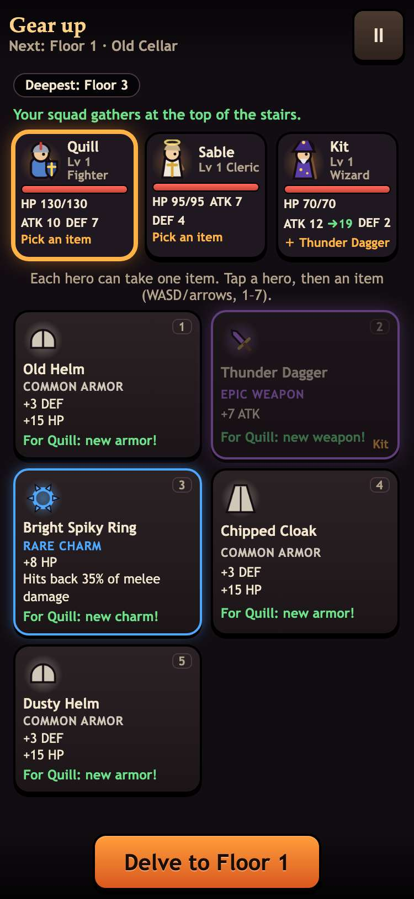

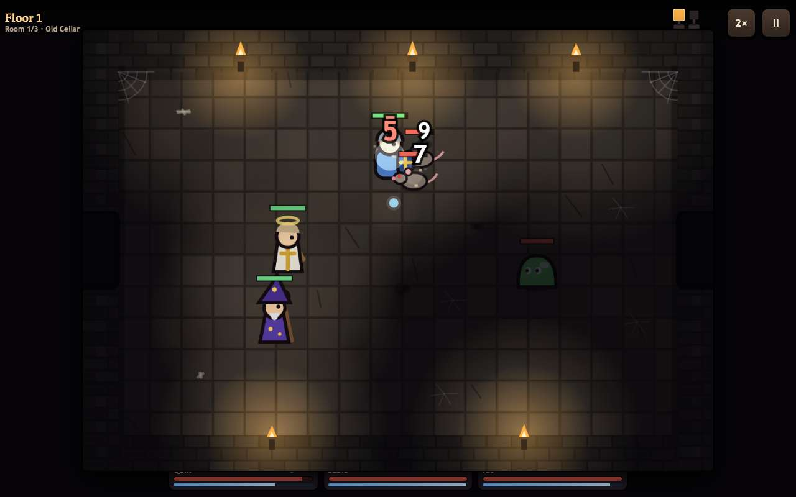 

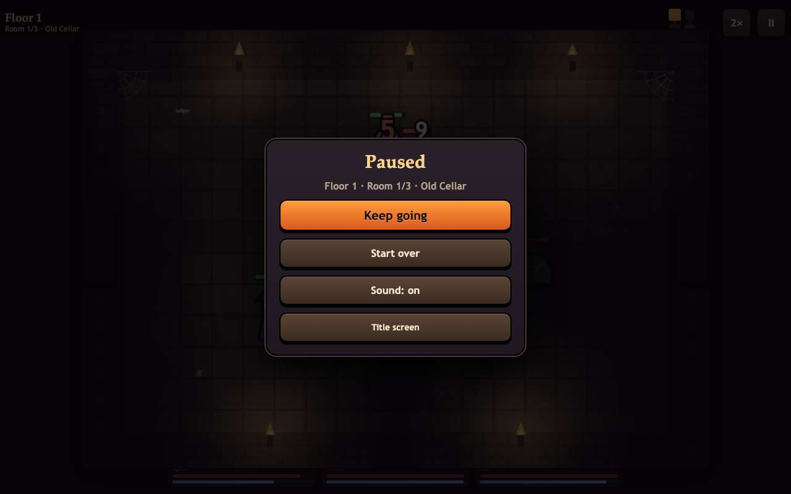 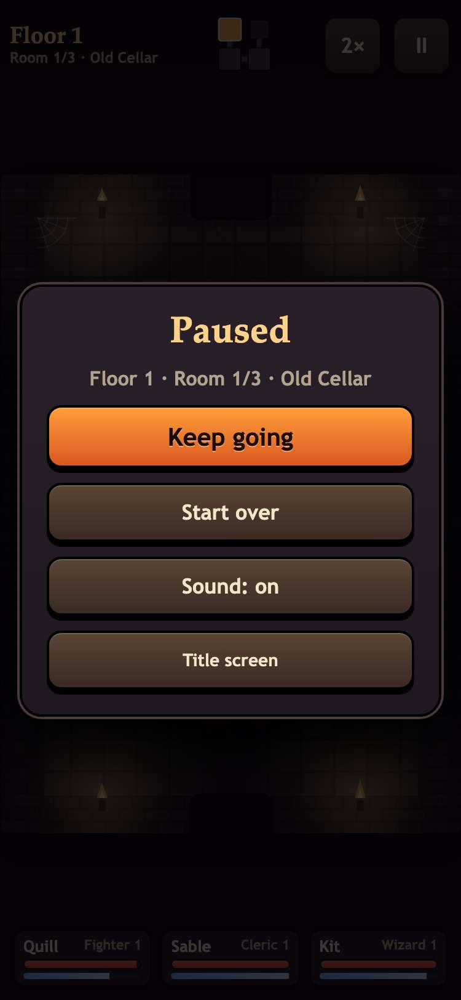

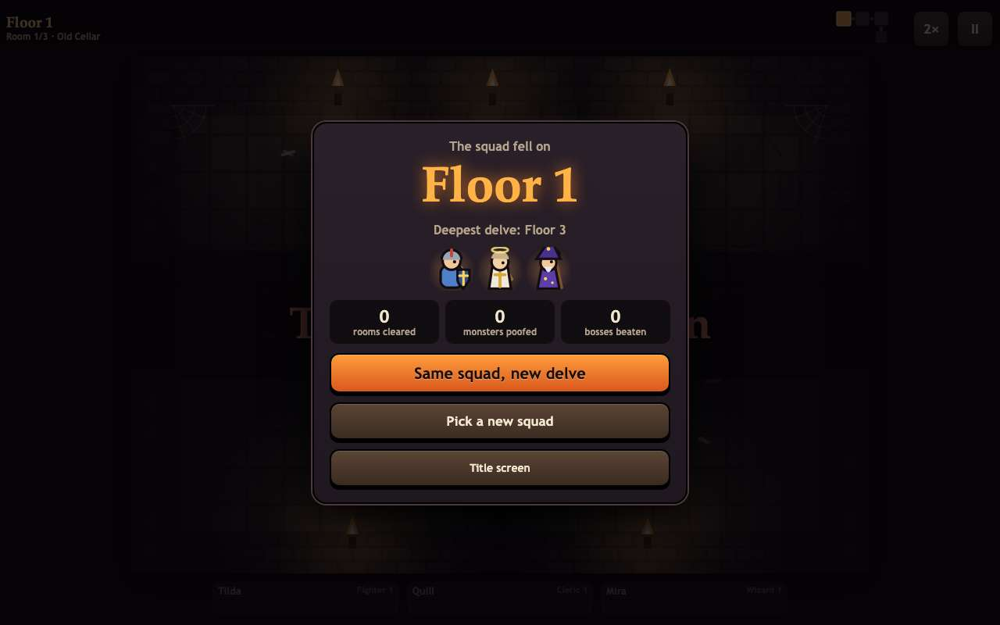 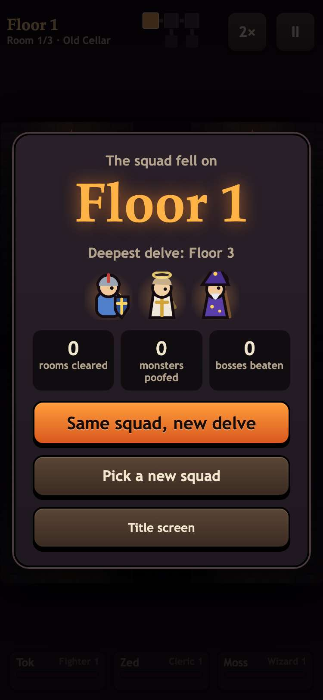

## 3. WASD and the arrows both pick heroes and loot, Space takes a card, and P or Escape pauses

- desktop: squad screen (4 columns): d→card 2, ArrowRight→card 3, a→card 2, ArrowLeft→card 1, s→card 2, w→card 1, ArrowDown→card 2, ArrowUp→card 1; Space added Fighter, Cleric, Wizard
- desktop: campfire heroes: d→hero 2, ArrowRight→hero 3, a→hero 2, ArrowLeft→hero 1, D→hero 2, A→hero 1; loot: s→card 2, ArrowDown→card 3, w→card 2, ArrowUp→card 1, ArrowUp (wraps)→card 5, S→card 1; Space gave card 3 to the Fighter, key 4 gave card 4 to the Cleric; P paused and Escape resumed at the campfire, Escape paused and P resumed in the fight

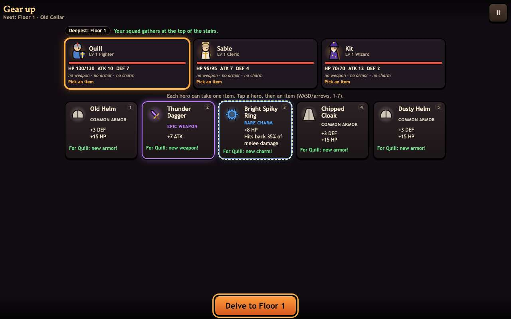

## 4. at 375 x 812 every screen shows everything jeremy.v1 showed, with real, fallback and wide fonts

- phone: real fonts: all 374 lines jeremy.v1 showed whole on its 12 screens (title, squad, squad, three picked, campfire, campfire, a card taken, paused at the campfire, delve, paused in the delve, boss-floor campfire, boss room, campfire after the boss, game over) are whole, uncovered and as big in jeremy.v2; arena 375x535 -> 375x535, top bar ends at 72 -> 72, squad bar starts at 746 -> 746, uncovered 100% -> 100%
- phone: fallback fonts: all 375 lines jeremy.v1 showed whole on its 12 screens (title, squad, squad, three picked, campfire, campfire, a card taken, paused at the campfire, delve, paused in the delve, boss-floor campfire, boss room, campfire after the boss, game over) are whole, uncovered and as big in jeremy.v2; arena 375x535 -> 375x535, top bar ends at 72 -> 72, squad bar starts at 746 -> 746, uncovered 100% -> 100%
- phone: wide fonts: all 386 lines jeremy.v1 showed whole on its 12 screens (title, squad, squad, three picked, campfire, campfire, a card taken, paused at the campfire, delve, paused in the delve, boss-floor campfire, boss room, campfire after the boss, game over) are whole, uncovered and as big in jeremy.v2; arena 375x535 -> 375x535, top bar ends at 72 -> 72, squad bar starts at 745 -> 745, uncovered 100% -> 100%

## 5. at 812 x 375 every screen shows everything jeremy.v1 showed, with real, fallback and wide fonts

- phone: real fonts: all 269 lines jeremy.v1 showed whole on its 12 screens (title, squad, squad, three picked, campfire, campfire, a card taken, paused at the campfire, delve, paused in the delve, boss-floor campfire, boss room, campfire after the boss, game over) are whole, uncovered and as big in jeremy.v2; arena 407x285 -> 407x285, top bar ends at 72 -> 72, squad bar starts at 309 -> 309, uncovered 100% -> 100%
- phone: fallback fonts: all 269 lines jeremy.v1 showed whole on its 12 screens (title, squad, squad, three picked, campfire, campfire, a card taken, paused at the campfire, delve, paused in the delve, boss-floor campfire, boss room, campfire after the boss, game over) are whole, uncovered and as big in jeremy.v2; arena 407x285 -> 407x285, top bar ends at 72 -> 72, squad bar starts at 309 -> 309, uncovered 100% -> 100%
- phone: wide fonts: all 263 lines jeremy.v1 showed whole on its 12 screens (title, squad, squad, three picked, campfire, campfire, a card taken, paused at the campfire, delve, paused in the delve, boss-floor campfire, boss room, campfire after the boss, game over) are whole, uncovered and as big in jeremy.v2; arena 407x285 -> 407x285, top bar ends at 72 -> 72, squad bar starts at 308 -> 308, uncovered 100% -> 100%

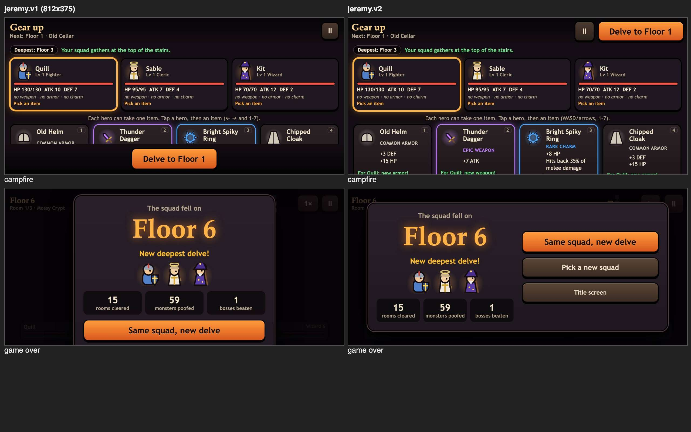

## 6. at 667 x 375 every screen shows everything jeremy.v1 showed, with real, fallback and wide fonts

- phone: real fonts: all 191 lines jeremy.v1 showed whole on its 12 screens (title, squad, squad, three picked, campfire, campfire, a card taken, paused at the campfire, delve, paused in the delve, boss-floor campfire, boss room, campfire after the boss, game over) are whole, uncovered and as big in jeremy.v2; arena 407x285 -> 407x285, top bar ends at 72 -> 72, squad bar starts at 309 -> 309, uncovered 100% -> 100%
- phone: fallback fonts: all 191 lines jeremy.v1 showed whole on its 12 screens (title, squad, squad, three picked, campfire, campfire, a card taken, paused at the campfire, delve, paused in the delve, boss-floor campfire, boss room, campfire after the boss, game over) are whole, uncovered and as big in jeremy.v2; arena 407x285 -> 407x285, top bar ends at 72 -> 72, squad bar starts at 309 -> 309, uncovered 100% -> 100%
- phone: wide fonts: all 190 lines jeremy.v1 showed whole on its 12 screens (title, squad, squad, three picked, campfire, campfire, a card taken, paused at the campfire, delve, paused in the delve, boss-floor campfire, boss room, campfire after the boss, game over) are whole, uncovered and as big in jeremy.v2; arena 407x285 -> 407x285, top bar ends at 72 -> 72, squad bar starts at 308 -> 308, uncovered 100% -> 100%

## 7. at 740 x 360 every screen shows everything jeremy.v1 showed, with real, fallback and wide fonts

- phone: real fonts: all 248 lines jeremy.v1 showed whole on its 12 screens (title, squad, squad, three picked, campfire, campfire, a card taken, paused at the campfire, delve, paused in the delve, boss-floor campfire, boss room, campfire after the boss, game over) are whole, uncovered and as big in jeremy.v2; arena 385x270 -> 385x270, top bar ends at 72 -> 72, squad bar starts at 294 -> 294, uncovered 100% -> 100%
- phone: fallback fonts: all 248 lines jeremy.v1 showed whole on its 12 screens (title, squad, squad, three picked, campfire, campfire, a card taken, paused at the campfire, delve, paused in the delve, boss-floor campfire, boss room, campfire after the boss, game over) are whole, uncovered and as big in jeremy.v2; arena 385x270 -> 385x270, top bar ends at 72 -> 72, squad bar starts at 294 -> 294, uncovered 100% -> 100%
- phone: wide fonts: all 242 lines jeremy.v1 showed whole on its 12 screens (title, squad, squad, three picked, campfire, campfire, a card taken, paused at the campfire, delve, paused in the delve, boss-floor campfire, boss room, campfire after the boss, game over) are whole, uncovered and as big in jeremy.v2; arena 385x270 -> 385x270, top bar ends at 72 -> 72, squad bar starts at 293 -> 293, uncovered 100% -> 100%

## 8. at 1024 x 768 every screen shows everything jeremy.v1 showed, with real, fallback and wide fonts

- desktop: real fonts: all 414 lines jeremy.v1 showed whole on its 12 screens (title, squad, squad, three picked, campfire, campfire, a card taken, paused at the campfire, delve, paused in the delve, boss-floor campfire, boss room, campfire after the boss, game over) are whole, uncovered and as big in jeremy.v2; arena 968x678 -> 968x678, top bar ends at 72 -> 72, squad bar starts at 702 -> 702, uncovered 100% -> 100%
- desktop: fallback fonts: all 416 lines jeremy.v1 showed whole on its 12 screens (title, squad, squad, three picked, campfire, campfire, a card taken, paused at the campfire, delve, paused in the delve, boss-floor campfire, boss room, campfire after the boss, game over) are whole, uncovered and as big in jeremy.v2; arena 968x678 -> 968x678, top bar ends at 72 -> 72, squad bar starts at 702 -> 702, uncovered 100% -> 100%
- desktop: wide fonts: all 459 lines jeremy.v1 showed whole on its 12 screens (title, squad, squad, three picked, campfire, campfire, a card taken, paused at the campfire, delve, paused in the delve, boss-floor campfire, boss room, campfire after the boss, game over) are whole, uncovered and as big in jeremy.v2; arena 968x678 -> 968x678, top bar ends at 72 -> 72, squad bar starts at 701 -> 701, uncovered 100% -> 100%

## 9. at 1280 x 800 every screen shows everything jeremy.v1 showed, with real, fallback and wide fonts

- desktop: real fonts: all 414 lines jeremy.v1 showed whole on its 12 screens (title, squad, squad, three picked, campfire, campfire, a card taken, paused at the campfire, delve, paused in the delve, boss-floor campfire, boss room, campfire after the boss, game over) are whole, uncovered and as big in jeremy.v2; arena 1014x710 -> 1014x710, top bar ends at 72 -> 72, squad bar starts at 734 -> 734, uncovered 100% -> 100%
- desktop: fallback fonts: all 416 lines jeremy.v1 showed whole on its 12 screens (title, squad, squad, three picked, campfire, campfire, a card taken, paused at the campfire, delve, paused in the delve, boss-floor campfire, boss room, campfire after the boss, game over) are whole, uncovered and as big in jeremy.v2; arena 1014x710 -> 1014x710, top bar ends at 72 -> 72, squad bar starts at 734 -> 734, uncovered 100% -> 100%
- desktop: wide fonts: all 459 lines jeremy.v1 showed whole on its 12 screens (title, squad, squad, three picked, campfire, campfire, a card taken, paused at the campfire, delve, paused in the delve, boss-floor campfire, boss room, campfire after the boss, game over) are whole, uncovered and as big in jeremy.v2; arena 1014x710 -> 1014x710, top bar ends at 72 -> 72, squad bar starts at 733 -> 733, uncovered 100% -> 100%

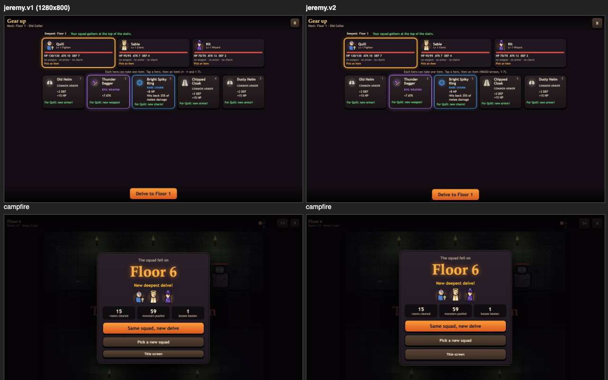

## 10. at 1366 x 768 every screen shows everything jeremy.v1 showed, with real, fallback and wide fonts

- desktop: real fonts: all 414 lines jeremy.v1 showed whole on its 12 screens (title, squad, squad, three picked, campfire, campfire, a card taken, paused at the campfire, delve, paused in the delve, boss-floor campfire, boss room, campfire after the boss, game over) are whole, uncovered and as big in jeremy.v2; arena 968x678 -> 968x678, top bar ends at 72 -> 72, squad bar starts at 702 -> 702, uncovered 100% -> 100%
- desktop: fallback fonts: all 416 lines jeremy.v1 showed whole on its 12 screens (title, squad, squad, three picked, campfire, campfire, a card taken, paused at the campfire, delve, paused in the delve, boss-floor campfire, boss room, campfire after the boss, game over) are whole, uncovered and as big in jeremy.v2; arena 968x678 -> 968x678, top bar ends at 72 -> 72, squad bar starts at 702 -> 702, uncovered 100% -> 100%
- desktop: wide fonts: all 460 lines jeremy.v1 showed whole on its 12 screens (title, squad, squad, three picked, campfire, campfire, a card taken, paused at the campfire, delve, paused in the delve, boss-floor campfire, boss room, campfire after the boss, game over) are whole, uncovered and as big in jeremy.v2; arena 968x678 -> 968x678, top bar ends at 72 -> 72, squad bar starts at 701 -> 701, uncovered 100% -> 100%

## 11. what stays still works: the squad clears the first room, the Rat King waits on Floor 5

- desktop: room 1's 3 monsters poofed; Floor 5's campfire names the Rat King; with seed 42 Floor 5's loot is the same in jeremy.v1 and jeremy.v2: Chipped Plate, Old Robe, Sturdy Sword, Bright Power Rune, Little Lucky Clover
- phone: room 1's 3 monsters poofed; Floor 5's campfire names the Rat King; with seed 42 Floor 5's loot is the same in jeremy.v1 and jeremy.v2: Chipped Plate, Old Robe, Sturdy Sword, Bright Power Rune, Little Lucky Clover

## 12. jeremy.v1's saves load in jeremy.v2 under the same keys

- desktop: seeded best 7, runs 12, sound off; jeremy.v2 showed Floor 7 and sound off, then saved runs 13 under the same three keys (gameon.delve-squad.runs, gameon.delve-squad.sound, gameon.delve-squad.best); jeremy.v1 still reads them
- phone: seeded best 7, runs 12, sound off; jeremy.v2 showed Floor 7 and sound off, then saved runs 13 under the same three keys (gameon.delve-squad.runs, gameon.delve-squad.sound, gameon.delve-squad.best); jeremy.v1 still reads them

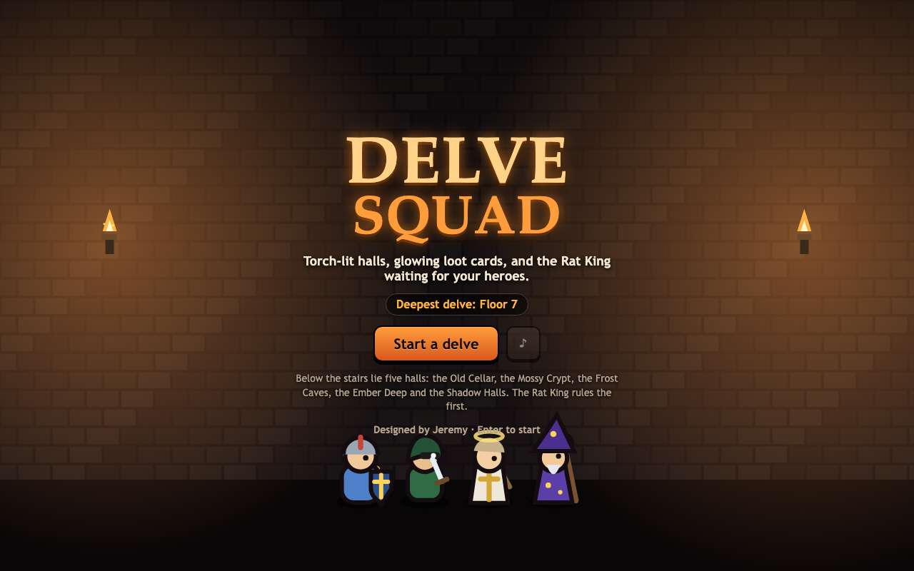 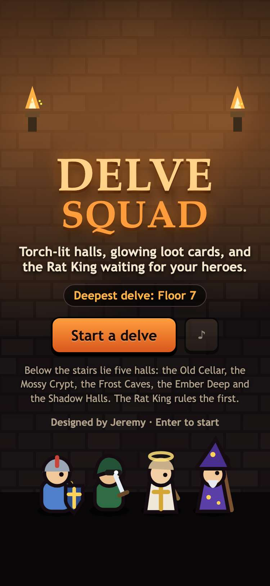

## 13. jeremy.v1 still plays at games/delve-squad/

- desktop: jeremy.v1 opened at games/delve-squad/, took a squad to the campfire and cleared the first room; games.json lists jeremy.v1 at games/delve-squad/ and jeremy.v2 at games/delve-squad/jeremy.v2/
- phone: jeremy.v1 opened at games/delve-squad/, took a squad to the campfire and cleared the first room; games.json lists jeremy.v1 at games/delve-squad/ and jeremy.v2 at games/delve-squad/jeremy.v2/

## 14. in the arcade, Delve Squad offers both versions and plays jeremy.v2 by default; #delve-squad@jeremy.v1 still opens jeremy.v1

- desktop: card (2 versions) → picker: jeremy.v2 first, "Bigger buttons, and WASD at the campfire" → jeremy.v2 plays in the frame (title, random squad, campfire, first room); #delve-squad@jeremy.v1 still opens jeremy.v1
- phone: card (2 versions) → picker: jeremy.v2 first, "Bigger buttons, and WASD at the campfire" → jeremy.v2 plays in the frame (title, random squad, campfire, first room); #delve-squad@jeremy.v1 still opens jeremy.v1

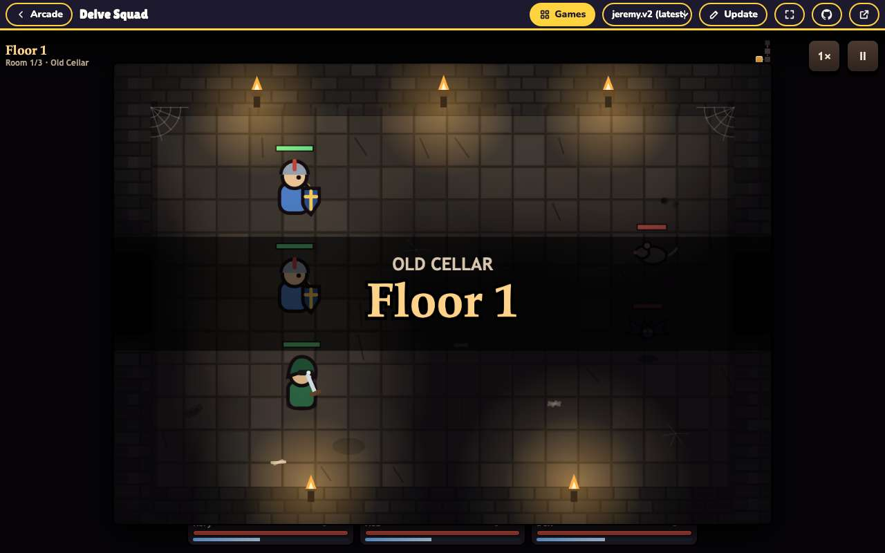 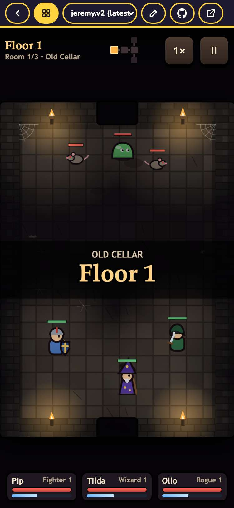
