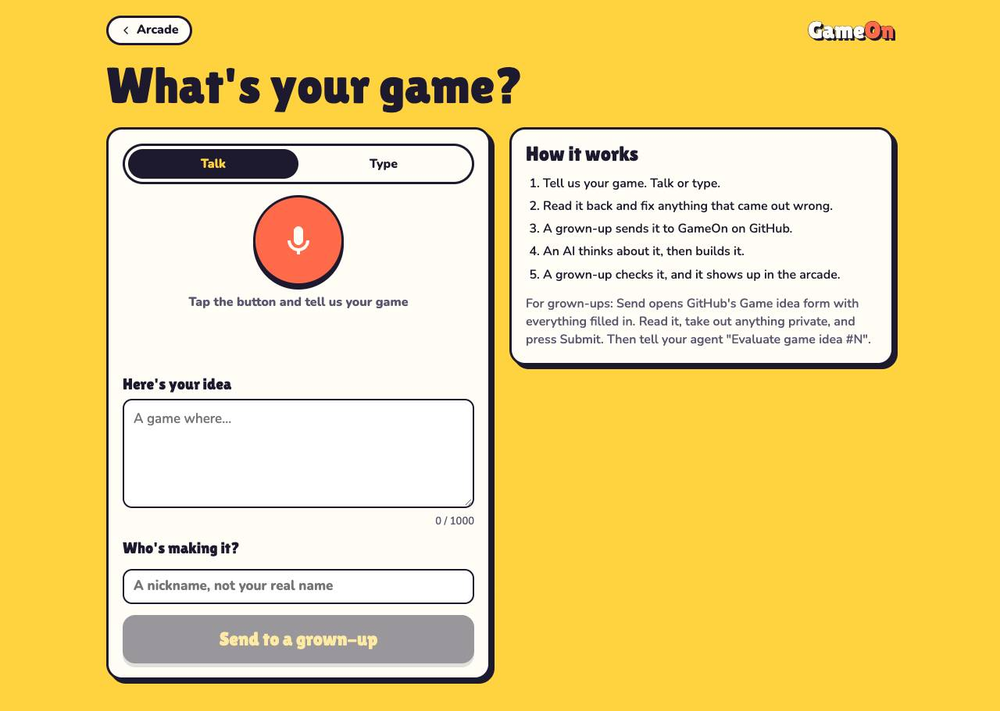
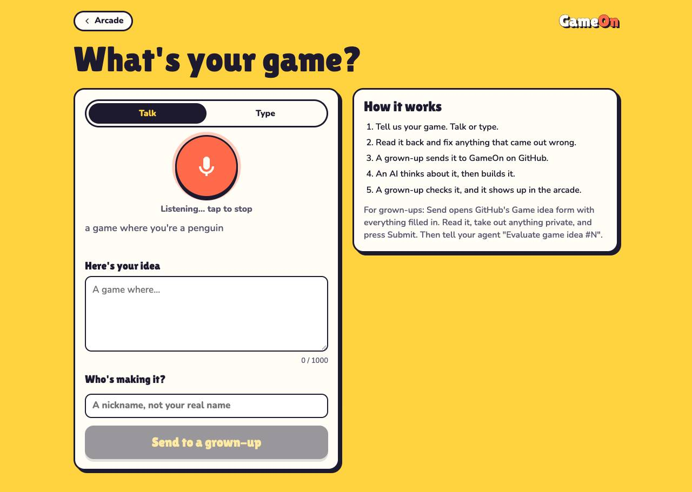
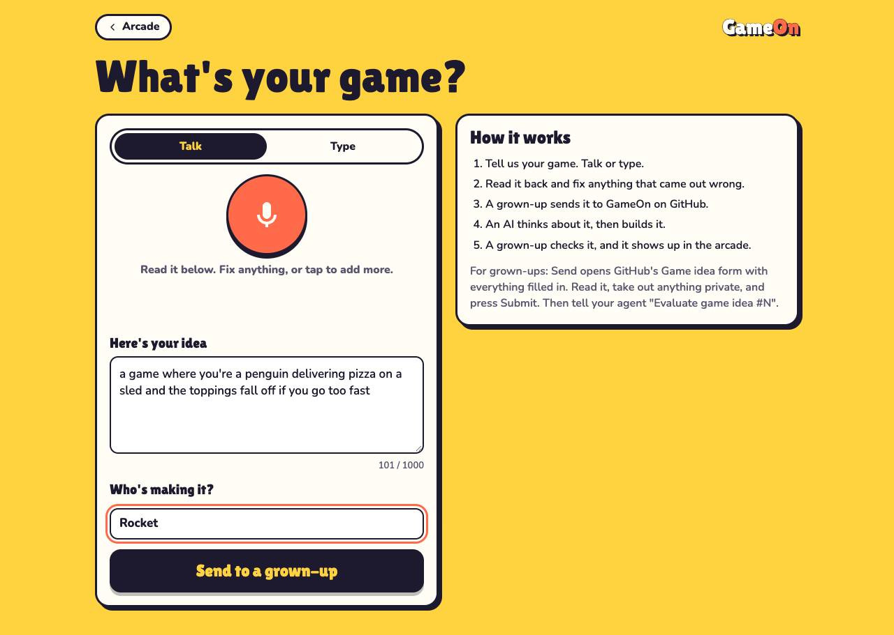
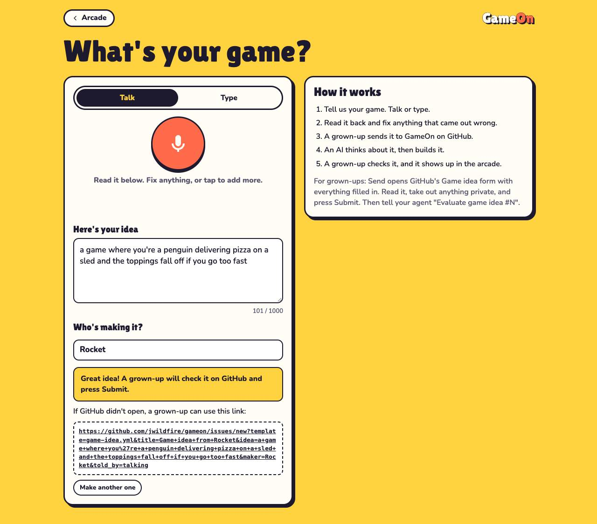
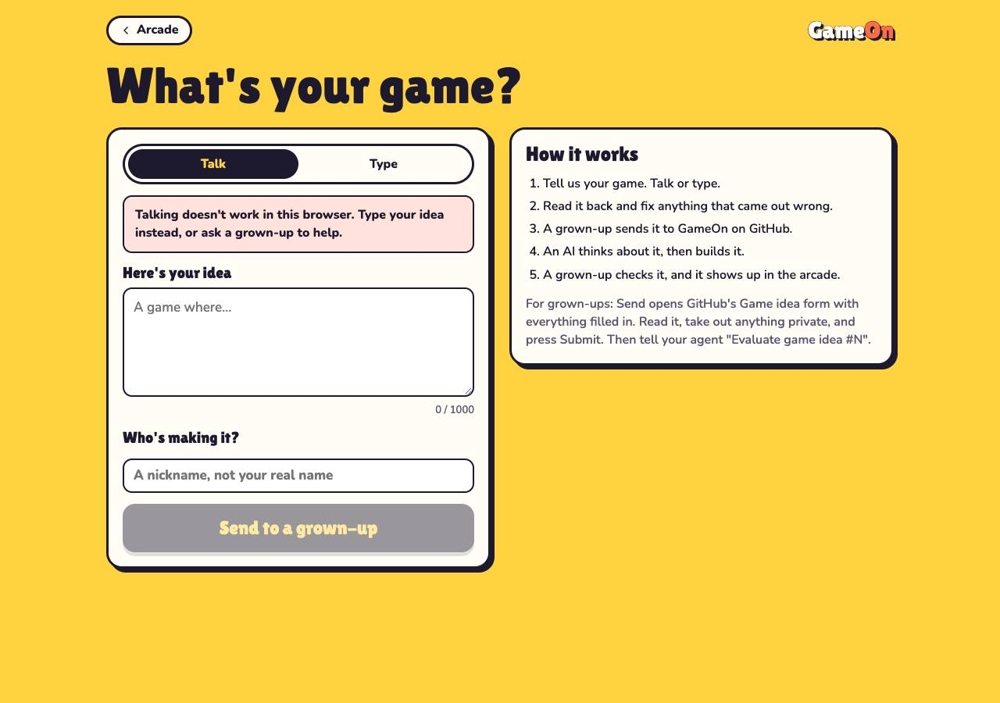
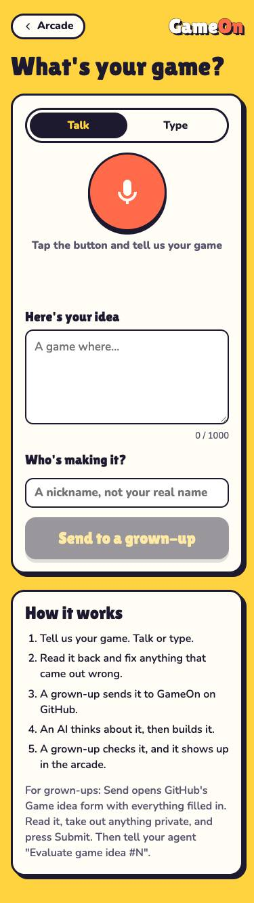
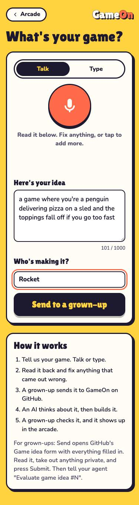
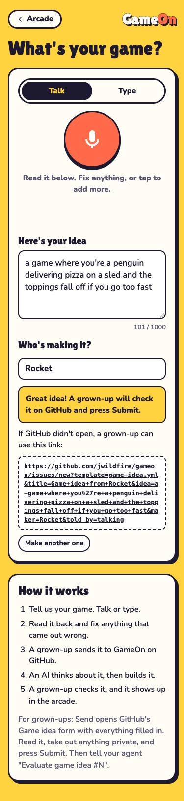
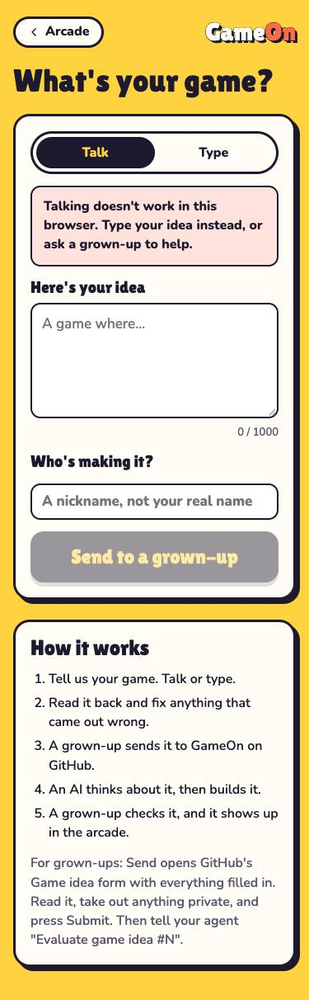

# Evidence: New Game page (gameon#41)

Run 2026-10-23T11:13:59.287Z with Playwright 1.56.1 driving Google Chrome against a local server of the branch.

**26 of 26 checks passed.** Speech is simulated with a stand-in for the browser's speech recognition; real microphones need a person.

| Check | Result | Detail |
|---|---|---|
| phone: Talk is the default | pass |  |
| phone: spoken words are read back in the idea box | pass | a game where you're a penguin delivering… |
| phone: Send is enabled with an idea and a nickname | pass |  |
| phone: Send opens the Game idea form | pass | https://github.com/jwildfire/gameon/issues/new?template=game-idea.yml&title=Game… |
| phone: address carries idea, maker, told_by and title | pass |  |
| phone: grown-up hand-off shows with a fallback link | pass |  |
| phone: no sideways scroll | pass | 375px |
| phone: no console errors | pass |  |
| phone: without speech recognition it opens on Type | pass |  |
| phone: Talk explains it isn't available | pass |  |
| phone: a too-short idea asks what happens instead of sending | pass |  |
| phone: over 1,000 characters disables Send | pass |  |
| phone: typed ideas are marked told_by=typing | pass |  |
| desktop: Talk is the default | pass |  |
| desktop: spoken words are read back in the idea box | pass | a game where you're a penguin delivering… |
| desktop: Send is enabled with an idea and a nickname | pass |  |
| desktop: Send opens the Game idea form | pass | https://github.com/jwildfire/gameon/issues/new?template=game-idea.yml&title=Game… |
| desktop: address carries idea, maker, told_by and title | pass |  |
| desktop: grown-up hand-off shows with a fallback link | pass |  |
| desktop: no sideways scroll | pass | 1280px |
| desktop: no console errors | pass |  |
| desktop: without speech recognition it opens on Type | pass |  |
| desktop: Talk explains it isn't available | pass |  |
| desktop: a too-short idea asks what happens instead of sending | pass |  |
| desktop: over 1,000 characters disables Send | pass |  |
| desktop: typed ideas are marked told_by=typing | pass |  |

## Screenshots

