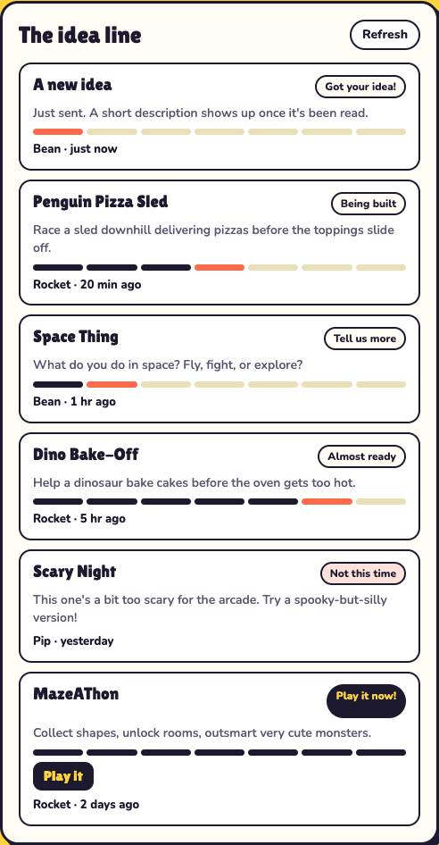
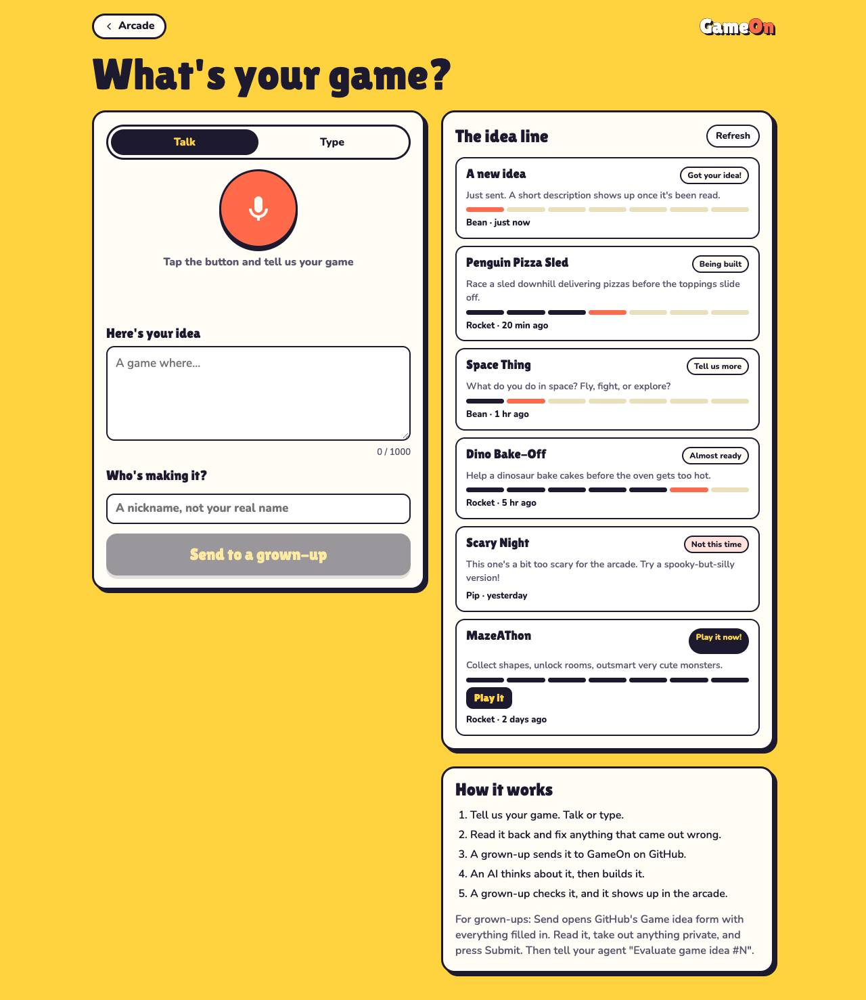
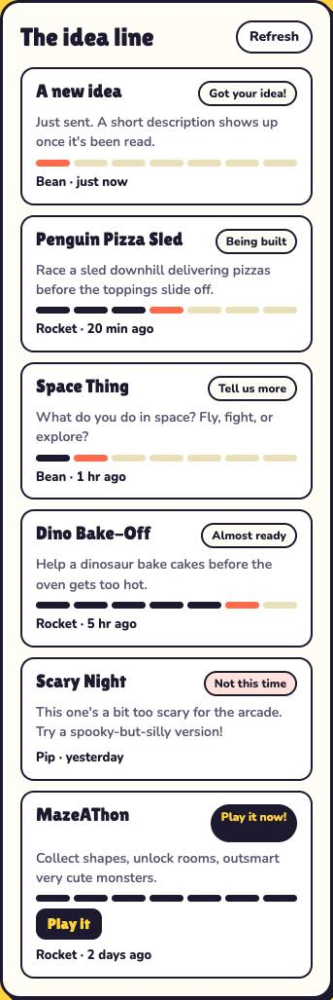
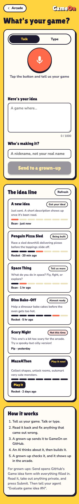
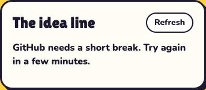
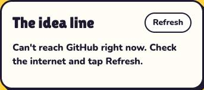

# Evidence: the idea line (gameon#42)

Run 2026-10-23T11:15:59.439Z with Playwright 1.56.1 driving Google Chrome. GitHub's API is stubbed with six ideas covering each kind of status, an eval comment for each evaluated one, a test-labelled idea and a PR (both must be hidden); then a 403 rate limit and an offline run.

**24 of 24 checks passed.**

| Check | Result | Detail |
|---|---|---|
| phone: shows the six real ideas, newest first, hiding test items and PRs | pass | A new idea, Penguin Pizza Sled, Space Thing, Dino Bake-Off, Scary Night, MazeAThon |
| phone: before an eval, it says Just sent and hides the kid's raw words | pass |  |
| phone: an evaluated idea shows the eval's title and one-liner | pass |  |
| phone: progress dots match the step (Being built = 3 done, 4th now) | pass |  |
| phone: Tell us more shows the eval's one question | pass |  |
| phone: Not this time shows the kind reason and no dots | pass |  |
| phone: a published game says Play it now! and links to the arcade | pass |  |
| phone: nickname and time shown | pass | Rocket · 20 min ago |
| phone: no sideways scroll | pass | 375px |
| phone: no console errors | pass |  |
| phone: rate limit shows a readable message | pass | GitHub needs a short break. Try again in a few minutes. |
| phone: offline shows a readable message | pass | Can't reach GitHub right now. Check the internet and tap Refresh. |
| desktop: shows the six real ideas, newest first, hiding test items and PRs | pass | A new idea, Penguin Pizza Sled, Space Thing, Dino Bake-Off, Scary Night, MazeAThon |
| desktop: before an eval, it says Just sent and hides the kid's raw words | pass |  |
| desktop: an evaluated idea shows the eval's title and one-liner | pass |  |
| desktop: progress dots match the step (Being built = 3 done, 4th now) | pass |  |
| desktop: Tell us more shows the eval's one question | pass |  |
| desktop: Not this time shows the kind reason and no dots | pass |  |
| desktop: a published game says Play it now! and links to the arcade | pass |  |
| desktop: nickname and time shown | pass | Rocket · 20 min ago |
| desktop: no sideways scroll | pass | 1280px |
| desktop: no console errors | pass |  |
| desktop: rate limit shows a readable message | pass | GitHub needs a short break. Try again in a few minutes. |
| desktop: offline shows a readable message | pass | Can't reach GitHub right now. Check the internet and tap Refresh. |

## Screenshots

