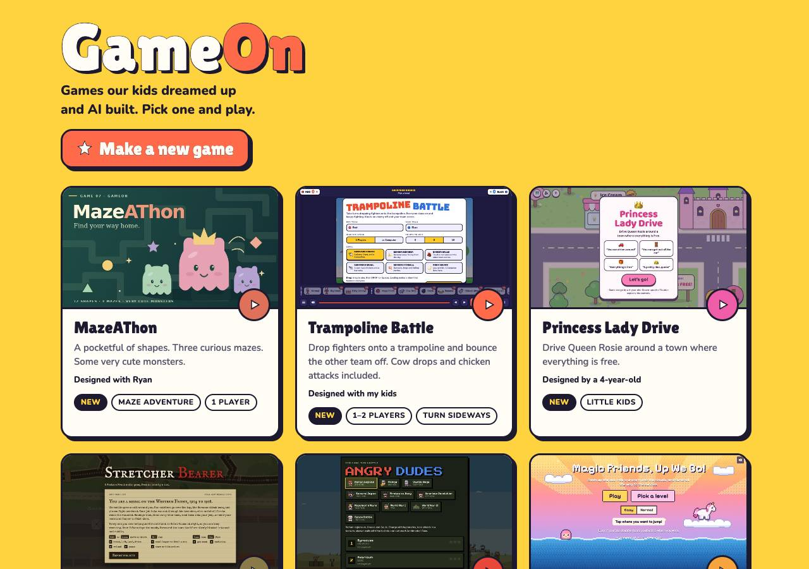
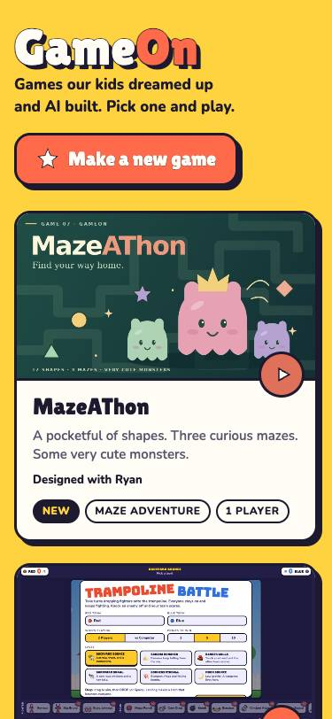

# Evidence: Make a new game button (gameon#43)

Run 2026-10-23T11:19:01.344Z with Playwright 1.56.1 driving Google Chrome, at 375 and 1280 wide, against the branch.

**12 of 12 checks passed.**

| Check | Result | Detail |
|---|---|---|
| local phone: the button is visible in the first screen | pass | top 150px, 253×60 |
| local phone: arcade still shows all its games | pass |  |
| local phone: no sideways scroll | pass | 375px |
| local phone: tapping it opens the New Game page | pass | /new/ |
| local phone: the New Game page's Arcade link comes back | pass |  |
| local phone: no console errors | pass |  |
| local desktop: the button is visible in the first screen | pass | top 204px, 299×62 |
| local desktop: arcade still shows all its games | pass |  |
| local desktop: no sideways scroll | pass | 1280px |
| local desktop: tapping it opens the New Game page | pass | /new/ |
| local desktop: the New Game page's Arcade link comes back | pass |  |
| local desktop: no console errors | pass |  |

## Screenshots

