# Evidence: 46-evidence-framework

**PASS: 5 of 5 checks pass at desktop and phone widths.**

Generated by `npm run evidence -- 46-evidence-framework` from [`tests/evidence/46-evidence-framework.spec.mjs`](../../tests/evidence/46-evidence-framework.spec.mjs) against the local server (python3 -m http.server) on this branch, starting from commit d6b68ad, 2026-10-23 11:19 UTC. Rules: [docs/evidence.md](../../docs/evidence.md).

| Check | Desktop 1280 | Phone 375 |
|---|---|---|
| the arcade home shows one card per game in games.json | pass | pass |
| MazeAThon plays inside the arcade frame | pass | pass |
| the switcher opens from a game and changes to another game | pass | pass |
| nothing scrolls sideways and the player buttons stay on screen | pass | pass |
| the New Game page turns a typed idea into a Game idea form for a grown-up | pass | pass |

## 1. the arcade home shows one card per game in games.json

- desktop: 7 cards, one for each game in games.json
- phone: 7 cards, one for each game in games.json

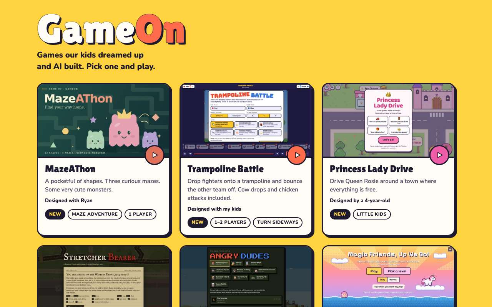 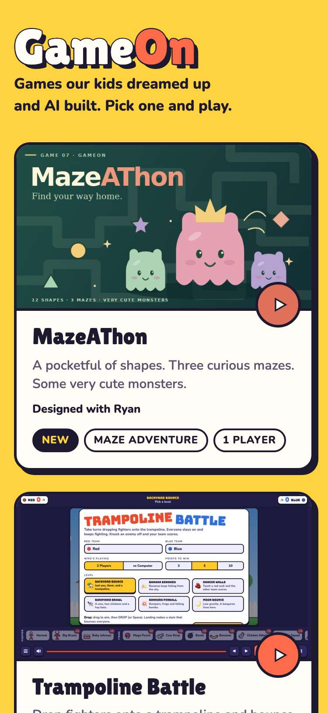

## 2. MazeAThon plays inside the arcade frame

- desktop: clock reads 0:01 after starting
- phone: clock reads 0:01 after starting

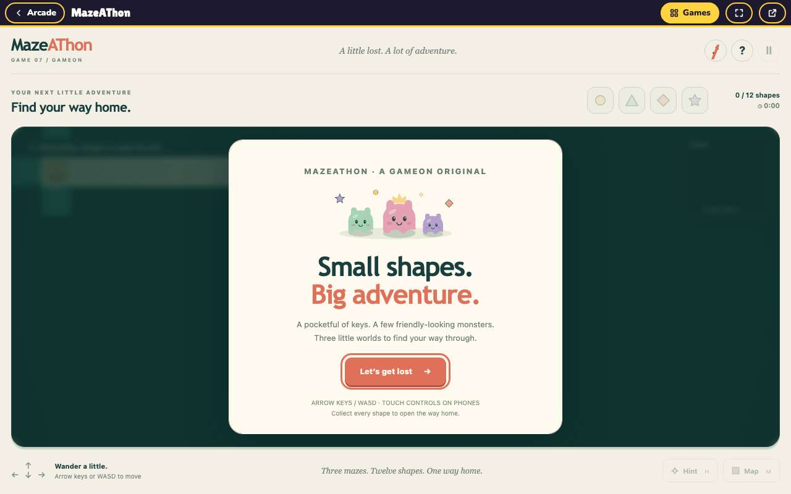 

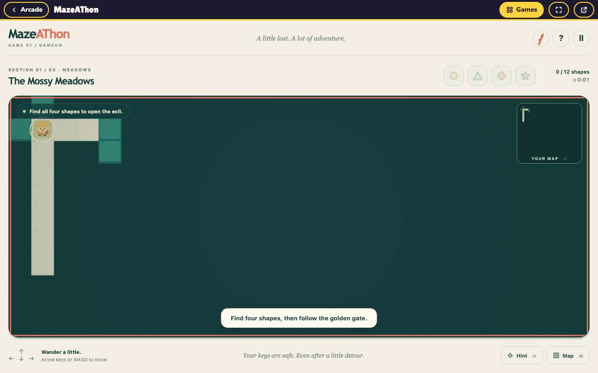 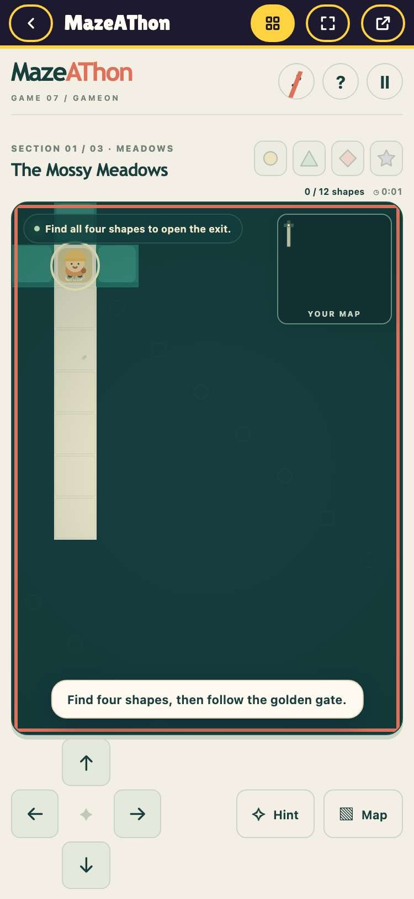

## 3. the switcher opens from a game and changes to another game

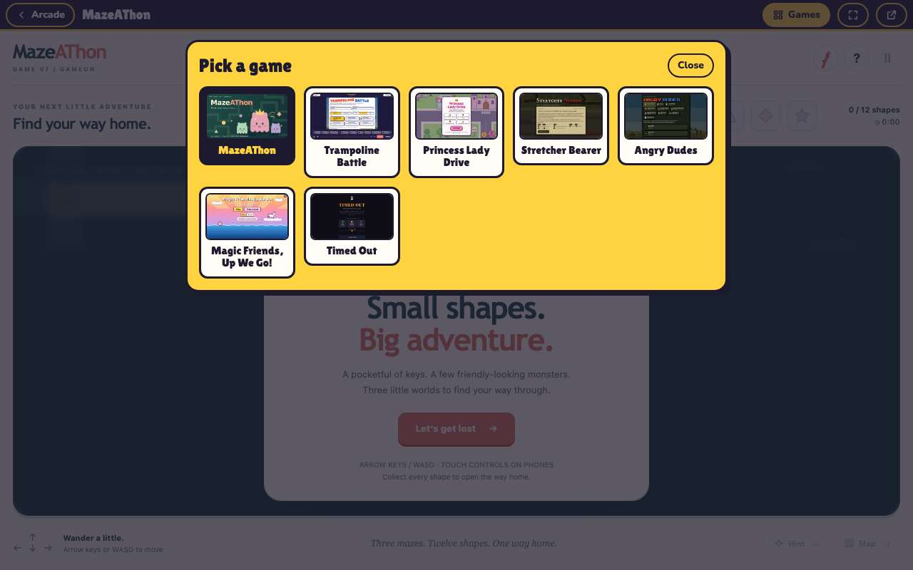 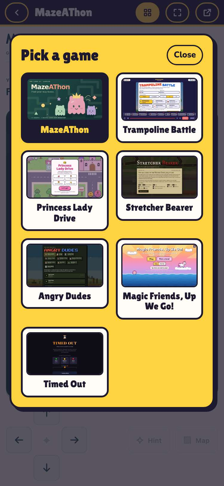

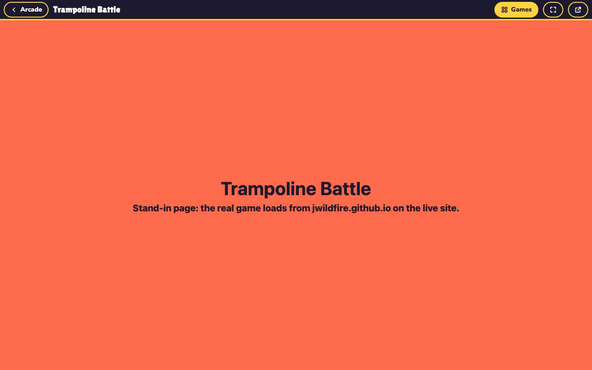 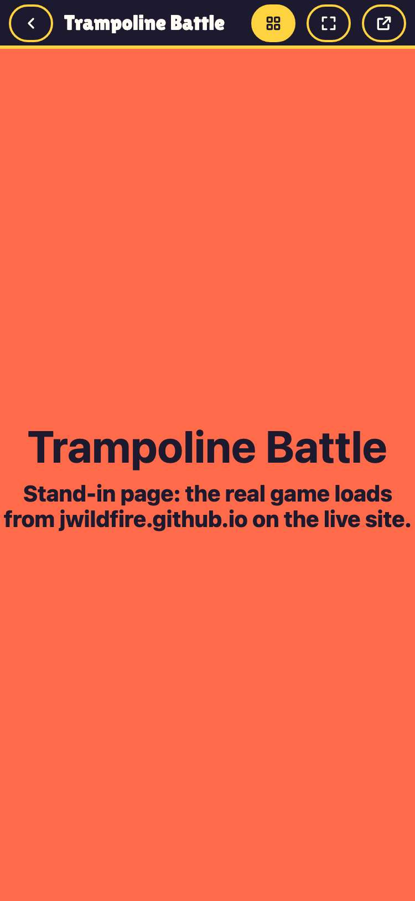

## 4. nothing scrolls sideways and the player buttons stay on screen

- desktop: 1280px wide, bar buttons with words
- phone: 375px wide, bar buttons icon-only

 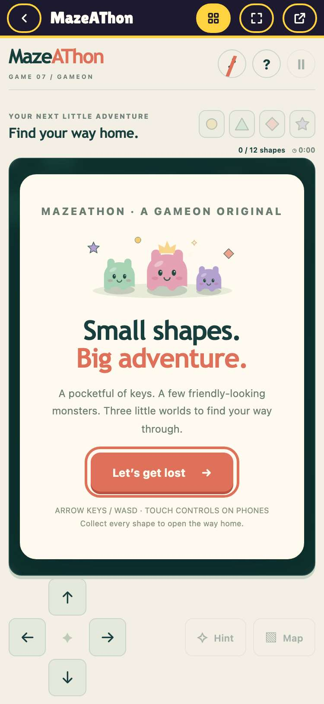

## 5. the New Game page turns a typed idea into a Game idea form for a grown-up

- desktop: Send opens the Game idea form with the idea, the nickname and told_by=typing filled in
- phone: Send opens the Game idea form with the idea, the nickname and told_by=typing filled in

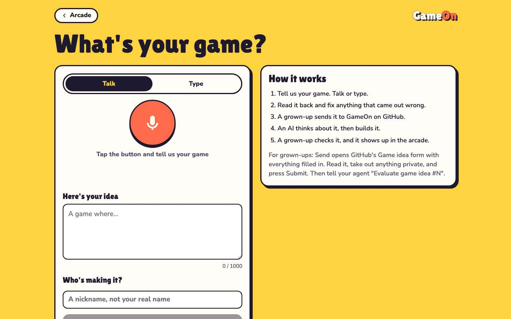 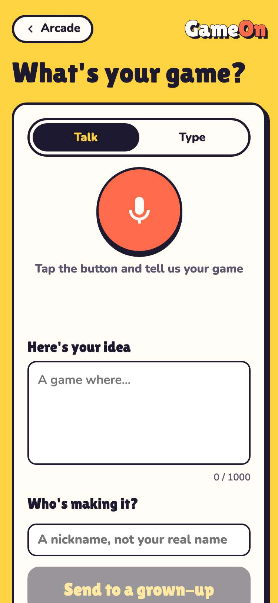

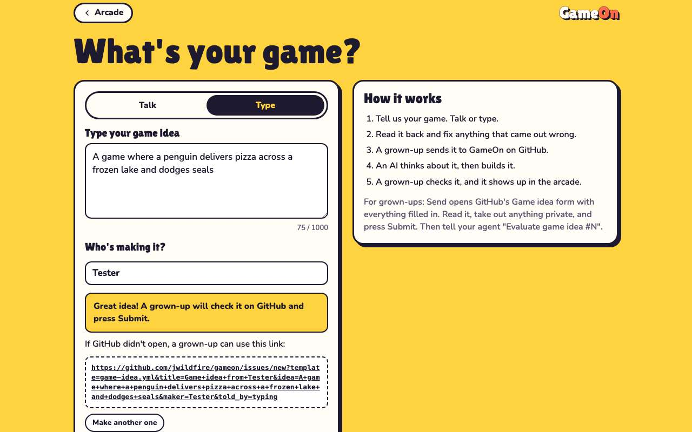 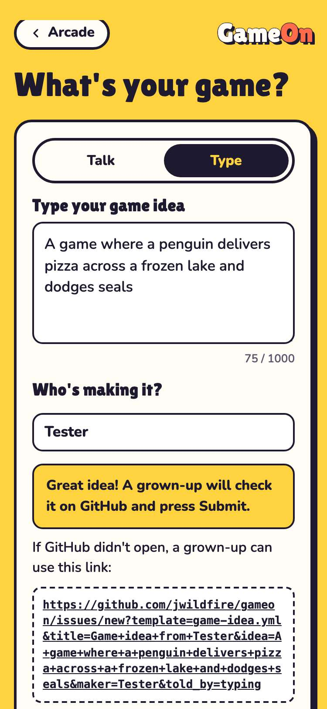
