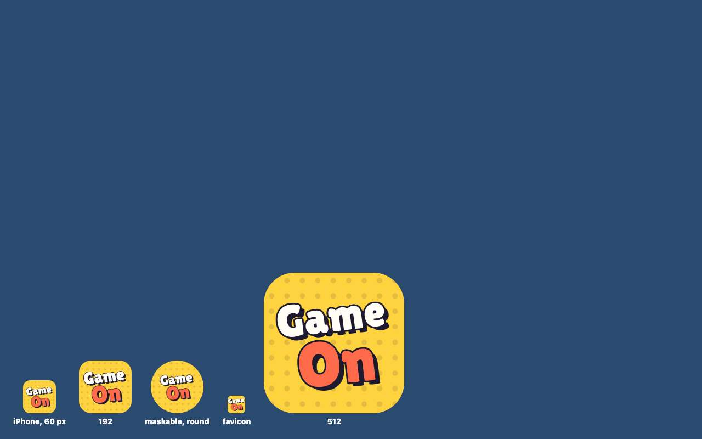
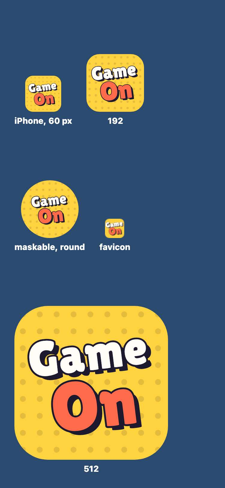
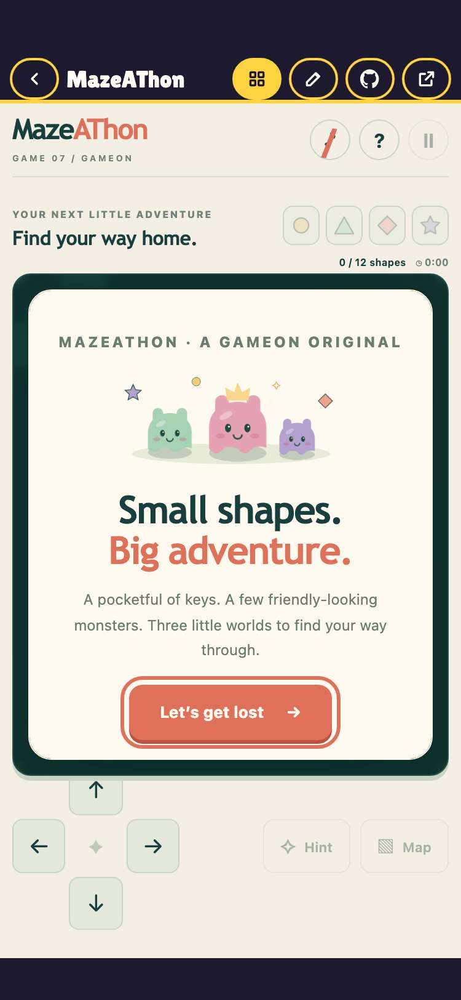
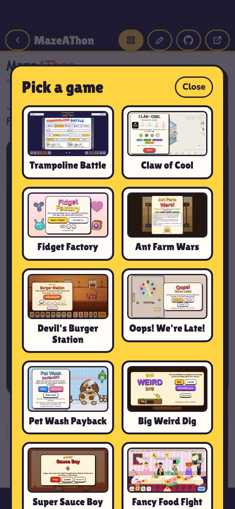
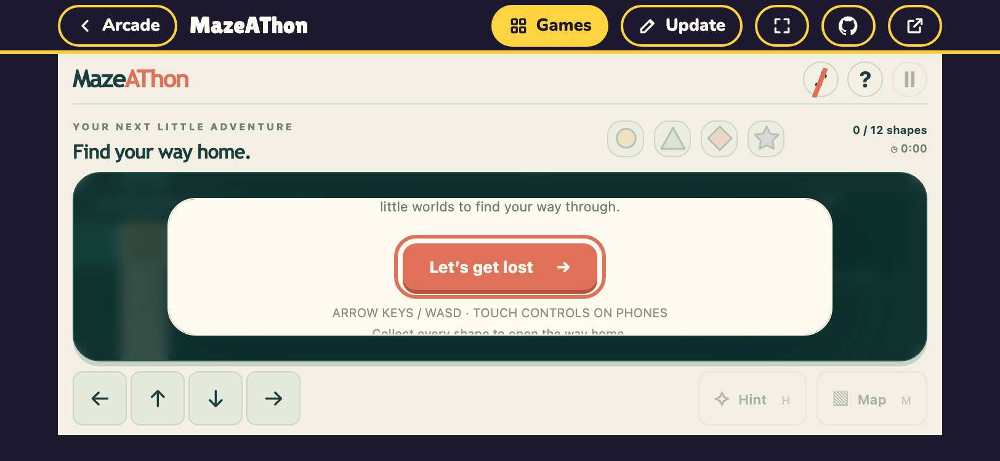
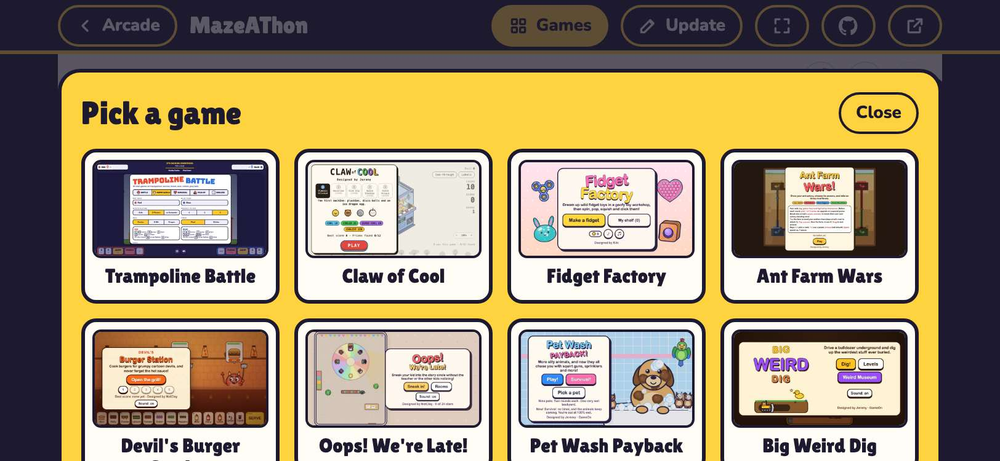
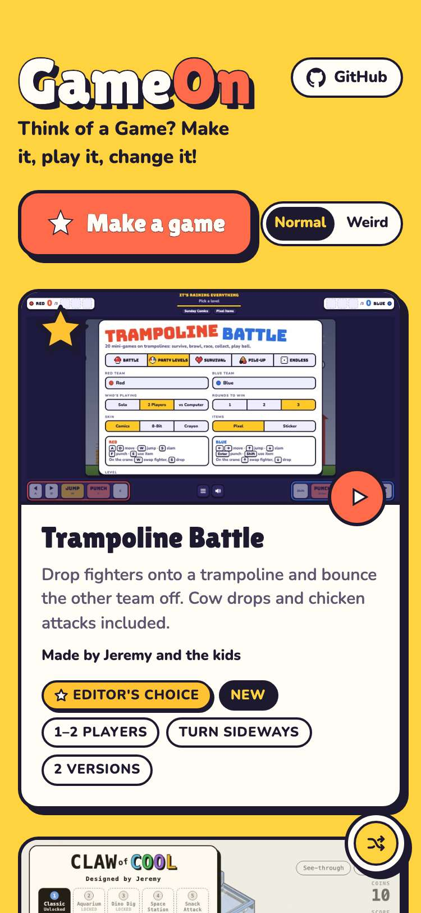

# Evidence: 74-home-screen

**PASS: 7 of 7 checks pass at desktop and phone widths.**

Generated by `npm run evidence -- 74-home-screen` from [`tests/evidence/74-home-screen.spec.mjs`](../../tests/evidence/74-home-screen.spec.mjs) against the local server (python3 -m http.server) on this branch, starting from commit 4693091, 2026-10-29 15:07 UTC. Rules: [docs/evidence.md](../../docs/evidence.md).

| Check | Desktop 1280 | Phone 375 |
|---|---|---|
| the manifest names GameOn, opens standalone and lists the icon sizes | pass | pass |
| Safari gets the tags to open full screen with the Apple touch icon | pass | pass |
| every icon loads at the size it claims, and reads at home-screen size | pass | pass |
| Chrome finds nothing stopping the arcade from installing | pass | pass |
| held upright with a notch, the player bar, game and switcher stay in the safe area | skipped | pass |
| held sideways with a notch, the player bar, game and switcher stay in the safe area | skipped | pass |
| held upright with a notch, the arcade home stays in the safe area | skipped | pass |

## 1. the manifest names GameOn, opens standalone and lists the icon sizes

- desktop: /manifest.webmanifest: GameOn, standalone, start_url and scope "./", theme #ffd23f
- desktop: icons: 192x192 any, 512x512 any, 512x512 maskable, 180x180 any
- phone: /manifest.webmanifest: GameOn, standalone, start_url and scope "./", theme #ffd23f
- phone: icons: 192x192 any, 512x512 any, 512x512 maskable, 180x180 any

## 2. Safari gets the tags to open full screen with the Apple touch icon

- desktop: viewport-fit=cover, apple-mobile-web-app-capable yes, title GameOn, black-translucent status bar, apple-touch-icon 180x180
- phone: viewport-fit=cover, apple-mobile-web-app-capable yes, title GameOn, black-translucent status bar, apple-touch-icon 180x180

## 3. every icon loads at the size it claims, and reads at home-screen size

- desktop: 192x192 any 192x192, 512x512 any 512x512, 512x512 maskable 512x512, 180x180 any 180x180, apple-touch-icon 180x180, favicon 32x32
- phone: 192x192 any 192x192, 512x512 any 512x512, 512x512 maskable 512x512, 180x180 any 180x180, apple-touch-icon 180x180, favicon 32x32

 

## 4. Chrome finds nothing stopping the arcade from installing

- desktop: Page.getInstallabilityErrors: none (manifest /manifest.webmanifest)
- phone: Page.getInstallabilityErrors: none (manifest /manifest.webmanifest)

## 5. held upright with a notch, the player bar, game and switcher stay in the safe area

- phone: 375x812, insets {"top":47,"right":0,"bottom":34,"left":0}: game frame 0,84 375x694
- phone: Claw of Cool's version chooser clears the insets too

## 6. held sideways with a notch, the player bar, game and switcher stay in the safe area

- phone: 812x375, insets {"top":0,"right":47,"bottom":21,"left":47}: game frame 47,44 718x310
- phone: Claw of Cool's version chooser clears the insets too

## 7. held upright with a notch, the arcade home stays in the safe area

