# Evidence: 82-intake-page

**PASS: 10 of 10 checks pass at desktop and phone widths.**

Generated by `npm run evidence -- 82-intake-page` from [`tests/evidence/82-intake-page.spec.mjs`](../../tests/evidence/82-intake-page.spec.mjs) against the local server (python3 -m http.server) on this branch, starting from commit b1969f9, 2026-10-25 03:15 UTC. Rules: [docs/evidence.md](../../docs/evidence.md).

| Check | Desktop 1280 | Phone 375 |
|---|---|---|
| with a family code, Send posts the idea and the code, and it shows as Just sent | pass | pass |
| the family code is remembered on this device until a grown-up forgets it | pass | pass |
| without a code, the robot check shows and its token is sent instead | pass | pass |
| a refusal stays on screen when the robot check passes again by itself | pass | pass |
| an update idea sends the game and version too | pass | pass |
| refusals read in plain kid-friendly words, and a wrong code is forgotten | pass | pass |
| the idea line reads /queue, never GitHub, and shows no idea words | pass | pass |
| the committed config points at the live Worker, with family codes off | pass | pass |
| with family codes off, there's no code field and every idea goes through the robot check | pass | pass |
| with no intake configured, the page is the Phase 0 page | pass | pass |

## 1. with a family code, Send posts the idea and the code, and it shows as Just sent

- desktop: body sent: {"idea":"<idea>","maker":"Bean","told_by":"typing","code":"test-family-code-1"}
- phone: body sent: {"idea":"<idea>","maker":"Bean","told_by":"typing","code":"test-family-code-1"}

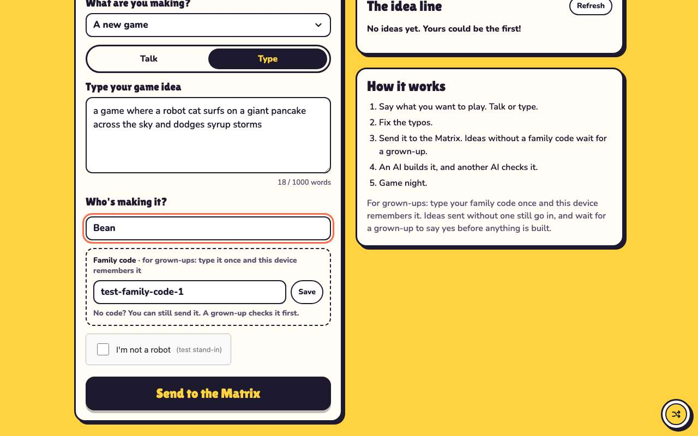 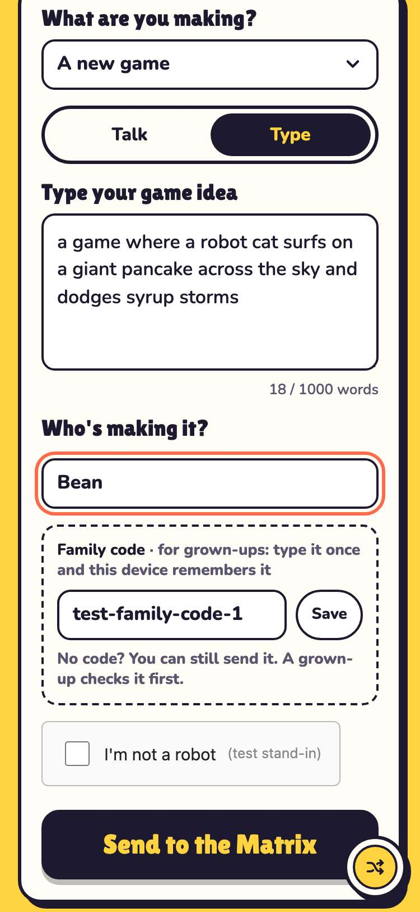

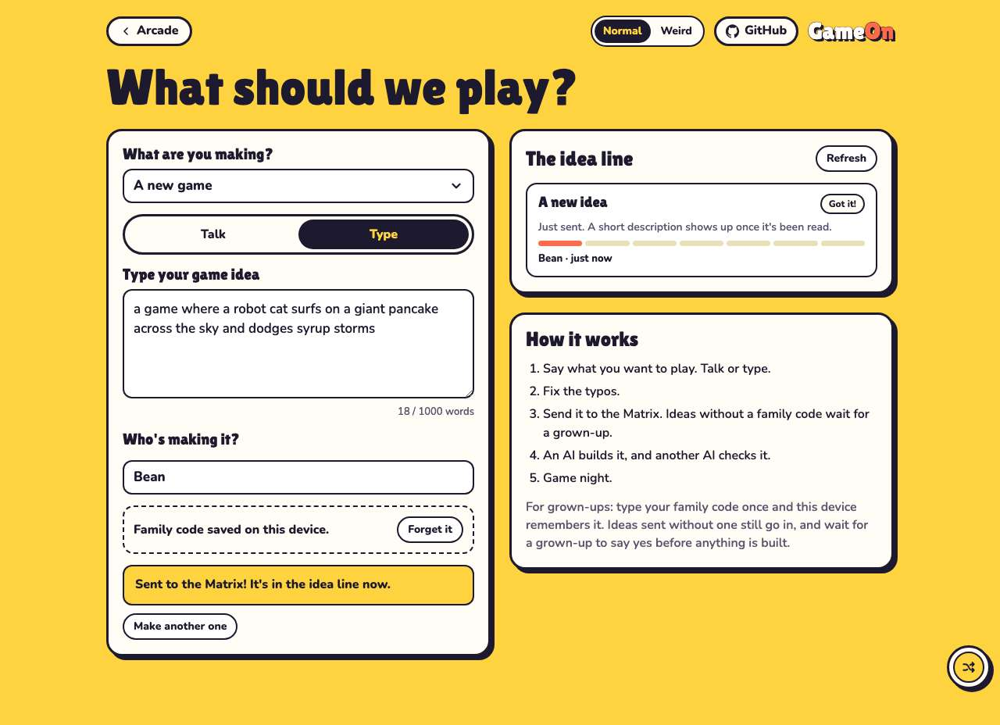 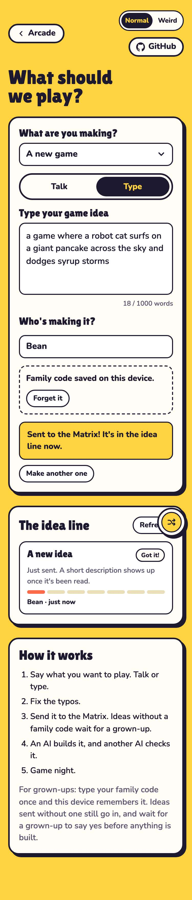

## 2. the family code is remembered on this device until a grown-up forgets it

- desktop: saved as gameon.arcade.familyCode; still there after a reload
- phone: saved as gameon.arcade.familyCode; still there after a reload

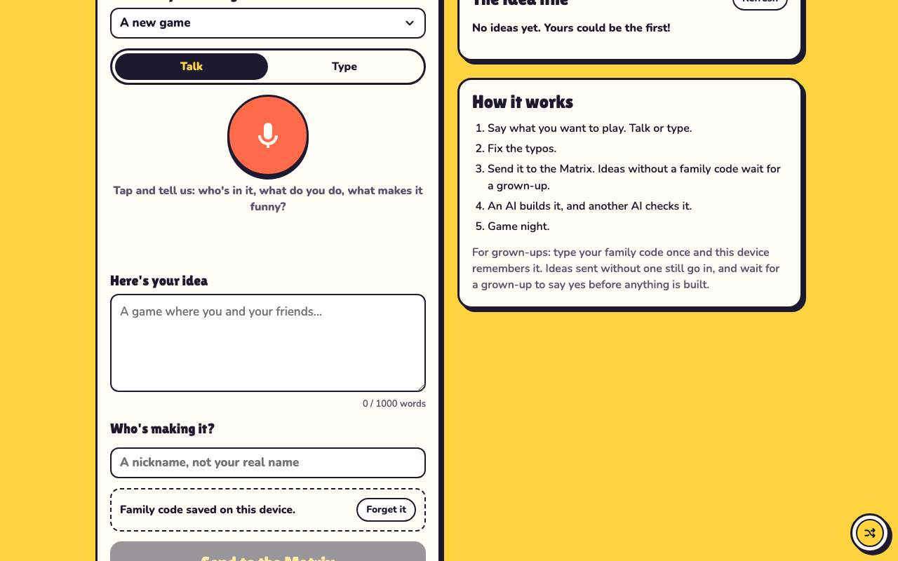 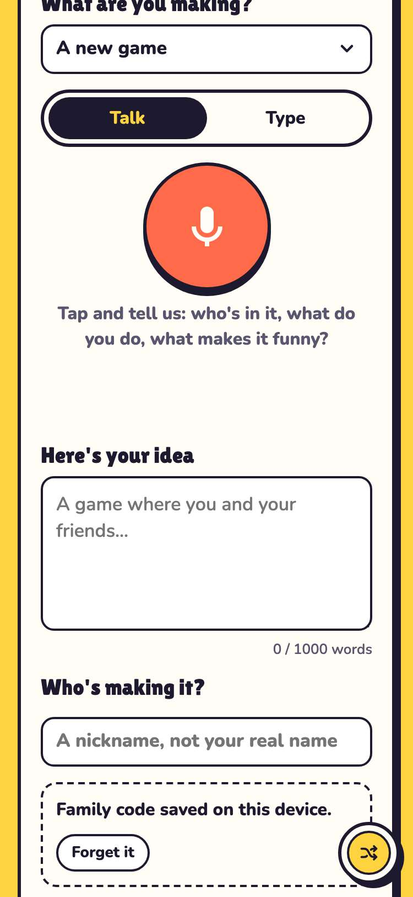

## 3. without a code, the robot check shows and its token is sent instead

- desktop: body sent: {"idea":"<idea>","maker":"Zed","told_by":"typing","turnstile":"fake-turnstile-token"}
- phone: body sent: {"idea":"<idea>","maker":"Zed","told_by":"typing","turnstile":"fake-turnstile-token"}

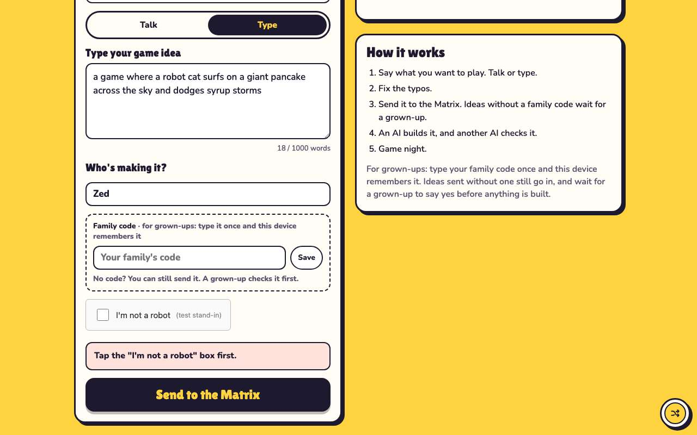 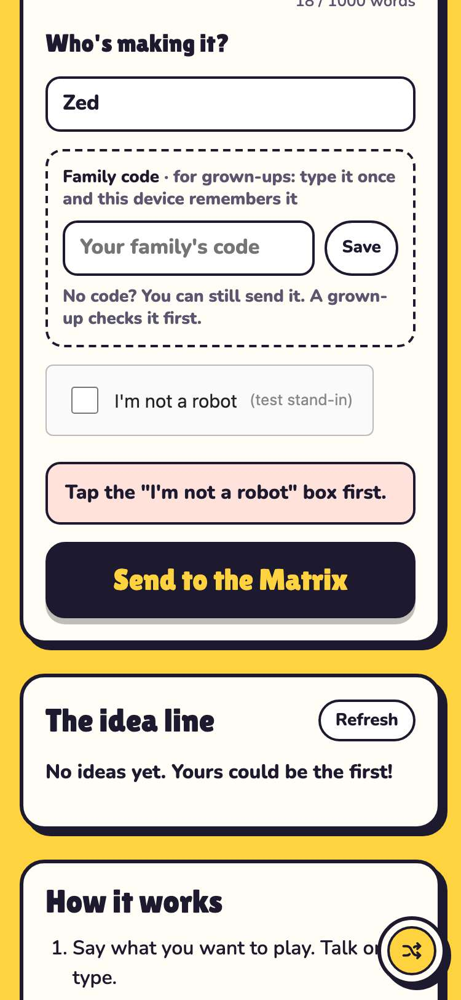

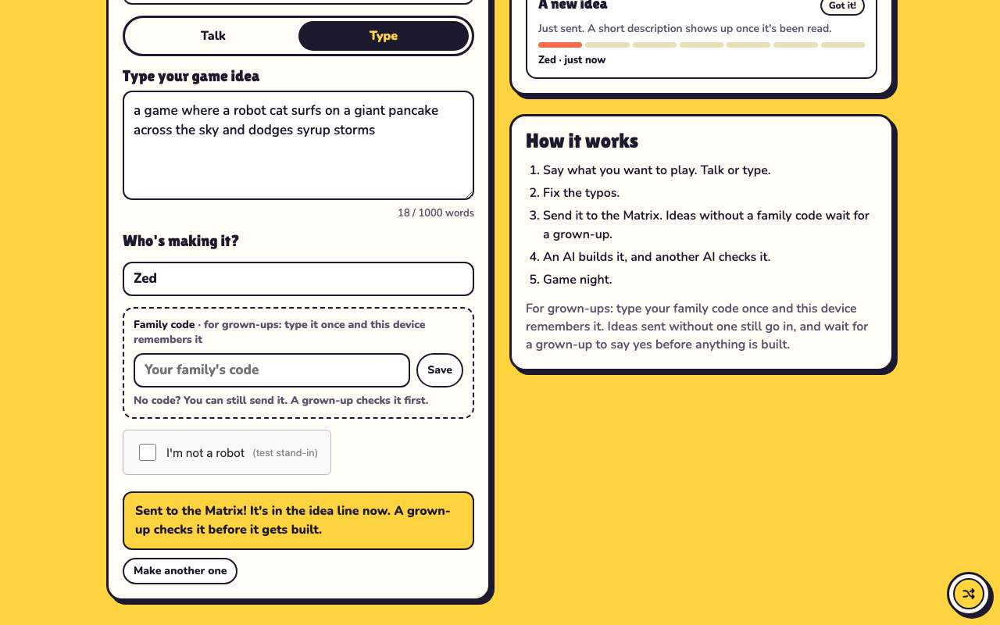 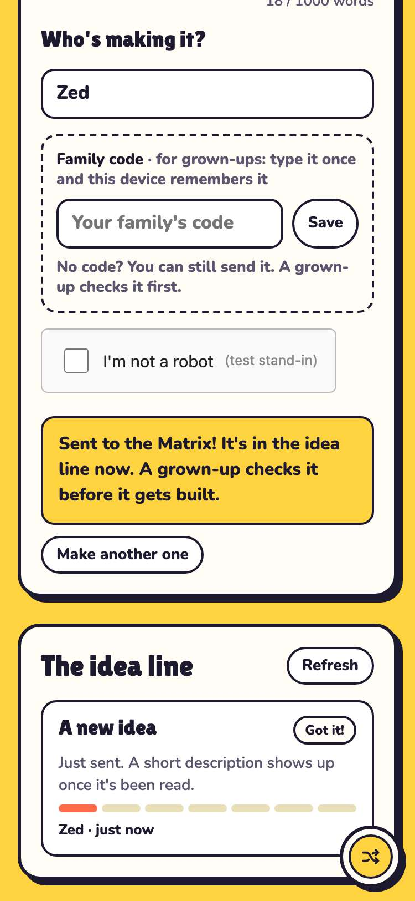

## 4. a refusal stays on screen when the robot check passes again by itself

- desktop: after a refused send and a fresh robot token, the refusal is still shown
- phone: after a refused send and a fresh robot token, the refusal is still shown

## 5. an update idea sends the game and version too

## 6. refusals read in plain kid-friendly words, and a wrong code is forgotten

- desktop: 3 tries: daily limit, wrong code, no internet
- phone: 3 tries: daily limit, wrong code, no internet

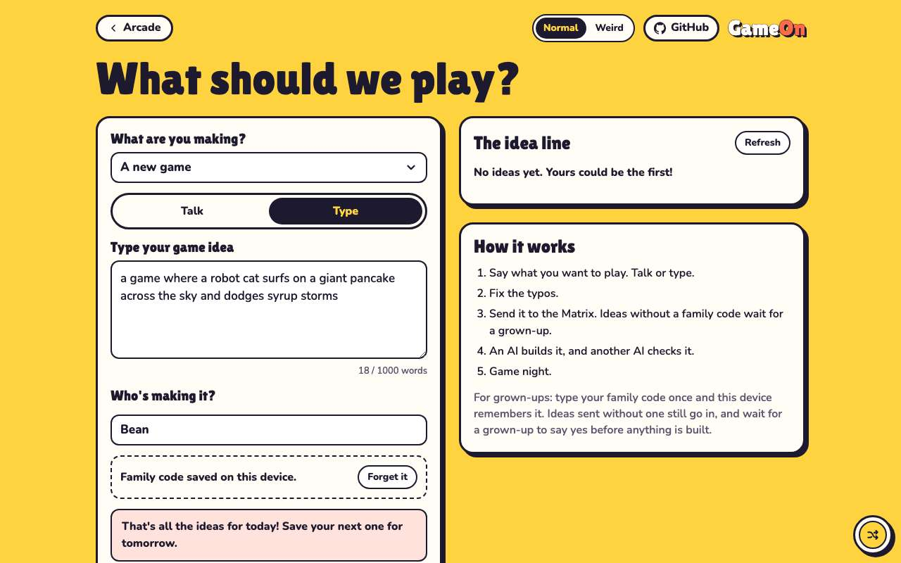 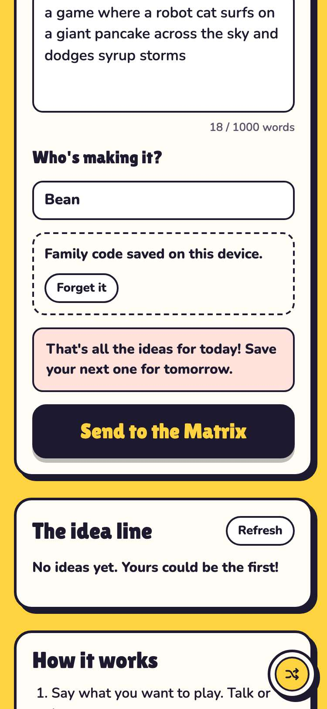

## 7. the idea line reads /queue, never GitHub, and shows no idea words

- desktop: 4 ideas from GET /queue; 0 requests to api.github.com
- phone: 4 ideas from GET /queue; 0 requests to api.github.com

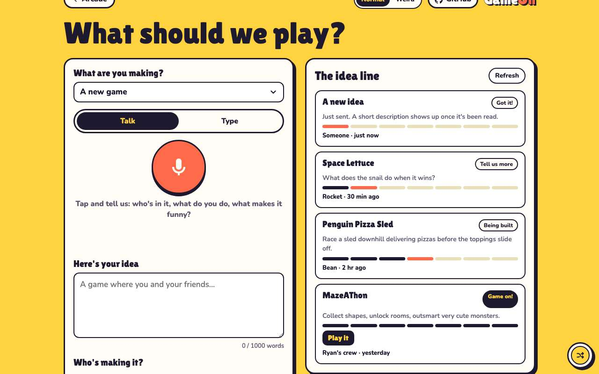 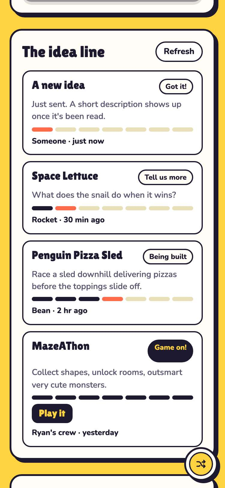

## 8. the committed config points at the live Worker, with family codes off

- desktop: new/intake-config.js: url https://gameon-intake.jwildfire.workers.dev, the public Turnstile site key, familyCodes false
- phone: new/intake-config.js: url https://gameon-intake.jwildfire.workers.dev, the public Turnstile site key, familyCodes false

## 9. with family codes off, there's no code field and every idea goes through the robot check

- desktop: familyCodes: false hides the code field, ignores a code saved earlier, shows the robot check, and sends its token with no code
- phone: familyCodes: false hides the code field, ignores a code saved earlier, shows the robot check, and sends its token with no code

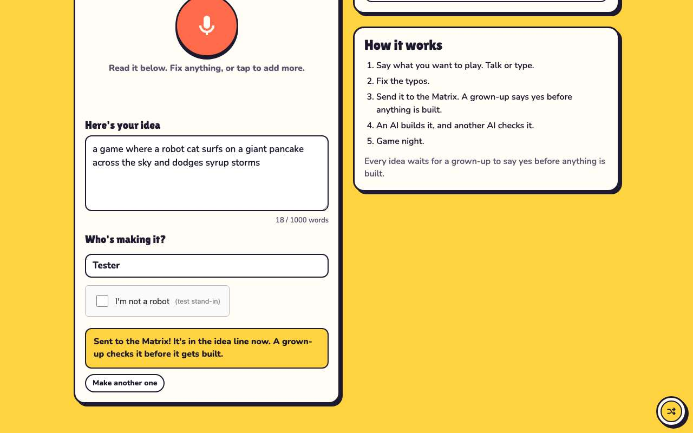 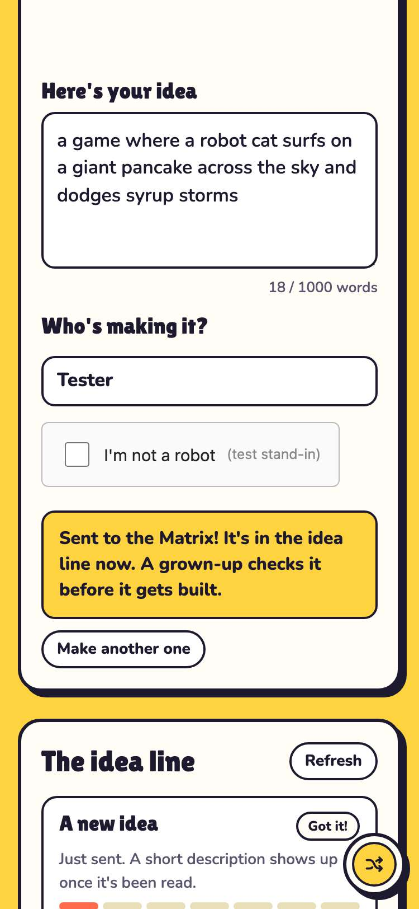

## 10. with no intake configured, the page is the Phase 0 page

- desktop: Send opens GitHub's Game idea form; the idea line reads the GitHub API
- phone: Send opens GitHub's Game idea form; the idea line reads the GitHub API

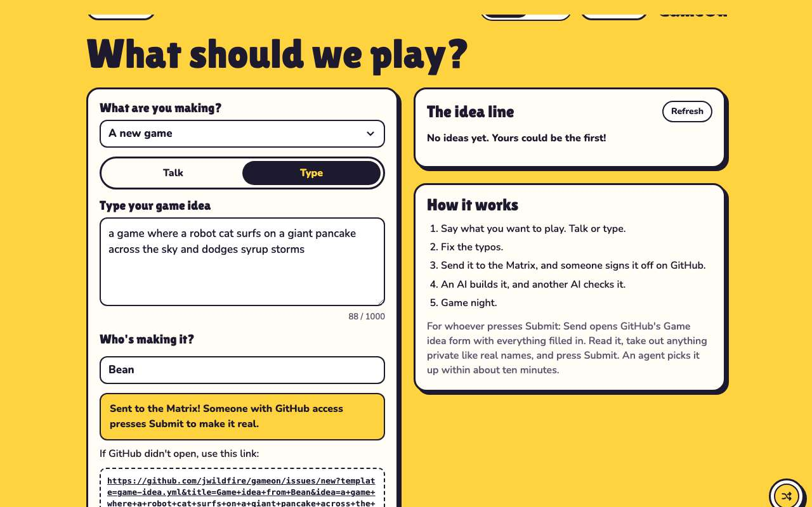 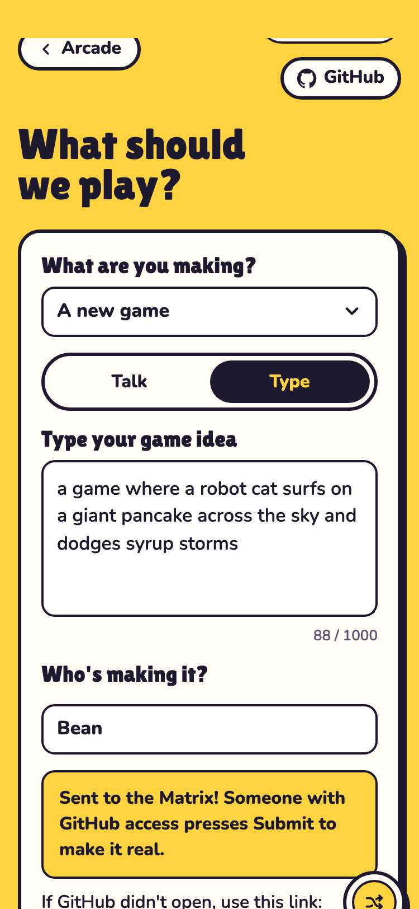
