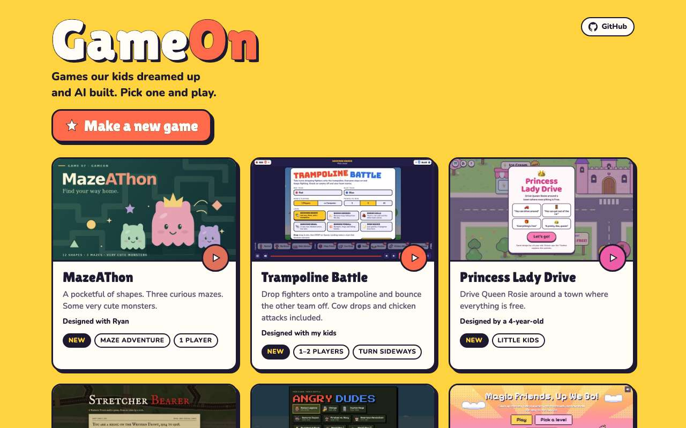
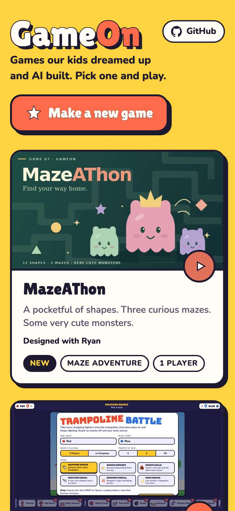
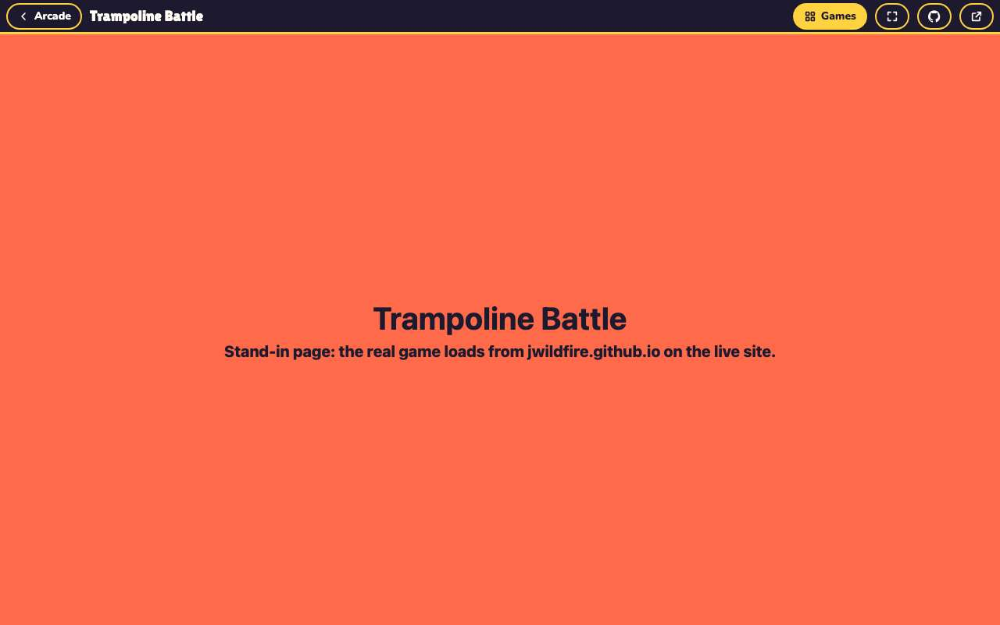
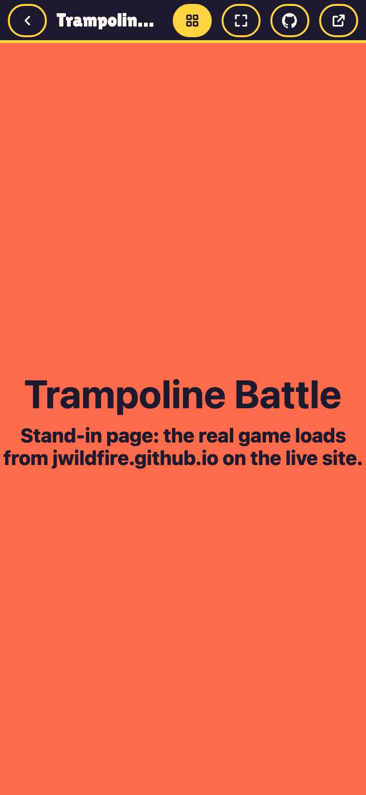
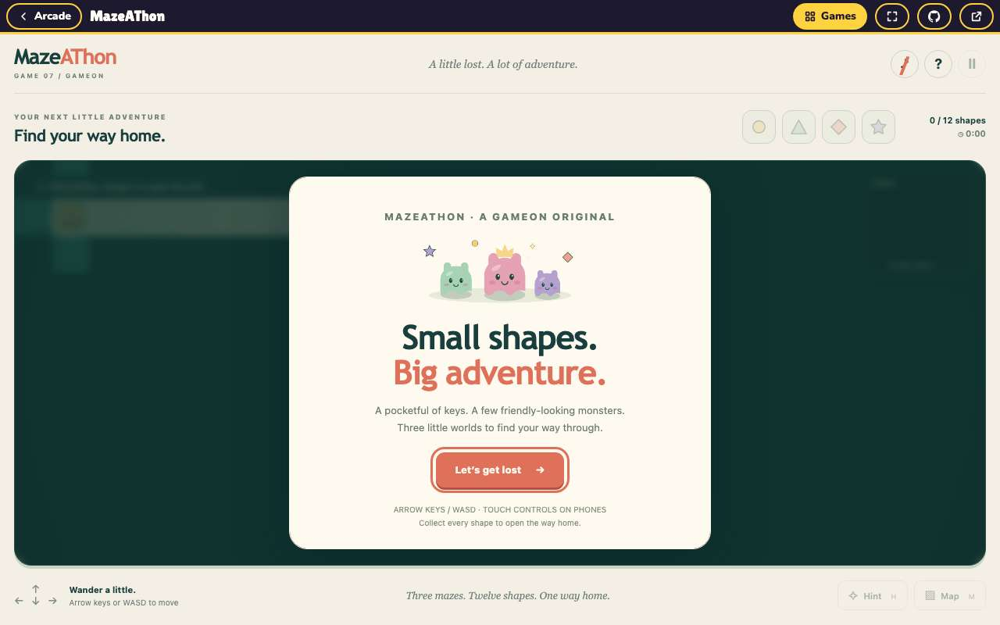
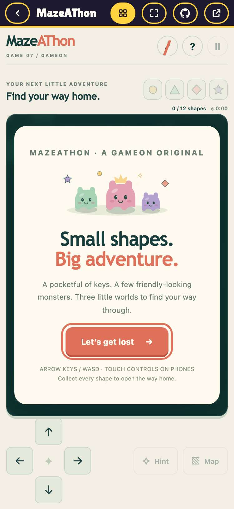
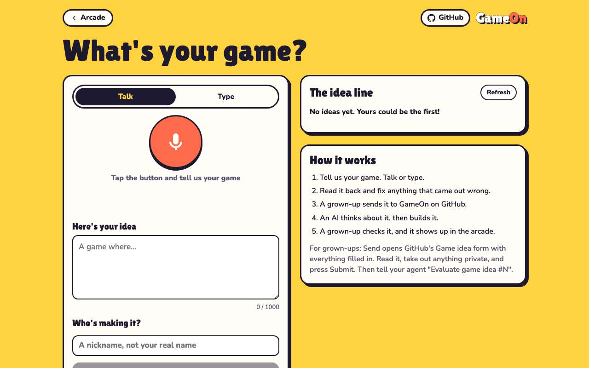
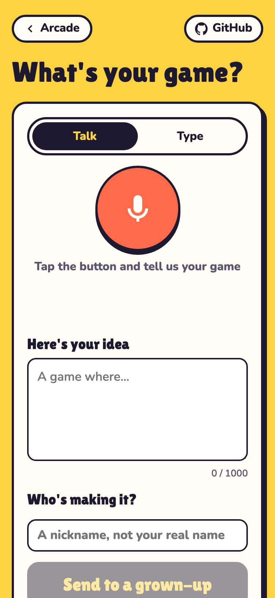

# Evidence: 95-github-links

**PASS: 4 of 4 checks pass at desktop and phone widths.**

Generated by `npm run evidence -- 95-github-links` from [`tests/evidence/95-github-links.spec.mjs`](../../tests/evidence/95-github-links.spec.mjs) against the local server (python3 -m http.server) on this branch, starting from commit b1625e7, 2026-10-23 11:23 UTC. Rules: [docs/evidence.md](../../docs/evidence.md).

| Check | Desktop 1280 | Phone 375 |
|---|---|---|
| the arcade home links to the GameOn repo | pass | pass |
| the player's GitHub button opens the current game's code | pass | pass |
| every game's GitHub button points at its own code | pass | pass |
| the New Game page links to the GameOn repo | pass | pass |

## 1. the arcade home links to the GameOn repo

- desktop: GitHub link → https://github.com/jwildfire/gameon
- phone: GitHub link → https://github.com/jwildfire/gameon

 

## 2. the player's GitHub button opens the current game's code

- desktop: Trampoline Battle → https://github.com/jwildfire/trampoline-battle; after switching, MazeAThon → https://github.com/jwildfire/gameon/tree/main/games/mazeathon
- phone: Trampoline Battle → https://github.com/jwildfire/trampoline-battle; after switching, MazeAThon → https://github.com/jwildfire/gameon/tree/main/games/mazeathon

 

 

## 3. every game's GitHub button points at its own code

- desktop: 7 of 7 games link to their code
- phone: 7 of 7 games link to their code

## 4. the New Game page links to the GameOn repo

 
