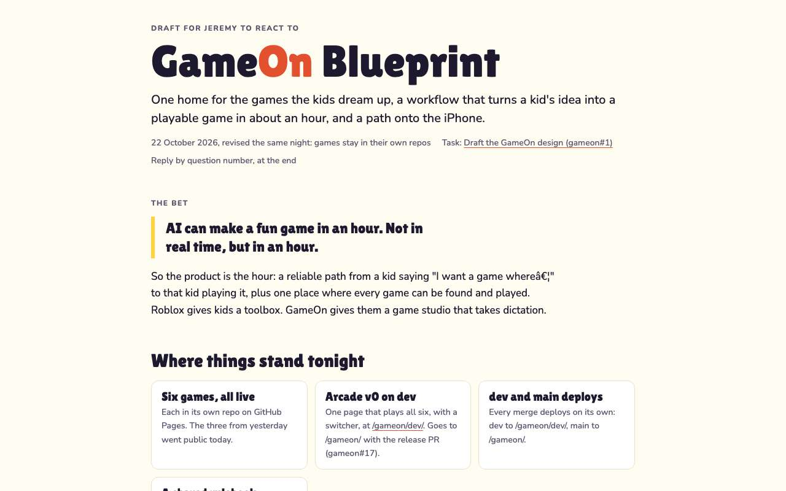
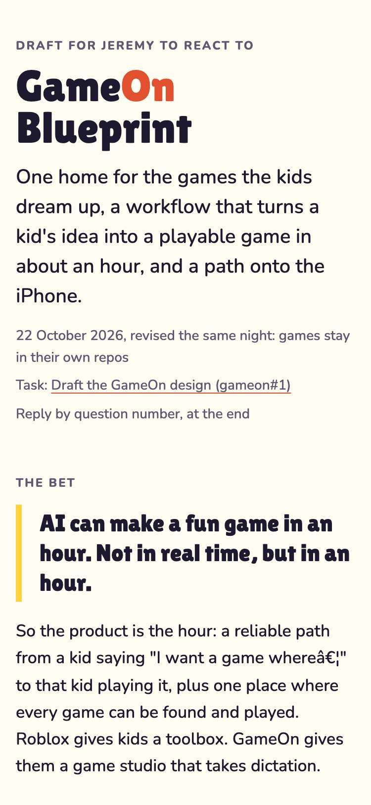
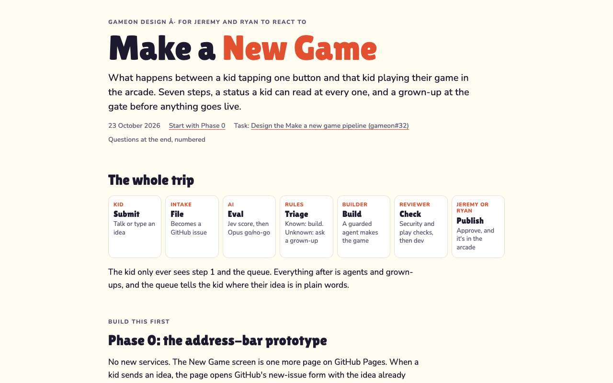
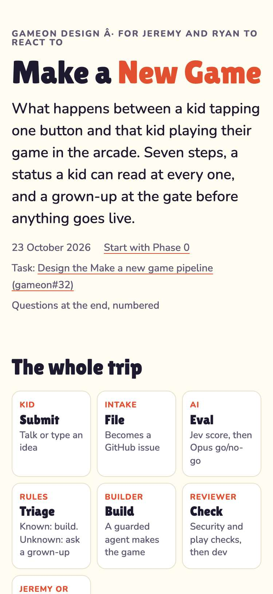

# Evidence: 98-design-viewport

**PASS: 2 of 2 checks pass at desktop and phone widths.**

Generated by `npm run evidence -- 98-design-viewport` from [`tests/evidence/98-design-viewport.spec.mjs`](../../tests/evidence/98-design-viewport.spec.mjs) against the local server (python3 -m http.server) on this branch, starting from commit 28ba28b, 2026-10-23 11:32 UTC. Rules: [docs/evidence.md](../../docs/evidence.md).

| Check | Desktop 1280 | Phone 375 |
|---|---|---|
| the GameOn Blueprint page has a viewport tag and fits the screen | pass | pass |
| the Make a New Game page has a viewport tag and fits the screen | pass | pass |

## 1. the GameOn Blueprint page has a viewport tag and fits the screen

- desktop: 1280px wide, nothing scrolls sideways
- phone: 375px wide, nothing scrolls sideways

 

## 2. the Make a New Game page has a viewport tag and fits the screen

- desktop: 1280px wide, nothing scrolls sideways
- phone: 375px wide, nothing scrolls sideways

 
