# Evidence: ideas-2-ant-farm-wars

**PASS: 8 of 8 checks pass at desktop and phone widths.**

Generated by `npm run evidence -- ideas-2-ant-farm-wars` from [`tests/evidence/ideas-2-ant-farm-wars.spec.mjs`](../../tests/evidence/ideas-2-ant-farm-wars.spec.mjs) against the local server (python3 -m http.server) on this branch, starting from commit 93a09d8, 2026-10-25 11:43 UTC. Rules: [docs/evidence.md](../../docs/evidence.md).

| Check | Desktop 1280 | Phone 375 |
|---|---|---|
| the title screen opens and a game starts with 3 cards to pick, with nothing loaded from the internet | pass | pass |
| picking a card starts the round: every rival picks too, and the ants dig glowing tunnels on their own | pass | pass |
| tapping a rival's nest sends your soldiers there, tapping elsewhere plants a flag, and dragging looks around | pass | pass |
| all four powers work from their buttons: fire, glue, cave-in and flying scouts | pass | pass |
| a round ends with a new pick that shows what the rivals took, and taking a queen's chamber knocks a colony out | pass | pass |
| the robot player can win, the win is saved only under gameon.ant-farm-wars., and losing shows your place | pass | pass |
| pause stops the farm, Start over starts a new game, speed-up works, and it plays when saving is blocked | pass | pass |
| Ant Farm Wars has a card right after the Editor's Choice games and plays in its frame | pass | pass |

## 1. the title screen opens and a game starts with 3 cards to pick, with nothing loaded from the internet

- desktop: round 1 offers: Tough Soldiers, Tunnel Cave-in, Flying Scouts; 14 cards in all (14); no requests outside the site; no sideways scrolling
- phone: round 1 offers: Tough Soldiers, Tunnel Cave-in, Flying Scouts; 14 cards in all (14); no requests outside the site; no sideways scrolling

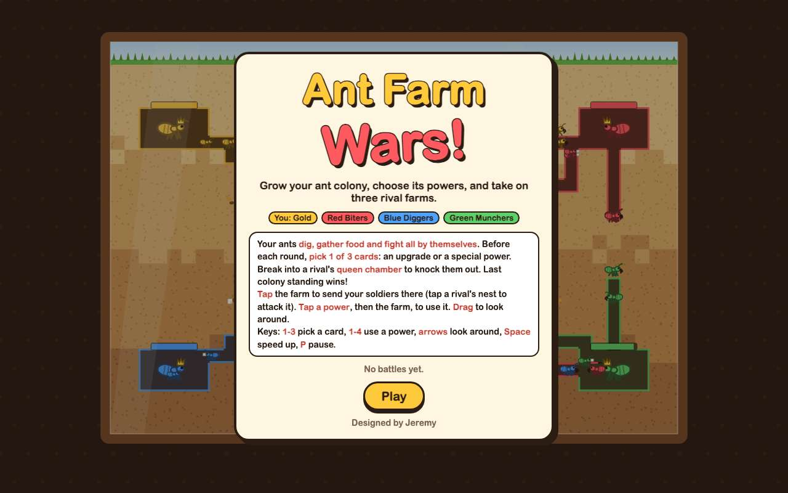 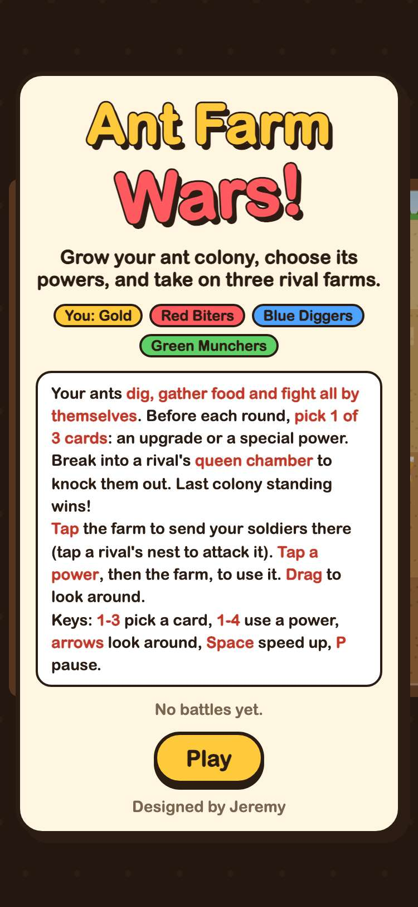

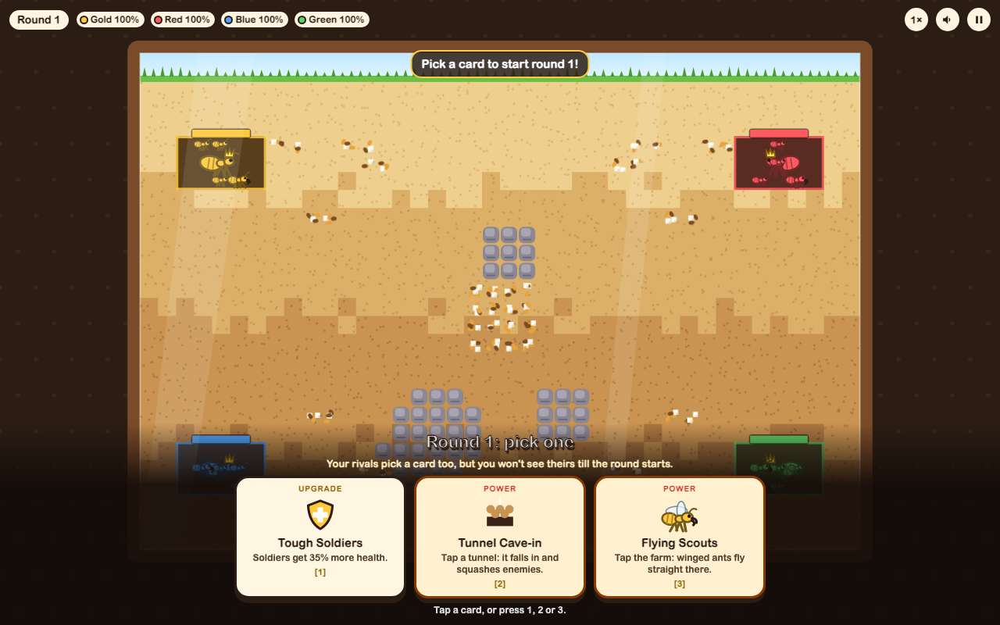 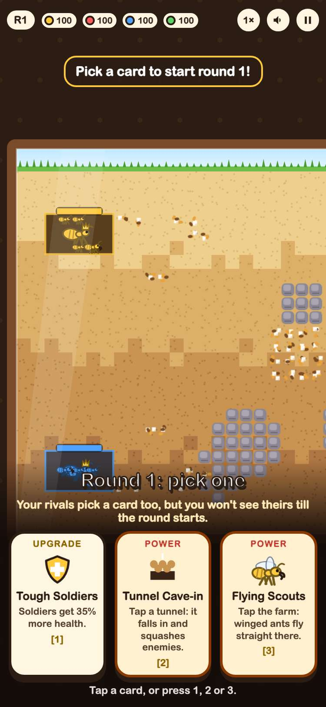

## 2. picking a card starts the round: every rival picks too, and the ants dig glowing tunnels on their own

- desktop: pressed 1; Red took Fire Ants, Blue took Flying Scouts, Green took Glue Spit; after 18 seconds the colonies had dug 46 new tunnel cells (food: 5/3/0/3)
- phone: tapped the first card; Red took Fire Ants, Blue took Flying Scouts, Green took Glue Spit; after 18 seconds the colonies had dug 46 new tunnel cells (food: 5/3/0/3)

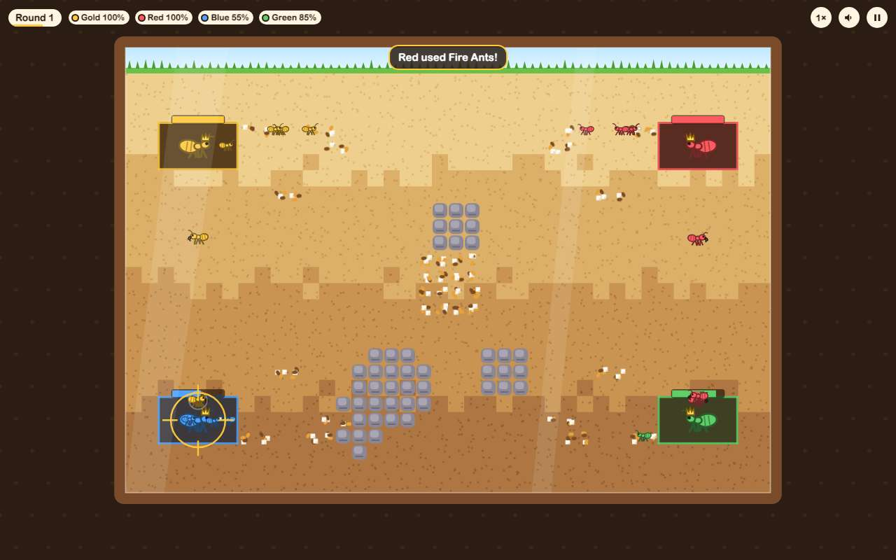 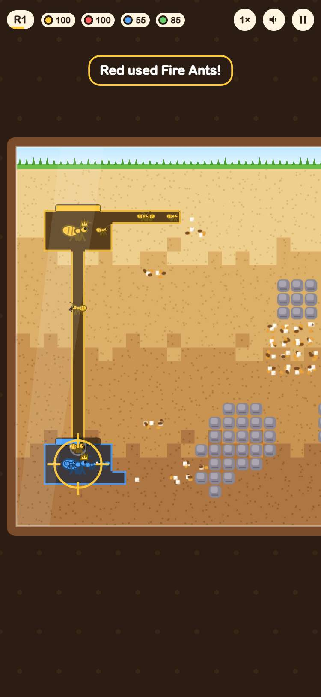

## 3. tapping a rival's nest sends your soldiers there, tapping elsewhere plants a flag, and dragging looks around

- desktop: tapping Blue's nest made it the target; tapping the dirt planted a flag at 9,12 and tapping it again took it away; the whole farm fits, so there's nothing to drag
- phone: tapping Blue's nest made it the target; tapping the dirt planted a flag at 9,12 and tapping it again took it away; dragging left moved the farm 100px

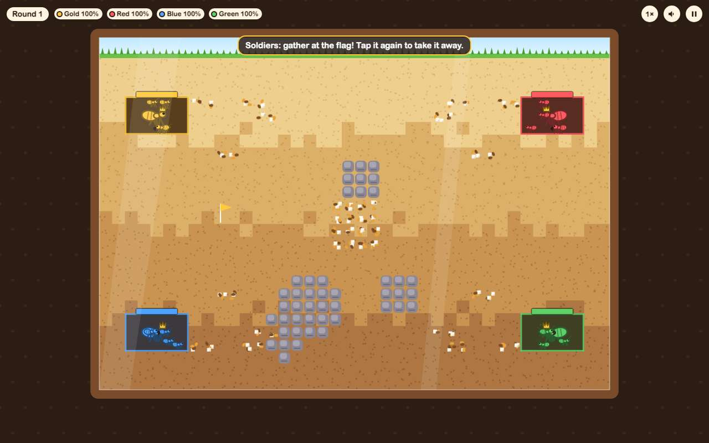 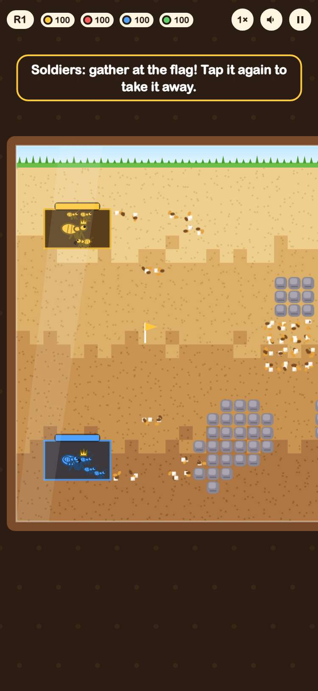

## 4. all four powers work from their buttons: fire, glue, cave-in and flying scouts

- desktop: at cell 4,8: fire took Blue's ants from 30 to 0 health, glue made a puddle, the cave-in filled 5+ tunnel cells back in, and 2 flying scouts took off; all four buttons show their recharge
- phone: at cell 4,8: fire took Blue's ants from 30 to 0 health, glue made a puddle, the cave-in filled 5+ tunnel cells back in, and 2 flying scouts took off; all four buttons show their recharge

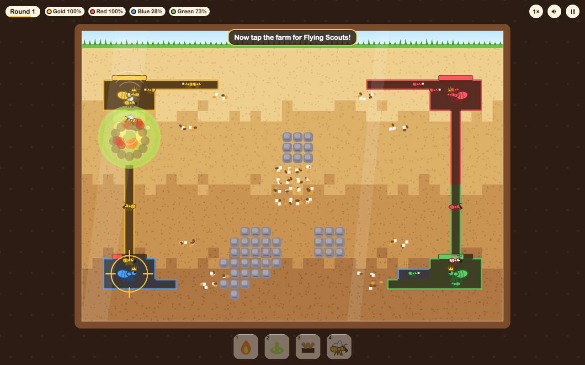 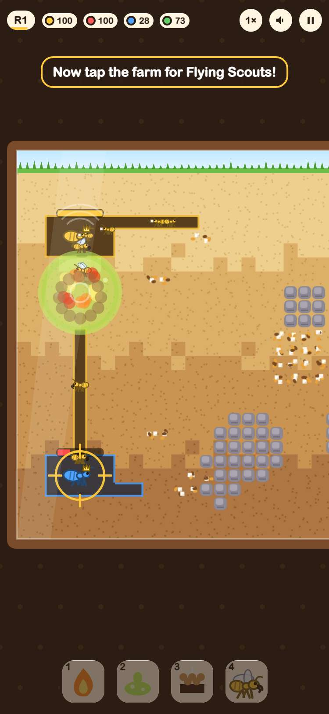

## 5. a round ends with a new pick that shows what the rivals took, and taking a queen's chamber knocks a colony out

- desktop: round 2 pick showed “Last round the rivals took: Red Fire Ants · Blue Flying Scouts · Green Glue Spit”; a gold soldier in Red's chamber bit the queen and the Red Biters were knocked out
- phone: round 2 pick showed “Last round the rivals took: Red Fire Ants · Blue Flying Scouts · Green Glue Spit”; a gold soldier in Red's chamber bit the queen and the Red Biters were knocked out

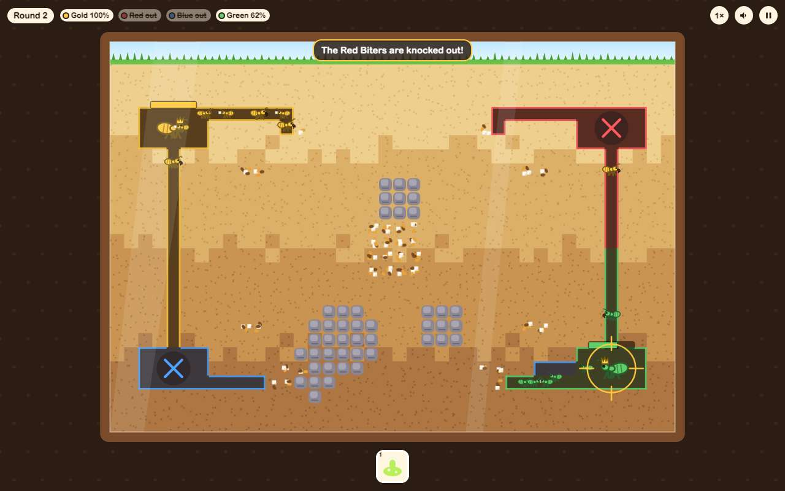 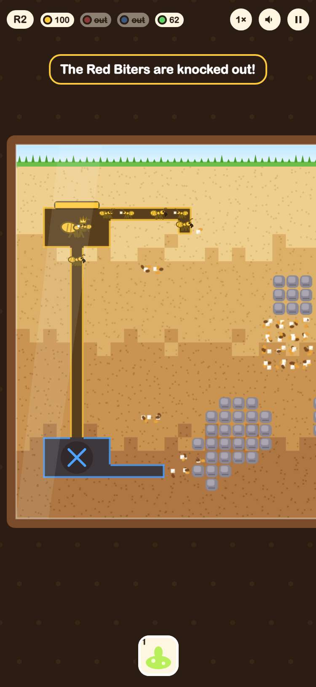

## 6. the robot player can win, the win is saved only under gameon.ant-farm-wars., and losing shows your place

- desktop: robot won 14 of 20 whole games (rounds: W8 W8 L10 W10 L12 W4 W13 L9 L9 W7 W6 L6 W10 W7 W12 W5 W11 W9 L10 W10); in the game it won seed 6 in 4 rounds; after a reload the title shows the record and the only keys are gameon.ant-farm-wars.record; a queen bitten to nothing in round 1 shows “Knocked out!” and 4th place
- phone: robot won 14 of 20 whole games (rounds: W8 W8 L10 W10 L12 W4 W13 L9 L9 W7 W6 L6 W10 W7 W12 W5 W11 W9 L10 W10); in the game it won seed 6 in 4 rounds; after a reload the title shows the record and the only keys are gameon.ant-farm-wars.record; a queen bitten to nothing in round 1 shows “Knocked out!” and 4th place

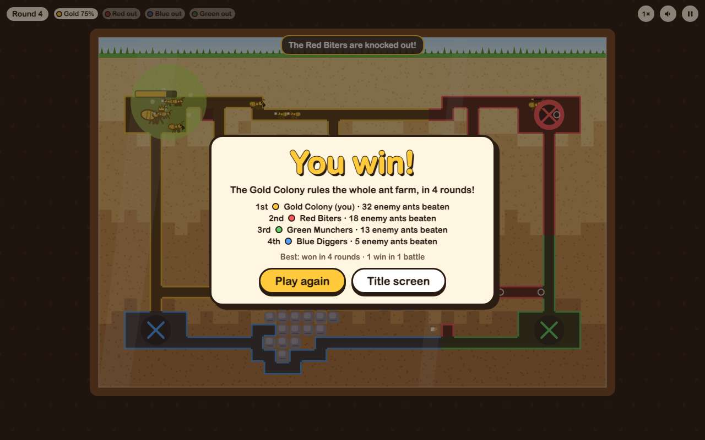 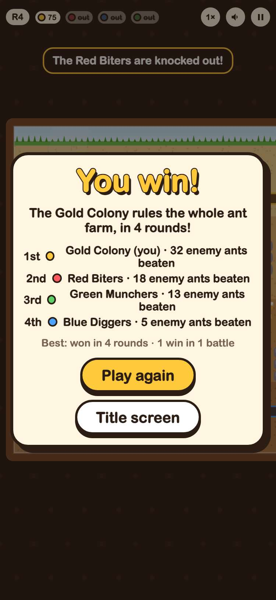

## 7. pause stops the farm, Start over starts a new game, speed-up works, and it plays when saving is blocked

- desktop: paused at 0.53s and the clock stayed put; resuming ran it on; the speed button went to 2×; Start over went back to a fresh round 1 pick; with localStorage throwing, a game still started and ran
- phone: paused at 0.53s and the clock stayed put; resuming ran it on; the speed button went to 2×; Start over went back to a fresh round 1 pick; with localStorage throwing, a game still started and ran

## 8. Ant Farm Wars has a card right after the Editor's Choice games and plays in its frame

- desktop: card at position 2, after the 1 Editor's Choice card(s) and ahead of devils-burger-station, with its 800x450 cover; plays inside the frame; GitHub button opens its folder
- phone: card at position 2, after the 1 Editor's Choice card(s) and ahead of devils-burger-station, with its 800x450 cover; plays inside the frame; GitHub button opens its folder

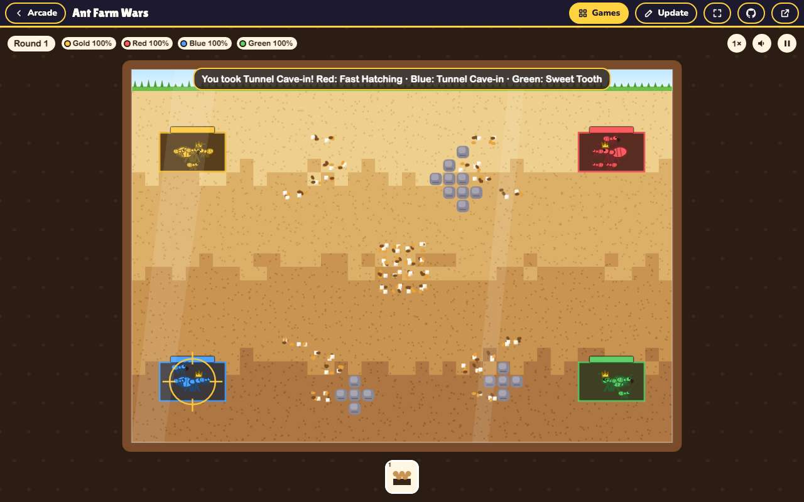 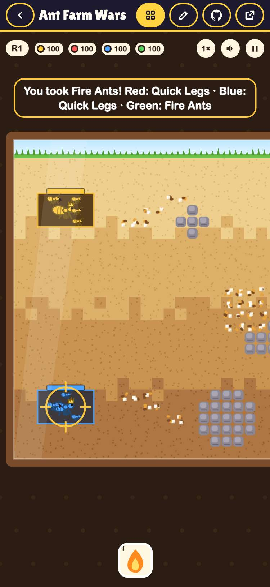
