# Evidence: ideas-3-pet-wash-payback-jeremy-v3

**PASS: 9 of 9 checks pass at desktop and phone widths.**

Generated by `npm run evidence -- ideas-3-pet-wash-payback-jeremy-v3` from [`tests/evidence/ideas-3-pet-wash-payback-jeremy-v3.spec.mjs`](../../tests/evidence/ideas-3-pet-wash-payback-jeremy-v3.spec.mjs) against the local server (python3 -m http.server) on this branch, starting from commit 3266b48, 2026-10-26 02:17 UTC. Rules: [docs/evidence.md](../../docs/evidence.md).

| Check | Desktop 1280 | Phone 375 |
|---|---|---|
| jeremy.v3 opens to its title screen with a new Survival button, and loads nothing from outside the site | pass | pass |
| Survival: no timer; Biscuit starts alone with the hose, and more animals keep joining, each with a name tag | pass | pass |
| Survival: past the on-screen cap, new animals wait on the fence and everyone attacks more often | pass | pass |
| Survival ends at 100% wet, shows how long you lasted and how many were chasing, and saves the best time | pass | pass |
| Survival can be paused, and R starts a fresh run | pass | pass |
| what stays: the normal game is jeremy.v2's, and plays the same as jeremy.v2 with the same seed | pass | pass |
| saves: jeremy.v1's and jeremy.v2's saves load, and stay exactly as they were | pass | pass |
| jeremy.v2 and jeremy.v1 still play | pass | pass |
| in the arcade, Pet Wash Payback plays jeremy.v3 by default, Survival starts there, and the picker still offers jeremy.v2 and jeremy.v1 | pass | pass |

## 1. jeremy.v3 opens to its title screen with a new Survival button, and loads nothing from outside the site

- desktop: title shows Play!, Survival! and Pick a pet → Survival! → "How long can you last?" → Go! starts a run at 0:00 with 1 chasing; no requests outside the site (jeremy.v2 made none either); no sideways scrolling
- phone: title shows Play!, Survival! and Pick a pet → Survival! → "How long can you last?" → Go! starts a run at 0:00 with 1 chasing; no requests outside the site (jeremy.v2 made none either); no sideways scrolling

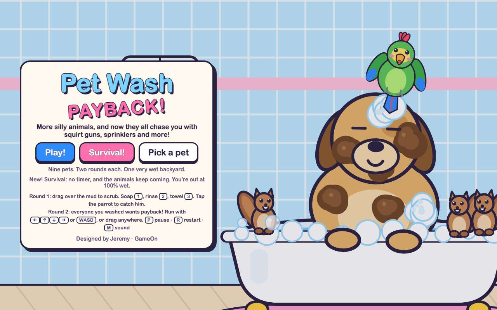 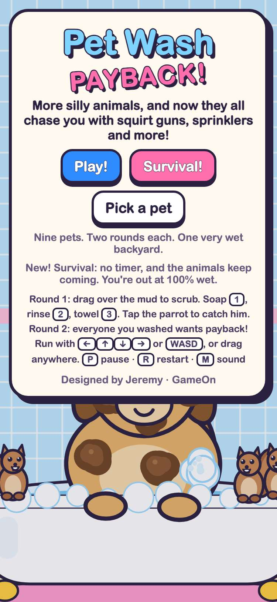

## 2. Survival: no timer; Biscuit starts alone with the hose, and more animals keep joining, each with a name tag

- desktop: started with Biscuit alone (the hose); joined at 5 s Truffle (mud splash), 10 s The Nutty Gang (bucket), 15 s Inky (8 squirt guns), 20 s Pickles (rain cloud), each with a name tag; the HUD said "3 chasing" at 0:10 and "5 chasing" at 0:20, counting up
- phone: started with Biscuit alone (the hose); joined at 5 s Inky (8 squirt guns), 10 s Bubbles (belly flop), 15 s Clover (sprinkler), 20 s Truffle (mud splash), each with a name tag; the HUD said "3 chasing" at 0:10 and "5 chasing" at 0:20, counting up

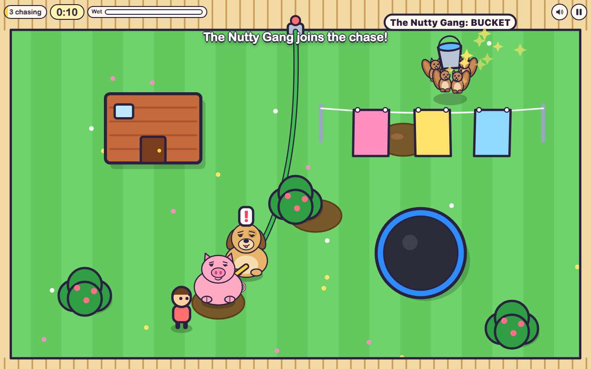 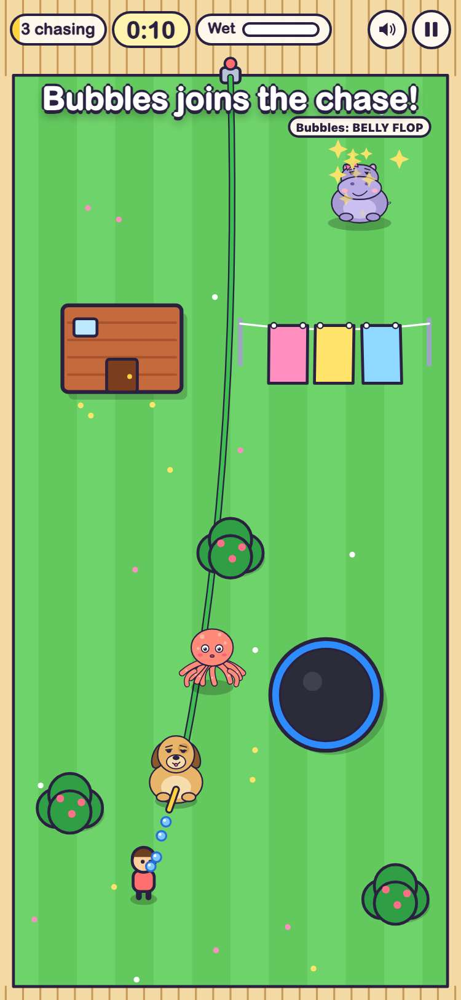

## 3. Survival: past the on-screen cap, new animals wait on the fence and everyone attacks more often

- desktop: at most 5 in the yard on this screen; the rest wait on the fence and tag in (5 s: 2 + 0 on the fence, 10 s: 3 + 0 on the fence, 15 s: 4 + 0 on the fence, 20 s: 5 + 0 on the fence, 25 s: 5 + 1 on the fence, 30 s: 5 + 2 on the fence, 35 s: 5 + 3 on the fence, 40 s: 5 + 4 on the fence, 45 s: 5 + 5 on the fence, 50 s: 5 + 6 on the fence, 55 s: 5 + 7 on the fence); each one past the cap makes everyone's wait between attacks shorter (×1.98 speed by 55 s): standing still, Biscuit waited 1.35 s between sprays on average in the 10 s after the yard filled (4 sprays), and 0.92 s twenty seconds later (4 sprays); still exactly one hose
- phone: at most 4 in the yard on this screen; the rest wait on the fence and tag in (5 s: 2 + 0 on the fence, 10 s: 3 + 0 on the fence, 15 s: 4 + 0 on the fence, 20 s: 4 + 1 on the fence, 25 s: 4 + 2 on the fence, 30 s: 4 + 3 on the fence, 35 s: 4 + 4 on the fence, 40 s: 4 + 5 on the fence, 45 s: 4 + 6 on the fence, 50 s: 4 + 7 on the fence); each one past the cap makes everyone's wait between attacks shorter (×1.98 speed by 50 s): standing still, Biscuit waited 1.27 s between sprays on average in the 10 s after the yard filled (4 sprays), and 0.83 s twenty seconds later (4 sprays); still exactly one hose

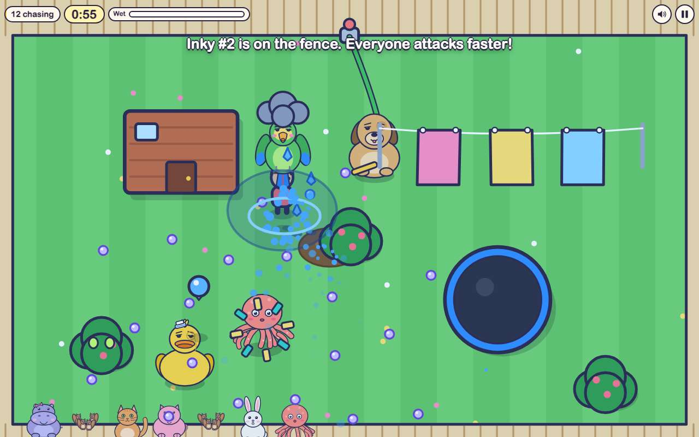 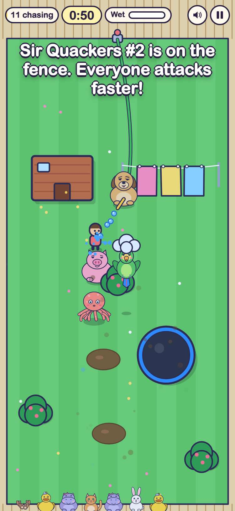

## 4. Survival ends at 100% wet, shows how long you lasted and how many were chasing, and saves the best time

- desktop: a dodging player lasted 0:36.4 with 8 animals chasing (Biscuit plus one more per 5 s), then SOAKED at 100%: the end screen showed the time, the count and "New best time!", saved as {"best":36.4,"animals":8,"runs":1}. Try again → 0:00, 1 chasing; standing still lasted 17.2 s, and the screen showed the best instead. After a reload the title says so too. Keys: gameon.pet-wash-payback.jeremy.v3.survival
- phone: a dodging player lasted 1:17.5 with 16 animals chasing (Biscuit plus one more per 5 s), then SOAKED at 100%: the end screen showed the time, the count and "New best time!", saved as {"best":77.5,"animals":16,"runs":1}. Try again → 0:00, 1 chasing; standing still lasted 21.9 s, and the screen showed the best instead. After a reload the title says so too. Keys: gameon.pet-wash-payback.jeremy.v3.survival

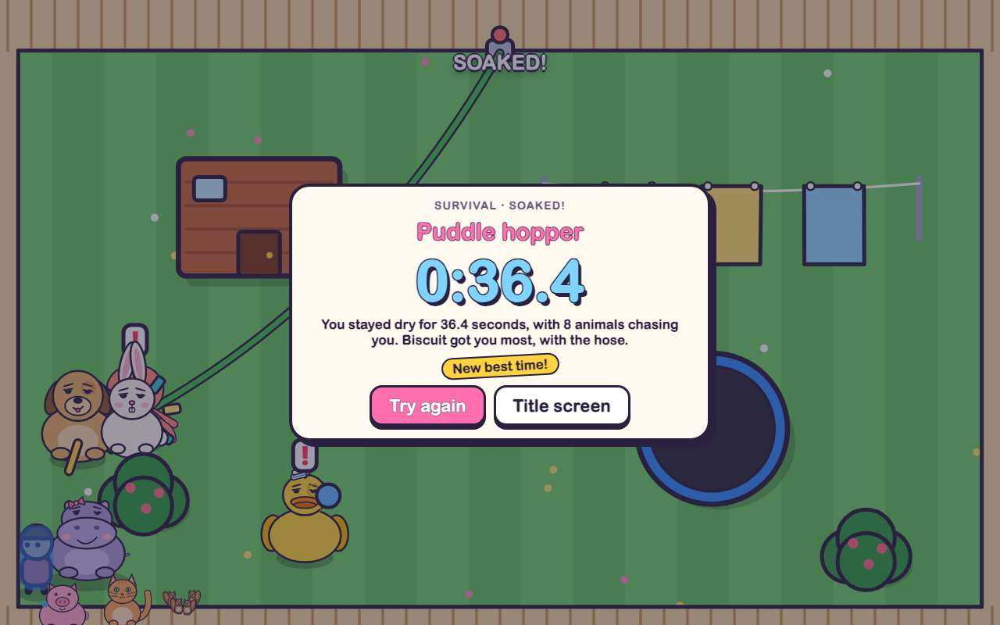 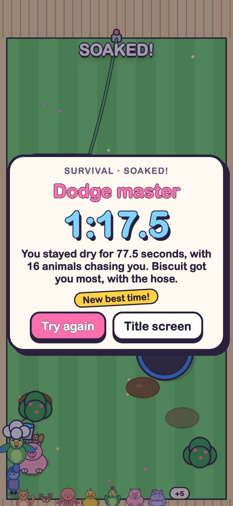

## 5. Survival can be paused, and R starts a fresh run

- desktop: paused at 12.0 s and the clock stayed put; Keep going, then R: a new Survival run at 0:00 with 1 chasing
- phone: paused at 12.0 s and the clock stayed put; Keep going, then R: a new Survival run at 0:00 with 1 chasing

## 6. what stays: the normal game is jeremy.v2's, and plays the same as jeremy.v2 with the same seed

- desktop: pets, weapons, speeds and scrub work are byte for byte jeremy.v2's. With seed 3, the same washing and dodging players got the same results in jeremy.v2 and jeremy.v3: Pickles washed with 28.47 s left (3 catches), and the nine-pet payback ended "SOAKED!" at 100% wet from 118 hits. Through the buttons: Play! → Biscuit's wash (0:35) → payback counting down 0:20 → 0:17 after 3.5 s → result → "Next: Mittens"
- phone: pets, weapons, speeds and scrub work are byte for byte jeremy.v2's. With seed 3, the same washing and dodging players got the same results in jeremy.v2 and jeremy.v3: Pickles washed with 25.53 s left (3 catches), and the nine-pet payback ended "SOAKED!" at 100% wet from 56 hits. Through the buttons: Play! → Biscuit's wash (0:35) → payback counting down 0:20 → 0:17 after 3.5 s → result → "Next: Mittens"

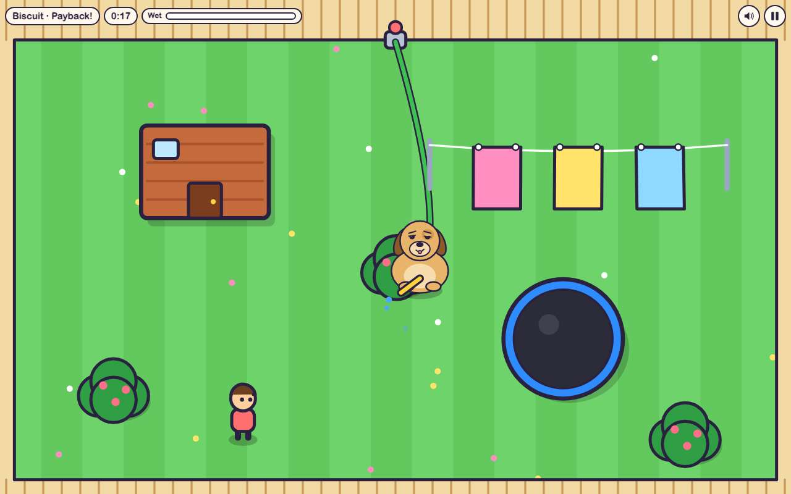 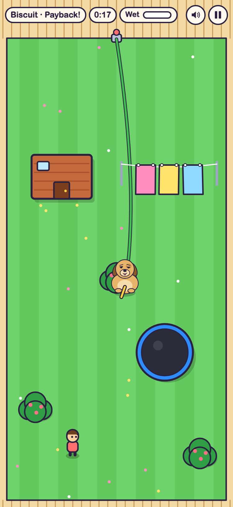

## 7. saves: jeremy.v1's and jeremy.v2's saves load, and stay exactly as they were

- desktop: seeded jeremy.v1's keys (best 4321, reached 3, muted) and jeremy.v2's (best 9876, reached 6): jeremy.v3 shows 9876 on its title, the better stars of the two in Pick a pet, the first 6 pets open and the sound off. After Biscuit's two rounds and a Survival run, all five old keys are byte for byte the same; new keys: gameon.pet-wash-payback.jeremy.v3.best, gameon.pet-wash-payback.jeremy.v3.reached, gameon.pet-wash-payback.jeremy.v3.survival; jeremy.v2 and jeremy.v1 still show their own bests
- phone: seeded jeremy.v1's keys (best 4321, reached 3, muted) and jeremy.v2's (best 9876, reached 6): jeremy.v3 shows 9876 on its title, the better stars of the two in Pick a pet, the first 6 pets open and the sound off. After Biscuit's two rounds and a Survival run, all five old keys are byte for byte the same; new keys: gameon.pet-wash-payback.jeremy.v3.best, gameon.pet-wash-payback.jeremy.v3.reached, gameon.pet-wash-payback.jeremy.v3.survival; jeremy.v2 and jeremy.v1 still show their own bests

## 8. jeremy.v2 and jeremy.v1 still play

- desktop: jeremy.v2 at games/pet-wash-payback/jeremy.v2/ (no Survival button): "Pet 1 of 9", Biscuit's wash running; jeremy.v1 at games/pet-wash-payback/: "Pet 1 of 5", Biscuit's wash running
- phone: jeremy.v2 at games/pet-wash-payback/jeremy.v2/ (no Survival button): "Pet 1 of 9", Biscuit's wash running; jeremy.v1 at games/pet-wash-payback/: "Pet 1 of 5", Biscuit's wash running

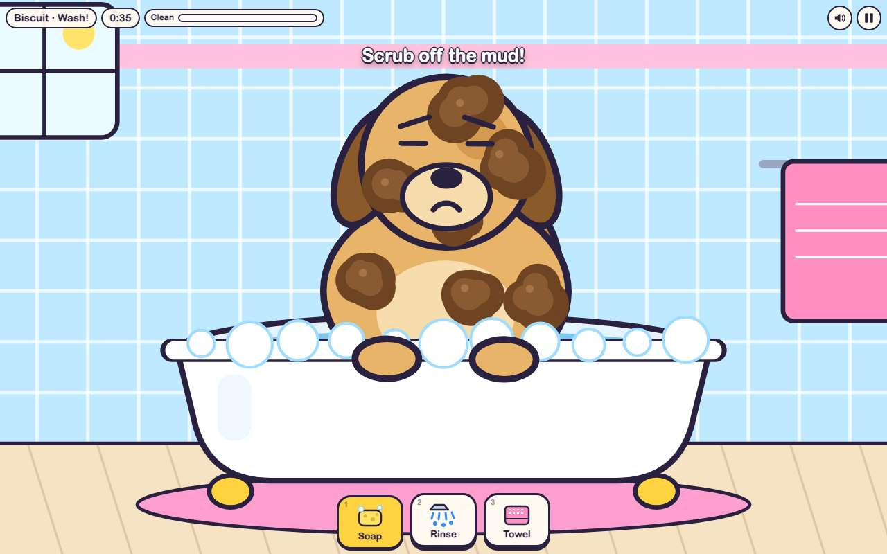 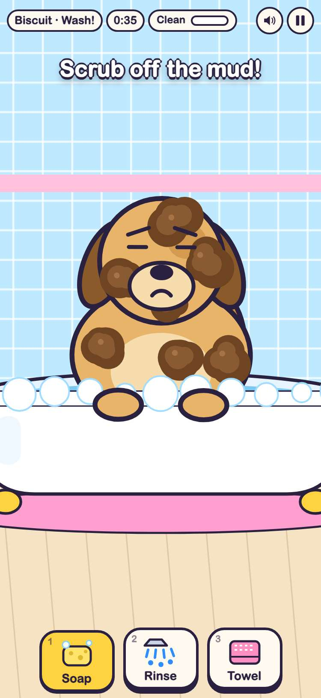

## 9. in the arcade, Pet Wash Payback plays jeremy.v3 by default, Survival starts there, and the picker still offers jeremy.v2 and jeremy.v1

- desktop: card (3 versions) → picker: jeremy.v3 Latest first, then jeremy.v2 and jeremy.v1 → jeremy.v3 in the frame: Survival! → Go! → a run with its chasing count; #pet-wash-payback@jeremy.v2 opens jeremy.v2 (no Survival button)
- phone: card (3 versions) → picker: jeremy.v3 Latest first, then jeremy.v2 and jeremy.v1 → jeremy.v3 in the frame: Survival! → Go! → a run with its chasing count; #pet-wash-payback@jeremy.v2 opens jeremy.v2 (no Survival button)

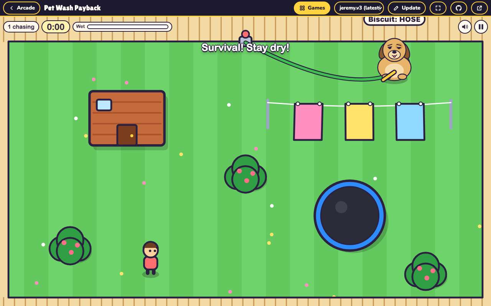 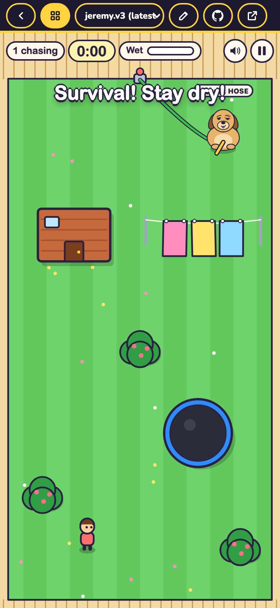
