# Evidence: ideas-6-pet-wash-payback-kiki-v1

**PASS: 11 of 11 checks pass at desktop and phone widths.**

Generated by `npm run evidence -- ideas-6-pet-wash-payback-kiki-v1` from [`tests/evidence/ideas-6-pet-wash-payback-kiki-v1.spec.mjs`](../../tests/evidence/ideas-6-pet-wash-payback-kiki-v1.spec.mjs) against the local server (python3 -m http.server) on this branch, starting from commit 072b7fe, 2026-10-26 03:57 UTC. Rules: [docs/evidence.md](../../docs/evidence.md).

| Check | Desktop 1280 | Phone 375 |
|---|---|---|
| kiki.v1 opens to its title screen with Leo in the tub, and Play starts Biscuit's wash, with nothing loaded from outside the site | pass | pass |
| Leo the Lion: mane mud takes extra scrubbing, his roar blows the bubbles off a soapy spot, and he shakes his mane dry | pass | pass |
| Leo's payback: his mane puffs up as the warning, then rings of drops fly out all around him, and the slide blocks them | pass | pass |
| the payback moves to school: three rounds in the backyard, then the hallway, the classroom and the playground, each with its own cover | pass | pass |
| at school every animal keeps its own way of getting you wet, and all ten can be in the playground at once | pass | pass |
| payback builds up over the ten rounds and four places: a dodging player escapes most, a still one gets soaked | pass | pass |
| what stays: a real drag soaps, rinses and towels a spot; the arrow keys or a drag joystick run; pause and restart work | pass | pass |
| a whole game through the real buttons: ten pets washed, ten payback rounds across four places, a final score | pass | pass |
| saves: jeremy.v2's and jeremy.v1's best scores, stars, unlocked pets and sound setting load, and their keys stay as they were | pass | pass |
| jeremy.v2 and jeremy.v1 still play at their own folders | pass | pass |
| in the arcade, kiki.v1 is a fork from jeremy.v2 in the version picker and plays in the frame, and the game's default doesn't change | pass | pass |

## 1. kiki.v1 opens to its title screen with Leo in the tub, and Play starts Biscuit's wash, with nothing loaded from outside the site

- desktop: title shows the one-liner and Leo at the back of the tub; 10 pets (dog, cat, squirrel, bunny, parrot, pig, hippo, octopus, lion, duck); Play → "Pet 1 of 10" → Biscuit in the tub with 7 mud spots and 35 s; no requests outside the site (jeremy.v2 made none either); no sideways scrolling
- phone: title shows the one-liner and Leo at the back of the tub; 10 pets (dog, cat, squirrel, bunny, parrot, pig, hippo, octopus, lion, duck); Play → "Pet 1 of 10" → Biscuit in the tub with 7 mud spots and 35 s; no requests outside the site (jeremy.v2 made none either); no sideways scrolling

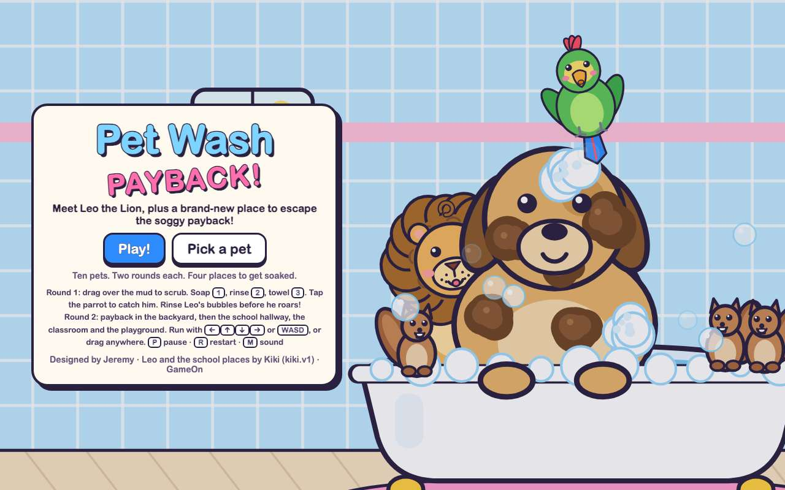 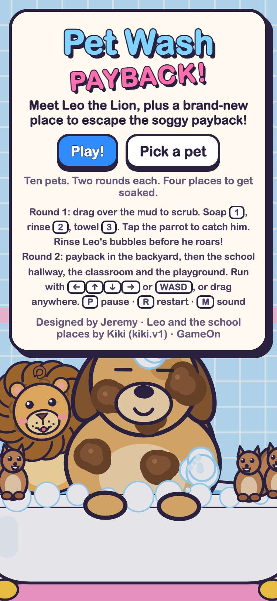

## 2. Leo the Lion: mane mud takes extra scrubbing, his roar blows the bubbles off a soapy spot, and he shakes his mane dry

- desktop: 4 of Leo's 10 spots are in his mane and need 437.5 soap work instead of 250: the same scrubbing took 84 frames there against 48 on a plain spot. With one spot soapy, he breathed in after 2.4 s ("Leo takes a BIG breath... rinse the bubbles!"), roared 1 s later and that spot went back to mud ("ROOOAR! ...hic! The bubbles blew right off!"). Bath finished with 18 s left after 4 roars (3 spots redone), then "Leo shakes his mane dry! FWOOMF!"; 2 stars
- phone: 4 of Leo's 10 spots are in his mane and need 437.5 soap work instead of 250: the same scrubbing took 101 frames there against 58 on a plain spot. With one spot soapy, he breathed in after 2.8 s ("Leo takes a BIG breath... rinse the bubbles!"), roared 1 s later and that spot went back to mud ("ROOOAR! ...hic! The bubbles blew right off!"). Bath finished with 10 s left after 5 roars (4 spots redone), then "Leo shakes his mane dry! FWOOMF!"; 2 stars

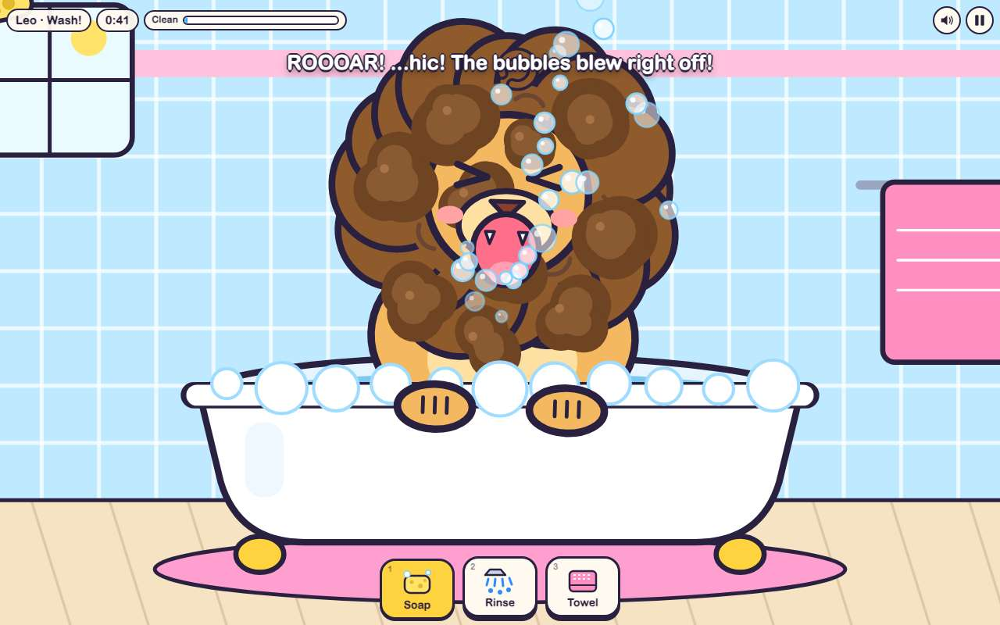 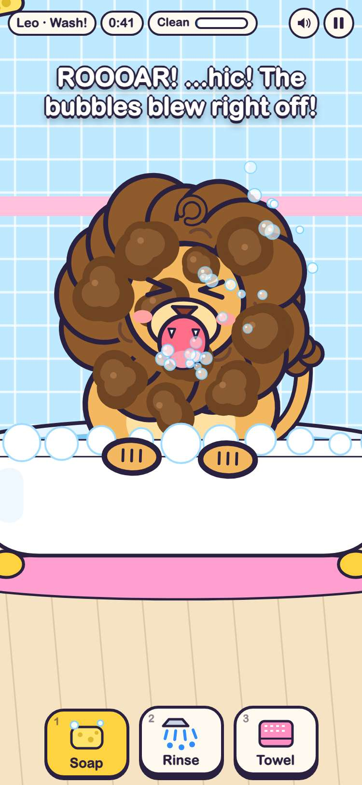

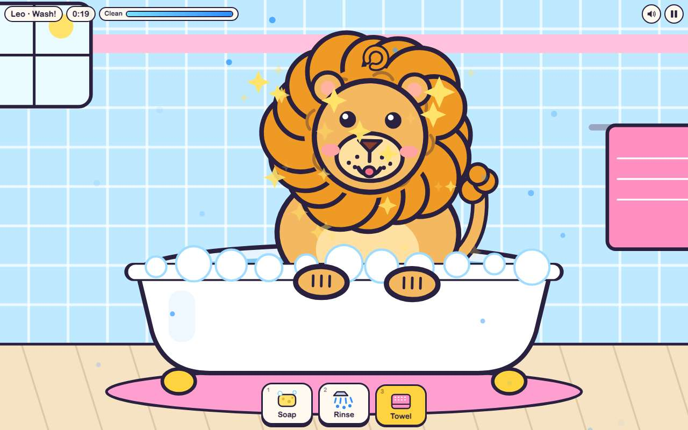 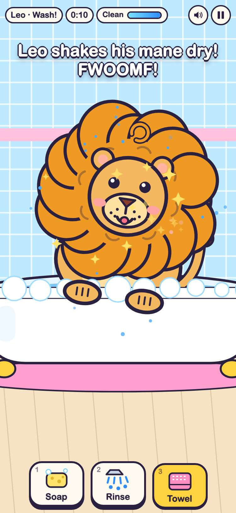

## 3. Leo's payback: his mane puffs up as the warning, then rings of drops fly out all around him, and the slide blocks them

- desktop: in the playground, standing out in the open: Leo got within 147 px after 0.3 s and puffed up his mane (no water yet) for 0.85 s, then shook: a ring of 30 drops flying out in all 8 directions, then a second ring; 4 of them hit the kid (13% wet). The same two rings with the slide between them, 190 px apart: 0 hits, 0% wet
- phone: in the playground, standing out in the open: Leo got within 147 px after 1.9 s and puffed up his mane (no water yet) for 0.85 s, then shook: a ring of 30 drops flying out in all 8 directions, then a second ring; 4 of them hit the kid (13% wet). The same two rings with the slide between them, 190 px apart: 0 hits, 0% wet

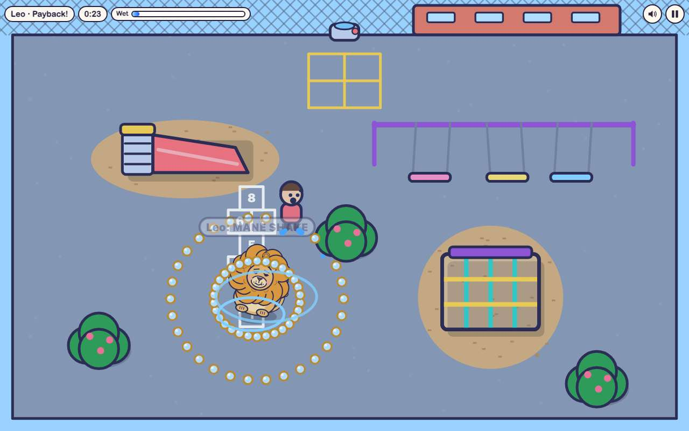 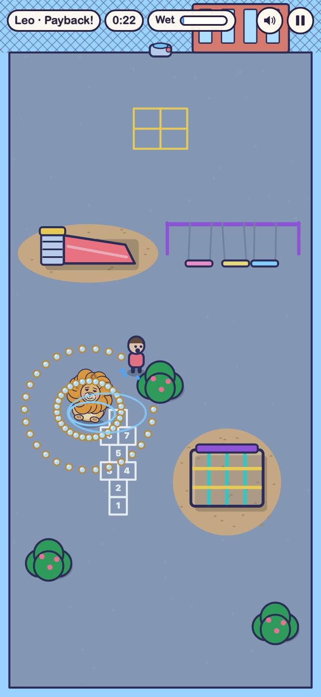

## 4. the payback moves to school: three rounds in the backyard, then the hallway, the classroom and the playground, each with its own cover

- desktop: places by pet: Biscuit backyard, Mittens backyard, The Nutty Gang backyard, Clover hallway, Pickles hallway, Truffle classroom, Bubbles classroom, Inky playground, Leo playground, Sir Quackers playground. Pick a pet shows them, with Leo open (NEW!). hallway: lockers, lockers (water blocked through each), Mittens hides in backpacks, art on a line; classroom: desks, desks, teacher (water blocked through each), Mittens hides in beanbag, nothing on a line; playground: slide, climber (water blocked through each), Mittens hides in bush, swing on a line
- phone: places by pet: Biscuit backyard, Mittens backyard, The Nutty Gang backyard, Clover hallway, Pickles hallway, Truffle classroom, Bubbles classroom, Inky playground, Leo playground, Sir Quackers playground. Pick a pet shows them, with Leo open (NEW!). hallway: lockers, lockers (water blocked through each), Mittens hides in backpacks, art on a line; classroom: desks, desks, teacher (water blocked through each), Mittens hides in beanbag, nothing on a line; playground: slide, climber (water blocked through each), Mittens hides in bush, swing on a line

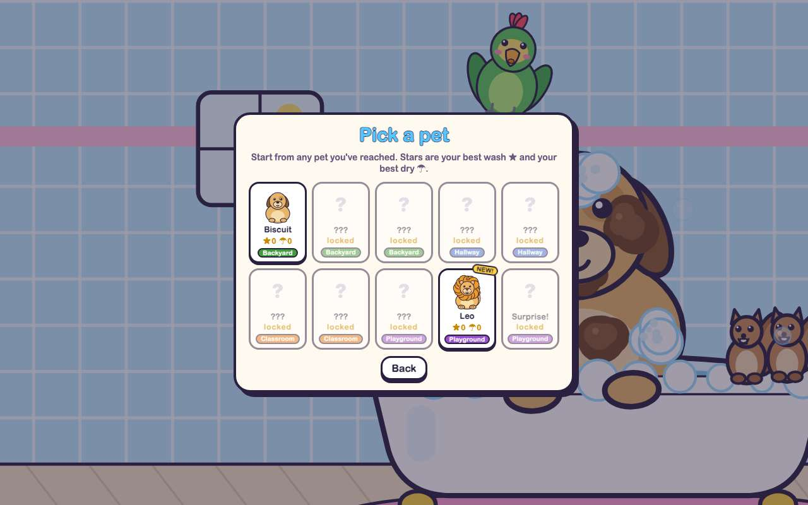 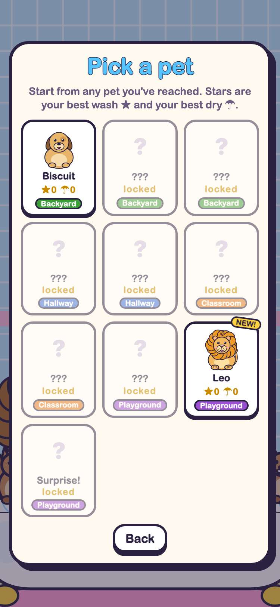

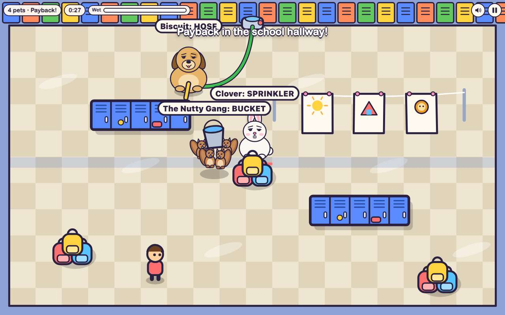 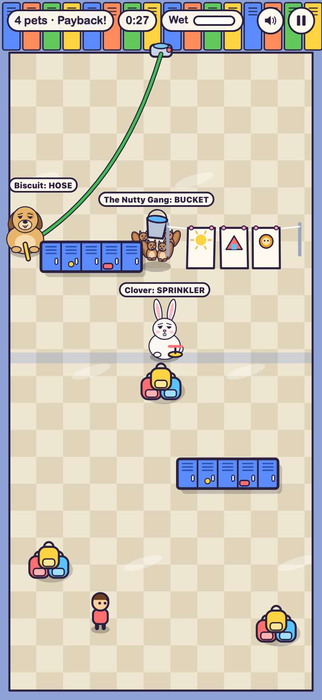

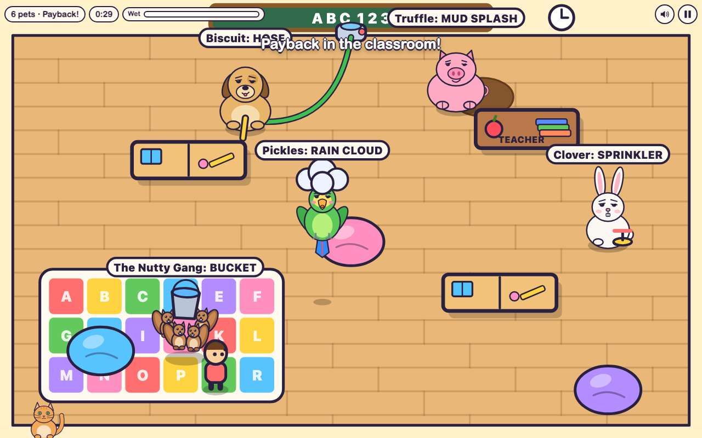 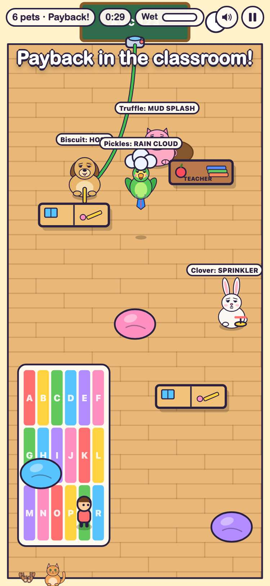

## 5. at school every animal keeps its own way of getting you wet, and all ten can be in the playground at once

- desktop: all ten in the playground: 5 at once (duck, dog, lion, octopus, hippo), the rest tag in from the bench; every pet joined in the 30 s round; 10 different kinds of water seen (balloon, bucket, hose, mane, mud, octo, rain, sprinkle, squirt, wave); exactly one hose. Alone, each got a still kid wet: hallway: dog 2 s, cat 2.6 s, squirrel 2.7 s, bunny 1.8 s, parrot 2.9 s, pig 2.6 s, hippo 3.2 s, octopus 2.8 s, lion 2.7 s, duck 2.8 s; classroom: dog 2.3 s, cat 2.6 s, squirrel 2.9 s, bunny 1.8 s, parrot 2.9 s, pig 4.2 s, hippo 6.2 s, octopus 2.8 s, lion 2.9 s, duck 2.8 s; playground: dog 2 s, cat 2.6 s, squirrel 2.7 s, bunny 1.8 s, parrot 2.9 s, pig 2.6 s, hippo 3.2 s, octopus 2.8 s, lion 2.7 s, duck 2.8 s
- phone: all ten in the playground: 4 at once (duck, dog, lion, octopus), the rest tag in from the bench; every pet joined in the 31 s round; 9 different kinds of water seen (balloon, bucket, hose, mane, mud, octo, rain, sprinkle, wave); exactly one hose. Alone, each got a still kid wet: hallway: dog 2.2 s, cat 3.2 s, squirrel 2.9 s, bunny 1.9 s, parrot 3.1 s, pig 4.2 s, hippo 6.1 s, octopus 3 s, lion 2.9 s, duck 2.8 s; classroom: dog 2.9 s, cat 3.2 s, squirrel 3.6 s, bunny 1.9 s, parrot 3.1 s, pig 4 s, hippo 7.3 s, octopus 3.5 s, lion 3.7 s, duck 2.8 s; playground: dog 2.2 s, cat 3.2 s, squirrel 2.9 s, bunny 4.3 s, parrot 3.1 s, pig 4.2 s, hippo 6.1 s, octopus 3 s, lion 2.9 s, duck 2.8 s

## 6. payback builds up over the ten rounds and four places: a dodging player escapes most, a still one gets soaked

- desktop: after Biscuit (backyard): 1 pet, 20 s; dodging 17% wet, standing still SOAKED; after Mittens (backyard): 2 pets, 23 s; dodging 5% wet, standing still SOAKED; after The Nutty Gang (backyard): 3 pets, 26 s; dodging 57% wet, standing still SOAKED; after Clover (hallway): 4 pets, 28 s; dodging 27% wet, standing still SOAKED; after Pickles (hallway): 5 pets, 30 s; dodging 77% wet, standing still SOAKED; after Truffle (classroom): 6 pets, 30 s; dodging 23% wet, standing still SOAKED; after Bubbles (classroom): 7 pets, 30 s; dodging 61% wet, standing still SOAKED; after Inky (playground): 8 pets, 30 s; dodging 80% wet, standing still SOAKED; after Leo (playground): 9 pets, 30 s; dodging 44% wet, standing still SOAKED; after Sir Quackers (playground): 10 pets, 30 s; dodging SOAKED, standing still SOAKED
- phone: after Biscuit (backyard): 1 pet, 20 s; dodging 2% wet, standing still SOAKED; after Mittens (backyard): 2 pets, 23 s; dodging 3% wet, standing still SOAKED; after The Nutty Gang (backyard): 3 pets, 26 s; dodging 32% wet, standing still SOAKED; after Clover (hallway): 4 pets, 28 s; dodging 14% wet, standing still SOAKED; after Pickles (hallway): 5 pets, 30 s; dodging 14% wet, standing still SOAKED; after Truffle (classroom): 6 pets, 30 s; dodging 31% wet, standing still SOAKED; after Bubbles (classroom): 7 pets, 30 s; dodging 17% wet, standing still SOAKED; after Inky (playground): 8 pets, 30 s; dodging 9% wet, standing still SOAKED; after Leo (playground): 9 pets, 30 s; dodging 47% wet, standing still SOAKED; after Sir Quackers (playground): 10 pets, 30 s; dodging SOAKED, standing still SOAKED

## 7. what stays: a real drag soaps, rinses and towels a spot; the arrow keys or a drag joystick run; pause and restart work

- desktop: mouse drag: Biscuit's spot 1 went mud → bubbles → wet → clean. In the hallway, holding → and ↑ ran the kid from (236, 423) to (421, 267); paused at 19.0 s and the clock stayed put; Restart started the round over in the hallway; P pauses and unpauses
- phone: touch drag: Biscuit's spot 1 went mud → bubbles → wet → clean. In the hallway, dragging the joystick up and right ran the kid from (150, 931) to (292, 845); paused at 21.0 s and the clock stayed put; Restart started the round over in the hallway; P pauses and unpauses

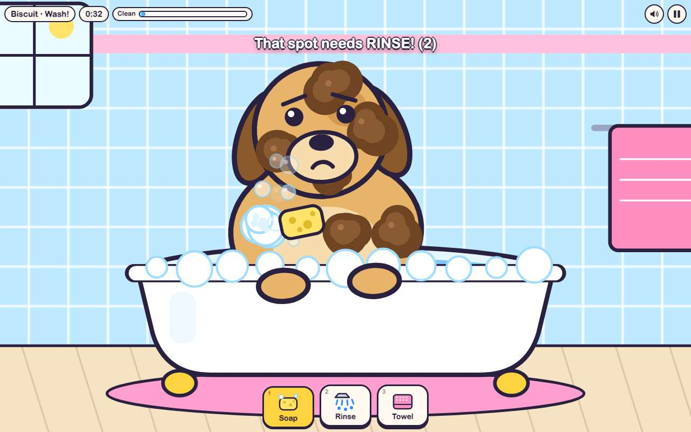 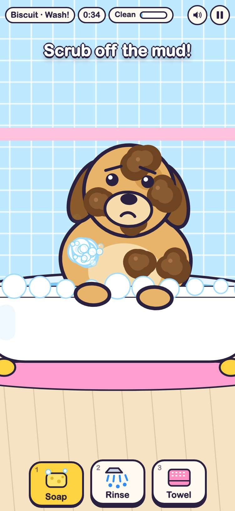

## 8. a whole game through the real buttons: ten pets washed, ten payback rounds across four places, a final score

- desktop: Biscuit: washed with 21.4 s left, then 1 pet in the backyard → 2% wet; Mittens: washed with 21.8 s left, then 2 pets in the backyard → 13% wet; The Nutty Gang: washed with 31.3 s left, then 3 pets in the backyard → 10% wet; Clover: washed with 23.3 s left, then 4 pets in the hallway → 43% wet; Pickles: washed with 27.5 s left, then 5 pets in the hallway → 36% wet; Truffle: washed with 21.1 s left, then 6 pets in the classroom → 45% wet; Bubbles: washed with 21.6 s left, then 7 pets in the classroom → 60% wet; Inky: washed with 27 s left, then 8 pets in the playground → 28% wet; Leo: washed with 22.6 s left, then 9 pets in the playground → 93% wet; Sir Quackers: washed with 22.8 s left, then 10 pets in the playground → 68% wet; final 11766 points
- phone: Biscuit: washed with 19.7 s left, then 1 pet in the backyard → 6% wet; Mittens: washed with 20.3 s left, then 2 pets in the backyard → 12% wet; The Nutty Gang: washed with 27.2 s left, then 3 pets in the backyard → 10% wet; Clover: washed with 19.7 s left, then 4 pets in the hallway → 38% wet; Pickles: washed with 25.5 s left, then 5 pets in the hallway → 31% wet; Truffle: washed with 13.9 s left, then 6 pets in the classroom → 41% wet; Bubbles: washed with 19.4 s left, then 7 pets in the classroom → 9% wet; Inky: washed with 24.7 s left, then 8 pets in the playground → 20% wet; Leo: washed with 15.9 s left, then 9 pets in the playground → 51% wet; Sir Quackers: washed with 18.8 s left, then 10 pets in the playground → SOAKED; final 11764 points

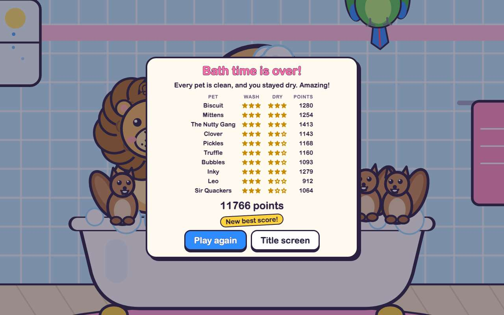 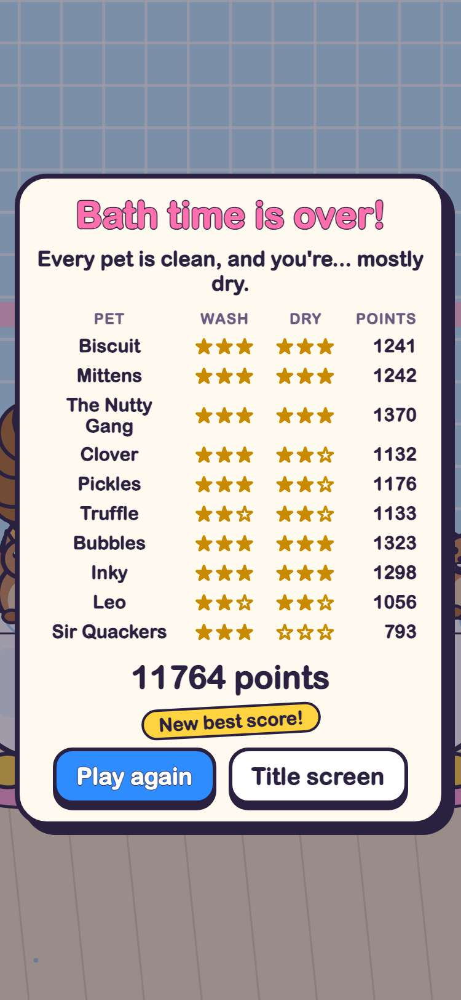

## 9. saves: jeremy.v2's and jeremy.v1's best scores, stars, unlocked pets and sound setting load, and their keys stay as they were

- desktop: seeded jeremy.v1's best (4321), reached 3 and muted, and jeremy.v2's best (7654) and reached 6: kiki.v1 shows the 7654 on its title, the better stars of the two in Pick a pet (Biscuit ★3 from v1, ☂3 from v2), the first 6 pets open (up to Truffle) plus Leo, and the sound off. After a round: all five old keys are byte for byte the same; new keys: gameon.pet-wash-payback.kiki.v1.best, gameon.pet-wash-payback.kiki.v1.reached; jeremy.v2 still shows its own best, stars and unlocked pets
- phone: seeded jeremy.v1's best (4321), reached 3 and muted, and jeremy.v2's best (7654) and reached 6: kiki.v1 shows the 7654 on its title, the better stars of the two in Pick a pet (Biscuit ★3 from v1, ☂3 from v2), the first 6 pets open (up to Truffle) plus Leo, and the sound off. After a round: all five old keys are byte for byte the same; new keys: gameon.pet-wash-payback.kiki.v1.best, gameon.pet-wash-payback.kiki.v1.reached; jeremy.v2 still shows its own best, stars and unlocked pets

## 10. jeremy.v2 and jeremy.v1 still play at their own folders

- desktop: jeremy.v2 at games/pet-wash-payback/jeremy.v2/: "Pet 1 of 9", Biscuit's wash running; jeremy.v1 at games/pet-wash-payback/: "Pet 1 of 5", Biscuit's wash running
- phone: jeremy.v2 at games/pet-wash-payback/jeremy.v2/: "Pet 1 of 9", Biscuit's wash running; jeremy.v1 at games/pet-wash-payback/: "Pet 1 of 5", Biscuit's wash running

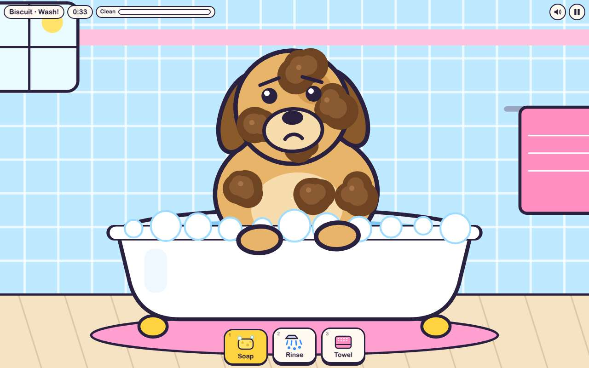 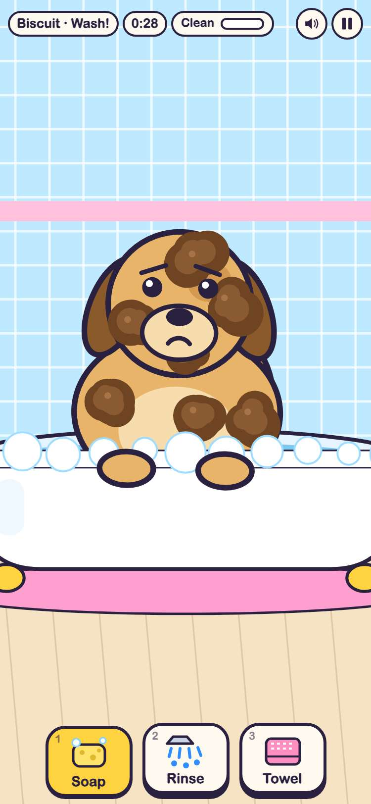

## 11. in the arcade, kiki.v1 is a fork from jeremy.v2 in the version picker and plays in the frame, and the game's default doesn't change

- desktop: card (4 versions) → picker: jeremy.v3 (Latest) first, kiki.v1 last as Kiki's fork ("Made by kiki, started from jeremy.v2") → #pet-wash-payback@kiki.v1 plays kiki.v1 in the frame ("Pet 1 of 10"); default stays jeremy.v3
- phone: card (4 versions) → picker: jeremy.v3 (Latest) first, kiki.v1 last as Kiki's fork ("Made by kiki, started from jeremy.v2") → #pet-wash-payback@kiki.v1 plays kiki.v1 in the frame ("Pet 1 of 10"); default stays jeremy.v3

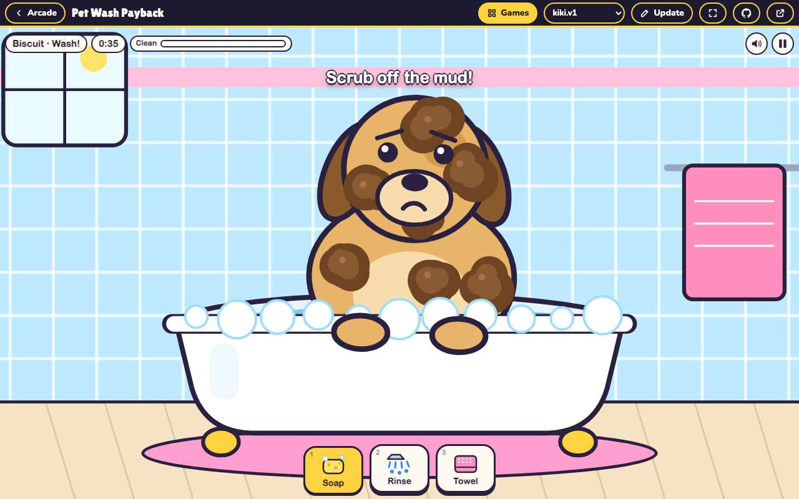 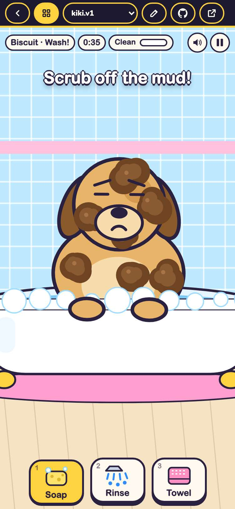
